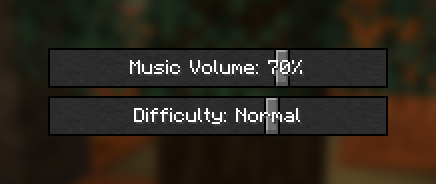
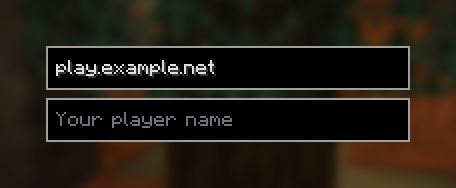

# Elementos

Elementos são as partes de um layout: botões, textos, imagens, controles deslizantes, música e muito mais. Esta página lista todos os tipos de elemento e suas configurações mais importantes.

> [!TIP]
> Botões e outras partes que uma tela tem por padrão são [Elementos Vanilla](/vanilla-elements). Você também pode movê-los, alterá-los e ocultá-los.

# Adicionar elementos

1. No editor de layout, clique com o botão direito em um espaço livre e clique em **Novo elemento**. O menu da barra superior tem a mesma lista em **Elemento -> Novo**.
2. Clique em um tipo de elemento. Passe o mouse sobre um tipo para ver para que ele serve.

O elemento aparece onde você clicou com o botão direito. Arraste-o para movê-lo, arraste suas bordas para redimensioná-lo e clique com o botão direito nele para acessar as configurações.


Para saber como selecionar, mover, copiar e excluir elementos, além de ver todos os atalhos do editor, consulte [Editor de layout](/layout-editor). Para manter os elementos no lugar em qualquer tamanho de janela, leia [Posicionar elementos](/positioning-elements). Para colocar elementos na frente ou atrás de outros, leia [Camadas e grupos](/layout-editor#layers-and-groups).

# Configurações de todos os elementos

Todos os elementos têm estas configurações no menu de clique com o botão direito, além das configurações específicas do tipo:

| Configuração | O que faz |
|---|---|
| **Ponto de ancoragem** | A que o elemento fica preso, como um canto da tela ou outro elemento. Consulte [Posicionar elementos](/positioning-elements). |
| **Posicionamento avançado** e **Dimensionamento avançado** | Calculam a posição e o tamanho, por exemplo, usando [marcadores de posição](/placeholders). Consulte [Posicionamento e dimensionamento avançados](/advanced-positioning-sizing). |
| **Requisitos de carregamento** e **Carregar apenas uma vez por sessão** | Exibem o elemento somente quando os [requisitos](/conditions) são atendidos ou apenas uma vez por inicialização do jogo. Consulte [Visibilidade dos elementos](/element-visibility). |
| **Atrasar aparecimento** e **Atrasar desaparecimento** | Aguardam alguns segundos antes de o elemento aparecer ou sumir. Consulte [Visibilidade dos elementos](/element-visibility#delaying-elements). |
| **Aparecimento/desaparecimento gradual** e **Opacidade** | Fazem o elemento aparecer ou desaparecer gradualmente, ou ficar translúcido. Consulte [Visibilidade dos elementos](/element-visibility#fading-in-and-out). |
| **Rotação**, **Inclinação vertical** e **Inclinação horizontal** | Giram e inclinam o elemento. Consulte [Rotacionar e inclinar elementos](/rotating-elements). |
| **Efeito paralaxe** | Move um pouco o elemento conforme o mouse se move. Consulte [Efeito paralaxe](/parallax). |
| **Copiar ID do elemento** | Copia o identificador usado por ações, marcadores de posição e outros elementos para encontrá-lo. Consulte [Identificadores de elementos](/element-identifiers). |
| **Nome de exibição no editor** | O nome do elemento na lista de camadas. |
| **Exportar para IA** | Converte o elemento em texto para [assistentes de IA](/export-for-ai). |

# Todos os elementos

Todos os elementos disponíveis no FancyMenu, organizados por finalidade.

## Botões e campos de entrada

### Botão

Um botão que executa um [script de ação](/action-scripts) ao ser clicado, por exemplo, para entrar em um servidor, abrir um site ou outro menu.


- **Editar script de ação**: o que o botão faz quando é clicado.
- **Rótulo** e **Rótulo ao passar o mouse**: o texto exibido e o texto exibido enquanto o mouse está sobre o botão. Ambos aceitam [marcadores de posição](/placeholders) e [formatação de texto](/text-formatting).
- **Alinhamento do rótulo**: posiciona o rótulo no lado **Esquerdo**, **Centralizado** ou **Direito** do botão. Rótulos largos demais para o botão rolam de um lado para o outro, independentemente do alinhamento.
- **Escala do rótulo**, **Cor base do rótulo**, **Cor do rótulo ao passar o mouse**, **Sombra do rótulo** e **Sublinhar rótulo ao passar o mouse**: definem o tamanho, as cores e a sombra do rótulo.
- **Texturas do botão** e **Texturas do ícone do botão**: permitem usar suas próprias imagens no botão e em um ícone nele, nos estados normal, sob o mouse e inativo. Consulte [Divisão em nove partes e repetição de textura](/nine-slicing-and-tiling) para saber como fazer texturas que se ajustam bem.
- **Som ao passar o mouse**, **Som ao tirar o mouse** e **Som ao clicar**: sons reproduzidos pelo botão.
- **Dica de ferramenta**: texto exibido enquanto o mouse está sobre o botão.
- **Controlar estado ativo**: define os [requisitos](/conditions) para que o botão possa ser clicado. Quando eles não são atendidos, o botão fica acinzentado.
- **Modo de modelo**: aplica a aparência deste botão a outros botões e controles deslizantes da tela. Consulte [Modelos de botões e controles deslizantes](/button-slider-templates).

### Controle deslizante

Um controle que os jogadores arrastam para escolher um valor. Ele executa seu script de ação sempre que o valor muda.



- **Tipo de controle deslizante**:
  - **Lista de valores**: percorre os textos em **Valores da lista**, um por linha. **Valores da variável de lista** obtém os valores de uma [variável de lista](/variables#text-and-list-variables).
  - **Intervalo de números inteiros**: números inteiros de **Valor mínimo do intervalo** até **Valor máximo do intervalo**.
  - **Intervalo de números decimais**: o mesmo, mas com números decimais. **Casas decimais do arredondamento** define quantos dígitos aparecem depois da vírgula; `-1` não arredonda.
- **Rótulo do controle deslizante**: seu texto. `$$value` exibe o valor atual.
- **Editar script de ação**: executa quando o valor muda. `$$value` corresponde ao novo valor.
- **Valor pré-selecionado**: o valor inicial do controle deslizante. Vincule-o ao valor que o controle altera para que exiba o valor correto quando a tela abrir.

Por exemplo, um controle deslizante de volume do tipo **Intervalo de números inteiros**, de `0` a `100`, pode ter o rótulo `Music Volume: $$value%` e uma ação [**Definir valor da variável (variável FM)**](/action-scripts#set-variable-value-fm-variable) com este valor:

```
music_volume:$$value
```

O **Valor pré-selecionado** é `$$music_volume`, para que o controle comece com o último valor escolhido pelo jogador.

Os controles deslizantes têm as mesmas configurações de rótulo, textura, som, dica de ferramenta e **Controlar estado ativo** dos botões. Assim, também é possível posicionar o rótulo à esquerda ou à direita com **Alinhamento do rótulo**.

### Caixa de seleção

Uma caixa que os jogadores podem marcar e desmarcar. Ela executa seu script de ação sempre que muda.


- `$$value` é `true` ou `false` no script de ação e nos requisitos de **Controlar estado ativo**.
- **Modo de variável** e **Vincular à variável**: a caixa de seleção exibe o valor de uma [variável](/variables) e grava nela `true` ou `false`. Se vinculada a uma variável de lista, `true` ou `false` se torna sua única entrada.
- Sem o Modo de variável, a caixa de seleção memoriza seu estado por conta própria, separadamente para cada [perfil](/profiles).
- **Texturas**: permite usar suas próprias imagens para a caixa e a marca de seleção.

As caixas de seleção têm as mesmas configurações de dica de ferramenta, som e **Navegável** dos botões.

### Campo de texto

Um campo onde os jogadores podem digitar, como um endereço de servidor ou um nome.



- **Vincular à variável**: o texto digitado pelos jogadores é armazenado na [variável](/variables), e o campo exibe o valor dela. Se vinculado a uma variável de lista, o texto digitado substitui a lista inteira.
- **Tipo de entrada**: **Texto**, **Apenas números**, **Apenas números decimais** ou **URL**. Não é possível digitar outros caracteres.
- **Texto de dica** e **Cor do texto de dica**: texto exibido enquanto o campo está vazio.
- **Comprimento máximo do texto**: quantidade máxima de caracteres que podem ser inseridos.
- **Cor de fundo**, **Cor da borda**, **Raio de arredondamento da borda** e **Cor do texto**: definem a aparência.

Por exemplo, um campo vinculado a `server_address` e um botão com a ação [**Entrar no servidor**](/action-scripts#join-server) e o valor `$$server_address` permitem que os jogadores entrem em qualquer servidor.

Sem uma variável, o marcador de posição [**Valor do campo de texto**](/placeholders#text-input-field-value) lê o texto, e a ação [**Definir valor do campo de texto**](/action-scripts#set-text-input-field-value) o altera.

## Textos e dicas de ferramenta

### Texto

Texto de qualquer tamanho, desde um rótulo curto até regras ou notas de atualização com rolagem, com [Markdown](/text-formatting) e [marcadores de posição](/placeholders).


- **Modo de origem**: digite o texto ou carregue-o de um arquivo ou site.
- Escolha uma aparência inicial e habilite a rolagem quando o texto for maior que o elemento.
- **Plano de fundo**: um painel escuro atrás do texto. Desative-o com **Exibir plano de fundo** ou use sua própria textura.

Saiba mais em [Texto em menus](/text-in-menus).

### Dica de ferramenta

Uma caixa de texto como as dicas de ferramenta do jogo, com [Markdown](/text-formatting) e [marcadores de posição](/placeholders).


- Ela aparece onde você a posicionar ou junto ao mouse com **Seguir o mouse**.
- Seus **Requisitos de carregamento** determinam quando ela aparece, por exemplo, com [**Elemento sob o mouse**](/conditions#is-element-hovered) para um botão.
- **Plano de fundo da dica de ferramenta**: permite usar sua própria textura em vez da caixa escura.

Saiba mais em [Texto em menus](/text-in-menus).

### Texto de abertura

O texto amarelo da tela de título, com suas próprias frases.


- **Modo de origem**: textos de abertura vanilla, seu próprio texto ou uma linha aleatória de um arquivo de texto.
- **Quicar**, **Escala**, **Rotação**, **Cor do texto** e **Sombra**: definem a aparência.
- **Atualizar ao carregar a tela**: escolhe um novo texto de abertura sempre que a tela é aberta.

Saiba mais em [Texto de abertura](/splash-text).

## Imagens e mídia

### Imagem

Uma imagem dos seus arquivos, de um site ou dos recursos do jogo. Imagens animadas também são reproduzidas.


- **Origem da imagem**: a imagem. Os arquivos compatíveis estão listados em [Imagens](/images).
- **Restaurar proporção**: altera a largura para que a imagem não fique esticada.
- **Textura dividida em nove partes** e **Repetir textura**: ajustam os quadros sem esticar as bordas ou repetem a imagem em padrão. Consulte [Divisão em nove partes e repetição de textura](/nine-slicing-and-tiling).
- **Tonalidade da imagem [HEX]**: colore a imagem.
- **Raio de arredondamento dos cantos**: arredonda os cantos.

### Apresentação de slides

Exibe as imagens de uma apresentação de slides, uma após a outra. As apresentações são criadas em `config/fancymenu/slideshows/`; consulte [Apresentações de slides](/slideshows).

- **Apresentação de slides**: a apresentação que será exibida.
- **Restaurar proporção**: altera a largura para que as imagens não fiquem esticadas.

### Vídeo

Reproduz um arquivo de vídeo, como um trailer ou um plano de fundo em movimento.

> [!IMPORTANT]
> Vídeos exigem os mods Watermedia V3 e Watermedia Binaries V3. Consulte [Vídeos](/video).

- **Origem do vídeo**: um arquivo de vídeo, um link da Web ou um recurso do jogo.
- **Repetir vídeo**, **Volume** e **Canal de áudio**: definem como o vídeo é reproduzido.
- **Reproduzir vídeo no editor de layout**: define se o vídeo também é reproduzido durante a edição.
- Ações como [**Alternar estado de pausa do elemento de vídeo**](/action-scripts#toggle-video-element-paused-state) pausam o vídeo, avançam para um horário ou alteram o volume.

**Vídeo [Rinku]** é um elemento de vídeo antigo que exige o mod Rinku. Ele ainda funciona em layouts antigos, mas não aparece em **Novo elemento**.

### Shader GLSL

Executa seu próprio shader GLSL dentro do elemento, por exemplo, para criar cores animadas ou efeitos do Shadertoy.


- **Origem do shader**: o código do shader. Shaders do Shadertoy com `mainImage` funcionam sem alterações.
- **Modo de compilação**: **Automático**, **Shadertoy** ou **Fragmento direto**.
- **Origem do buffer A** a **Origem do buffer D**: passagens adicionais para shaders com buffers.

Saiba como escrevê-los em [API de shader GLSL](/glsl-shader-api).

### Navegador

Exibe um site ao vivo, como um mapa de servidor ou uma página wiki.

> [!IMPORTANT]
> O Navegador exige o mod [Rinku](https://modrinth.com/mod/rinku) ([CurseForge](https://www.curseforge.com/minecraft/mc-mods/rinku)).

- **URL**: o site.
- **Interativo**: permite que os jogadores cliquem, rolem e digitem nele. No editor de layout, ele nunca é interativo.
- **Silenciar navegador**, **Volume de áudio/vídeo**, **Repetir vídeos** e **Ocultar controles de vídeo**: controlam a mídia da página.

Para carregar um arquivo HTML de `config/fancymenu/assets/`, comece a URL com `file:///`:

```
file:///config/fancymenu/assets/changelog.html
```

No Linux, use o marcador de posição [**Caminho absoluto de arquivo/pasta**](/placeholders#absolute-filefolder-path):

```
file:///{"placeholder":"absolute_path","values":{"short_path":"/config/fancymenu/assets/changelog.html"}}
```

Sites podem executar ações e ler marcadores de posição: [API JavaScript do navegador](/browser-api).

## Formas, itens e modelos

### Forma retangular

Um retângulo de uma só cor, como um painel atrás do texto.


- **Cor**: uma cor HEX. Dois dígitos adicionais a tornam translúcida, como em `#101828C8`.
- **Raio de arredondamento dos cantos**: arredonda todos os cantos ou cada canto individualmente.
- **Desfoque** e **Intensidade do desfoque**: desfocam o que está atrás da forma.

### Forma circular

Um círculo ou oval de uma só cor, como uma luz de status.


- **Cor**, **Desfoque** e **Intensidade do desfoque**: funcionam como na Forma retangular.
- **Arredondamento**: `2` cria um círculo. Números maiores deixam a forma mais quadrada; números menores, mais pontuda.

### Item

Exibe um item do Minecraft ou de um mod, como no inventário.


- **Chave do item**: o item, como `minecraft:diamond_sword`.
- **Quantidade do item**, **Nome do item**, **Descrição do item** e **Encantado**: funcionam como em um item real.
- **Exibir dica de ferramenta do item**: exibe a dica de ferramenta do item quando o mouse está sobre ele.
- **Dados NBT personalizados**: mais dados do item, escritos como a parte de um comando `/give` que vem logo depois do item.

### Modelo JSON de bloco/item

Exibe em 3D um modelo de bloco ou item dos recursos do jogo ou de um arquivo JSON seu.


- **Modelo**: a **Origem do modelo**, como `minecraft:models/block/crafting_table.json`.
- **Textura**: substitui a textura do modelo pela sua.
- **Transformação**: altera a escala, gira e move o modelo.
- **Iluminação**: **Matiz da luz [HEX]** colore a luz no modelo.

### Entidade de jogador

Exibe um jogador em 3D, como o próprio personagem do jogador na tela de título.


> [!IMPORTANT]
> Entidades de jogador exigem o mod Fancy Entity Renderer ([CurseForge](https://www.curseforge.com/minecraft/mc-mods/fancy-entity-renderer), [Modrinth](https://modrinth.com/mod/fancy-entity-renderer)). Sem ele, um erro é exibido no lugar do jogador.

- **Copiar jogador do cliente**: exibe o jogador que está jogando, com sua skin e seu nome.
- **Nome do jogador**, **Textura da skin** e **Textura da capa**: permitem exibir outro jogador ou skin.
- **Pose da entidade**, **Cabeça segue o mouse** e **Corpo segue o mouse**: definem como ela fica em pé e para onde olha.
- **Armadura e ferramentas**, **Papagaio**, **É bebê** e **Exibir nome do jogador**: definem o que ela veste e exibe.

Saiba mais em [Entidades de jogador](/player-entities). Para exibir apenas uma cabeça, consulte [Cabeças de jogador](/player-heads).

### Barra de progresso

Uma barra que se preenche, como uma barra de carregamento.


- **Origem do valor de progresso**: define o quanto a barra está preenchida. Use [marcadores de posição](/placeholders), como [**Progresso do carregamento do mundo**](/placeholders#world-loading-progress) em uma tela de carregamento de mundo.
- **Modo do valor de progresso**: **PORCENTAGEM (0-100)** ou **PONTO FLUTUANTE (0.0-1.0)**.
- **Direção**: o lado para o qual a barra se preenche.
- **Cor da barra** e **Cor do plano de fundo**, ou **Textura da barra** e **Textura do plano de fundo**.
- **Animação de preenchimento suave**: desliza até os novos valores em vez de saltar.
- **Usar progresso como âncora do elemento**: os elementos ancorados à barra se movem junto com o fim da parte preenchida.

## Auxiliares de layout

### Área rolável

Contém outros elementos e permite percorrê-los, como em uma lista de servidores ou uma página longa de informações.


- Arraste elementos para dentro dela no editor de layout. Ela aceita apenas elementos personalizados, não elementos vanilla.
- **Organização**: posicione os elementos manualmente ou deixe que a área os organize em pilha, grade ou fluxo.
- **Plano de fundo**: um painel escuro atrás da área. Desative-o com **Exibir plano de fundo** ou use sua própria textura.

Saiba tudo sobre isso em [Áreas roláveis](/scrollable-areas).

### Arrastador

Uma área que os jogadores podem agarrar e mover fora do editor. Os elementos ancorados a ela se movem junto, como em um painel de informações móvel. Ela fica invisível fora do editor.

**Salvar deslocamento de arraste do usuário** mantém a nova posição depois que a tela é fechada e o jogo é reiniciado. Saiba mais em [Arrastador](/dragger).

### Animador de elementos

Move e redimensiona outros elementos usando quadros-chave, como em um painel que desliza para dentro da tela. Ele fica invisível fora do editor.

- **Gerenciar elementos de destino**: os elementos que serão animados.
- **Editar quadros-chave**: abre o editor de quadros-chave.
- **Repetir animação**: recomeça ao chegar ao fim.

Saiba tudo sobre isso em [Animador de elementos](/element-animator).

## Elementos invisíveis

Estes elementos só aparecem no editor de layout.

### Marcador

Executa seu script de ação repetidamente enquanto a tela está aberta.

> [!IMPORTANT]
> [Agendadores](/schedulers) são a opção recomendada para tudo que se repete ou é executado mais tarde. Sempre que possível, use-os em vez de Marcadores. Eles funcionam em qualquer tela e até sem uma tela aberta, todas as ações funcionam neles, e as ações podem iniciá-los e interrompê-los.

Veja como fazer com Agendadores o que os Marcadores fazem:

- Executar continuamente enquanto uma tela está aberta: use um Agendador com **Atraso entre ticks (ms)**. Inicie-o com [**Iniciar agendador**](/action-scripts#start-scheduler) em **Editar script de ação 'Abrir tela'** do layout e interrompa-o com [**Parar agendador**](/action-scripts#stop-scheduler) em **Editar script de ação 'Fechar tela'**. Ambos ficam no menu de clique com o botão direito do plano de fundo do editor.
- Executar uma vez por inicialização do jogo: use um Agendador com **Iniciar ao iniciar** e **Ticks a executar** definido como `1`.
- Executar uma vez sempre que uma tela abrir: não é necessário usar Marcador nem Agendador. Coloque as ações em **Editar script de ação 'Abrir tela'**.

Configurações do Marcador:

- **Atraso entre ticks [ms]**: o intervalo, em milissegundos, entre duas execuções. `0` executa a cada tick, 20 vezes por segundo.
- **Modo de tick**: **Normal** executa continuamente. **Sessão** executa apenas uma vez até o jogo ser reiniciado. **Ao carregar a tela** executa uma vez sempre que a tela abre, inclusive quando o tamanho da janela muda.
- **Assíncrono**: executa em segundo plano. A maioria das ações não pode ser executada assim e exibe um erro.

### Áudio

Reproduz músicas ou sons enquanto a tela está aberta, uma faixa após a outra.

- **Gerenciar faixas**: os arquivos de áudio, sua ordem e seu **Peso da faixa** para a reprodução aleatória.
- **Modo de reprodução**: **Normal** reproduz as faixas em ordem; **Aleatório** as reproduz em ordem aleatória.
- **Repetir faixas**, **Volume** e **Canal de áudio**: definem como as faixas são reproduzidas.

Para manter a música tocando ao mudar de tela, coloque o elemento Áudio em um [Layout universal](/universal-layouts). Saiba mais em [Música de fundo dos menus](/background-music).

### Controlador de música

Desativa a música própria do jogo nesta tela.

- **Reproduzir música do menu**: a música dos menus quando nenhum mundo está carregado, como na tela de título.
- **Reproduzir música do mundo**: a música do mundo que continua tocando nos menus, como no inventário.

Só funciona enquanto uma tela está aberta.

### Cursor

Substitui o cursor do mouse pela sua própria imagem enquanto a tela está aberta.

- **Textura do cursor**: uma imagem PNG, por exemplo, de 32×32 pixels.
- **Coordenada X do ponto ativo** e **Coordenada Y do ponto ativo**: o pixel da imagem que clica, como a ponta de uma seta.
- **Modo de pré-visualização no editor**: exibe o cursor no editor enquanto o mouse está sobre o elemento.

Saiba mais em [Cursor personalizado](/custom-cursor).
