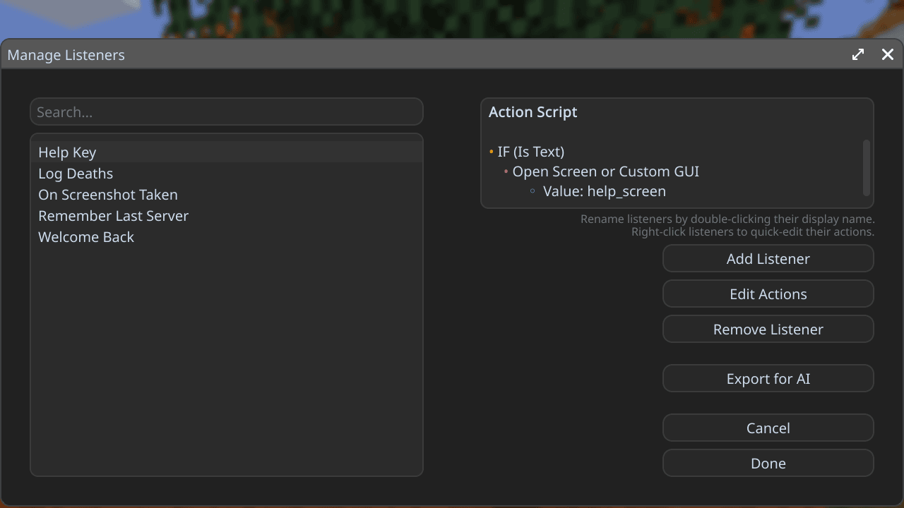

# Ouvintes

Os ouvintes executam um [script de ação](/action-scripts) quando algo acontece no jogo: uma tecla é pressionada, uma tela é aberta, você desbloqueia uma conquista e muito mais. Eles funcionam em todos os menus e durante o jogo, e não pertencem a um layout.

A maioria dos ouvintes também fornece variáveis ao script com informações sobre o que aconteceu, como o nome da tecla pressionada.

> [!CAUTION]
> Um ouvinte pode executar ações de arquivo, rede, comando, área de transferência, pacote de recursos e link quando nenhum menu está aberto. Use apenas ouvintes de perfis e arquivos de pessoas em quem você confia.

# Adicionar um ouvinte

1. Abra **barra de menus -> Personalização -> Gerenciar ouvintes**.
2. Clique em **Adicionar ouvinte**.
3. Clique no evento em **Ouvintes disponíveis**. A barra de pesquisa encontra ouvintes pelo nome e pela descrição.
   - **Descrição do ouvinte** mostra o que o ouvinte faz e quais variáveis fornece.
   - **Copiar variáveis para a área de transferência** copia os nomes das variáveis.
   - **Abrir descrição em janela separada** abre a descrição em uma janela própria.
4. Clique em **Concluído** ou clique duas vezes no ouvinte. O editor de scripts de ação será aberto.
5. Adicione as ações que devem ser executadas e clique em **Concluído**. Consulte [Scripts de ação](/action-scripts#making-an-action-script).
6. Clique em **Concluído** em **Gerenciar ouvintes** para salvar. O ouvinte começa a funcionar imediatamente.

**Cancelar** descarta todas as alterações feitas em **Gerenciar ouvintes**, após pedir sua confirmação.

# Gerenciar ouvintes

- Clique em um ouvinte para ver o tipo e o script de ação dele à direita.
- **Editar ações** ou clicar com o botão direito em um ouvinte abre o script de ação dele.
- Clique duas vezes no nome de um ouvinte para renomeá-lo, por exemplo, para `Tecla de ajuda`. `Enter` salva o nome e `Esc` cancela. Se o nome ficar vazio, o tipo do ouvinte será exibido novamente.
- **Remover ouvinte** exclui o ouvinte selecionado.
- **Exportar para IA** copia o ouvinte selecionado ou todos os ouvintes para um [chat com IA](/export-for-ai), incluindo as alterações não salvas.

Os ouvintes são salvos em `config/fancymenu/listener_instances.txt` (consulte [Locais de armazenamento de dados](/data-storage-locations)). Cada [perfil](/profiles) tem seus próprios ouvintes.

# Variáveis dos ouvintes

As variáveis de um ouvinte começam com `$$` e funcionam em todo o script correspondente: em todos os valores de ação e nos requisitos das [instruções IF](/action-scripts#if-else-if-and-else). Letras maiúsculas e minúsculas fazem diferença. Cada ouvinte abaixo lista suas variáveis, que também aparecem na descrição no seletor de ouvintes.

Por exemplo, este ouvinte abre uma tela de ajuda quando `H` é pressionada:

1. Adicione um ouvinte **Ao pressionar uma tecla do teclado**.
2. No script, use **Adicionar instrução IF** com o requisito [**É texto**](/conditions#is-text). Defina **Modo de comparação** como **Igual a**, **Texto** como `$$key_name` e **Comparar com texto** como `H`.
3. Dentro do IF, adicione [**Abrir tela ou GUI personalizada**](/action-scripts#open-screen-or-custom-gui) com sua tela de ajuda.

Mais informações sobre variáveis dos ouvintes:

- As variáveis dos ouvintes são sempre texto. Quando um ouvinte não consegue descobrir um valor, a variável recebe um valor substituto, como `ERROR`, `UNKNOWN`, `NONE`, `EMPTY`, `0`, `-1` ou nada.
- As variáveis dos ouvintes são preenchidas antes dos [marcadores de posição](/placeholders), então também funcionam dentro deles.
- As variáveis dos ouvintes só existem enquanto o script é executado. Para manter um valor, salve-o em uma de suas [variáveis](/variables) com [**Definir valor da variável (variável FM)**](/action-scripts#set-variable-value-fm-variable).
- Suas próprias variáveis, criadas em **barra de menus -> Personalização -> Gerenciar variáveis**, também funcionam nos scripts de ouvintes, usando `$$` e o nome da variável, como `$$coins`. Se uma delas tiver o mesmo nome de uma variável do ouvinte, `$$name` se refere à variável do ouvinte. Suas variáveis com nomes mais longos, como `key_name_log`, continuam funcionando.
- O texto vindo do chat, de servidores, arquivos e outros jogadores pode ser qualquer coisa. Nunca o insira diretamente em comandos, caminhos de arquivo ou links.

# É bom saber

- Alguns ouvintes precisam que o FancyMenu esteja no servidor. Isso é indicado abaixo. No modo para um jogador, eles sempre funcionam.
- Alguns ouvintes são executados com muita frequência, como **Ao mover o mouse na tela**, **Ao rolar elemento**, **Ao mudar de posição** e **Ao reproduzir som no mundo**. Mantenha os scripts curtos e nunca use ações lentas, como [**Recarregar FancyMenu**](/action-scripts#reload-fancymenu), neles.
- Para substituir uma tela com **Ao abrir tela**, verifique primeiro `$$screen_identifier` com uma instrução IF. Caso contrário, todas as telas serão substituídas, inclusive a que você abrir.

# Todos os ouvintes

Todos os ouvintes do FancyMenu, organizados de acordo com o que os aciona.

## Teclado e mouse

Para verificar qual tecla foi pressionada, use `$$key_name`. Os códigos numéricos das teclas não são iguais em todas as versões do Minecraft.

### Ao pressionar uma tecla do teclado

**Identificador:** `keyboard_key_pressed`

É executado quando uma tecla é pressionada, nos menus e durante o jogo. Enquanto uma tecla estiver pressionada, o ouvinte será executado repetidamente.

- `$$key_name`: o nome da tecla, como `H` ou `Left Shift`
- `$$key_keycode`: o código numérico da tecla
- `$$key_scancode`: o código de varredura da tecla
- `$$key_modifiers`: um número que representa as teclas modificadoras pressionadas ao mesmo tempo, como `Shift` e `Ctrl`

### Ao soltar uma tecla do teclado

**Identificador:** `keyboard_key_released`

É executado quando uma tecla é solta, nos menus e durante o jogo.

Fornece as mesmas variáveis que **Ao pressionar uma tecla do teclado**: `$$key_name`, `$$key_keycode`, `$$key_scancode` e `$$key_modifiers`.

### Ao digitar um caractere na tela

**Identificador:** `keyboard_char_typed`

É executado para cada caractere digitado enquanto uma tela está aberta.

- `$$char`: o caractere digitado

### Ao mover o mouse na tela

**Identificador:** `mouse_moved`

É executado sempre que o mouse se move enquanto uma tela está aberta.

- `$$mouse_pos_x`, `$$mouse_pos_y`: a posição do mouse em pixels da GUI
- `$$mouse_move_delta_x`, `$$mouse_move_delta_y`: a distância percorrida desde a última vez

### Ao clicar em um botão do mouse

**Identificador:** `mouse_button_clicked`

É executado uma vez quando um botão do mouse é pressionado, nos menus e durante o jogo.

- `$$button`: `left`, `right` ou `middle`. Os outros botões retornam seu número.
- `$$mouse_pos_x`, `$$mouse_pos_y`: a posição do mouse em pixels da GUI

### Ao soltar um botão do mouse

**Identificador:** `mouse_button_released`

É executado uma vez quando um botão do mouse é solto, nos menus e durante o jogo.

Fornece as mesmas variáveis que **Ao clicar em um botão do mouse**: `$$button`, `$$mouse_pos_x` e `$$mouse_pos_y`.

### Ao rolar o mouse na tela

**Identificador:** `mouse_scrolled`

É executado quando a roda do mouse é girada enquanto uma tela está aberta.

- `$$scroll_delta_y`: a distância percorrida pela roda. É maior que `0` ao rolar para cima e menor que `0` ao rolar para baixo.

## Telas e elementos

### Ao abrir tela

**Identificador:** `screen_open`

É executado logo após uma tela ser aberta. Uma ação [**Abrir tela ou GUI personalizada**](/action-scripts#open-screen-or-custom-gui) no script pode substituir a tela por outra.

- `$$screen_identifier`: o [identificador](/screen-identifiers) da tela

### Ao fechar tela

**Identificador:** `screen_close`

É executado logo após uma tela ser fechada.

- `$$screen_identifier`: o [identificador](/screen-identifiers) da tela fechada

### Ao clicar em texto Markdown

**Identificador:** `text_clicked`

É executado quando alguém clica em um [evento de clique](/text-formatting#click-and-hover-events) em um texto, como `[Leia as regras](click:open_rules)`.

- `$$text_event_id`: o ID do evento, como `open_rules`

### Ao passar o mouse sobre texto Markdown

**Identificador:** `text_hovered`

É executado quando o mouse passa sobre um [evento de foco](/text-formatting#click-and-hover-events) em um texto, como `[O que é isto?](hover:show_hint)`.

- `$$text_event_id`: o ID do evento, como `show_hint`

### Ao rolar elemento

**Identificador:** `scroll_area_scrolled`

É executado sempre que o conteúdo de uma [área rolável](/scrollable-areas) ou de um [elemento de texto](/text-in-menus) se move. Enquanto o conteúdo desliza, isso acontece a cada quadro. Não é executado no editor de layout.

- `$$element_identifier`: o [identificador](/element-identifiers) do elemento
- `$$scroll_x`: o quanto o conteúdo foi rolado para o lado, em pixels
- `$$scroll_y`: o quanto o conteúdo foi rolado para baixo, em pixels
- `$$scroll_percent`: o quanto o conteúdo foi rolado na direção principal do elemento, de `0` (início) a `100` (fim)

### Ao rolar elemento até o início

**Identificador:** `scroll_area_reached_start`

É executado quando o conteúdo de uma área rolável ou de um elemento de texto volta ao início.

Fornece as mesmas variáveis que **Ao rolar elemento**: `$$element_identifier`, `$$scroll_x`, `$$scroll_y` e `$$scroll_percent`.

### Ao rolar elemento até o fim

**Identificador:** `scroll_area_reached_end`

É executado quando o conteúdo de uma área rolável ou de um elemento de texto chega ao fim, por exemplo, quando alguém termina de rolar por todas as regras.

Fornece as mesmas variáveis que **Ao rolar elemento**: `$$element_identifier`, `$$scroll_x`, `$$scroll_y` e `$$scroll_percent`.

### Ao iniciar a reprodução de textura animada

**Identificador:** `animated_texture_started_playing`

É executado quando uma [textura animada](/animations) (GIF, APNG ou FMA) começa a ser reproduzida e sempre que começa novamente.

- `$$texture_source`: a origem da textura: um caminho de arquivo, um link da web ou um local de recurso
- `$$texture_source_type`: `LOCAL`, `WEB` ou `RESOURCE_LOCATION`
- `$$texture_will_restart`: `true` se ela começar novamente após esta reprodução; caso contrário, `false`

### Ao terminar a reprodução de textura animada

**Identificador:** `animated_texture_finished_playing`

É executado quando uma textura animada termina uma reprodução. Se ela estiver em loop, isso acontece logo antes de começar novamente.

Fornece as mesmas variáveis que **Ao iniciar a reprodução de textura animada**: `$$texture_source`, `$$texture_source_type` e `$$texture_will_restart`.

### Ao mudar o status da reprodução de vídeo

**Identificador:** `video_playback_status_changed`

É executado quando um elemento de [vídeo](/video) ou o plano de fundo de um menu começa, pausa, para ou termina.

- `$$video_source`: a origem do vídeo: um caminho de arquivo, um link da web ou um local de recurso
- `$$video_source_type`: `LOCAL`, `WEB` ou `RESOURCE_LOCATION`
- `$$is_looping`: `true` se o vídeo estiver em loop; caso contrário, `false`
- `$$new_status`:
  - `PLAYING`: o vídeo começou ou saiu da pausa
  - `PAUSED`: o vídeo foi pausado
  - `STOPPED`: o vídeo foi parado
  - `FINISHED`: o vídeo chegou ao fim. Vídeos em loop também retornam este status, logo antes de começarem novamente.

## Variáveis, arquivos e dados

### Ao atualizar variável [variável FM]

**Identificador:** `fm_variable_updated`

É executado sempre que uma [variável](/variables) recebe um valor.

- `$$var_name`: o nome da variável
- `$$old_value`: o valor anterior
- `$$new_value`: o novo valor

Para variáveis de lista, os dois valores correspondem à lista inteira como um array JSON, como `["Diamonds","Emeralds"]`.

### Ao iniciar download de arquivo por ação

**Identificador:** `file_download_started_via_action`

É executado quando começa um download de [**Baixar arquivo para o diretório do jogo**](/action-scripts#download-file-to-game-directory), assim que o nome do arquivo é conhecido. O arquivo só aparece no caminho indicado quando o download termina. Use **Ao baixar arquivo por ação** para saber quando ele está pronto.

- `$$download_url`: o link do arquivo
- `$$target_file_path`: onde o arquivo será salvo

### Ao baixar arquivo por ação

**Identificador:** `file_downloaded_via_action`

É executado quando o download de [**Baixar arquivo para o diretório do jogo**](/action-scripts#download-file-to-game-directory) termina ou falha.

- `$$download_url`: o link do arquivo
- `$$target_file_path`: onde o arquivo foi salvo. Se o download falhar, pode ser apenas a pasta.
- `$$download_succeeded`: `true` ou `false`

### Ao selecionar arquivo

**Identificador:** `file_selected_via_action`

É executado quando [**Selecionar arquivo do sistema**](/action-scripts#select-file-from-system) termina: o arquivo foi copiado, o seletor de arquivos foi cancelado ou ocorreu uma falha.

- `$$selected_file_path`: o caminho completo do arquivo escolhido. Fica vazio se o seletor for cancelado.
- `$$target_file_path`: onde o arquivo foi copiado, dentro da pasta do jogo
- `$$selection_succeeded`: `true` quando o arquivo foi copiado
- `$$selection_cancelled`: `true` quando o seletor foi fechado sem escolher um arquivo
- `$$failure_reason`: o que deu errado. Fica vazio se nada der errado.

### Ao extrair ZIP por ação

**Identificador:** `zip_extracted_via_action`

É executado quando [**Extrair arquivo ZIP no diretório do jogo**](/action-scripts#extract-zip-file-in-game-directory) termina.

- `$$source_zip_path`: o arquivo ZIP
- `$$target_folder_path`: a pasta onde ele foi extraído
- `$$extract_succeeded`: `true` ou `false`
- `$$failure_reason`: o que deu errado. Fica vazio se nada der errado.

Os caminhos na pasta do jogo começam com `/`, como `/config/fancymenu/assets/pack.zip`. Os caminhos na pasta `.minecraft` começam com `.minecraft/`.

### Ao receber dados FM

**Identificador:** `fm_data_received`

É executado quando o servidor envia dados a este jogador com `/fmdata send`. Consulte [Dados FM](/fm-data).

- `$$data_identifier`: o identificador usado para enviar os dados
- `$$data`: os dados
- `$$sent_by`: o IP do servidor ou `integrated_server` no modo para um jogador

### Ao conectar a servidor remoto

**Identificador:** `remote_server_connected`

É executado quando uma [conexão com servidor remoto](/remote-server-communication) é aberta.

- `$$request_id`: o ID da solicitação da conexão
- `$$remote_server_url`: o link do servidor remoto

### Ao receber dados de servidor remoto

**Identificador:** `remote_server_data_received`

É executado sempre que um servidor remoto conectado envia texto.

- `$$request_id`: o ID da solicitação da conexão
- `$$remote_server_url`: o link do servidor remoto
- `$$data`: o texto enviado

### Ao fechar conexão com servidor remoto

**Identificador:** `remote_server_connection_closed`

É executado quando uma conexão com servidor remoto é fechada.

- `$$request_id`: o ID da solicitação da conexão
- `$$remote_server_url`: o link do servidor remoto
- `$$intentionally_closed`: `true` quando [**Fechar conexão com servidor remoto**](/action-scripts#close-remote-server-connection) fechou a conexão
- `$$crashed`: `true` quando a conexão falhou
- `$$unknown_close_reason`: `true` quando a conexão foi fechada por um motivo desconhecido

## Jogo, mundos e servidores

### Ao sair do Minecraft

**Identificador:** `quit_minecraft`

É executado uma vez quando o jogo começa a fechar.

- `$$timestamp_millis`: o horário em milissegundos desde 1970
- `$$timestamp_iso`: o horário como texto ISO-8601, por exemplo, `2026-11-24T18:30:00.123Z`

### Ao tirar captura de tela

**Identificador:** `screenshot_taken`

É executado quando uma captura de tela é feita e salva, por exemplo, usando a tecla de captura de tela.

- `$$screenshot_path`: o caminho da captura de tela na pasta do jogo, como `/screenshots/2026-10-29_14.30.00.png`

### Ao entrar em mundo para um jogador

**Identificador:** `world_entered`

É executado quando o carregamento de um mundo para um jogador termina e você pode se mover.

- `$$world_name`: o nome do mundo
- `$$world_save_path`: o caminho completo da pasta de salvamento do mundo
- `$$world_difficulty`: a dificuldade do mundo
- `$$world_cheats_allowed`: `true` quando os comandos estão ativados
- `$$world_icon_path`: o caminho completo do ícone do mundo
- `$$world_is_first_join`: `true` na primeira visita após a criação do mundo

### Ao sair de mundo para um jogador

**Identificador:** `world_left`

É executado quando um mundo para um jogador é fechado e salvo.

Fornece as mesmas variáveis que **Ao entrar em mundo para um jogador**, exceto `$$world_is_first_join`: `$$world_name`, `$$world_save_path`, `$$world_difficulty`, `$$world_cheats_allowed` e `$$world_icon_path`.

### Ao começar a entrar em um servidor

**Identificador:** `start_joining_server`

É executado quando o jogo começa a se conectar a um servidor ou Realm, antes de entrar nele. Também é executado se a conexão falhar ou for cancelada, para que possa lembrar o servidor, por exemplo, para um botão de reconexão na tela de desconexão.

- `$$server_ip`: o IP do servidor

### Ao entrar em um servidor

**Identificador:** `server_joined`

É executado depois que você entra em um servidor multijogador.

- `$$server_ip`: o IP do servidor

### Ao sair de um servidor

**Identificador:** `server_left`

É executado depois que você sai de um servidor multijogador.

- `$$server_ip`: o IP do servidor

### Ao outro jogador entrar no mundo/servidor

**Identificador:** `other_player_joined_world`

É executado quando outro jogador entra no seu mundo ou servidor.

- `$$player_name`: o nome do jogador
- `$$player_uuid`: o UUID do jogador

### Ao outro jogador sair do mundo/servidor

**Identificador:** `other_player_left_world`

É executado quando outro jogador sai do seu mundo ou servidor.

- `$$player_name`: o nome do jogador
- `$$player_uuid`: o UUID do jogador

### Ao outro jogador morrer

**Identificador:** `other_player_died`

É executado quando outro jogador no seu mundo morre.

- `$$player_name`: o nome do jogador
- `$$player_uuid`: o UUID do jogador
- `$$death_pos_x`, `$$death_pos_y`, `$$death_pos_z`: onde o jogador morreu

## Chat

### Ao receber mensagem no chat

**Identificador:** `chat_message_received`

É executado quando a mensagem de um jogador aparece no seu chat.

- `$$chat_message_string`: a mensagem como texto simples
- `$$chat_message_component`: a mensagem como componente de texto JSON
- `$$sender_uuid`: o UUID de quem enviou ou `ERROR` quando for desconhecido
- `$$sender_name`: o nome de quem enviou ou `ERROR` quando for desconhecido

### Ao enviar mensagem no chat

**Identificador:** `chat_message_sent`

É executado quando você envia uma mensagem no chat. Comandos não contam.

- `$$chat_message_string`: a mensagem como texto simples
- `$$chat_message_component`: a mensagem como componente de texto JSON

### Ao receber mensagem do sistema no chat

**Identificador:** `system_message_received_in_chat`

É executado quando aparece no chat uma mensagem que não veio de um jogador, como o retorno de um comando.

- `$$system_message_string`: a mensagem como texto simples
- `$$system_message_component`: a mensagem como componente de texto JSON

## Jogador

### Ao morrer

**Identificador:** `player_death`

É executado logo após a tela de morte ser aberta.

- `$$days_survived`: os dias de jogo desde sua última morte, arredondados para baixo
- `$$death_reason_string`: a mensagem de morte como texto simples
- `$$death_reason_component`: a mensagem de morte como componente de texto JSON
- `$$death_pos_x`, `$$death_pos_y`, `$$death_pos_z`: onde você morreu

### Ao receber dano

**Identificador:** `damage_taken`

É executado uma vez para cada golpe que você recebe.

- `$$damage_amount`: a quantidade de vida retirada pelo golpe
- `$$damage_type`: o tipo de dano, como `minecraft:fall`
- `$$is_fatal_damage`: `true` quando o golpe matou você
- `$$damage_source`: o tipo da entidade que causou o dano, como `minecraft:zombie`, ou `NONE`

### Ao receber efeito

**Identificador:** `effect_gained`

É executado uma vez quando você recebe um efeito de status.

- `$$effect_key`: o efeito, como `minecraft:speed`
- `$$effect_type`: `positive`, `negative` ou `neutral`
- `$$effect_duration`: por quanto tempo ele dura, em ticks (20 ticks equivalem a 1 segundo)

### Ao perder efeito

**Identificador:** `effect_lost`

É executado uma vez quando um efeito de status termina.

- `$$effect_key`: o efeito, como `minecraft:speed`
- `$$effect_type`: `positive`, `negative` ou `neutral`

### Ao mudar experiência

**Identificador:** `experience_changed`

É executado sempre que seus pontos de experiência aumentam ou diminuem.

- `$$new_experience_amount`: seu total atual de pontos de experiência
- `$$old_experience_amount`: seu total anterior de pontos de experiência
- `$$is_level_up`: `true` quando você alcança um novo nível

### Ao desbloquear conquista

**Identificador:** `achievement_unlocked`

É executado uma vez quando você desbloqueia uma conquista (progresso). Conquistas já concluídas, como as que já estavam concluídas ao entrar em um mundo, não contam.

- `$$achievement_key`: a conquista, como `minecraft:story/mine_diamond`
- `$$achievement_label`: o título no idioma do jogo
- `$$achievement_description`: a descrição no idioma do jogo
- `$$achievement_icon_item_key`: o item usado como ícone, como `minecraft:diamond`
- `$$achievement_type`: `advancement`, `goal` ou `challenge`

### Ao pular

**Identificador:** `jump`

É executado sempre que você pula. Não tem variáveis.

### Ao começar a correr

**Identificador:** `started_running`

É executado uma vez quando você começa a correr. Não tem variáveis.

### Ao parar de correr

**Identificador:** `stopped_running`

É executado uma vez quando você para de correr. Não tem variáveis.

### Ao mudar de posição

**Identificador:** `position_changed`

É executado sempre que você se move para outro bloco.

- `$$old_pos_x`, `$$old_pos_y`, `$$old_pos_z`: a posição anterior do bloco
- `$$new_pos_x`, `$$new_pos_y`, `$$new_pos_z`: a nova posição do bloco

### Ao começar a queimar

**Identificador:** `started_burning`

É executado uma vez quando você começa a queimar. Não tem variáveis.

### Ao parar de queimar

**Identificador:** `stopped_burning`

É executado uma vez quando você para de queimar. Não tem variáveis.

### Ao começar a se afogar

**Identificador:** `started_drowning`

É executado uma vez quando você começa a receber dano por afogamento. Não tem variáveis.

### Ao começar a congelar

**Identificador:** `started_freezing`

É executado uma vez quando você começa a congelar, como na neve fofa.

- `$$freezing_intensity`: o quanto você está congelado, de `0.0` (nada) a `1.0` (completamente congelado)

### Ao parar de congelar

**Identificador:** `stopped_freezing`

É executado uma vez quando você para de congelar. Não tem variáveis.

### Ao congelar completamente

**Identificador:** `fully_frozen`

É executado uma vez quando você fica completamente congelado. Não tem variáveis.

### Ao começar a nadar

**Identificador:** `start_swimming`

É executado uma vez quando você começa a nadar.

- `$$fluid_type`: o fluido, como `minecraft:water`

### Ao parar de nadar

**Identificador:** `stop_swimming`

É executado uma vez quando você para de nadar.

- `$$fluid_type`: o fluido, como `minecraft:water`

### Ao começar a tocar em um fluido

**Identificador:** `start_touching_fluid`

É executado uma vez quando você começa a tocar em um fluido, como água ou lava.

- `$$fluid_type`: o fluido, como `minecraft:lava`

### Ao parar de tocar em um fluido

**Identificador:** `stop_touching_fluid`

É executado uma vez quando você para de tocar em um fluido.

- `$$fluid_type`: o fluido, como `minecraft:lava`

## Itens

### Ao pegar item

**Identificador:** `item_picked_up`

É executado uma vez quando você pega um item.

- `$$item_key`: o item, como `minecraft:diamond`

### Ao jogar item fora

**Identificador:** `item_dropped`

É executado uma vez quando você joga um item do inventário fora.

- `$$item_key`: o item, como `minecraft:diamond`

### Ao consumir item

**Identificador:** `item_consumed`

É executado uma vez quando você termina de comer ou beber um item.

- `$$item_key`: o item, como `minecraft:golden_apple`

### Ao usar item

**Identificador:** `item_used`

É executado uma vez quando você usa um item.

- `$$item_key`: o item, como `minecraft:flint_and_steel`
- `$$used_on_type`: onde ele foi usado: `block`, `entity`, `self` ou `none`
- `$$used_on_entity_key`: o tipo da entidade em que ele foi usado. Fica vazio se não houver uma entidade.
- `$$used_on_block_key`: o bloco em que ele foi usado. Fica vazio se não houver um bloco.
- `$$target_pos_x`, `$$target_pos_y`, `$$target_pos_z`: a posição em que ele foi usado ou `-1`

### Ao quebrar item

**Identificador:** `item_broke`

É executado uma vez quando um item do seu inventário quebra.

- `$$item_key`: o item, como `minecraft:iron_pickaxe`
- `$$item_type`: `tool`, `armor` ou `other`

### Ao passar o mouse sobre item no inventário

**Identificador:** `item_hovered_in_inventory`

É executado uma vez quando o mouse passa sobre um item em qualquer inventário, como o seu ou o de um baú.

- `$$item_key`: o item, como `minecraft:diamond_sword`
- `$$item_display_name_string`: o nome do item como texto simples
- `$$item_display_name_json`: o nome do item como componente de texto JSON

## Blocos

### Ao começar a olhar para bloco

**Identificador:** `start_looking_at_block`

É executado uma vez quando sua mira começa a apontar para um bloco a até 20 blocos de distância.

- `$$block_key`: o bloco, como `minecraft:oak_log`
- `$$block_pos_x`, `$$block_pos_y`, `$$block_pos_z`: a posição do bloco
- `$$distance_to_player`: a distância dos seus olhos até o ponto para o qual a mira aponta

### Ao parar de olhar para bloco

**Identificador:** `stop_looking_at_block`

É executado uma vez quando sua mira para de apontar para um bloco.

Fornece as mesmas variáveis que **Ao começar a olhar para bloco**, referentes ao bloco para o qual você olhava antes: `$$block_key`, `$$block_pos_x`, `$$block_pos_y`, `$$block_pos_z` e `$$distance_to_player`.

### Ao quebrar bloco

**Identificador:** `block_broke`

É executado uma vez quando você quebra um bloco.

- `$$block_key`: o bloco, como `minecraft:stone`
- `$$broke_with_item_key`: o item na sua mão, como `minecraft:iron_pickaxe`, ou `EMPTY`
- `$$block_pos_x`, `$$block_pos_y`, `$$block_pos_z`: a posição do bloco

### Ao colocar bloco

**Identificador:** `block_placed`

É executado uma vez quando você coloca um bloco.

- `$$block_key`: o bloco, como `minecraft:torch`
- `$$block_pos_x`, `$$block_pos_y`, `$$block_pos_z`: a posição do bloco

### Ao interagir com bloco

**Identificador:** `interacted_with_block`

É executado uma vez quando você usa um bloco, por exemplo, ao abrir um baú ou apertar um botão.

- `$$block_key`: o bloco, como `minecraft:chest`
- `$$block_pos_x`, `$$block_pos_y`, `$$block_pos_z`: a posição do bloco

### Ao pisar em bloco

**Identificador:** `stepping_on_block`

É executado uma vez quando você pisa em um bloco.

- `$$block_key`: o bloco, como `minecraft:grass_block`
- `$$block_pos_x`, `$$block_pos_y`, `$$block_pos_z`: a posição do bloco

## Entidades

### Ao começar a olhar para entidade

**Identificador:** `start_looking_at_entity`

É executado uma vez quando sua mira começa a apontar para uma entidade a até 20 blocos de distância.

- `$$entity_key`: o tipo da entidade, como `minecraft:villager`
- `$$distance_to_player`: a distância dos seus olhos até o ponto para o qual a mira aponta
- `$$entity_pos_x`, `$$entity_pos_y`, `$$entity_pos_z`: a posição da entidade
- `$$entity_uuid`: o UUID da entidade

### Ao parar de olhar para entidade

**Identificador:** `stop_looking_at_entity`

É executado uma vez quando sua mira para de apontar para uma entidade.

Fornece as mesmas variáveis que **Ao começar a olhar para entidade**, referentes à entidade para a qual você olhava antes: `$$entity_key`, `$$distance_to_player`, `$$entity_pos_x`, `$$entity_pos_y`, `$$entity_pos_z` e `$$entity_uuid`.

### Ao entidade entrar no campo de visão

**Identificador:** `entity_starts_being_in_sight`

É executado uma vez quando uma entidade aparece na sua tela, a até 200 blocos de distância.

- `$$entity_key`: o tipo da entidade, como `minecraft:creeper`
- `$$distance_to_player`: a distância dos seus olhos até a entidade
- `$$entity_pos_x`, `$$entity_pos_y`, `$$entity_pos_z`: a posição da entidade
- `$$entity_uuid`: o UUID da entidade

### Ao entidade sair do campo de visão

**Identificador:** `entity_stops_being_in_sight`

É executado uma vez quando uma entidade visível sai da sua tela ou fica a mais de 200 blocos de distância.

Fornece as mesmas variáveis que **Ao entidade entrar no campo de visão**: `$$entity_key`, `$$distance_to_player`, `$$entity_pos_x`, `$$entity_pos_y`, `$$entity_pos_z` e `$$entity_uuid`.

### Ao interagir com entidade

**Identificador:** `entity_interacted`

É executado uma vez quando você usa uma entidade, por exemplo, ao negociar com um aldeão.

- `$$entity_key`: o tipo da entidade, como `minecraft:villager`
- `$$entity_pos_x`, `$$entity_pos_y`, `$$entity_pos_z`: a posição da entidade
- `$$entity_uuid`: o UUID da entidade

### Ao montar entidade

**Identificador:** `entity_mounted`

É executado uma vez quando você começa a montar uma entidade, como um cavalo ou um barco.

- `$$entity_key`: o tipo da entidade, como `minecraft:horse`
- `$$entity_pos_x`, `$$entity_pos_y`, `$$entity_pos_z`: a posição da entidade
- `$$entity_uuid`: o UUID da entidade

### Ao desmontar entidade

**Identificador:** `entity_unmounted`

É executado uma vez quando você para de montar uma entidade.

- `$$entity_key`: o tipo da entidade, como `minecraft:horse`
- `$$entity_pos_x`, `$$entity_pos_y`, `$$entity_pos_z`: a posição da entidade
- `$$entity_uuid`: o UUID da entidade

### Ao surgir entidade

**Identificador:** `entity_spawned`

Requer o FancyMenu no servidor. É executado quando uma entidade surge em qualquer lugar do mundo, mesmo que esteja longe ou em outra dimensão.

- `$$entity_key`: o tipo da entidade, como `minecraft:zombie`
- `$$distance_to_player`: a distância até você ou `-1` se estiver em outra dimensão
- `$$entity_pos_x`, `$$entity_pos_y`, `$$entity_pos_z`: onde ela surgiu
- `$$entity_uuid`: o UUID da entidade
- `$$dimension_key`: a dimensão, como `minecraft:overworld`
- `$$is_same_dimension_as_player`: `true` quando ela surgiu na sua dimensão

### Ao morrer entidade

**Identificador:** `entity_died`

Requer o FancyMenu no servidor. É executado quando uma entidade morre em qualquer lugar do mundo, mesmo que esteja longe ou em outra dimensão.

- `$$entity_key`: o tipo da entidade, como `minecraft:ender_dragon`
- `$$distance_to_player`: a distância até você ou `-1` se estiver em outra dimensão
- `$$death_pos_x`, `$$death_pos_y`, `$$death_pos_z`: onde ela morreu
- `$$entity_uuid`: o UUID da entidade
- `$$dimension_key`: a dimensão, como `minecraft:the_end`
- `$$damage_type`: o tipo de dano que a matou, como `minecraft:player_attack`
- `$$is_same_dimension_as_player`: `true` quando ela morreu na sua dimensão
- `$$entity_killed_by_name`: o nome de quem a matou ou `NONE`
- `$$entity_killed_by_key`: o tipo de quem a matou, como `minecraft:player`, ou `NONE`
- `$$entity_killed_by_uuid`: o UUID de quem a matou ou `NONE`

## Mundo e locais

### Ao entrar em bioma

**Identificador:** `enter_biome`

É executado uma vez quando você entra em outro bioma.

- `$$biome_key`: o bioma, como `minecraft:cherry_grove`

### Ao sair de bioma

**Identificador:** `leave_biome`

É executado uma vez quando você sai de um bioma.

- `$$biome_key`: o bioma do qual você saiu, como `minecraft:cherry_grove`

### Ao entrar em estrutura

**Identificador:** `enter_structure`

Requer o FancyMenu no servidor. É executado uma vez quando você entra na área de uma estrutura. A área é aproximada, então o evento também pode ser acionado perto de uma estrutura ou acima dela, como no caso de uma mina abandonada abaixo de você. Para detectar apenas o interior, use **Ao entrar em estrutura (alta precisão)**.

- `$$structure_key`: a estrutura, como `minecraft:village_plains`

### Ao sair de estrutura

**Identificador:** `leave_structure`

Requer o FancyMenu no servidor. É executado uma vez quando você sai da área de uma estrutura. A área é aproximada, assim como em **Ao entrar em estrutura**.

- `$$structure_key`: a estrutura da qual você saiu

### Ao entrar em estrutura (alta precisão)

**Identificador:** `enter_structure_high_precision`

Requer o FancyMenu no servidor. É executado uma vez quando você entra no interior de uma estrutura.

- `$$structure_key`: a estrutura, como `minecraft:stronghold`

### Ao sair de estrutura (alta precisão)

**Identificador:** `leave_structure_high_precision`

Requer o FancyMenu no servidor. É executado uma vez quando você sai completamente de uma estrutura.

- `$$structure_key`: a estrutura da qual você saiu

### Ao entrar em dimensão

**Identificador:** `enter_dimension`

É executado uma vez quando você entra em outra dimensão.

- `$$dimension_key`: a dimensão, como `minecraft:the_nether`

### Ao mudar o clima

**Identificador:** `weather_changed`

É executado uma vez quando o clima muda. Também é executado quando o clima no local onde você está muda: enquanto chove, entrar em um deserto, bioma nevado ou construção também conta.

- `$$weather_type`: `clear`, `rain` ou `thunder`
- `$$weather_can_snow`: `true` quando poderia nevar onde você está
- `$$weather_can_rain`: `true` quando poderia chover onde você está

### Ao iniciar invasão

**Identificador:** `raid_started`

Requer o FancyMenu no servidor. É executado quando uma invasão começa enquanto você está na área dela, fazendo a barra da invasão aparecer. Não tem variáveis.

Entrar em uma invasão que já está acontecendo não conta. Para isso, use **Ao entrar na área de invasão ativa**.

### Ao entrar na área de invasão ativa

**Identificador:** `enter_active_raid_area`

Requer o FancyMenu no servidor. É executado quando você entra na área de uma invasão que já está acontecendo, fazendo a barra da invasão aparecer. Não tem variáveis.

### Ao sair da área de invasão ativa

**Identificador:** `leave_active_raid_area`

Requer o FancyMenu no servidor. É executado quando você sai da área de uma invasão, fazendo a barra da invasão desaparecer. Morrer ou mudar de dimensão nessa área também conta, mas o fim da invasão não. Não tem variáveis.

### Ao terminar invasão

**Identificador:** `raid_finished`

Requer o FancyMenu no servidor. É executado quando uma invasão termina enquanto você está na área dela.

- `$$raid_result`: `victory` ou `defeat`

## Som e música

### Ao iniciar faixa de música

**Identificador:** `music_track_started`

É executado uma vez quando uma faixa de música começa a tocar.

- `$$track_resource_location`: o arquivo de som da faixa
- `$$track_display_name`: o nome da faixa ou `UNKNOWN`
- `$$track_artist`: o artista da faixa ou `UNKNOWN`
- `$$track_duration_ms`: a duração, em milissegundos, ou `0` quando for desconhecida

### Ao parar faixa de música

**Identificador:** `music_track_stopped`

É executado uma vez quando a faixa de música para, porque terminou ou foi substituída por outra.

Fornece as mesmas variáveis que **Ao iniciar faixa de música**: `$$track_resource_location`, `$$track_display_name`, `$$track_artist` e `$$track_duration_ms`.

### Ao reproduzir som no mundo

**Identificador:** `world_sound_triggered`

É executado sempre que um som começa a tocar no mundo perto de você, como o som de uma porta ou de um creeper.

- `$$sound_resource_location`: o arquivo de som
- `$$sound_display_name`: a legenda do som ou `UNKNOWN`
- `$$sound_origin_pos_x`, `$$sound_origin_pos_y`, `$$sound_origin_pos_z`: de onde vem o som
- `$$sound_origin_distance_to_player`: a distância até o som
- `$$sound_origin_direction_from_player`: a direção do som em graus (de 0 a 360), em relação à direção para a qual você está olhando
