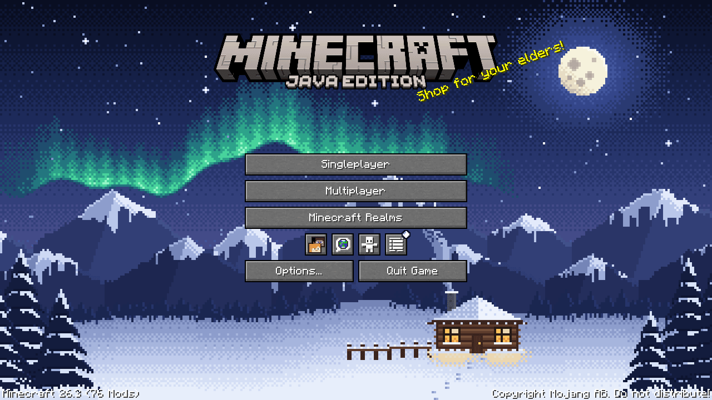
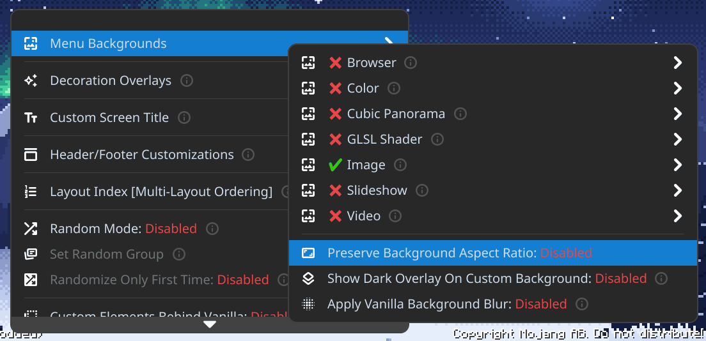

# Planos de fundo dos menus

Um layout pode dar à tela um plano de fundo próprio: uma imagem, uma animação, um panorama, uma apresentação de slides, um vídeo, uma cor, um site ou um shader. Ele substitui o plano de fundo normal da tela, como o panorama da tela de título, o desfoque de outros menus ou o mundo atrás do menu de pausa.

> [!TIP]
> Para dar o mesmo plano de fundo a todos os menus sem criar layouts, use [Personalizações globais](/global-customizations#menu-backgrounds).

# Definindo um plano de fundo

1. Abra um layout da tela no [editor de layouts](/layout-editor).
2. Clique com o botão direito no plano de fundo do editor e abra **Planos de fundo dos menus**. Essa opção também fica em **barra de menus -> Layout -> Propriedades do layout**.
3. Abra um tipo de plano de fundo, como **Imagem**.
4. Clique em **Mostrar plano de fundo** para definir como **Ativado**.
5. Configure o plano de fundo, por exemplo, usando **Escolher imagem** para um plano de fundo do tipo Imagem.

Em **Planos de fundo dos menus**, cada tipo ativado tem um ✔ antes dele, e cada tipo desativado tem um ✖. Passe o mouse sobre um tipo para ver o que ele faz.

Para voltar ao plano de fundo normal da tela, defina **Mostrar plano de fundo** do tipo como **Desativado**. As configurações são mantidas, então você pode ativá-lo novamente mais tarde.

# Tipos de plano de fundo

## Imagem

Uma imagem dos seus arquivos, de um site ou dos recursos do jogo, estendida por toda a tela. Imagens animadas também são reproduzidas. Os arquivos compatíveis estão listados em [Imagens](/images).

- **Escolher imagem**: a imagem. Veja de onde ela pode vir em [Recursos](/resources).
- **Escolher imagem alternativa**: é exibida enquanto a imagem não pode ser carregada, como uma imagem da web quando você está offline.
- **Reiniciar texturas animadas ao abrir a tela**: reinicia a [imagem animada](/animations) sempre que a tela é aberta. Caso contrário, ela continua de onde parou.
- **Repetir textura**: repete a imagem em toda a tela em vez de estendê-la. Veja [Divisão em nove partes e repetição](/nine-slicing-and-tiling).
- **Deslizar imagens largas da esquerda para a direita**: uma imagem larga, como uma foto de uma paisagem inteira, preenche a altura da tela e desliza lentamente de um lado para o outro, parando brevemente em cada extremidade.
- **Efeito de paralaxe** e suas configurações: a imagem se move um pouco com o mouse. Veja [Efeito de paralaxe](/parallax#menu-backgrounds).

**Deslizar imagens largas da esquerda para a direita** não pode ser ativado junto com **Repetir textura** ou **Efeito de paralaxe**.

## Cor

Uma cor aplicada à tela inteira.

- **Cor [HEX]**: a cor, como `#1B2440`. Dois dígitos adicionais a tornam translúcida, como `#1B2440C8`. Também pode ser um [placeholder](/placeholders).

A Cor fica abaixo de todos os outros planos de fundo do layout, preenchendo as partes transparentes deles. Veja [Empilhando planos de fundo](#stacking-backgrounds).

## Panorama cúbico

Um panorama que gira lentamente, como o da tela de título. Você cria panoramas em `config/fancymenu/panoramas/`; veja [Panoramas](/panoramas).

- **Nome do panorama**: abre **Escolher panorama**, onde você seleciona um dos seus panoramas e vê uma prévia dele.
- **Limpar panorama**: remove o panorama.

Sem um panorama, o plano de fundo exibe a textura roxa e preta de textura ausente do Minecraft.

## Apresentação de slides

Exibe as imagens de uma apresentação de slides, uma após a outra. Você cria apresentações de slides em `config/fancymenu/slideshows/`; veja [Apresentações de slides](/slideshows).

- **Nome da apresentação de slides**: abre **Escolher apresentação de slides**, onde você seleciona uma das suas apresentações.
- **Limpar apresentação de slides**: remove a apresentação.

Sem uma apresentação de slides, o plano de fundo também exibe a textura ausente do Minecraft.

## Vídeo

Reproduz um vídeo dos seus arquivos, de um site ou dos recursos do jogo. É necessário ter o Watermedia; veja [Vídeos](/video#requirements). Sem ele, o plano de fundo exibe uma nota com links para download.

- **Origem do vídeo**: o vídeo.
- **Repetir vídeo**, **Volume** e **Canal de som**: controlam a reprodução.
- **Efeito de paralaxe** e suas configurações: funcionam como nos planos de fundo do tipo Imagem.
- **Reproduzir vídeo no editor de layouts**: quando desativado, o vídeo fica pausado no editor de layouts.

As [ações](/video) podem pausar o vídeo e alterar o volume e o tempo de reprodução. Elas precisam do ID do plano de fundo: clique em **Copiar identificador do plano de fundo** nas configurações dele.

## Navegador

Um site que ocupa a tela inteira, como o [elemento Navegador](/elements#browser).

> [!IMPORTANT]
> O Navegador precisa do mod [Rinku](https://modrinth.com/mod/rinku). Sem ele, o plano de fundo fica vermelho e informa que o Rinku está ausente.

- **URL**: o site. Pode conter [placeholders](/placeholders).
- **Processar cliques do mouse**, **Processar rolagem do mouse** e **Processar pressionamentos de teclas**: permitem que os jogadores cliquem, rolem e digitem no site. O teclado é direcionado a ele assim que a tela é aberta.
- **Consumir cliques do mouse**, **Consumir rolagem do mouse** e **Consumir pressionamentos de teclas**: impedem que os cliques, a rolagem e as teclas passem pelo site, evitando que a própria tela também reaja a eles.
- **Silenciar navegador**, **Volume de áudio/vídeo**, **Repetir vídeos** e **Ocultar controles de vídeo**: controlam a mídia no site.

Os botões e elementos que ficam na frente do plano de fundo sempre recebem os cliques primeiro. No editor de layouts, o plano de fundo exibe listras no lugar do site.

## Shader GLSL

Desenha um shader, um pequeno programa para a placa de vídeo, como ondas animadas, estrelas ou padrões. Shaders do Shadertoy também funcionam.

- **Código-fonte do shader**: o código do shader.
- **Mostrar erros de compilação**: exibe erros no código na tela. Desative essa opção em layouts concluídos.

Todas as outras configurações, como passagens extras, texturas e tempo, são explicadas na [API do shader GLSL](/glsl-shader-api).

## Vídeo [Rinku]

Um plano de fundo de vídeo mais antigo que precisa do Rinku. Ele só aparece na lista quando está ativado, como nos layouts de versões anteriores. Use **Vídeo** em vez dele.

# Configurações de todos os planos de fundo

Abaixo dos tipos, **Planos de fundo dos menus** tem configurações que funcionam para todos os planos de fundo do layout:

- **Manter proporção dos planos de fundo**: mantém as proporções dos planos de fundo do tipo Imagem, Apresentação de slides e Vídeo. Eles ainda preenchem a tela inteira, e as partes que não couberem serão cortadas. Quando desativado, eles são esticados para preencher a tela.
- **Mostrar sobreposição escura no plano de fundo personalizado**: aplica aos planos de fundo a camada escura e translúcida dos menus do Minecraft, destacando os botões e o texto.
- **Aplicar desfoque padrão do plano de fundo**: desfoca os planos de fundo como o Minecraft desfoca o mundo atrás dos menus. A intensidade depende da configuração **Desfoque do plano de fundo dos menus** em **Configurações de acessibilidade** do Minecraft. Em `0`, não há desfoque.

Da esquerda para a direita: sem configuração, **Mostrar sobreposição escura no plano de fundo personalizado** e **Aplicar desfoque padrão do plano de fundo**.

# Empilhando planos de fundo

Você pode ativar vários tipos em um mesmo layout. Eles são desenhados uns sobre os outros nesta ordem, de baixo para cima:

1. Cor
2. Panorama cúbico
3. Imagem
4. Apresentação de slides
5. Vídeo
6. Vídeo [Rinku]
7. Navegador
8. Shader GLSL

Os tipos adicionados por outros mods ficam por último, no topo.

O FancyMenu desenha preto atrás dos planos de fundo, então as partes transparentes de uma imagem ficam pretas. Um plano de fundo do tipo Cor abaixo dela preenche essas partes com uma cor:

À esquerda, somente a Imagem está ativada. À direita, um plano de fundo do tipo Cor preenche o céu.

- Uma Imagem, Apresentação de slides ou Shader translúcido sobre um Panorama cúbico funciona da mesma forma, como uma moldura ao redor de um panorama giratório.
- Um plano de fundo do tipo Vídeo nunca é translúcido. Ele cobre tudo que estiver abaixo, inclusive as áreas que o vídeo não alcança.

## Vários layouts

Quando vários layouts estão ativos em uma tela, como um [layout universal](/universal-layouts) e um layout da própria tela, os planos de fundo deles também se empilham:

- O layout com o maior **Índice do layout [Ordenação de vários layouts]** fica por cima. Defina esse valor no menu de clique com o botão direito do plano de fundo do editor.
- Se um dos layouts ativar uma [configuração de todos os planos de fundo](#settings-for-all-backgrounds), ela será ativada para os planos de fundo de todos eles.
- O editor de layouts mostra apenas os planos de fundo do layout que você está editando.

# Informações úteis

- Os elementos do layout sempre ficam na frente dos planos de fundo dele.
- **Copiar identificador do plano de fundo**, nas configurações de cada tipo, copia o ID do plano de fundo para ações e placeholders que o controlam, como os dos [planos de fundo do tipo Vídeo](/video).
- **Exportar para IA**, nas configurações de cada tipo, copia o plano de fundo para um [chat de IA](/export-for-ai).
- O cabeçalho e o rodapé de telas com listas, como a lista de mundos, têm texturas próprias: clique com o botão direito no plano de fundo do editor e abra **Personalizações do cabeçalho/rodapé**.
