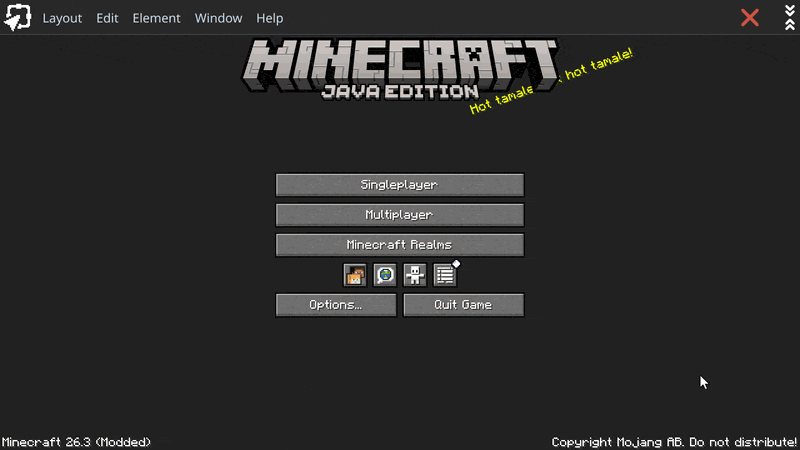

# Panoramas

Um panorama é um plano de fundo que gira lentamente ao seu redor, como o da tela inicial do Minecraft. Ele é feito de seis imagens que formam um cubo ao redor de quem está vendo.

Você pode exibir seus próprios panoramas como [plano de fundo do menu](/menu-backgrounds) de um layout ou no lugar do panorama do Minecraft em todos os menus.


> [!TIP]
> O panorama desta página é gratuito para uso em testes e nos seus próprios modpacks: [forest_homestead.zip](https://raw.githubusercontent.com/Keksuccino/docs_fancymenu/refs/heads/wiki-2026/assets/forest_homestead.zip) (4 MB). Extraia o arquivo em `config/fancymenu/panoramas/` e recarregue o FancyMenu.

# Criar um panorama

1. Abra a pasta `panoramas` em `config/fancymenu/`, dentro do diretório do jogo. **Barra de menus -> Ferramentas -> Abrir diretório do FancyMenu** abre `config/fancymenu/`.
2. Crie uma pasta para o panorama, como `forest_homestead`. O nome não importa.
3. Coloque nela um arquivo `properties.txt` e uma pasta chamada `panorama` com as [seis imagens](#as-seis-imagens). O arquivo `overlay.png` é opcional.
4. Recarregue o FancyMenu usando **Barra de menus -> Personalização -> Recarregar o FancyMenu** ou `Ctrl + Alt + R` (`Cmd + Alt + R` no macOS), ou reinicie o jogo.

```text
config/fancymenu/panoramas/
└── forest_homestead/
    ├── properties.txt
    ├── overlay.png
    └── panorama/
        ├── panorama_0.png
        ├── panorama_1.png
        ├── panorama_2.png
        ├── panorama_3.png
        ├── panorama_4.png
        └── panorama_5.png
```

# As seis imagens

Cada imagem é um lado do cubo:


| Imagem | Lado |
|---|---|
| `panorama_0.png` | Frente |
| `panorama_1.png` | Direita |
| `panorama_2.png` | Trás |
| `panorama_3.png` | Esquerda |
| `panorama_4.png` | Cima |
| `panorama_5.png` | Baixo |

- Os quatro lados ficam ao seu redor nesta ordem: a borda direita de cada imagem continua na borda esquerda da próxima, e a borda direita de `panorama_3.png` se conecta à borda esquerda de `panorama_0.png`.
- A borda inferior da imagem de cima encosta na borda superior da imagem frontal. A borda superior da imagem de baixo encosta na borda inferior da imagem frontal.
- As seis imagens devem ser arquivos PNG do mesmo tamanho. Use imagens quadradas, como 1024 × 1024.
- O FancyMenu não suaviza as imagens, então a pixel art continua nítida.

Esse é o mesmo layout usado pelo Minecraft em seu próprio panorama, então panoramas feitos para o Minecraft também funcionam.

# properties.txt

```text
type = panorama

panorama-meta {
  name = forest_homestead
  speed = 2.0
  fov = 85.0
  angle = 25.0
  start_rotation = 0
}
```

| Configuração | Função |
|---|---|
| `name` | O nome usado para selecionar o panorama. Escolha um nome diferente para cada panorama. |
| `speed` | A velocidade de rotação. `1.0` dá uma volta completa em cerca de 4 minutos; `2.0` é duas vezes mais rápido. `0` mantém o panorama parado. Velocidades acima de `10.0` não aumentam a rapidez. |
| `fov` | Quanto do panorama aparece na tela, em graus, do topo até a parte inferior da tela. Valores menores aproximam a imagem. |
| `angle` | O quanto a câmera aponta para baixo, em graus. `0` aponta diretamente para o horizonte; valores negativos apontam para cima. |
| `start_rotation` | A posição inicial da rotação, em graus, de `0` a `360`. `0` começa com a imagem frontal no centro. |

Somente `name` é obrigatório. As configurações não especificadas usam `speed = 1.0`, `fov = 85.0`, `angle = 25.0` e `start_rotation = 0`. Mantenha as linhas `type = panorama` e `panorama-meta {` como estão, escreva uma configuração por linha e use ponto para separar as casas decimais, como em `1.5`.

# Sobreposição

Um arquivo `overlay.png` ao lado de `properties.txt` é desenhado sobre o panorama e esticado para preencher a tela inteira. Ele não gira junto com o panorama, por isso é indicado para elementos como vinhetas, molduras ou filtros de cor. As partes transparentes deixam o panorama aparecer.

# Usar um panorama

## Como plano de fundo do menu



1. No [editor de layout](/layout-editor), clique com o botão direito no plano de fundo e abra **Planos de fundo do menu -> Panorama cúbico**.
2. Clique em **Mostrar plano de fundo** para ativá-lo.
3. Clique em **Nome do panorama**, escolha o seu panorama e clique em **Concluído**. A prévia à direita mostra o panorama girando.

**Remover panorama** remove o panorama. Para combiná-lo com outros planos de fundo, consulte [Planos de fundo do menu](/menu-backgrounds).

## Em todos os menus

**Barra de menus -> Personalização -> Personalizações globais -> Panorama do plano de fundo personalizado do menu -> Escolher panorama** exibe seu panorama no lugar do panorama do Minecraft, na tela inicial e em todos os menus antes de você entrar em um mundo. Consulte [Personalizações globais](/global-customizations#menu-backgrounds).

## Pré-carregamento

Um panorama grande pode levar um instante para aparecer na primeira vez. Para carregá-lo enquanto o jogo inicia, adicione-o usando **Adicionar panorama cúbico** em **Barra de menus -> Personalização -> Pré-carregar recursos**. Consulte [Pré-carregar recursos](/preload-layouts#pre-loading-slideshows--panoramas).

# Informações úteis

- Os panoramas giram para a direita: a imagem frontal se move para a esquerda e a imagem da direita aparece.
- Todos os menus que exibem o mesmo panorama compartilham sua rotação, então ela continua suavemente ao alternar entre eles. A rotação pausa quando nenhum menu o exibe.
- Recarregar o FancyMenu reinicia cada panorama em seu valor de `start_rotation`.
- Os panoramas pertencem ao [perfil](/profiles) carregado.
- Se um panorama não aparecer em **Escolher panorama**, é porque não foi carregado. O log do jogo, `logs/latest.log`, informa o motivo, como a ausência de `name` ou de uma imagem.
- Um padrão quadriculado roxo e preto indica que nenhum panorama foi selecionado, que as seis imagens têm tamanhos diferentes ou que o layout usa um nome de panorama que não existe mais.
- Se dois panoramas tiverem o mesmo `name`, somente um deles será exibido.
