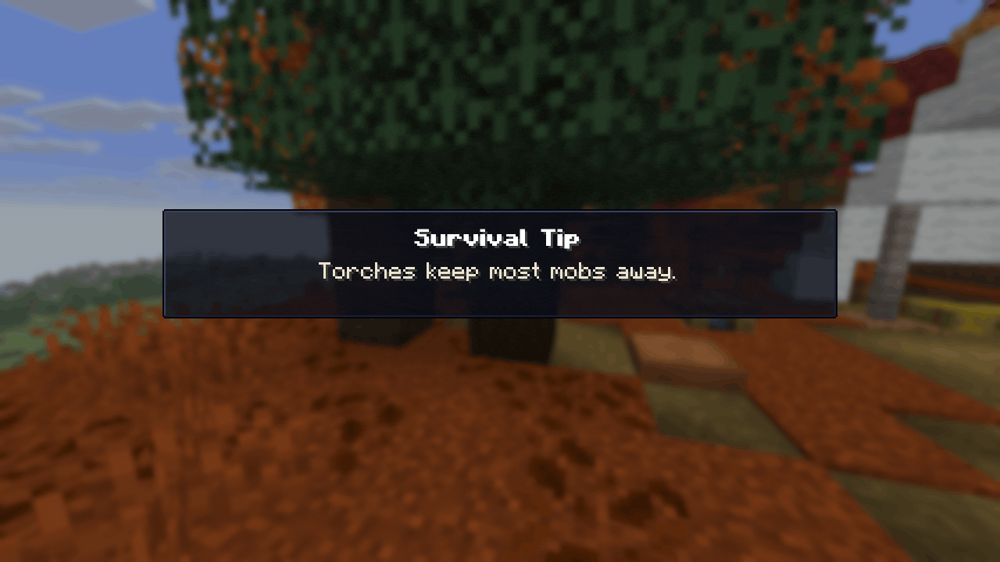

# Agendadores

Os agendadores executam um [script de ação](/action-scripts) em intervalos programados: uma vez depois de esperar, algumas vezes ou repetidamente até que algo os interrompa. Eles funcionam em qualquer menu e durante o jogo, mesmo quando nenhum menu está aberto, e não pertencem a um layout.

Os agendadores são a opção recomendada para tudo o que deve acontecer mais tarde ou repetidamente. Sempre que possível, use-os em vez dos [elementos Ticker](/elements#ticker).

> [!CAUTION]
> Um agendador pode executar ações de arquivo, rede, comando, área de transferência, pacote de recursos e link enquanto nenhum menu está aberto. Use apenas agendadores de perfis e arquivos de pessoas em quem você confia.

# Adicionando um agendador

1. Abra **barra de menus -> Personalização -> Gerenciar Agendadores**.
2. Clique em **Adicionar Agendador**. O editor de scripts de ação será aberto.
3. Adicione as ações que devem ser executadas a cada vez e clique em **Concluído**. Consulte [Scripts de Ação](/action-scripts#making-an-action-script).

4. O novo agendador aparecerá com um ID aleatório. Clique nele e depois em **Editar Configurações**.
5. Defina um **ID do Agendador**, como `random_tip`, configure o [temporizador](#settings) e clique em **Concluído**.
6. Clique em **Iniciar agora** para testá-lo.

Tudo o que você altera em **Gerenciar Agendadores** é salvo imediatamente.

O agendador dos GIFs executa [**Organizar Lista (Variável FM)**](/action-scripts#arrange-list-fm-variable) com **Embaralhar** na lista `tips` a cada 4 segundos. Um elemento de Texto mostra a primeira entrada da lista e, por isso, exibe uma dica aleatória. Saiba como a lista e o texto funcionam em [Ações de lista](/variables#list-actions).

# Configurações

| Configuração | O que faz |
|---|---|
| **ID do Agendador** | O nome usado por ações e requisitos. Aceita apenas letras minúsculas, números, `.`, `_` e `-`. |
| **Atraso inicial (ms)** | Quanto tempo o agendador espera depois de ser iniciado antes de executar pela primeira vez. `0` faz com que ele seja executado imediatamente. |
| **Intervalo entre execuções (ms)** | O tempo entre duas execuções. `0` faz com que ele seja executado a cada tick, 20 vezes por segundo. |
| **Número de execuções** | Quantas vezes ele é executado antes de parar sozinho. `0` mantém o agendador em execução até que algo o interrompa. |
| **Iniciar ao iniciar o jogo** | Inicia o agendador sempre que o jogo é iniciado. |

Os tempos são expressos em milissegundos: `1000` equivale a um segundo, `60000` a um minuto e `1800000` a meia hora.

# Iniciando e parando

Um agendador só é executado depois de ser iniciado:

- Com **Iniciar ao iniciar o jogo**, quando o jogo é iniciado e após a troca de [perfis](/profiles).
- Com **Iniciar agora**, em **Gerenciar Agendadores**. Enquanto o agendador estiver em execução, o botão será **Parar agora**.
- Com a ação [**Iniciar agendador**](/action-scripts#start-scheduler) e o ID do agendador, como no script de um botão ou de um [ouvinte](/listeners).

Ele para:

- Sozinho, depois de executar o número de vezes definido em **Número de execuções**.
- Com **Parar agora** ou com a ação [**Parar agendador**](/action-scripts#stop-scheduler) e seu ID.
- Quando é renomeado ou removido, quando você troca de [perfil](/profiles) e quando o jogo é fechado. Depois que o jogo for reiniciado, somente os agendadores com **Iniciar ao iniciar o jogo** voltarão a ser executados.

Um agendador em execução não pode ser iniciado novamente: **Iniciar agendador** não faz nada até que ele pare. Para iniciá-lo novamente, use **Parar agendador** e depois **Iniciar agendador**.

O requisito [**Agendador está em execução**](/conditions#scheduler-is-running) verifica se um agendador está em execução, por exemplo, para exibir um botão de parar somente enquanto ele estiver ativo.

## Somente enquanto uma tela estiver aberta

Para executar um agendador somente enquanto uma determinada tela estiver aberta, como a tela de título:

1. Abra o layout da tela no editor de layouts.
2. Clique com o botão direito no plano de fundo do editor, selecione **Editar script de ação 'Abrir tela'** e adicione **Iniciar agendador** com o ID do agendador.
3. Clique com o botão direito no plano de fundo novamente, selecione **Editar script de ação 'Fechar tela'** e adicione **Parar agendador** com o mesmo ID.

# Gerenciando agendadores

- Clique em um agendador para ver suas configurações, se está em execução e seu script de ação à direita.
- **Editar Ações** ou clicar com o botão direito em um agendador abre o script de ação.
- Clique duas vezes no ID de um agendador para renomeá-lo. `Enter` salva o nome e `Esc` cancela. Renomear interrompe o agendador, e as ações que usam o ID antigo não o encontrarão mais.
- **Remover Agendador** exclui o agendador selecionado após pedir sua confirmação.
- **Exportar para IA** copia o agendador selecionado ou todos os agendadores para uma [conversa com IA](/export-for-ai).
- A barra de pesquisa encontra agendadores pelo ID.

Os agendadores são salvos em `config/fancymenu/scheduler_instances.txt` (consulte [Locais de armazenamento de dados](/data-storage-locations)). Cada [perfil](/profiles) tem seus próprios agendadores.

# Exemplo: lembrete para fazer uma pausa

Uma notificação a cada 30 minutos após o início do jogo:

1. Adicione um agendador com [**Mostrar notificação**](/action-scripts#show-toast). Defina **Título** como `Time for a Break` e **Mensagem** como `Stand up, stretch and drink some water.`
2. Em **Editar Configurações**, defina **ID do Agendador** como `break_reminder`, **Atraso inicial (ms)** e **Intervalo entre execuções (ms)** como `1800000` e **Iniciar ao iniciar o jogo** como **Ativado**.

Sem o **Atraso inicial (ms)**, a primeira notificação apareceria assim que o jogo fosse iniciado.

# Bom saber

- Mantenha o **Intervalo entre execuções (ms)** tão alto quanto a tarefa permitir. Com o valor `0`, as ações são executadas 20 vezes por segundo, e ações lentas deixam o jogo lento.
- Quando o jogo fica lento, várias execuções podem acontecer em sequência.
- As alterações no script de ação entram em vigor imediatamente, mesmo enquanto o agendador está em execução. As alterações nas configurações entram em vigor na próxima vez que ele for iniciado.
- Se uma ação falhar, o agendador continuará em execução. O erro será registrado no log do jogo, em `logs/latest.log`.
- Para uma única espera dentro de um script de ação, como "abrir a tela 2 segundos depois do clique", o bloco [Executar depois](/action-scripts#execute-later) é mais simples.
