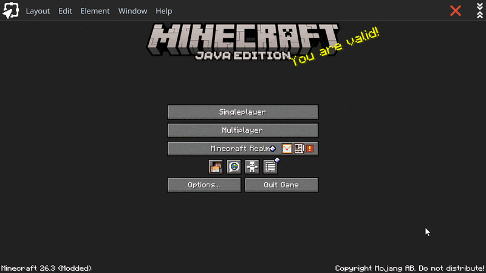

# Apresentações de slides

Uma apresentação de slides exibe imagens uma após a outra e faz uma transição suave de uma para a seguinte, como capturas de tela do mundo do seu modpack.

Você pode exibi-la como [plano de fundo do menu](/menu-backgrounds) de um layout ou em uma parte da tela usando um [elemento Slideshow](/elements#slideshow).


# Criar uma apresentação de slides

1. Abra a pasta `slideshows` em `config/fancymenu/`, no diretório do seu jogo. **Barra de menus -> Tools -> Open FancyMenu Directory** abre `config/fancymenu/`.
2. Crie nela uma pasta para sua apresentação de slides, como `world_tour`. O nome não importa.
3. Coloque nela um arquivo [`properties.txt`](#propertiestxt) e uma pasta chamada `images` com [suas imagens](#as-imagens). Um arquivo [`overlay.png`](#sobreposição) é opcional.
4. Recarregue o FancyMenu usando **Barra de menus -> Customization -> Reload FancyMenu** ou `Ctrl + Alt + R` (`Cmd + Alt + R` no macOS), ou reinicie o jogo.

```text
config/fancymenu/slideshows/
└── world_tour/
    ├── properties.txt
    ├── overlay.png
    └── images/
        ├── 01_river_valley.png
        ├── 02_cherry_grove.png
        └── 03_coast.png
```

# As imagens

- Apenas arquivos PNG e JPG são reconhecidos, com nomes que terminem em `.png` ou `.jpg`. Renomeie arquivos `.jpeg` para `.jpg`.
- As imagens são exibidas na ordem alfabética dos nomes dos arquivos, de A a Z. Os números contam como letras, então `10.png` vem antes de `2.png`. Comece os nomes com zeros, como `01`, `02` … `10`.
- Todas as imagens devem ter o mesmo tamanho. A primeira determina o formato da apresentação, e as demais são redimensionadas para caber nele.
- Arquivos em pastas dentro de `images` não são reconhecidos.

# properties.txt

```text
type = slideshow

slideshow-meta {
  name = world_tour
  duration = 5.0
  fadespeed = 5.0
  randomize = false
}
```

| Configuração | O que faz |
|---|---|
| `name` | O nome usado para selecionar a apresentação de slides. Dê um nome diferente para cada apresentação. |
| `duration` | O tempo, em segundos, entre uma troca de imagem e a seguinte, incluindo a transição. Se a transição demorar mais, a próxima troca aguardará até ela terminar. |
| `fadespeed` | A velocidade da transição entre uma imagem e a seguinte. Com `1.0`, a transição dura cerca de 6 segundos; com `3.0`, cerca de 2. Deve ser maior que `0`. |
| `randomize` | `true` exibe as imagens em ordem aleatória, sem repetir a mesma imagem duas vezes seguidas. `false` exibe as imagens na ordem dos nomes dos arquivos. |

Apenas `name` é obrigatório. As configurações omitidas usam `duration = 10.0`, `fadespeed = 1.0` e `randomize = false`. Mantenha as linhas `type = slideshow` e `slideshow-meta {` como estão, escreva uma configuração por linha e use ponto nos números decimais, como em `2.5`.

Apresentações de slides criadas para versões antigas podem ter as linhas `width`, `height`, `x` e `y`. Elas não fazem nada: o plano de fundo ou o elemento determina onde a apresentação aparece e qual será seu tamanho.

# Sobreposição

Um arquivo `overlay.png` ao lado de `properties.txt` é desenhado sobre cada imagem e redimensionado para o tamanho da apresentação de slides. Ele não faz a transição junto com as imagens, por isso é ideal para molduras, vinhetas ou um logotipo no canto. As partes transparentes deixam as imagens aparecerem.

A sobreposição faz parte da apresentação de slides, então aparece em todos os lugares em que ela é exibida. Para usar as mesmas imagens com e sem moldura, crie duas apresentações de slides.

# Usar uma apresentação de slides

## Como plano de fundo do menu



1. No [editor de layout](/layout-editor), clique com o botão direito no plano de fundo e abra **Menu Backgrounds -> Slideshow**.
2. Clique em **Show Background** para ativá-lo.
3. Clique em **Slideshow Name**, selecione sua apresentação de slides e clique em **Done**. A prévia à direita mostra a apresentação em execução.

**Clear Slideshow** remove a apresentação. Para combiná-la com outros planos de fundo, consulte [Planos de fundo do menu](/menu-backgrounds).

A apresentação de slides é redimensionada para preencher a tela inteira. Para manter o formato das imagens, ative **Preserve Background Aspect Ratio** em **Menu Backgrounds**. Assim, ela preencherá a tela, mas será cortada nas laterais ou na parte superior e inferior.

## Como elemento


1. No editor de layout, clique com o botão direito em uma área vazia e adicione um Slideshow usando **New Element**.
2. Clique com o botão direito no elemento, clique em **Slideshow** e selecione sua apresentação. O elemento assume o formato das imagens.
3. Mova e redimensione o elemento como qualquer outro. **Restore Aspect Ratio** ajusta novamente a largura para corresponder à altura, evitando que as imagens sejam esticadas.

## Pré-carregamento

Cada imagem é carregada na primeira vez que aparece, então imagens grandes podem demorar um pouco para surgir na primeira vez. Para carregar todas as imagens e a sobreposição durante a inicialização do jogo, adicione a apresentação usando **Add Slideshow** em **Barra de menus -> Customization -> Pre-Load Resources**. Consulte [Pré-carregar recursos](/preload-layouts#pre-loading-slideshows--panoramas).

# Informações úteis

- Tudo que exibe a mesma apresentação de slides mostra a mesma imagem ao mesmo tempo, inclusive em menus diferentes.
- Uma apresentação só é executada enquanto algo a exibe. Quando volta a aparecer após uma pausa maior que seu `duration`, a transição para a próxima imagem começa imediatamente.
- Recarregar o FancyMenu reinicia todas as apresentações de slides. Após a reinicialização, a primeira imagem permanece na tela por apenas metade do tempo das outras.
- As apresentações de slides pertencem ao [perfil](/profiles) carregado.
- Se uma apresentação não aparecer em **Choose Slideshow**, é porque não foi carregada. O log do jogo, `logs/latest.log`, informa o motivo, como a ausência de `name`, `properties.txt` ou da pasta `images`.
- No Windows, ative a exibição das extensões de arquivo no Explorador de Arquivos para evitar que `properties.txt` acabe se tornando `properties.txt.txt` por engano.
- Um padrão quadriculado roxo e preto indica que nenhuma apresentação foi selecionada ou que o layout usa o nome de uma apresentação que não existe mais.
- Se duas apresentações tiverem o mesmo `name`, apenas uma delas será exibida.
- A **Sobreposição de depuração** (`Ctrl + Alt + D`) mostra quantas apresentações e imagens o FancyMenu carregou.
