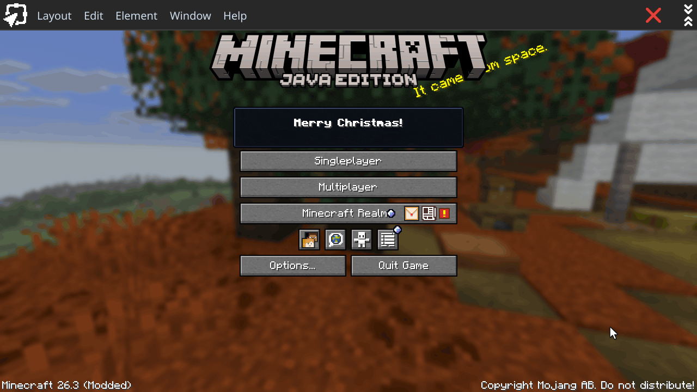

# Условия

Условия — это проверки, например: «курсор находится над этой кнопкой», «сейчас декабрь» или «мир загружен». Используйте их, чтобы:

- показывать [элемент](/elements) только при определённых условиях;
- загружать целый макет только при определённых условиях;
- делать кнопки, ползунки и флажки кликабельными только при определённых условиях;
- запускать отдельные части [сценария действий](/action-scripts) только при определённых условиях.

FancyMenu постоянно проверяет условия, пока открыто меню, поэтому элементы сразу появляются, скрываются или меняются. Это информационное окно показывается, только когда курсор находится над кнопкой «Сетевая игра»:

# Где их найти

| Где | Что делают условия |
|---|---|
| Щёлкните элемент правой кнопкой мыши -> **Условия загрузки** | Элемент показывается, только когда условия выполнены. Работает и для [стандартных элементов](/vanilla-elements). |
| Щёлкните правой кнопкой мыши по фону редактора -> **Условия загрузки [для всего макета]** | Весь макет загружается, только когда условия выполнены. См. раздел [Условия для всего макета](#layout-wide-requirements). |
| Щёлкните правой кнопкой мыши по кнопке, ползунку или флажку -> **Активность элемента управления** | Элемент можно нажать, только когда условия выполнены. Иначе он будет затенён. Эта функция есть и у стандартных кнопок. |
| IF, ELSE-IF и WHILE в [сценариях действий](/action-scripts#statements) | Действия внутри выполняются, только когда условия выполнены. |

В редакторе макета элементы видны всегда, поэтому их можно редактировать. Условия элементов работают за пределами редактора.

> [!TIP]
> В разделе [Видимость элементов](/element-visibility) описаны другие способы показывать и скрывать элементы, например с задержкой, затуханием или переключением кнопкой.

# Добавление условия

1. Щёлкните элемент правой кнопкой мыши и выберите **Условия загрузки**. Откроется окно **Управление условиями**.
2. Щёлкните правой кнопкой мыши по пустому списку и выберите **Добавить условие** или нажмите `A`.
3. Выберите категорию в разделе **Доступные условия** или начните вводить текст, чтобы найти условие по названию или описанию. В разделе **Описание условия** объясняется выбранное условие.
4. Нажмите **Следующий шаг**, чтобы задать значение. Для условий, которым значение не нужно, вместо этого появится кнопка **Готово**. Дважды щёлкните по условию, чтобы сделать то же самое.
5. Укажите значение и нажмите **Готово**. Например, для условия **Is Element Hovered** нужен идентификатор элемента. Чтобы получить его, щёлкните элемент правой кнопкой мыши и выберите **Копировать идентификатор элемента**.
6. Нажмите **Готово** в окне **Управление условиями**.

## Режим условия

Кнопка **Режим условия** в окне выбора условия переключает режимы:

- **Обычный**: условие выполнено, если проверка верна.
- **Противоположный**: условие выполнено, если проверка НЕ верна. Например, условие **Is World Loaded** в противоположном режиме выполняется только в главном меню.

В окне **Управление условиями** для каждого условия отображаются режим и значение.

## Значения

- Значения поддерживают [подстановки](/placeholders) и ваши [переменные](/variables#showing-variables-in-text), например `$$coins`. FancyMenu подставляет их каждый раз при проверке условия.
- Многие поля значений предлагают варианты по мере ввода, например биомы, идентификаторы модов, языки или названия переменных. Щёлкните по нужному варианту или нажмите `Tab`.
- Для условий с простым значением открывается однострочный редактор текста. В его заголовке указано, что нужно ввести, например **Target Element ID**.

## Управление условиями

Щёлкните правой кнопкой мыши по списку, условию или группе в окне **Управление условиями**, чтобы воспользоваться следующими командами:

| Команда | Сочетание клавиш | Что делает |
|---|---|---|
| **Добавить условие** | `A` | Добавляет условие. |
| **Добавить группу** | `G` | Добавляет группу (см. ниже). |
| **Изменить условие** | `Enter` или двойной щелчок | Открывает окно выбора условия с его типом, режимом и значением. |
| **Удалить условие** / **Удалить группу** | `Delete` | Удаляет условие или группу. |
| **Отменить** / **Повторить** | `Ctrl + Z` / `Ctrl + Y` | Отменяет или повторяет изменения в этом окне. |
| **Экспортировать условия для ИИ** | | Экспортирует все условия из окна в [чат с ИИ](/export-for-ai), включая несохранённые изменения. |

Клавиши `Up` и `Down` выбирают условие выше или ниже. Нажмите **Готово** (`Ctrl + S`), чтобы сохранить изменения, или **Отмена**, чтобы отменить все изменения, сделанные в окне. В macOS используйте `Cmd` вместо `Ctrl`.

Если выбрано несколько элементов, команда **Условия загрузки** изменяет условия сразу для всех них. Если условия элементов различаются, FancyMenu сначала запросит подтверждение, поскольку заменит условия у каждого элемента.

# Объединение условий

Все условия в окне **Управление условиями** должны быть выполнены. Чтобы задать условие «это ИЛИ то», используйте группу.

Группа работает как одно условие:

- Режим **And**: должны быть выполнены все условия в группе. Новые группы создаются в этом режиме.
- Режим **Or**: достаточно выполнить одно условие в группе.

1. Щёлкните правой кнопкой мыши по списку и выберите **Добавить группу** или нажмите `G`. Группа получит имя, например `group_1`.
2. Щёлкните правой кнопкой мыши по группе и выберите **Режим группы**, чтобы переключаться между режимами **And** и **Or**.
3. Нажмите **Изменить условия группы** или дважды щёлкните по группе. Откроется окно, похожее на **Управление условиями**.
4. Добавьте условия в группу и нажмите **Готово**.

Например, можно показывать рождественское приветствие в декабре или когда игрок включил `xmas_lights`: создайте группу в режиме Or с условиями **Is Real Time Month** со значением `12` и **Is Variable Value (FM Variable)** для переменной `xmas_lights` со значением `on`.

- В группы можно вкладывать другие группы, например для условия «(A и B) или (C и D)». В заголовке окна отображается текущий путь, например `Edit Group: group_1 › group_2`.
- Команда **Изменить идентификатор группы** переименовывает группу. Каждое имя можно использовать только один раз, в том числе внутри групп.
- Пустая группа в режиме **Or** никогда не считается выполненной.

# Условия для всего макета

Условия для всего макета определяют, загружать ли макет целиком. Используйте их для ночной версии главного экрана, отдельного макета для каждого языка или макета, который показывается только в одиночной игре.

Щёлкните правой кнопкой мыши по фону редактора и выберите **Условия загрузки [для всего макета]**. Эта команда также находится в меню **строка меню -> Макет -> Свойства макета**.

- Если результат проверки изменится при открытом меню, FancyMenu заново соберёт экран с макетами, условия которых теперь выполнены.
- Эти условия работают и с [универсальными макетами](/universal-layouts).
- Чтобы включать и выключать макет кнопкой, поместите кнопку в другой макет. См. раздел [Включение и выключение макетов](/element-visibility#turning-layouts-on-and-off).

# Полезно знать

- Условия, связанные с миром и игроком, не выполняются, пока мир не загружен, например в главном меню.
- Условия, связанные с элементами, курсором мыши, инвентарём, игроком и миром, не работают в [тикере](/elements#ticker), если включён параметр **Асинхронно**. В этом случае FancyMenu покажет ошибку с названием условия.
- Условия из удалённых дополнений пропускаются. Если сохранить макет в редакторе, такие условия будут удалены навсегда.
- Параметр **строка меню -> Настройка -> Параметры -> Длительность кэширования условий [мс]** повторно использует результаты проверки условий в течение заданного числа миллисекунд, что ускоряет работу больших макетов. Значение `0` отключает кэширование; оно используется по умолчанию. Кэширование может приводить к неожиданному поведению сценариев действий и быстрых изменений.

# Все условия

Условия отсортированы так же, как в окне выбора: сначала по категории, затем по названию. Условия без категории находятся внизу списка выбора, а здесь — в разделе [Прочее](#other).

## Интерфейс

### Is Active Cursor Type

**Идентификатор:** `is_active_cursor_type`

Выполняется, когда курсор мыши имеет заданную форму, например **Указующая рука** над ссылкой или **Текстовый курсор** над текстовым полем.

- Значение: нажмите **Тип курсора**, чтобы выбрать **Обычный**, **Текстовый курсор**, **Перекрестие**, **Указующая рука**, **Изменение размера по горизонтали**, **Изменение размера по вертикали**, **Изменение размера по диагонали СЗ-ЮВ**, **Изменение размера по диагонали СВ-ЮЗ**, **Изменение размера во всех направлениях** или **Запрещено**.

### Is Any Button Hovered

**Идентификатор:** `fancymenu_visibility_requirement_is_any_button_hovered`

Выполняется, когда курсор находится над любой видимой кнопкой — стандартной или пользовательской.

### Is Any Element Hovered

**Идентификатор:** `fancymenu_visibility_requirement_is_any_element_hovered`

Выполняется, когда курсор находится над любым видимым элементом, не только кнопкой.

### Is Any Screen Open

**Идентификатор:** `is_any_screen_open`

Выполняется, когда открыто любое меню, например меню паузы или инвентарь. Не выполняется, когда игрок играет без открытого меню.

### Is Button Active

**Идентификатор:** `fancymenu_visibility_requirement_is_button_active`

Выполняется, когда кнопку можно нажать.

- Значение: [идентификатор элемента](/element-identifiers) кнопки. Щёлкните по ней правой кнопкой мыши в редакторе и выберите **Копировать идентификатор элемента**.

### Is Customization Menu Bar Visible

**Идентификатор:** `is_customization_menu_bar_visible`

Выполняется, когда отображается строка меню FancyMenu. Не выполняется в режиме модпака или когда строка меню отключена.

### Is Element Focused

**Идентификатор:** `is_element_focused`

Выполняется, когда элемент находится в фокусе. Кнопки и ползунки получают фокус при нажатии на них или при переходе к ним клавишами со стрелками или `Tab`. Переход с помощью клавиш не считается наведением курсора, поэтому для игроков, использующих клавиатуру, добавьте это условие и **Is Element Hovered** в [группу Or](#combining-requirements).

- Значение: [идентификатор элемента](/element-identifiers), например `mc_titlescreen_multiplayer_button`.

### Is Element Hovered

**Идентификатор:** `fancymenu_visibility_requirement_is_element_hovered`

Выполняется, когда курсор находится над элементом. Элемент должен быть видимым.

- Значение: [идентификатор элемента](/element-identifiers), например `mc_titlescreen_multiplayer_button` для кнопки «Сетевая игра» на главном экране. Чтобы получить идентификатор, щёлкните элемент правой кнопкой мыши в редакторе и выберите **Копировать идентификатор элемента**.

### Is Element Scrolled to End

**Идентификатор:** `is_scroll_area_scrolled_to_end`

Выполняется, когда [прокручиваемая область](/scrollable-areas) или текстовый элемент прокручен до конца. Если элемент не требует прокрутки, считается, что он уже прокручен до конца. Подходит для кнопки **Принять**, которая должна срабатывать только после того, как игрок прочитал правила.

- Значение: [идентификатор элемента](/element-identifiers) прокручиваемой области или текстового элемента.

### Is GUI Scale

**Идентификатор:** `fancymenu_loading_requirement_is_gui_scale`

Выполняется, когда масштаб интерфейса Minecraft соответствует заданному значению.

- Значение: число, например `2` для точного совпадения, `>2` для значения больше 2 или `<4` для значения меньше 4. Можно использовать и дробные числа, например `<3.5`.
- Несколько условий разделяйте запятыми. Для обычных чисел должно совпасть одно из значений, например `2,3`. Все условия с `>` и `<` должны выполняться, например `>1,<4`.

### Is Key Pressed

**Идентификатор:** `is_key_pressed`

Выполняется, пока клавиша удерживается нажатой. Чтобы запускать действия один раз при каждом нажатии клавиши, используйте слушатель [**При нажатии клавиши**](/listeners#on-keyboard-key-pressed).

- Значение: нажмите **Изменить клавишу** в разделе **Выбор клавиши** и нажмите нужную клавишу.

### Is Layout Enabled

**Идентификатор:** `fancymenu_visibility_requirement_is_layout_enabled`

Выполняется, когда макет включён.

- Значение: название макета, например `winter_title_screen`.

### Is MC Debug Overlay Enabled

**Идентификатор:** `is_debug_overlay_enabled`

Выполняется, когда отображается отладочный экран F3. Не выполняется, если интерфейс скрыт клавишей F1.

### Is Modpack Mode Enabled

**Идентификатор:** `is_modpack_mode_enabled`

Выполняется, когда включён режим модпака FancyMenu.

### Is Screen Title

**Идентификатор:** `is_menu_title`

Выполняется, когда заголовок открытого экрана совпадает с заданным, например «Настройки» или «Игровое меню». Это заголовок, который видят игроки, а не [идентификатор экрана](/screen-identifiers).

- Значение: текст заголовка или его ключ локализации, например `options.title`. В окне значения показываются оба варианта для редактируемого экрана, а также предлагаются ключи локализации.
- Ключи локализации работают на любом языке. Текст заголовка должен совпадать точно.

## Реальное время

Эти условия проверяют часы компьютера игрока. Несколько значений разделяйте запятыми: должно совпасть одно из них.

### Is Real Time Day

**Идентификатор:** `fancymenu_visibility_requirement_is_realtime_day`

Выполняется в определённые дни месяца.

- Значение: от `1` до `31`, например `24,25,26`.

### Is Real Time Hour

**Идентификатор:** `fancymenu_visibility_requirement_is_realtime_hour`

Выполняется в определённые часы.

- Значение: от `0` до `23`, например `20,21,22,23` для вечера.

### Is Real Time Minute

**Идентификатор:** `fancymenu_visibility_requirement_is_realtime_minute`

Выполняется в определённые минуты часа.

- Значение: от `0` до `59`.

### Is Real Time Month

**Идентификатор:** `fancymenu_visibility_requirement_is_realtime_month`

Выполняется в определённые месяцы.

- Значение: от `1` (январь) до `12` (декабрь), например `12` для Рождества.

### Is Real Time Second

**Идентификатор:** `fancymenu_visibility_requirement_is_realtime_second`

Выполняется в определённые секунды минуты.

- Значение: от `0` до `59`.

### Is Real Time Week Day

**Идентификатор:** `fancymenu_visibility_requirement_is_realtime_week_day`

Выполняется в определённые дни недели.

- Значение: от `1` (воскресенье) до `7` (суббота), например `1,7` для выходных.

### Is Real Time Year

**Идентификатор:** `fancymenu_visibility_requirement_is_realtime_year`

Выполняется в определённые годы.

- Значение: полный год, например `2027`.

## Система

### File/Folder Exists

**Идентификатор:** `fancymenu_loading_requirement_file_exists`

Выполняется, если файл или папка существуют.

- Значение: путь к файлу в папке игры, например `config/mymodpack/welcome_seen.txt`. Пути, начинающиеся с `.minecraft/`, указывают на стандартную папку `.minecraft`.

### Is Internet Connection Available

**Идентификатор:** `is_internet_connection_available`

Выполняется, когда компьютер подключён к интернету. FancyMenu время от времени проверяет подключение в фоновом режиме.

### Is OS Linux

**Идентификатор:** `fancymenu_loading_requirement_is_os_linux`

Выполняется в Linux. Технически — во всех системах, кроме Windows и macOS.

### Is OS macOS

**Идентификатор:** `fancymenu_loading_requirement_is_os_macos`

Выполняется в macOS.

### Is OS Windows

**Идентификатор:** `fancymenu_loading_requirement_is_os_windows`

Выполняется в Windows.

### Scheduler Is Running

**Идентификатор:** `fancymenu_visibility_requirement_is_scheduler_running`

Выполняется, пока работает [планировщик](/schedulers).

- Значение: идентификатор планировщика, например `my_scheduler`.

## Окно

Размеры окна указаны в реальных пикселях окна игры, а не в пикселях интерфейса. В описании условия отображается текущий размер.

### Is Fullscreen

**Идентификатор:** `fancymenu_loading_requirement_is_fullscreen`

Выполняется, когда игра работает в полноэкранном режиме.

### Is Window Height

**Идентификатор:** `fancymenu_loading_requirement_is_window_height`

Выполняется, когда высота окна соответствует заданному значению.

- Значение: высота, например `1080`. Несколько значений высоты разделяйте запятыми: должно совпасть одно из них.

### Is Window Height Bigger Than

**Идентификатор:** `fancymenu_loading_requirement_is_window_height_bigger_than`

Выполняется, когда высота окна больше заданной.

- Значение: высота, например `1080`.

### Is Window Width

**Идентификатор:** `fancymenu_loading_requirement_is_window_width`

Выполняется, когда ширина окна соответствует заданному значению.

- Значение: ширина, например `1920`. Несколько значений ширины разделяйте запятыми: должно совпасть одно из них.

### Is Window Width Bigger Than

**Идентификатор:** `fancymenu_loading_requirement_is_window_width_bigger_than`

Выполняется, когда ширина окна больше заданной.

- Значение: ширина, например `1920`.

## Мир

Эти условия никогда не выполняются, пока мир не загружен. Для условий **Is Player In Structure** и **Is In Active Raid Area** FancyMenu должен быть установлен на сервере. В одиночной игре они работают всегда.

### Has Player Absorption Hearts

**Идентификатор:** `has_player_absorption_hearts`

Выполняется, когда у игрока есть золотые сердца поглощения.

### Has Player Permission Level

**Идентификатор:** `fancymenu_loading_requirement_has_player_permission_level`

Выполняется, когда уровень прав игрока в мире или на сервере не ниже заданного, например когда игрок является оператором.

- Значение: от `0` до `4`. Уровень `0` соответствует всем игрокам, уровня `2` достаточно для команд вроде `/gamemode`, а уровень `4` выдаётся командой `/op`.

### Is Adventure

**Идентификатор:** `fancymenu_visibility_requirement_is_adventure`

Выполняется, когда игрок находится в режиме приключения.

### Is Any Effect Active

**Идентификатор:** `is_any_effect_active`

Выполняется, когда на игроке есть любой эффект, например скорость или отравление.

### Is Attack Strength Weakened

**Идентификатор:** `is_attack_strength_weakened`

Выполняется, когда атака игрока заряжена не полностью. В этот момент отображается индикатор атаки.

### Is Block/Item In Tag

**Идентификатор:** `is_in_tag`

Выполняется, когда блок или предмет относится к тегу, например `minecraft:logs` или `c:tools`. Теги существуют только при загруженном мире.

- Значение: нажмите **Тип тега**, чтобы выбрать **Блок** или **Предмет**, затем укажите **Ключ блока/предмета** и **Тег**. В обоих полях предлагаются варианты. Символ `#` перед тегом можно не указывать.
- Ключ удобно использовать с переменными слушателя, например `$$block_key`. Так, оператор IF в сценарии слушателя [**При разрушении блока**](/listeners#on-block-broke) может показывать уведомление только при добыче брёвен.

### Is Camera Perspective

**Идентификатор:** `is_camera_perspective`

Выполняется, когда выбрано определённое положение камеры (F5).

- Значение: нажмите кнопку и выберите **От первого лица**, **От третьего лица** или **Вид спереди**.

### Is Clear Weather

**Идентификатор:** `is_clear_weather`

Выполняется, когда нет ни дождя, ни грозы.

### Is Creative

**Идентификатор:** `fancymenu_visibility_requirement_is_creative`

Выполняется, когда игрок находится в творческом режиме.

### Is Cursor Holding Inventory Item

**Идентификатор:** `is_cursor_holding_inventory_item`

Выполняется, когда курсор мыши удерживает предмет в окне инвентаря.

### Is Difficulty

**Идентификатор:** `is_difficulty`

Выполняется, когда в мире установлена заданная сложность.

- Значение: `peaceful`, `easy`, `normal` или `hard`.

### Is Effect Active

**Идентификатор:** `is_effect_active`

Выполняется, когда на игроке действует определённый эффект.

- Значение: ключ эффекта, например `minecraft:speed`. Если вы находитесь в мире, поле предлагает варианты эффектов.

### Is Entity Nearby

**Идентификатор:** `is_entity_nearby`

Выполняется, когда рядом с игроком находится сущность заданного типа.

- Значение: **ключ сущности в реестре**, например `minecraft:creeper`, и **радиус проверки в блоках**, например `10`. Если вы находитесь в мире, поле ключа предлагает варианты сущностей.

### Is Game Mode

**Идентификатор:** `is_gamemode`

Выполняется, когда игрок находится в заданном игровом режиме.

- Значение: `survival`, `creative`, `adventure` или `spectator`.

### Is Hardcore

**Идентификатор:** `is_hardcore`

Выполняется в мирах в режиме хардкора.

### Is Hotbar Slot Selected

**Идентификатор:** `is_hotbar_slot_active`

Выполняется, когда выбран заданный слот панели быстрого доступа.

- Значение: от `0` (самый левый слот) до `8`.

### Is In Active Raid Area

**Идентификатор:** `is_in_active_raid_area`

Выполняется, когда игрок находится в зоне активного рейда, в которой отображается шкала рейда. Для работы FancyMenu должен быть установлен на сервере.

### Is Inventory Slot Filled

**Идентификатор:** `is_inventory_slot_filled`

Выполняется, когда в заданном слоте инвентаря игрока есть предмет.

- Значение: номер слота. Слоты от `0` до `8` относятся к панели быстрого доступа, а от `9` до `35` — к остальной части инвентаря.

### Is Item Hovered In Inventory

**Идентификатор:** `is_item_hovered_in_inventory`

Выполняется, когда курсор находится над предметом в окне инвентаря, например в инвентаре игрока или сундуке.

### Is Multiplayer

**Идентификатор:** `fancymenu_loading_requirement_is_multiplayer`

Выполняется, когда игрок находится на сервере.

### Is Player Creative Flying

**Идентификатор:** `is_player_creative_flying`

Выполняется, когда игрок летит в творческом режиме.

### Is Player Flying With Elytra

**Идентификатор:** `is_player_flying_with_elytra`

Выполняется, когда игрок планирует на элитрах.

### Is Player Fully Frozen

**Идентификатор:** `is_player_fully_frozen`

Выполняется, когда игрок полностью замёрз в рыхлом снегу, а на шкале здоровья отображаются замороженные сердца.

### Is Player In Biome

**Идентификатор:** `is_player_in_biome`

Выполняется, когда игрок находится в заданном биоме.

- Значение: ключ биома, например `minecraft:birch_forest`. Если вы находитесь в мире, поле предлагает варианты биомов.

### Is Player In Dimension

**Идентификатор:** `is_player_in_dimension`

Выполняется, когда игрок находится в заданном измерении.

- Значение: ключ измерения: `minecraft:overworld`, `minecraft:the_nether`, `minecraft:the_end` или ключ из мода. Если вы находитесь в мире, поле предлагает варианты измерений.

### Is Player In Fluid

**Идентификатор:** `is_player_in_fluid`

Выполняется, когда игрок находится в любой жидкости, например в воде или лаве.

### Is Player In Lava

**Идентификатор:** `is_player_in_lava`

Выполняется, когда игрок находится в лаве.

### Is Player In Powder Snow

**Идентификатор:** `is_player_in_powder_snow`

Выполняется, когда игрок находится в рыхлом снегу.

### Is Player In Structure

**Идентификатор:** `is_player_in_structure`

Выполняется, когда игрок находится внутри заданной структуры. Для работы FancyMenu должен быть установлен на сервере.

- Значение: ключ структуры, например `minecraft:village_plains`. Если вы находитесь в мире, поле предлагает варианты структур.

### Is Player In Water

**Идентификатор:** `is_player_in_water`

Выполняется, когда игрок хотя бы частично находится в воде.

### Is Player Jumping or Falling

**Идентификатор:** `is_player_jumping`

Выполняется, когда игрок находится в воздухе. Плавание, нахождение в жидкости, полёт на элитрах, сон и ползание не учитываются.

### Is Player Left-Handed

**Идентификатор:** `is_left_handed`

Выполняется, если в настройках скина Minecraft для параметра «Основная рука» выбрано значение «Левая».

### Is Player Poisoned

**Идентификатор:** `is_player_poisoned`

Выполняется, когда на игроке действует эффект отравления, а на шкале здоровья отображаются отравленные сердца.

### Is Player Riding Entity With Health

**Идентификатор:** `is_player_riding_entity_with_health`

Выполняется, когда игрок едет на живой сущности, например на лошади или свинье. Лодки и вагонетки не учитываются.

### Is Player Riding Entity/Vehicle

**Идентификатор:** `is_player_riding_entity`

Выполняется, когда игрок едет на чём-либо, например на лошади, в лодке или вагонетке.

### Is Player Riding Jumpable Entity

**Идентификатор:** `is_player_riding_jumpable_entity`

Выполняется, когда игрок едет на сущности, которая может прыгать, например на лошади.

### Is Player Running

**Идентификатор:** `is_player_running`

Выполняется, когда игрок бежит.

### Is Player Sneaking

**Идентификатор:** `is_player_sneaking`

Выполняется, когда игрок крадётся.

### Is Player Swimming

**Идентификатор:** `is_player_swimming`

Выполняется, когда игрок плывёт.

### Is Player Under Water

**Идентификатор:** `is_player_under_water`

Выполняется, когда голова игрока находится под водой.

### Is Player Using Item

**Идентификатор:** `is_player_using_item`

Выполняется, когда игрок использует предмет, например ест, пьёт зелье или натягивает тетиву лука.

### Is Player Wearing Pumpkin

**Идентификатор:** `is_player_wearing_pumpkin`

Выполняется, когда игрок носит вырезанную тыкву на голове.

### Is Player Withered

**Идентификатор:** `is_player_withered`

Выполняется, когда на игроке действует эффект иссушения, а на шкале здоровья отображаются иссушённые сердца.

### Is Raining

**Идентификатор:** `is_raining`

Выполняется, когда в месте, где находится игрок, идёт дождь.

### Is Singleplayer

**Идентификатор:** `fancymenu_loading_requirement_is_singpleplayer`

Выполняется, когда игрок находится в мире одиночной игры.

### Is Snowing

**Идентификатор:** `is_snowing`

Выполняется, когда в месте, где находится игрок, идёт снег.

### Is Spectator

**Идентификатор:** `fancymenu_visibility_requirement_is_spectator`

Выполняется, когда игрок находится в режиме наблюдателя.

### Is Survival

**Идентификатор:** `fancymenu_visibility_requirement_is_survival`

Выполняется, когда игрок находится в режиме выживания.

### Is Thundering

**Идентификатор:** `is_thundering`

Выполняется во время грозы.

### Is World Loaded

**Идентификатор:** `fancymenu_loading_requirement_is_world_loaded`

Выполняется, когда игрок находится в мире — одиночном или сетевом.

### Was Player In Powder Snow

**Идентификатор:** `was_player_in_powder_snow`

Выполняется, если мгновение назад игрок находился в рыхлом снегу.

## Прочее

### Is Game Language

**Идентификатор:** `fancymenu_loading_requirement_is_language`

Выполняется, когда в Minecraft выбран заданный язык.

- Значение: код языка, например `en_us` или `de_de`. Поле предлагает все языки.

### Is Mod Loaded

**Идентификатор:** `fancymenu_loading_requirement_is_mod_loaded`

Выполняется, если установлены заданные моды.

- Значение: идентификатор мода, например `jei`. Поле предлагает идентификаторы установленных модов. Несколько идентификаторов разделяйте запятыми: должны быть установлены все перечисленные моды. Значение `optifine` проверяет наличие OptiFine.

### Is Number

**Идентификатор:** `fancymenu_visibility_requirement_is_number`

Сравнивает два числа. В поля можно вводить подстановки или переменные, например `$$coins`.

- **Режим сравнения**: **Равно**, **Больше**, **Меньше**, **Больше или равно** или **Меньше или равно**.
- **Число**: проверяемое число, например `$$coins`.
- **Сравнить с числом**: число для сравнения, например `100`.

Поддерживаются дробные числа, например `2.5`. Если в поле указано не число, условие никогда не выполняется.

### Is Resource Pack Enabled

**Идентификатор:** `is_resource_pack_enabled`

Выполняется, когда включён заданный набор ресурсов.

- Значение: название набора, как оно отображается на экране «Наборы ресурсов», например `Programmer Art`, или его идентификатор. Регистр не учитывается.

### Is Rinku Loaded

**Идентификатор:** `is_rinku_loaded`

Выполняется, если установлен мод [Rinku](https://modrinth.com/mod/rinku). Он необходим для [элемента браузера](/elements#browser) и устаревших [типов видео на базе Rinku](/video#requirements).

### Is Server IP

**Идентификатор:** `fancymenu_visibility_requirement_is_server_ip`

Выполняется, когда игрок находится на заданном сервере.

- Значение: адрес сервера, например `play.example.net`. Если указан порт, например `play.example.net:25566`, он тоже должен совпадать.

### Is Server Online

**Идентификатор:** `fancymenu_loading_requirement_is_server_online`

Выполняется, когда сервер доступен. FancyMenu проверяет его в фоновом режиме примерно каждые 30 секунд, поэтому после запуска игры может потребоваться немного подождать.

- Значение: адрес сервера, например `play.example.net`.

### Is Text

**Идентификатор:** `fancymenu_visibility_requirement_is_text`

Сравнивает два текстовых значения. В поля можно вводить подстановки или переменные, например `$$key_name`.

- **Режим сравнения**: **Равно**, **Содержит**, **Начинается с** или **Заканчивается на**.
- **Текст**: проверяемый текст.
- **Сравнить с текстом**: текст для сравнения.

Регистр учитывается.

### Is Variable Value (FM Variable)

**Идентификатор:** `fancymenu_visibility_requirement_is_variable_value`

Выполняется, когда одна из ваших [переменных](/variables) имеет заданное значение.

- **Имя переменной**: имя переменной без `$$`. Поле предлагает ваши переменные.
- **Проверяемое значение переменной**: значение, например `on`. Оно должно полностью совпадать с переменной с учётом регистра.

Если переменная не существует, условие не выполняется. Для переменной-списка сравнивается весь JSON-массив значений, например `["apple","banana"]`. Чтобы проверить наличие одного значения, используйте условие **List Contains Entry (FM Variable)**.

### List Contains Entry (FM Variable)

**Идентификатор:** `list_contains_entry`

Выполняется, когда в [переменной-списке](/variables#text-and-list-variables) есть заданный элемент.

- **Имя переменной-списка**: имя списка без `$$`. Поле предлагает переменные-списки и предупреждает, если введено имя текстовой переменной.
- **Искомый элемент**: элемент для поиска. Он должен полностью совпасть с одним из элементов списка, а не только с его частью.
- **Не учитывать регистр**: если включено, `Apple` также совпадает с `apple`.

Если список не существует, условие не выполняется.

### Mouse Button Is Pressed

**Идентификатор:** `mouse_click`

Выполняется, пока удерживается нажатой кнопка мыши. Чтобы запускать действия один раз при каждом щелчке, используйте слушатель [**При нажатии кнопки мыши**](/listeners#on-mouse-button-clicked).

- Значение: `left` или `right`.

### Only Once Per Session

**Идентификатор:** `once_per_session`

Выполняется при первой проверке, а затем больше не выполняется до перезапуска игры. Каждый экземпляр этого условия учитывается отдельно.

Для элементов, которые должны появиться только один раз за игровой сеанс, удобнее использовать параметр **Загрузить один раз за сеанс** у элементов в разделе [Видимость элементов](/element-visibility#load-once-per-session): такие элементы остаются на экране до открытия нового экрана.
