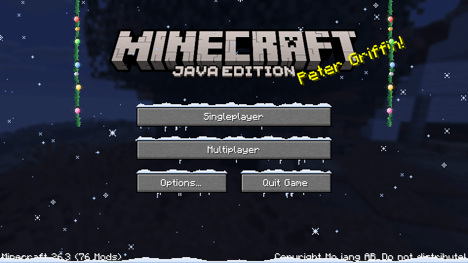
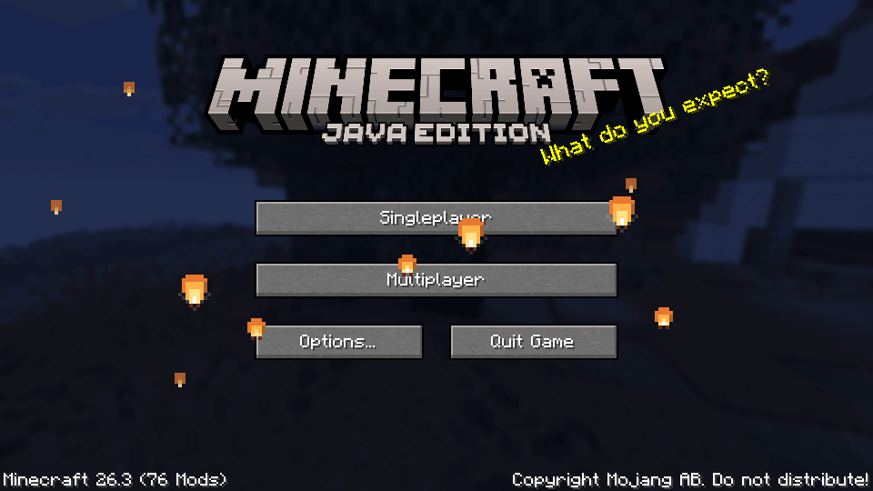

# Декоративные эффекты

Декоративные эффекты — это анимация на весь экран: например, падающий снег, светлячки, туман или гирлянды. Многие эффекты взаимодействуют с меню: снег накапливается на кнопках, птицы садятся на них, а туман рассеивается вокруг курсора.



# Добавление эффекта

1. Откройте макет в редакторе макетов.
2. Щёлкните правой кнопкой мыши по фону редактора и откройте раздел **Декоративные эффекты**.
3. Откройте эффект, например **Снегопад**.
4. Нажмите **Показать эффект**, чтобы включить его.

Включённые эффекты отмечены в списке значком ✔. В макете можно одновременно показывать сколько угодно эффектов. Наведите курсор на эффект или его настройку, чтобы узнать, что они делают.

Эффекты воспроизводятся и в редакторе макетов, но взаимодействуют с элементами только в настоящем меню. Сохраните макет и откройте меню, чтобы увидеть всё в действии.

Если для одного экрана используются несколько макетов с эффектами, будут воспроизводиться все эффекты, даже если один и тот же эффект включён дважды. Это относится и к [универсальным макетам](/universal-layouts).

# Настройки всех эффектов

У каждого эффекта есть две настройки:

- **Показать эффект** включает или выключает эффект.
- **Слои** задаёт, где отображается эффект:
  - **Фон и передний план**: дальние части отображаются за элементами, а ближние — перед ними, создавая приятное ощущение глубины. Этот вариант выбран по умолчанию.
  - **Только фон**: всё отображается за элементами, но перед фоном меню.
  - **Только передний план**: всё отображается перед элементами.

Элементы эффекта, которые оказываются прямо на элементах меню (например, снег на кнопке), всегда остаются на них.

У многих эффектов также есть следующие настройки:

| Настройка | Описание |
|---|---|
| **Количество (%)** | Задаёт количество эффекта: от 25% до 300%. Значение 100% соответствует обычному количеству. |
| **Размер** | Увеличивает пиксельную графику в 2 или 3 раза. Все пиксели остаются чёткими квадратами. |
| **Вид** | **Детализированный** показывает пиксельную графику целиком, с тенями и дополнительными эффектами. **Простой** вариант выглядит более плоским и ближе к классическому стилю. |

# Эффекты и ваши элементы

Многие эффекты взаимодействуют с элементами меню: на них накапливаются снег, пепел и конфетти, с них свисают сосульки, на них растёт мох и садятся птицы.

Чтобы выбрать, какие элементы будут участвовать, щёлкните правой кнопкой мыши по элементу и настройте параметр **Подвергать воздействию декоративных эффектов**:

- По умолчанию он включён для кнопок, ползунков, флажков, полей ввода и [ванильных элементов](/vanilla-elements).
- К ним также относятся логотип, текст-заставка, брендинг и уведомление об авторских правах на экране заголовка. Отключите настройку для них, если не хотите, чтобы на них что-либо оседало.
- Скрытые элементы не участвуют. Не участвует и та часть элемента, которая обрезается [прокручиваемой областью](/scrollable-areas).

> [!TIP]
> Оставляйте между элементами не менее 13 пикселей. Элементы, которые накапливаются на элементе или свисают под ним, могут вырасти только до размера, который позволяет зазор до следующего элемента.

Некоторые эффекты реагируют на щелчки мышью — например, пузыри, иней и конфетти. При этом все щелчки по-прежнему доходят до кнопок.

# Все декоративные эффекты

Все декоративные эффекты FancyMenu, сгруппированные по темам.

## Погода

### Снегопад

Снег падает и постепенно накапливается на кнопках и вдоль нижнего края экрана.


- **Накапливать снег** позволяет снегу скапливаться.
- Настройки **Цвет снега [HEX]**, **Скорость снегопада**, **Количество (%)** и **Размер** изменяют снег.

### Дождь

Дождь падает, оставляет рябь в неглубоких лужах и капает с кнопок.


- **Лужи** покрывают элементы и нижний край экрана влажной плёнкой, на которой расходятся круги от падающих капель.
- **Капли с элементов** позволяет каплям задерживаться на элементах и падать с них.
- **Вспышки молнии** время от времени добавляют молнии с разветвлёнными разрядами и мягкими вспышками. Настройка **Яркость вспышки молнии** задаёт яркость.
- Настройки **Цвет дождя [HEX]**, **Количество (%)** и **Размер** изменяют дождь.

> [!WARNING]
> Настройка **Вспышки молнии** заставляет экран мигать. Оставьте её выключенной, если игроки могут быть чувствительны к мигающему свету.

### Туман

Мягкие слои тумана плывут по экрану и окутывают элементы; гуще всего туман у земли.


- **Рассеивать вокруг курсора** заставляет туман расступаться вокруг мыши.

### Иней

Меню покрывается льдом. Лёд ползёт по краям, заполняет углы и покрывает элементы. Щёлкните по льду, чтобы отколоть кусок.


- Настройки **Края экрана**, **Углы** и **На элементах** включают или выключают соответствующие участки льда. Текст на элементах остаётся чётким.

## Природа

### Листья

Листья падают, а порывы ветра подхватывают и разгоняют их.


- Настройка **Вид** переключает листья между вариантами **Детализированный** и **Простой**.
- В настройке **Цвета** можно выбрать **Осеннюю палитру** (пять тёплых осенних цветов) или **Свой диапазон** (пять цветов между **Начальным цветом листьев [HEX]** и **Конечным цветом листьев [HEX]**).
- Настройка **Порывы ветра** включает или выключает сильные порывы. **Сила ветра** задаёт их мощность.
- Настройки **Плотность листьев**, **Скорость падения листьев** и **Масштаб эффекта листьев** изменяют листья.

### Цветущая сакура

Цветущие ветви появляются в верхних углах, а лепестки медленно опускаются вниз.


- Настройки **Левая ветвь** и **Правая ветвь** показывают или скрывают соответствующие ветви.
- Настройки **Вид** и **Количество (%)** изменяют лепестки.

### Поросший зеленью экран

Природа захватывает меню: мох, лианы, трава и цветы постепенно разрастаются по всему экрану.


- Настройки **Трава**, **Левые лианы**, **Правые лианы** и **На элементах** включают или выключают соответствующие виды растительности. Текст на элементах остаётся чётким.
- Настройки **Цветы на лианах**, **Цветы на элементах** и **Цветы в траве** добавляют цветы. Параметр **Количество цветов (%)** задаёт их количество.

### Облака

Пушистые пиксельные облака плывут по небу за элементами в трёх слоях глубины. У облаков нет собственных настроек.


### Солнечные лучи

Лучи расходятся веером от солнца за краем экрана, а в свете танцуют пылинки.


- Настройка **Сторона солнца** задаёт край экрана, за которым находится солнце. **Угол солнца (°)** перемещает его вдоль этого края.
- Настройки **Цвет солнечного света [HEX]** и **Интенсивность (%)** изменяют свет.
- Настройка **Свечение солнца** добавляет мягкое сияние вокруг солнца.
- Настройка **Пыль** добавляет пылинки, плывущие в лучах. Движения мыши взбалтывают их.
- Настройка **Останавливать лучи на элементах** заставляет лучи останавливаться на элементах, подсвечивать их края и отбрасывать тени. Если настройка выключена, лучи проходят перед элементами.

### Пузыри

Потоки пузырей покачиваются на пути вверх и скользят по нижней стороне элементов. Щёлкните по ним, чтобы лопнуть! У пузырей нет собственных настроек.


## Животные

### Птицы

Маленькие птицы прилетают, прыгают по элементам и улетают, когда мышь подходит слишком близко.


### Бабочки

Яркие бабочки порхают вокруг, отдыхают на элементах и пугаются мыши.


### Летучие мыши

Небольшие группы летучих мышей пролетают через экран и повисают вниз головой под элементами. Подойдите слишком близко — и они проснутся!


Для птиц, бабочек и летучих мышей доступны настройки **Количество (%)** и **Размер**.

### Светлячки

Группы светлячков светятся и кружат вокруг; некоторые садятся на элементы.


- Настройка **Вид** переключает светлячков между вариантами **Детализированный** и **Простой**. Параметр **Невидимые тела** показывает их тёмные тельца между вспышками.
- Настройка **Следовать за мышью** заставляет группы следовать за мышью, когда та находится поблизости.
- Настройка **Посадка** позволяет светлячкам время от времени садиться на элементы.
- Настройки **Цвет светлячков [HEX]**, **Количество групп**, **Плотность группы**, **Размер группы** и **Масштаб светлячков** изменяют светлячков.

### Бадди

Бадди — маленький виртуальный питомец, который живёт внизу меню. Он ходит по экрану, показывает свои потребности в облачках мыслей, реагирует на игры с ним и помнит всё между игровыми сессиями.


#### Забота о Бадди

У Бадди есть четыре потребности со значениями от `0` до `100`:

- **Голод** со временем усиливается. Еда утоляет голод.
- **Счастье** со временем снижается. Поглаживания, еда и игры повышают его.
- **Энергия** расходуется, пока Бадди бодрствует, и восстанавливается во время сна.
- **Веселье** со временем снижается. Игры повышают его.

Чтобы позаботиться о Бадди:

- Щёлкните по Бадди левой кнопкой мыши, чтобы погладить его. Если так разбудить его, он станет немного менее счастливым.
- Щёлкните по Бадди правой кнопкой мыши, чтобы открыть экран состояния. На вкладке **Характеристики** показаны его потребности, уровень и опыт. На вкладке **Достижения** показаны его достижения.
- Нажмите **Покормить** на экране состояния, затем перетащите еду к Бадди.
- Нажмите **Поиграть** на экране состояния, затем перетащите мяч и отпустите кнопку, чтобы бросить его. Бадди побежит за мячом и поймает его.
- Нажмите **Спать**, чтобы дать Бадди отдохнуть. Он также засыпает самостоятельно, когда его энергия сильно падает.
- Время от времени Бадди оставляет кучки. Щёлкните по кучке левой кнопкой мыши, чтобы убрать её. Если вокруг лежат три кучки или больше, Бадди продолжает терять счастье.

#### Уровни и достижения

Забота о Бадди приносит ему опыт. Бадди может достичь уровня от 1 до 30. Чем выше его уровень, тем медленнее снижаются голод, счастье и энергия — на 30-м уровне скорость снижения уменьшается вдвое.

#### Если Бадди погибнет

Если голод или счастье остаются на уровне `0` в течение 10 часов реального времени, Бадди погибает и оставляет надгробие. Щёлкните по надгробию левой кнопкой мыши, чтобы начать заново с новым Бадди. Отключите настройку **Бадди может погибнуть**, чтобы он не погибал.

Настройка **Сбросить сохранение Бадди** позволяет начать заново в любой момент.

> [!WARNING]
> Сброс Бадди навсегда удаляет его потребности, уровень, опыт, достижения и кучки.

#### Сохранение и настройка

Бадди сохраняется примерно раз в две минуты и при закрытии его экрана. Данные хранятся в `<game-directory>/fancymenu_data/buddy/`. У каждого эффекта Бадди — собственное сохранение. См. раздел [Расположение данных](/data-storage-locations).

- **Пользовательские текстуры** заменяют спрайты, предметы, значки, экран состояния и надгробие Бадди на ваши текстуры.
- **Настройка характеристик** позволяет изменить, как быстро снижаются потребности, сколько дают и отнимают разные занятия, а также максимальное количество кучек, которые могут лежать одновременно (**Максимум кучек**).

## Ночное небо

### Северное сияние

Сияющие полосы северного сияния появляются в верхней части неба и медленно колышутся за элементами.


- Настройка **Цвет края [HEX]** задаёт цвет яркого нижнего края. **Цвет вершины [HEX]** задаёт цвет, в который переходят лучи.

### Падающие звёзды

Звёздное ночное небо за элементами: каждые несколько секунд пролетает падающая звезда, а время от времени начинается целый метеорный поток. У падающих звёзд нет собственных настроек.


### Небесные фонарики

Светящиеся бумажные фонарики поднимаются в ночное небо — иногда сразу целой группой. Для небесных фонариков доступны настройки **Количество (%)** и **Размер**.



## Праздник

### Конфетти

Хлопушки в нижних углах каждые несколько секунд разбрасывают конфетти, которое накапливается на элементах.


- Настройка **Хлопушки в углах** включает или выключает хлопушки.
- Настройка **Взрыв при щелчке** создаёт небольшой взрыв конфетти в месте каждого щелчка.
- Режим **Смешивать цвета** использует случайные цвета. Отключите его, чтобы использовать для всего конфетти цвет из настройки **Цвет конфетти [HEX]**.
- Настройка **Максимум осевших частиц** задаёт, сколько упавших кусочков может находиться на экране одновременно.
- Настройки **Количество (%)**, **Размер** и **Скорость падения конфетти** изменяют конфетти.

### Фейерверки

Ракеты взлетают и разрываются фейерверками.


- Настройка **Показывать взлёт ракет** показывает взлетающие ракеты.
- Настройки **Количество (%)**, **Размер** и **Размер взрыва** изменяют фейерверки.

### Гирлянды

Гирлянды лампочек натягиваются над меню и покачиваются на ветру.


- Настройка **Вид** переключает гирлянды между вариантами **Простой** и **Детализированный**. Параметр **Хвойная гирлянда** заменяет провод еловыми ветками с игрушками.
- Настройка **Режим свечения** задаёт, как лампочки светятся и мигают (см. ниже).
- Настройки **Масштаб гирлянд**, **Сила ветра** и **Скорость мерцания** изменяют все гирлянды.
- В разделе **Гирлянды** есть меню для каждой из восьми позиций. Включите гирлянду параметром **Показывать гирлянду**.

У каждой гирлянды есть следующие настройки:

- **Количество лампочек** задаёт, сколько лампочек на ней висит. Значение `0` заполняет гирлянду лампочками по всей длине.
- **Цвет лампочек [HEX]** задаёт цвет лампочек. Режим **Разноцветные гирлянды** делает их разноцветными.
- **Цвет провода [HEX]** задаёт цвет провода. Используйте альфа-канал, чтобы сделать его полупрозрачным или скрыть.
- Параметры **Индивидуальные цвета лампочек** и **Индивидуальные размеры лампочек** позволяют задать цвет или размер для каждой лампочки отдельным значением в списке через запятую. Если лампочек больше, чем значений, список начинается сначала:

```
#FF0000, #00FF00, #0000FF
```

| Режим свечения | Поведение лампочек |
|---|---|
| **Включены** | Все лампочки светятся; время от времени одна из них слегка тускнеет, как настоящая лампочка. |
| **На полную яркость** | Все лампочки светятся на полной яркости. |
| **На половину яркости** | Все лампочки светятся на половине яркости. |
| **Выключены** | Все лампочки выключены. |
| **Цикл** | По очереди запускает режимы «Мерцание», «Бегущий огонёк», «Через одну» и «Дыхание», переключаясь каждые 7 секунд. |
| **Мерцание** | Лампочки мерцают случайным образом. |
| **Бегущий огонёк** | Яркий огонёк пробегает вдоль гирлянды. |
| **Через одну** | Светится каждая вторая лампочка, затем их сменяет другая половина. |
| **Дыхание** | Все лампочки вместе плавно загораются и гаснут. |

## Жуткое

### Паутина

Пыльная паутина висит в верхних углах, а маленькие пауки спускаются по нитям.


- Настройки **Левая паутина** и **Правая паутина** показывают или скрывают каждую из паутин вместе с пауком.
- Настройка **Пауки** позволяет паукам спускаться, висеть и забираться обратно. Они убегают от мыши.
- Параметр **Замкнуть край** соединяет концы нитей каймой, чтобы на экране не оставалось свободных концов.

### Угли

Снизу поднимаются тлеющие угли, а пепел опускается и накапливается.


- Настройка **Пепел на земле** добавляет вдоль нижнего края экрана толстый слой пепла с тлеющими участками и раскалёнными углями.
- Настройка **Пепел на элементах** позволяет пеплу накапливаться на элементах.

## Пользовательские

### Браузер

Эффект «Браузер» показывает веб-сайт на весь экран.

> [!IMPORTANT]
> Для эффекта «Браузер» требуется мод [Rinku](https://modrinth.com/mod/rinku).

- Параметр **URL** задаёт адрес веб-сайта.
- Настройки **Перехватывать щелчки мыши**, **Перехватывать прокрутку мыши** и **Перехватывать нажатия клавиш** не позволяют вводу передаваться меню, находящемуся за браузером.
- Настройки **Обрабатывать щелчки мыши**, **Обрабатывать прокрутку мыши** и **Обрабатывать нажатия клавиш** позволяют самому браузеру реагировать на ввод.
- Настройки **Скрыть элементы управления видео**, **Зацикливать видео**, **Отключить звук браузера** и **Громкость аудио/видео** управляют видео и звуком на сайте.

Настройки перехвата и обработки включены по умолчанию, поэтому браузер работает как обычный браузер поверх меню. Чтобы показать веб-сайт только в качестве фона, отключите их все.

Веб-сайты также могут выполнять действия FancyMenu и считывать подстановки. См. раздел [API JavaScript для браузера](/browser-api).

### Шейдер GLSL

Эффект «Шейдер GLSL» отображает ваш шейдер на весь экран, создавая анимированные или статичные эффекты. Вставьте код шейдера в поле **Исходный код шейдера**.

Инструкции по созданию шейдеров для FancyMenu см. в разделе [API шейдеров GLSL](/glsl-shader-api).
