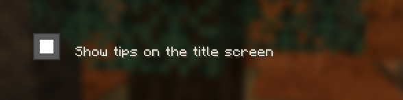

# Элементы

Элементы — это составные части макета: кнопки, текст, изображения, ползунки, музыка и многое другое. На этой странице перечислены все типы элементов и их основные настройки.

> [!TIP]
> Кнопки и другие элементы, которые изначально есть на экране, — это [ванильные элементы](/vanilla-elements). Их тоже можно перемещать, изменять и скрывать.

# Добавление элементов

1. В редакторе макета щёлкните правой кнопкой мыши по свободному месту и выберите **Новый элемент**. Тот же список есть в строке меню: **Элемент -> Новый**.
2. Выберите тип элемента. Наведите курсор на тип, чтобы узнать, для чего он нужен.

Элемент появится там, где вы щёлкнули правой кнопкой мыши. Перетащите его, чтобы переместить, потяните за края, чтобы изменить размер, или щёлкните по нему правой кнопкой мыши, чтобы открыть настройки.


Как выбирать, перемещать, копировать и удалять элементы, а также все сочетания клавиш редактора: [Редактор макета](/layout-editor). Чтобы элементы оставались на месте при любом размере окна, прочитайте раздел [Позиционирование элементов](/positioning-elements). Чтобы разместить элементы перед другими или за ними, прочитайте раздел [Слои и группы](/layout-editor#layers-and-groups).

# Общие настройки элементов

У каждого элемента в меню, которое открывается щелчком правой кнопки мыши, есть следующие настройки, а также настройки его типа:

| Настройка | Назначение |
|---|---|
| **Точка привязки** | К чему привязан элемент: например, к углу экрана или другому элементу. См. раздел [Позиционирование элементов](/positioning-elements). |
| **Расширенное позиционирование** и **Расширенный размер** | Расчёт положения и размера, например, с помощью [подстановок](/placeholders). См. раздел [Расширенное позиционирование и размер](/advanced-positioning-sizing). |
| **Требования для отображения** и **Загружать один раз за сеанс** | Показывать элемент, только если выполнены [условия](/conditions), или только один раз после запуска игры. См. раздел [Видимость элементов](/element-visibility). |
| **Задержка появления** и **Задержка исчезновения** | Подождать несколько секунд, прежде чем элемент появится или исчезнет. См. раздел [Видимость элементов](/element-visibility#delaying-elements). |
| **Плавное появление/исчезновение** и **Непрозрачность** | Плавно показывать и скрывать элемент или делать его полупрозрачным. См. раздел [Видимость элементов](/element-visibility#fading-in-and-out). |
| **Поворот**, **Вертикальный наклон** и **Горизонтальный наклон** | Поворачивать и наклонять элемент. См. раздел [Поворот и наклон элементов](/rotating-elements). |
| **Эффект параллакса** | Немного перемещать элемент вслед за мышью. См. раздел [Эффект параллакса](/parallax). |
| **Копировать ID элемента** | Копирует идентификатор, по которому действия, подстановки и другие элементы находят этот элемент. См. раздел [Идентификаторы элементов](/element-identifiers). |
| **Отображаемое имя в редакторе** | Имя элемента в списке слоёв. |
| **Экспорт для ИИ** | Преобразует элемент в текст для [ИИ-ассистентов](/export-for-ai). |

# Все элементы

Все элементы FancyMenu, сгруппированные по назначению.

## Кнопки и поля ввода

### Кнопка

Кнопка, которая при нажатии выполняет [скрипт действия](/action-scripts): например, подключается к серверу, открывает сайт или другое меню.


- **Изменить скрипт действия**: задаёт, что делает кнопка при нажатии.
- **Надпись** и **Надпись при наведении**: текст кнопки и текст, отображаемый при наведении курсора. Оба поля поддерживают [подстановки](/placeholders) и [форматирование текста](/text-formatting).
- **Выравнивание надписи**: размещает надпись **слева**, **по центру** или **справа** на кнопке. Если надпись шире кнопки, она прокручивается из стороны в сторону независимо от выравнивания.
- **Масштаб надписи**, **Основной цвет надписи**, **Цвет надписи при наведении**, **Тень надписи** и **Подчёркивать надпись при наведении**: задают размер, цвета и тень надписи.
- **Текстуры кнопки** и **Текстуры значка кнопки**: позволяют задать собственные изображения для кнопки и значка на ней в обычном, наведённом и неактивном состояниях. О текстурах, которые хорошо масштабируются, см. раздел [Девятисегментное масштабирование и мозаичное заполнение](/nine-slicing-and-tiling).
- **Звук при наведении**, **Звук при отведении курсора** и **Звук нажатия**: задают звуки кнопки.
- **Подсказка**: текст, который отображается при наведении курсора на кнопку.
- **Управлять активным состоянием**: [условия](/conditions), при которых кнопку можно нажать. Если они не выполнены, кнопка становится серой.
- **Режим шаблона**: задаёт внешний вид этой кнопки для других кнопок и ползунков на экране. См. раздел [Шаблоны кнопок и ползунков](/button-slider-templates).

### Ползунок

Ползунок, с помощью которого игроки выбирают значение. Его скрипт действия запускается при каждом изменении значения.


- **Тип ползунка**:
  - **Список значений**: перебирает тексты из поля **Значения списка** — по одному на строку. Параметр **Значения из переменной-списка** берёт их из [переменной-списка](/variables#text-and-list-variables).
  - **Диапазон целых чисел**: целые числа от **Минимального значения диапазона** до **Максимального значения диапазона**.
  - **Диапазон десятичных чисел**: аналогично, но с десятичными числами. Параметр **Округлять до знака после запятой** задаёт количество цифр после запятой; значение `-1` отключает округление.
- **Надпись ползунка**: его текст. `$$value` показывает текущее значение.
- **Изменить скрипт действия**: запускается при изменении значения. `$$value` — новое значение.
- **Начальное значение**: значение ползунка при запуске. Укажите значение, на которое влияет ползунок, чтобы при открытии экрана отображалось правильное значение.

Например, ползунок громкости типа **Диапазон целых чисел** со значениями от `0` до `100` может иметь надпись `Громкость музыки: $$value%` и действие [**Установить значение переменной (переменная FM)**](/action-scripts#set-variable-value-fm-variable) со следующим значением:

```
music_volume:$$value
```

В поле **Начальное значение** укажите `$$music_volume`, чтобы при запуске ползунок устанавливался на последнее выбранное игроком значение.

У ползунков те же настройки надписи, текстуры, звука, подсказки и **Управления активным состоянием**, что и у кнопок. Поэтому надпись можно также расположить слева или справа с помощью параметра **Выравнивание надписи**.

### Флажок

Флажок, который игроки могут устанавливать и снимать. Его скрипт действия запускается при каждом изменении состояния.



- В скрипте действия и условиях **Управления активным состоянием** `$$value` принимает значение `true` или `false`.
- **Режим переменной** и **Связать с переменной**: флажок отображает значение [переменной](/variables) и записывает в неё `true` или `false`. Если связать флажок с переменной-списком, `true` или `false` станет единственным элементом списка.
- Если режим переменной не используется, флажок хранит своё состояние отдельно для каждого [профиля](/profiles).
- **Текстуры**: позволяют задать собственные изображения для рамки и галочки.

У флажков те же настройки подсказки, звука и **Навигации**, что и у кнопок.

### Поле ввода текста

Поле, в которое игроки могут вводить текст, например адрес сервера или имя.


- **Связать с переменной**: введённый текст записывается в [переменную](/variables), а в поле отображается её значение. Если связать поле с переменной-списком, введённый текст заменит весь список.
- **Тип ввода**: **Текст**, **Только числа**, **Только десятичные числа** или **URL**. Вводить другие символы нельзя.
- **Текст подсказки** и **Цвет текста подсказки**: текст, отображаемый, пока поле пустое.
- **Максимальная длина текста**: максимальное количество символов.
- **Цвет фона**, **Цвет рамки**, **Радиус скругления рамки** и **Цвет текста**: задают внешний вид поля.

Например, если связать поле с переменной `server_address`, а кнопке назначить действие [**Подключиться к серверу**](/action-scripts#join-server) со значением `$$server_address`, игроки смогут подключаться к любому серверу.

Если переменная не задана, подстановка [**Значение поля ввода текста**](/placeholders#text-input-field-value) считывает текст, а действие [**Задать значение поля ввода текста**](/action-scripts#set-text-input-field-value) изменяет его.

## Текст и подсказки

### Текст

Текст любой длины — от короткой надписи до прокручиваемых правил или заметок к обновлению. Поддерживаются [Markdown](/text-formatting) и [подстановки](/placeholders).


- **Режим источника**: введите текст или загрузите его из файла либо с сайта.
- Можно выбрать внешний вид, с которого начнётся настройка, и включить прокрутку, если текст не помещается в элемент.
- **Фон**: тёмная панель за текстом. Чтобы отключить её, снимите флажок **Показывать фон**. Вместо неё можно использовать собственную текстуру.

Подробнее: [Текст в меню](/text-in-menus).

### Подсказка

Текстовое поле, похожее на игровые всплывающие подсказки. Поддерживаются [Markdown](/text-formatting) и [подстановки](/placeholders).


- Подсказка отображается в заданном месте или рядом с курсором, если включена настройка **Следовать за курсором**.
- **Требования для отображения** определяют, когда она появляется. Например, можно использовать условие [**На элемент наведён курсор**](/conditions#is-element-hovered) для кнопки.
- **Фон подсказки**: позволяет заменить тёмную рамку собственной текстурой.

Подробнее: [Текст в меню](/text-in-menus).

### Заставка

Жёлтая надпись на главном экране с собственным текстом.


- **Режим источника**: стандартные заставки игры, собственный текст или случайная строка из текстового файла.
- **Подпрыгивание**, **Масштаб**, **Поворот**, **Цвет текста** и **Тень**: задают внешний вид.
- **Обновлять при загрузке экрана**: выбирает новую заставку при каждом открытии экрана.

Подробнее: [Заставка](/splash-text).

## Изображения и медиа

### Изображение

Изображение из ваших файлов, с сайта или из ресурсов игры. Также поддерживаются анимированные изображения.


- **Источник изображения**: изображение. Список поддерживаемых форматов приведён в разделе [Изображения](/images).
- **Сохранять пропорции**: изменяет ширину, чтобы изображение не растягивалось.
- **Девятисегментная текстура** и **Повторять текстуру**: позволяют масштабировать рамки без растягивания краёв или замостить изображение. См. раздел [Девятисегментное масштабирование и мозаичное заполнение](/nine-slicing-and-tiling).
- **Оттенок изображения [HEX]**: задаёт цвет изображения.
- **Радиус скругления углов**: скругляет углы изображения.

### Слайд-шоу

По очереди показывает изображения из слайд-шоу. Создавайте слайд-шоу в папке `config/fancymenu/slideshows/`. См. раздел [Слайд-шоу](/slideshows).

- **Слайд-шоу**: слайд-шоу для отображения.
- **Сохранять пропорции**: изменяет ширину, чтобы изображения не растягивались.

### Видео

Воспроизводит видеофайл, например трейлер или движущийся фон.

> [!IMPORTANT]
> Для видео нужны моды Watermedia V3 и Watermedia Binaries V3. См. раздел [Видео](/video).

- **Источник видео**: видеофайл, веб-ссылка или ресурс игры.
- **Зацикливать видео**, **Громкость** и **Звуковой канал**: настройки воспроизведения.
- **Воспроизводить видео в редакторе макета**: определяет, будет ли видео воспроизводиться во время редактирования.
- Такие действия, как [**Переключить состояние паузы видеоэлемента**](/action-scripts#toggle-video-element-paused-state), позволяют приостановить видео, перейти к нужному моменту или изменить громкость.

**Видео [Rinku]** — это устаревший видеоэлемент, для которого требуется мод Rinku. Он по-прежнему работает в старых макетах, но отсутствует в меню **Новый элемент**.

### Шейдер GLSL

Запускает внутри элемента собственный шейдер GLSL, например анимированное изменение цвета или эффект с Shadertoy.


- **Источник шейдера**: код шейдера. Шейдеры Shadertoy с функцией `mainImage` работают без изменений.
- **Режим компиляции**: **Авто**, **Shadertoy** или **Непосредственный фрагментный шейдер**.
- **Источник буфера A** — **Источник буфера D**: дополнительные проходы для шейдеров с буферами.

Как их создавать: [API шейдеров GLSL](/glsl-shader-api).

### Браузер

Отображает веб-сайт в реальном времени, например карту сервера или страницу вики.

> [!IMPORTANT]
> Для браузера нужен мод [Rinku](https://modrinth.com/mod/rinku) ([CurseForge](https://www.curseforge.com/minecraft/mc-mods/rinku)).

- **URL**: адрес сайта.
- **Интерактивность**: позволяет игрокам нажимать, прокручивать и вводить текст. В редакторе макета браузер всегда неинтерактивен.
- **Отключить звук браузера**, **Громкость аудио/видео**, **Зацикливать видео** и **Скрыть элементы управления видео**: настройки медиа на странице.

Чтобы загрузить HTML-файл из папки `config/fancymenu/assets/`, укажите в начале URL `file:///`:

```
file:///config/fancymenu/assets/changelog.html
```

В Linux вместо этого используйте подстановку [**Абсолютный путь к файлу/папке**](/placeholders#absolute-filefolder-path):

```
file:///{"placeholder":"absolute_path","values":{"short_path":"/config/fancymenu/assets/changelog.html"}}
```

Сайты могут запускать действия и считывать подстановки: [JavaScript API браузера](/browser-api).

## Фигуры, предметы и модели

### Прямоугольник

Прямоугольник одного цвета, например панель за текстом.


- **Цвет**: цвет в формате HEX. Добавьте ещё две цифры, чтобы сделать фигуру полупрозрачной, например `#101828C8`.
- **Радиус скругления углов**: скругляет все углы или каждый угол по отдельности.
- **Размытие** и **Интенсивность размытия**: размывают то, что находится за фигурой.

### Круг

Круг или овал одного цвета, например индикатор состояния.


- **Цвет**, **Размытие** и **Интенсивность размытия**: те же настройки, что и у прямоугольника.
- **Округлость**: значение `2` соответствует кругу. Чем больше значение, тем квадратнее фигура; чем меньше — тем острее.

### Предмет

Показывает предмет Minecraft или мода, как в инвентаре.


- **Ключ предмета**: предмет, например `minecraft:diamond_sword`.
- **Количество предметов**, **Название предмета**, **Описание предмета** и **Зачарован**: настройки, как у настоящего предмета.
- **Показывать подсказку предмета**: показывает подсказку, когда курсор наведён на предмет.
- **Пользовательские данные NBT**: дополнительные данные предмета в том же формате, что и часть команды `/give`, следующая за предметом.

### JSON-модель блока/предмета

Показывает 3D-модель блока или предмета из ресурсов игры либо из вашего JSON-файла.


- **Модель**: **Источник модели**, например `minecraft:models/block/crafting_table.json`.
- **Текстура**: заменяет текстуру модели на вашу.
- **Преобразование**: масштабирует, поворачивает и перемещает модель.
- **Освещение**: параметр **Оттенок света [HEX]** задаёт цвет освещения модели.

### Сущность игрока

Показывает игрока в 3D, например персонажа игрока на главном экране.


> [!IMPORTANT]
> Для сущностей игроков нужен мод Fancy Entity Renderer ([CurseForge](https://www.curseforge.com/minecraft/mc-mods/fancy-entity-renderer), [Modrinth](https://modrinth.com/mod/fancy-entity-renderer)). Без него вместо игрока отображается сообщение об ошибке.

- **Копировать игрока клиента**: показывает игрока, который запустил игру, с его скином и именем.
- **Имя игрока**, **Текстура скина** и **Текстура плаща**: задают другого игрока или скин.
- **Поза сущности**, **Голова следует за курсором** и **Тело следует за курсором**: задают позу и направление взгляда.
- **Броня и инструменты**, **Попугай**, **Является малышом** и **Показывать имя игрока**: задают экипировку и отображаемые элементы.

Подробнее: [Сущности игроков](/player-entities). Если нужна только голова, см. раздел [Головы игроков](/player-heads).

### Индикатор выполнения

Заполняющаяся полоса, например индикатор загрузки.


- **Источник значения выполнения**: задаёт заполненность индикатора. Здесь можно использовать [подстановки](/placeholders), например [**Ход загрузки мира**](/placeholders#world-loading-progress) на экране загрузки мира.
- **Режим значения выполнения**: **ПРОЦЕНТЫ (0–100)** или **ЧИСЛО С ПЛАВАЮЩЕЙ ТОЧКОЙ (0.0–1.0)**.
- **Направление**: задаёт сторону, в которую заполняется полоса.
- **Цвет полосы** и **Цвет фона** либо **Текстура полосы** и **Текстура фона**.
- **Плавная анимация заполнения**: полоса плавно переходит к новым значениям, а не переключается мгновенно.
- **Использовать индикатор выполнения для привязки элементов**: элементы, привязанные к полосе, перемещаются вместе с краем её заполненной части.

## Вспомогательные элементы макета

### Область с прокруткой

Содержит другие элементы и позволяет прокручивать их, например список серверов или длинную информационную страницу.


- Перетащите в неё элементы в редакторе макета. Добавлять можно только пользовательские элементы, но не ванильные.
- **Расположение**: расставьте элементы вручную или позвольте области выстроить их в стопку, сетку или поток.
- **Фон**: тёмная панель за областью. Чтобы отключить её, снимите флажок **Показывать фон**. Вместо неё можно использовать собственную текстуру.

Подробнее: [Области с прокруткой](/scrollable-areas).

### Перемещаемая область

Область, которую игроки могут захватить и переместить за пределами редактора. Привязанные к ней элементы перемещаются вместе с ней — например, так можно сделать перемещаемую информационную панель. За пределами редактора она невидима.

Параметр **Сохранять смещение перетаскивания пользователя** сохраняет новое положение после закрытия экрана и перезапуска игры. Подробнее: [Перемещаемая область](/dragger).

### Аниматор элементов

Перемещает и изменяет размер других элементов с помощью ключевых кадров, например позволяет панели выезжать на экран. За пределами редактора он невидим.

- **Настроить целевые элементы**: элементы, для которых создаётся анимация.
- **Изменить ключевые кадры**: открывает редактор ключевых кадров.
- **Зациклить анимацию**: запускает анимацию заново после завершения.

Подробнее: [Аниматор элементов](/element-animator).

## Невидимые элементы

Эти элементы видны только в редакторе макета.

### Тикер

Повторно запускает свой скрипт действия, пока экран открыт.

> [!IMPORTANT]
> Для всего, что должно выполняться повторно или с задержкой, рекомендуется использовать [планировщики](/schedulers). По возможности используйте их вместо тикеров. Они работают на любом экране и даже без открытого экрана, поддерживают любые действия, а запускать и останавливать их можно с помощью действий.

Вот как заменить задачи тикеров планировщиками:

- Постоянное выполнение, пока открыт экран: создайте планировщик с параметром **Задержка тика (мс)**. Запустите его действием [**Запустить планировщик**](/action-scripts#start-scheduler) в разделе **Изменить скрипт действия «Открыть экран»** макета, а остановите действием [**Остановить планировщик**](/action-scripts#stop-scheduler) в разделе **Изменить скрипт действия «Закрыть экран»**. Оба параметра доступны в меню, которое открывается щелчком правой кнопки мыши по фону редактора.
- Однократный запуск при каждом запуске игры: создайте планировщик с параметром **Запускать при старте** и значением **Количество тиков** `1`.
- Однократный запуск при каждом открытии экрана: не нужен ни тикер, ни планировщик. Добавьте действия в раздел **Изменить скрипт действия «Открыть экран»**.

Настройки тикера:

- **Задержка тика [мс]**: время между запусками в миллисекундах. Значение `0` запускает действие при каждом тике — 20 раз в секунду.
- **Режим тика**: **Обычный** запускает действие постоянно. **Сеанс** запускает его только один раз до перезапуска игры. **При загрузке экрана** запускает его каждый раз при открытии экрана, в том числе при изменении размера окна.
- **Асинхронно**: запускает действие в фоновом режиме. Большинство действий так выполнить нельзя — при попытке появится ошибка.

### Аудио

Воспроизводит музыку или звуки, пока открыт экран, переключая дорожки одну за другой.

- **Настроить дорожки**: аудиофайлы, порядок их воспроизведения и **Вес дорожки**, используемый при перемешивании.
- **Режим воспроизведения**: режим **Обычный** воспроизводит дорожки по порядку, а **Перемешивание** — в случайном порядке.
- **Зацикливать дорожки**, **Громкость** и **Звуковой канал**: настройки воспроизведения.

Чтобы музыка продолжала звучать при переходе между экранами, поместите аудиоэлемент в [универсальный макет](/universal-layouts). Подробнее: [Фоновая музыка меню](/background-music).

### Управление музыкой

Отключает на этом экране встроенную музыку игры.

- **Воспроизводить музыку меню**: музыка меню, когда мир не загружен, например на главном экране.
- **Воспроизводить музыку мира**: музыка мира, которая продолжает звучать в меню, например в инвентаре.

Работает только пока открыт экран.

### Курсор

Заменяет курсор мыши на собственное изображение, пока открыт экран.

- **Текстура курсора**: изображение PNG, например размером 32×32 пикселя.
- **Координата X активной точки** и **Координата Y активной точки**: пиксель изображения, по которому выполняется нажатие, например кончик стрелки.
- **Режим предпросмотра в редакторе**: показывает курсор в редакторе, когда мышь наведена на элемент.

Подробнее: [Собственный курсор](/custom-cursor).
