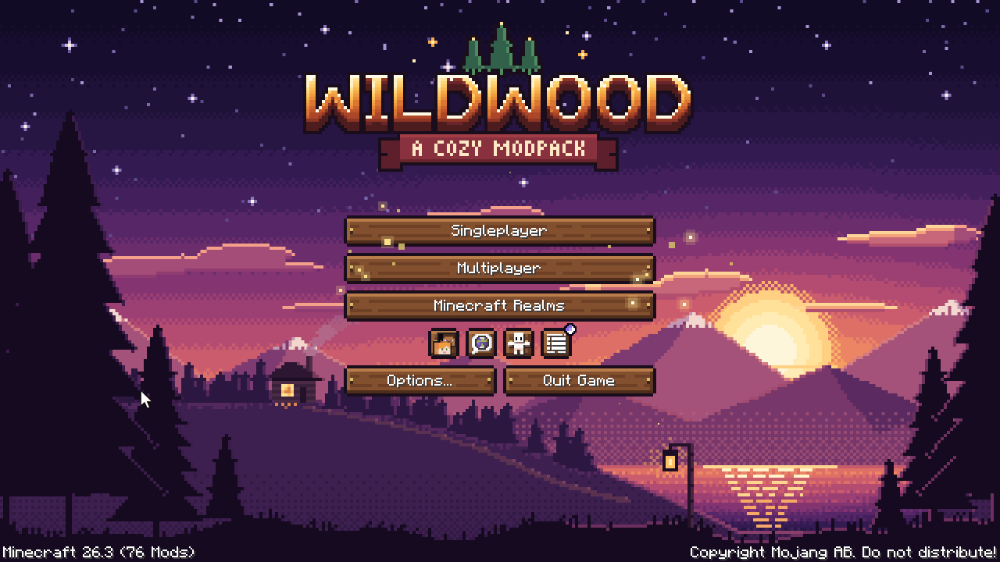

# Начало работы

FancyMenu позволяет менять любые меню Minecraft: например, титульный экран, меню паузы и меню других модов. Добавляйте собственные фоны, логотипы, кнопки, надписи, звуки и анимации, перемещайте или скрывайте существующие элементы, назначайте кнопкам новые действия или создавайте целые меню с нуля. И всё это — прямо в игре, без кода.

На этой странице вы шаг за шагом освоите основы. В процессе вы создадите упрощённую версию этого титульного экрана, а в разделе [Как создан пример](#how-the-example-is-made) узнаете, что добавлено в полную версию.

> [!TIP]
> Хотите установить этот титульный экран в свою игру? Скачайте [wildwood_title_screen.fmp](https://raw.githubusercontent.com/Keksuccino/docs_fancymenu/refs/heads/wiki-2026/assets/wildwood_title_screen.fmp?raw=true), затем [импортируйте](/profiles#importing) и [загрузите](/profiles#loading-a-profile) его в разделе **строка меню -> Настройка -> Профили**. Файл можно бесплатно использовать как угодно: чтобы попробовать FancyMenu, изучить его или добавить в свою сборку модов — с изменениями или без. Указывать автора не нужно.

# Строка меню

Строка меню в верхней части каждого меню — это доступ ко всем возможностям FancyMenu.

- **Настройка**: макеты текущего меню и всё, что относится ко всей конфигурации, например [глобальные настройки](/global-customizations), [пользовательские интерфейсы](/custom-guis), [переменные](/variables), [слушатели](/listeners), [планировщики](/schedulers), [профили](/profiles) и настройки FancyMenu.
- **Инструменты**: вспомогательные функции, например [экземпляры-заглушки экрана](/dummy-screen-instances), [создатель AFMA](/animations#fma-and-afma), **Просмотр ресурсов игры** и **Открыть папку FancyMenu**, которая открывает папку вашей конфигурации (см. [Расположение данных](/data-storage-locations)).
- **Справка**: эта документация, сервер Discord, **Сообщить об ошибке** и [Экспорт для ИИ](/export-for-ai).
- Значок двери справа закрывает текущее меню — пригодится в меню, из которых иначе нельзя выйти.
- Двойные стрелки в самом правом углу сворачивают строку меню до небольшой кнопки и разворачивают её обратно.

Игрокам вашей сборки модов строка меню не нужна. Инструкции по её отключению см. в разделе [Сборки модов](/modpacks#disabling-the-menu-bar-and-hotkeys).

## Сочетания клавиш строки меню

Они работают во всех меню, кроме редактора макетов, а также отключены в режиме сборки модов. В macOS используйте `Cmd + Option` вместо `Ctrl + Alt`.

| Сочетание клавиш | Действие |
|---|---|
| `Ctrl + Alt + C` | Показать или скрыть строку меню. Если она вдруг исчезла, это сочетание вернёт её. |
| `Ctrl + Alt + R` | Перезагрузить FancyMenu — то же действие, что и **строка меню -> Настройка -> Перезагрузить FancyMenu**. |
| `Ctrl + Alt + D` | Показать или скрыть **отладочную панель**, где отображается [идентификатор](/screen-identifiers) меню и другие сведения. |
| `Ctrl + Alt + L` | Открыть [редактор макетов](/layout-editor) с последним редактировавшимся макетом. |

# Ваш первый макет

Макет содержит изменения меню: фон, добавленные элементы, а также изменения существующих кнопок и надписей. У одного меню может быть несколько макетов, и каждый из них можно включать и отключать.

## Создание макета

1. Откройте меню, которое хотите изменить, например титульный экран.
2. Нажмите **строка меню -> Настройка -> Настройка текущего экрана**, чтобы появилось состояние **Включено**. FancyMenu изменяет только те меню, для которых эта настройка включена.
3. Нажмите **строка меню -> Настройка -> Макеты -> Создать -> Для текущего экрана**.

Откроется редактор макетов. В нём меню выглядит так же, как для игроков, поэтому все изменения видны сразу. Подробности о редакторе, в том числе о перемещении, изменении размера и копировании элементов, см. в разделе [Редактор макетов](/layout-editor).

Пункт **Для всех экранов [универсальный]** вместо этого создаёт [универсальный макет](/universal-layouts), который отображается во всех меню.

## Установка фона

Сначала поместите изображения в папку `config/fancymenu/assets` вашей игры. Пункт **строка меню -> Инструменты -> Открыть папку FancyMenu** откроет папку `config/fancymenu`.

1. Щёлкните правой кнопкой мыши по фону редактора и откройте **Фоны меню -> Изображение**.
2. Нажмите **Показывать фон**, чтобы появилось состояние **Включено**.
3. Нажмите **Выбрать изображение**, установите для параметра **Тип источника** значение **Локальный** и нажмите **Выбрать локальный файл ресурса**.
4. Выберите изображение и нажмите **ОК**. Двойной щелчок открывает папки.

В качестве фона также можно использовать панорамы, слайд-шоу, видео, цвета и многое другое. См. раздел [Фоны меню](/menu-backgrounds).

## Добавление логотипа

1. Щёлкните по логотипу Minecraft и нажмите `Delete`. То же самое сделайте с жёлтым текстом-заставкой.
2. В строке меню редактора нажмите **Элемент -> Создать -> Изображение**.
3. Щёлкните правой кнопкой мыши по новому элементу, нажмите **Источник изображения** и выберите логотип так же, как выбирали фон.

Стандартные элементы, которые вы удаляете, на самом деле лишь скрываются. Вернуть их можно через **Элемент -> Удалённые стандартные элементы**.

4. Щёлкните по нему правой кнопкой мыши и нажмите **Восстановить соотношение сторон**, чтобы логотип не был сжат. Нажмите `Esc`, чтобы закрыть меню.
5. Перетащите его на нужное место.

Можно добавить и многое другое: кнопки, надписи, видео и игроков. См. раздел [Элементы](/elements).

## Изменение кнопок

1. Щёлкните по первой кнопке, затем, удерживая `Ctrl` (`Cmd` в macOS), щёлкните по остальным, чтобы выбрать их все. Щелчок правой кнопкой мыши по одной из кнопок изменит их все одновременно.
2. Щёлкните правой кнопкой мыши по одной из них, нажмите **Текстуры кнопок -> Установить -> Обычный фон** и выберите текстуру так же, как выбирали фон.

3. Повторите то же самое для параметра **Фон при наведении** — текстуры, которая отображается, когда курсор находится над кнопкой.
4. Нажмите **Текстуры кнопок -> Пользовательский фон с разбиением на 9 частей**, чтобы появилось состояние **Включено**. Это сохраняет чёткие края текстуры на кнопках любой ширины. См. раздел [Разбиение на 9 частей](/nine-slicing-and-tiling).

В контекстном меню, открытом для нескольких элементов, есть только общие для них настройки, поэтому выделяйте только кнопки. Чтобы увидеть все настройки одной кнопки — например, её надпись, звуки, действие при нажатии ([скрипты действий](/action-scripts)) и условия отображения ([видимость элементов](/element-visibility)), — щёлкните по ней правой кнопкой мыши. См. раздел [Стандартные элементы и элементы модов](/vanilla-elements).

## Сохранение

1. Нажмите `Ctrl + S` (`Cmd + S` в macOS) или выберите **Макет -> Сохранить**.
2. При первом сохранении FancyMenu попросит указать имя файла. Оставьте предложенное имя или введите новое, затем нажмите **Сохранить**.
3. Закройте редактор кнопкой X справа в строке меню.

Макет сразу появится в меню. Чтобы позже изменить его, наведите курсор на макет в разделе **строка меню -> Настройка -> Макеты** и нажмите **Редактировать макет** либо нажмите `Ctrl + Alt + L`.

# Как создан пример

Титульный экран в начале страницы дополняет созданный вами экран несколькими деталями:

- Небо, холмы и деревья — это три изображения, которые двигаются вслед за мышью; деревья перемещаются сильнее всего. См. раздел [Эффект параллакса](/parallax).
- Холмы и деревья — это элементы-изображения размером с экран. Чтобы они оставались позади кнопок и надписей, в контекстном меню фона редактора включён параметр **Пользовательские элементы позади стандартных**.
- Светлячки добавлены с помощью [декоративного оверлея](/decoration-overlays#fireflies).
- Размер холмов, деревьев и логотипа зависит от размера экрана благодаря [расширенной настройке положения и размера](/advanced-positioning-sizing) с плейсхолдерами. Поэтому меню подходит для окон любого размера. На невысоких экранах логотип уменьшается и никогда не закрывает кнопки.

Чтобы посмотреть всё это в редакторе макетов, загрузите [пример профиля](#getting-started) и откройте его макет для редактирования.

# Что дальше

**Создайте красивый интерфейс**

- [Элементы](/elements): всё, что можно добавить в меню.
- [Расположение элементов](/positioning-elements): элементы остаются на месте при любом размере окна.
- [Фоны меню](/menu-backgrounds), [Анимации](/animations), [Видео](/video), [Декоративные оверлеи](/decoration-overlays) и [Фоновая музыка](/background-music).

**Добавьте интерактивность**

- [Скрипты действий](/action-scripts): действия кнопок и других элементов.
- [Видимость элементов](/element-visibility) и [Условия](/conditions): показывайте элементы только при определённых условиях.
- [Плейсхолдеры](/placeholders): динамическая информация в надписях, например имя игрока.
- [Переменные](/variables), [Слушатели](/listeners) и [Планировщики](/schedulers): сохраняйте данные, реагируйте на события игры и запускайте действия по таймеру.

**Создавайте новое**

- [Пользовательские интерфейсы](/custom-guis): целые меню с нуля.
- [Универсальные макеты](/universal-layouts): изменения для всех меню.
- [Глобальные настройки](/global-customizations): настройки всей игры, например заголовка окна.
- [Экран загрузки](/loading-screen) и [Вступление в игру](/game-intro).

**Поделитесь результатом**

- [Сборки модов](/modpacks): добавьте свою конфигурацию в сборку модов.
- [Профили](/profiles): переключайтесь между конфигурациями и экспортируйте их.

# Получение помощи

- Ответы на самые распространённые вопросы собраны в разделе [Часто задаваемые вопросы](/faq).
- Пункт **строка меню -> Справка -> Присоединиться к Discord** ведёт на сервер FancyMenu в Discord.
- [Экспорт для ИИ](/export-for-ai) преобразует вашу конфигурацию в текст для чатов с ИИ, например для бота поддержки на сервере Discord.
- Если что-то работает неправильно, выберите **строка меню -> Справка -> Сообщить об ошибке**.

# Для разработчиков

Информацию о создании дополнений для FancyMenu и его использовании в своих модах см. в [документации для разработчиков](https://github.com/Keksuccino/FancyMenu-Dev-Docs/wiki).
