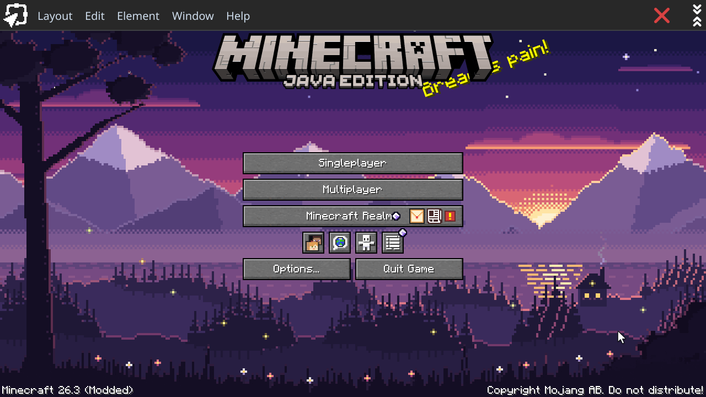

# Эффект параллакса

Эффект параллакса слегка сдвигает фон меню или элемент при движении мыши. Пусть дальние слои двигаются меньше, а ближние — больше, и меню обретёт глубину.

Эффект работает для [элементов](/elements), а также для **изображений** и **видео** в качестве [фона меню](/menu-backgrounds).

# Элементы

1. Щёлкните элемент правой кнопкой мыши в редакторе макета и прокрутите вниз до раздела **Эффект параллакса**.
2. Щёлкните **Эффект параллакса**, чтобы установить значение **Включено**.
3. Щёлкните **Интенсивность параллакса (X)** и **Интенсивность параллакса (Y)**, чтобы задать величину смещения.
4. Сохраните макет и закройте редактор. Элементы двигаются только за пределами редактора.

Чтобы применить эффект сразу к нескольким элементам, сначала [выберите](/layout-editor#selecting) их (`Ctrl` + щелчок добавляет элемент к выделению), а затем щёлкните правой кнопкой мыши по одному из них.

| Параметр | Описание |
|---|---|
| **Эффект параллакса** | Включает эффект. |
| **Интенсивность параллакса (X)** | Величина смещения элемента влево и вправо: от `0.0` (без смещения) до `1.0`. Для новых элементов задано значение `0.5`. |
| **Интенсивность параллакса (Y)** | То же самое для смещения вверх и вниз. |
| **Инвертировать направление параллакса** | Элемент двигается в том же направлении, что и мышь. Если параметр выключен, элемент двигается в противоположную сторону. |

При значении `1.0`, если мышь находится у края экрана, элемент смещается в сторону на расстояние до 5% ширины экрана и вверх или вниз — на расстояние до 5% его высоты. В центре экрана элементы остаются на заданных местах.

- Элементы, [привязанные](/positioning-elements) к элементу с эффектом, двигаются вместе с ним; их собственный эффект добавляется к смещению.
- Параметр **Оставаться на экране** не удерживает элементы с эффектом на экране, поэтому они могут смещаться за его края.
- Растянутые элементы не двигаются в направлении растяжения.
- [Стандартные кнопки и ползунки](/vanilla-elements) начинают двигаться только после того, как вы их переместите. При точке привязки **Стандартное (исходное)** они остаются там, где их разместила игра.
- Кнопки можно нажимать в том месте, где они отображаются.
- Для [прокручиваемых областей](/scrollable-areas), находящихся в них элементов и элементов подсказок эффект параллакса недоступен.

# Фон меню

1. Щёлкните правой кнопкой мыши по фону редактора и откройте **Фон меню -> Изображение** (или **Видео**).
2. Щёлкните **Эффект параллакса**, чтобы установить значение **Включено**.
3. Задайте значения параметров **Задать интенсивность эффекта параллакса (X)** и **Задать интенсивность эффекта параллакса (Y)**.

Фоны реагируют на эффект гораздо сильнее, чем элементы. Фон увеличивается в соответствии с интенсивностью, поэтому его края не видны: при значении `1.0` он становится вдвое больше экрана и может смещаться в сторону на расстояние до половины ширины экрана. Используйте небольшие значения: для новых фонов задано `0.02`, а хорошо подходят значения от `0.01` до `0.1`.

- Параметр **Инвертировать направление параллакса** заставляет фон двигаться в том же направлении, что и мышь.
- Параметры **Сдвигать широкие изображения слева направо** и **Эффект параллакса** нельзя включить одновременно.
- Параметры **Повторять текстуру** и **Сохранять соотношение сторон фона** можно использовать вместе с эффектом.
- Фоны двигаются и в редакторе макета.

# Создание сцены с глубиной

Сцена в начале этой страницы состоит из неба и трёх слоёв на экране заголовка:

1. Нарисуйте сцену отдельными слоями, от дальних к ближним: например, небо, горы, холмы и передний план. Все слои, кроме неба, должны быть изображениями PNG с прозрачными областями.
2. Установите небо в качестве фона меню **Изображение** и включите для него эффект параллакса.
3. Добавьте остальные слои как [элементы «Изображение»](/elements#image), от дальних к ближним, чтобы самый ближний слой оказался сверху.
4. Сделайте слои немного больше экрана, чтобы их края не показывались при движении. Для слоя со значением `1.0` нужно добавить по 5% ширины экрана слева и справа и по 5% высоты сверху и снизу. Выключите параметр **Оставаться на экране**, чтобы размещать слои за пределами экрана.
5. Включите эффект параллакса для каждого слоя: для дальних слоёв задайте низкую интенсивность, а для ближних — высокую.
6. Щёлкните правой кнопкой мыши по фону редактора и установите для параметра **Пользовательские элементы позади стандартных** значение **Включено**, чтобы слои оставались позади кнопок и логотипа.

Вот значения интенсивности для этой сцены:

| Слой | Интенсивность (X) | Интенсивность (Y) |
|---|---|---|
| Небо (фон меню) | `0.02` | `0.01` |
| Горы | `0.35` | `0.2` |
| Холмы | `0.6` | `0.3` |
| Передний план | `1.0` | `0.5` |

> [!TIP]
> Задайте интенсивность по оси Y примерно вдвое ниже, чем по оси X. Тогда земля в пейзаже будет не так сильно двигаться вверх и вниз.

# Полезно знать

- Всё перемещается с шагом в один пиксель интерфейса, поэтому при низкой интенсивности движение будет ступенчатым.
- В параметрах интенсивности можно использовать [подстановки](/placeholders): наведите указатель на подстановку и нажмите **Установить как обычный текст** в небольшом меню рядом с ней. С помощью [переменной](/variables) можно позволить игрокам уменьшать интенсивность эффекта в собственном меню настроек.
