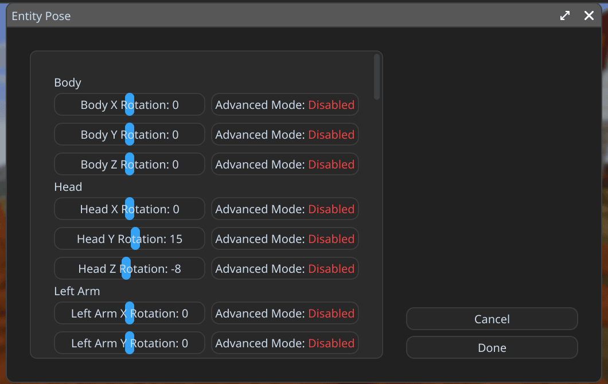

# Сущности игроков

Элемент «Сущность игрока» отображает игрока в 3D — как персонажа самого игрока рядом с кнопками главного меню. Он может копировать персонажа того, кто играет, показывать любого другого игрока или быть вашим собственным персонажем с уникальными скином, плащом и именем.

> [!IMPORTANT]
> В Minecraft 1.20.1 и новее для сущностей игроков требуется мод Fancy Entity Renderer ([CurseForge](https://www.curseforge.com/minecraft/mc-mods/fancy-entity-renderer), [Modrinth](https://modrinth.com/mod/fancy-entity-renderer)). Без него вместо них отображается красный квадрат. Если для вашей версии Minecraft ещё нет сборки этого мода, сущности игроков в ней отображаться не будут.

# Добавление сущности игрока

Щёлкните правой кнопкой мыши по фону редактора и выберите **Новый элемент -> Сущность игрока**. Перетаскивайте маркеры, чтобы изменить размер. Размер игрока зависит от высоты элемента.

Все перечисленные ниже настройки находятся в контекстном меню элемента, которое открывается щелчком правой кнопкой мыши.

# Кого показывать

- **Копировать игрока клиента** показывает персонажа самого игрока — с его именем, скином и плащом. Пока эта настройка включена, параметры имени, скина и плаща заблокированы.
- **Имя игрока** может быть любым и не обязано принадлежать реальному игроку. Поддерживаются [плейсхолдеры](/placeholders).
- **Показывать имя игрока** отображает над головой табличку с именем. Если отключить **Поворот таблички с именем**, она не будет поворачиваться вместе с игроком.

## Скин и плащ

- **Автоматический скин** и **Автоматический плащ** загружают скин и плащ игрока, указанного в поле **Имя игрока**. Для этого требуется подключение к интернету.
- **Текстура скина** и **Текстура плаща** используют ваши собственные файлы скина и плаща, например файл скина из раздела [ресурсов](/resources). Скин должен быть в стандартном формате Minecraft.
- **Узкий скин** предназначен для скинов с тонкими руками, например скина Алекс. **Автоматический скин** и **Копировать игрока клиента** определяют это самостоятельно.

# Поза и движение

- **Голова следит за мышью** и **Тело следит за мышью** заставляют игрока смотреть на указатель мыши. Для новых сущностей игроков обе настройки включены.
- **Поза** задаёт положение тела: **Стоя**, **Присев**, **Лёжа**, **Плывёт**, **Умирает** или **Атака с вращением**.
- **Движение тела** анимирует позу.

## Поза сущности

Пункт **Поза сущности** открывает окно, где можно задать поворот по осям X, Y и Z для **Головы**, **Тела**, **Левой руки**, **Правой руки**, **Левой ноги** и **Правой ноги** в диапазоне от `-180` до `180`.

Переключатель **Расширенный режим** рядом с ползунком заменяет его текстовым полем с поддержкой [плейсхолдеров](/placeholders). Если в поле указать [переменную](/variables), например `$$arm_angle`, с помощью [планировщика](/schedulers) можно анимировать игрока, изменяя значение переменной.

# Броня, предметы и другое

- **Броня и инструменты** надевает на игрока предметы: **Броня на голову**, **Броня на тело**, **Броня на ноги**, **Броня на ступни**, **Предмет в левой руке** и **Предмет в правой руке**. Введите идентификатор предмета, например `minecraft:diamond_sword`. Идентификаторы предметов поддерживают плейсхолдеры. Настройки **Зачаровать броню на голову** и другие переключатели зачарования добавляют эффект зачарования.
- **Малыш** уменьшает игрока, превращая его в малыша.
- **Попугай** помещает попугая на правое плечо. Чтобы разместить его на левом плече, включите **Попугай на левом плече**.

# Полезно знать

- Сущности игроков нельзя поворачивать, наклонять, делать полупрозрачными или скрывать с помощью прозрачности.
- Если вам нужна только голова игрока, см. раздел [Головы игроков](/player-heads).
- В Minecraft 1.19.2 для сущностей игроков не нужен Fancy Entity Renderer, но доступно меньше настроек: вместо **Поза** есть **Присел**, а настройки **Поворот таблички с именем**, **Движение тела** и **Броня и инструменты** отсутствуют. Размер задаётся параметром **Масштаб сущности** (по умолчанию `30`, поэтому значение `60` увеличивает размер вдвое), а не размером элемента.
