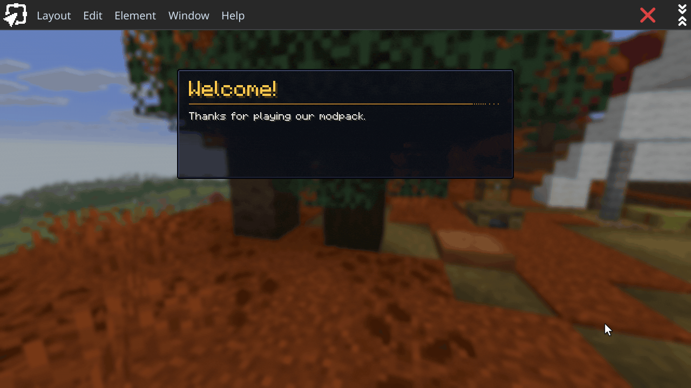

# Текст в меню

В FancyMenu есть два элемента для отображения текста:

- **Текст** показывает текст прямо в меню: от одной строки до длинных прокручиваемых страниц, например списка изменений, правил или новостей.
- **Подсказка** показывает текстовое окно в заданном месте или рядом с курсором, например когда кнопка находится под курсором.

Оба элемента поддерживают [Markdown](/text-formatting) и [подстановки](/placeholders), а также имеют общие настройки внешнего вида и стиля.

> [!TIP]
> Эта страница посвящена элементам и их настройкам. О том, что можно написать в тексте — например, о заголовках, списках, ссылках и цветах — см. в разделе [Форматирование текста](/text-formatting).

# Добавление текста

1. Откройте макет в редакторе макетов.
2. Щёлкните правой кнопкой мыши по фону редактора и выберите **Новый элемент -> Текст**.
3. Щёлкните правой кнопкой мыши по новому элементу и выберите **Содержимое текста**.
4. Введите текст и нажмите **Готово**.

# Содержимое текста

## Режим источника

Щёлкните правой кнопкой мыши по элементу и задайте **Режим источника**:

- **Прямой**: введите текст самостоятельно в текстовом редакторе.
- **Ресурс**: текст загружается из текстового файла. Нажмите **Источник текста**, чтобы выбрать локальный файл из `<game-directory>/config/fancymenu/assets/`, веб-URL или файл из набора ресурсов. См. раздел [Ресурсы](/resources).

Веб-источники отлично подходят, например, для списка изменений или новостей, которые всегда актуальны и не требуют обновления сборки модов.

FancyMenu хранит текст из файлов и веб-источников до закрытия игры. Чтобы загрузить его снова, перезагрузите FancyMenu: **панель меню -> Настройка -> Перезагрузить FancyMenu**.

## Динамический текст

Текст может отображать актуальные значения с помощью [подстановок](/placeholders), например `Добро пожаловать, {"placeholder":"playername"}!`. Также можно выводить значения [переменных](/variables). Текст обновляется автоматически при изменении этих значений.

## Текстовый редактор

Нажмите **Содержимое текста**, чтобы открыть текстовый редактор. Нажмите **Подстановки** в правом верхнем углу, чтобы просмотреть все подстановки и добавить их в текст.

### Сочетания клавиш для форматирования

В текстовом редакторе элементов «Текст» и «Подсказка» есть сочетания клавиш для часто используемых вариантов форматирования. В macOS используйте `Cmd` вместо `Ctrl`.

| Сочетание клавиш | Действие |
|---|---|
| `Ctrl + B` | Полужирный |
| `Ctrl + I` | Курсив |
| `Ctrl + U` | Подчёркивание |
| `Ctrl + L` | Выровнять по левому краю |
| `Ctrl + E` | Выровнять по центру |
| `Ctrl + R` | Выровнять по правому краю |

- Сначала выделите текст, который хотите отформатировать. Нажмите то же сочетание ещё раз, чтобы убрать форматирование.
- Если текст не выделен, сочетание добавит символы форматирования и поместит курсор между ними — можно сразу продолжать ввод.
- Сочетания для выравнивания действуют на выделенные строки или на строку с курсором. Если нажать `Ctrl + E` или `Ctrl + R` на строках с таким же выравниванием, они снова выровняются по левому краю.
- Щёлкните правой кнопкой мыши в редакторе и откройте меню **Форматирование**, чтобы увидеть все эти параметры.

### Другие сочетания клавиш

Этот же текстовый редактор используется для большинства текстов в FancyMenu, например значений действий и многих настроек элементов. Эти сочетания работают во всех таких полях. В macOS используйте `Cmd` вместо `Ctrl`.

| Сочетание клавиш | Действие |
|---|---|
| `Ctrl + C` | Копировать выделенный текст |
| `Ctrl + X` | Вырезать выделенный текст |
| `Ctrl + V` | Вставить |
| `Ctrl + A` | Выделить весь текст |
| `Ctrl + Z` | Отменить действие |
| `Ctrl + Y` | Повторить действие |
| `Ctrl + D` | Дублировать строку с курсором |
| `Alt + Arrow Up` / `Alt + Arrow Down` | Переместить строку с курсором вверх или вниз |
| `Shift + Arrow keys` | Выделить текст |
| `Ctrl + Home` / `Ctrl + End` | Перейти в начало или конец текста |
| `Ctrl + G` | Перейти к строке: введите её номер и нажмите `Enter` |
| `Ctrl + S` | То же, что и **Готово** |

Сочетания клавиш редактора макетов см. в разделе [Редактор макетов](/layout-editor#shortcuts).

# Внешний вид и стили

Щёлкните правой кнопкой мыши по элементу и откройте **Markdown**, чтобы изменить внешний вид текста.

## Варианты оформления

**Оформление** сразу задаёт все параметры стиля текста:

- **Пиксельное**: пиксельная графика в стиле шрифта Minecraft, тёплые цвета, золотистые детали и маркеры, нарисованные от руки.
- **Классическое**: классический стиль FancyMenu — белый текст, серые поля и линии.
- **Нейтральное**: лаконичный стиль в цветах текущей темы интерфейса FancyMenu. Цвета сохраняются вместе с элементом, поэтому не меняются при переключении темы.

Для новых элементов используется пиксельное оформление. Элементы из старых макетов сохраняют привычное классическое оформление.

> [!NOTE]
> Выбор оформления заменяет внесённые вами изменения стиля. Передумали? Просто отмените действие с помощью `Ctrl + Z`.

## Параметры стиля

Выбрав оформление, вы по-прежнему можете отдельно настроить каждую его часть. В меню **Markdown** есть параметры для **Текста**, **Заголовков**, **Списков**, **Ссылок**, **Кода**, **Цитат**, **Выделенных блоков**, **Таблиц**, **Изображений** и **Разделителей**. Наведите курсор на параметр, чтобы узнать, что он делает.

В разделе **Markdown -> Текст** находятся основные настройки: цвет текста, тень, межстрочный интервал и отступ между текстом и краями элемента.

## Отключение Markdown

Если Markdown вам не нужен, отключите **Markdown -> Обработчик Markdown**. Текст будет отображаться точно так, как вы его ввели. Это также немного ускоряет отображение очень длинных текстов.

## Другие настройки текста

Щёлкните правой кнопкой мыши по элементу, чтобы найти и эти параметры:

- **Масштаб текста** увеличивает или уменьшает текст.
- **Регистр** отображает текст как обычно, полностью заглавными или полностью строчными буквами.
- **Автоматический перенос строк** переносит строки, которые не помещаются в элемент. Если отключить этот параметр, длинные строки будут продолжаться за его пределами.
- **Удалять HTML-разрывы строк** убирает из текста HTML-разрывы строк (` `). Это удобно для текста с веб-сайтов.

# Фон

Элементы «Текст» могут отображать за текстом панель. Откройте **Фон** в контекстном меню элемента:

- **Показывать фон** включает или отключает панель. У новых элементов «Текст» этот параметр включён.
- По умолчанию используется встроенная тёмная панель. Вместо неё можно использовать собственную текстуру с [разбиением на девять частей](/nine-slicing-and-tiling) и замощением, чтобы сохранить форму краёв.
- **Отступы** задаёт, насколько фон выходит за пределы текста.
- **Фон под полосами прокрутки** позволяет фону заходить и под полосы прокрутки. Если отключить этот параметр, полосы будут находиться рядом с фоном.

Для подсказок есть отдельное меню **Фон**, где можно задать текстуру и её разбиение на девять частей.

# Прокрутка

Если текст не помещается в элемент «Текст», его можно прокручивать. Для прокрутки используйте колёсико мыши. Удерживайте `Shift`, чтобы прокручивать по горизонтали.

Параметр **Направление прокрутки** задаёт, будет ли текст прокручиваться **По вертикали**, **По горизонтали** или **В обоих направлениях**. В направлениях, для которых прокрутка отключена, всё, что не помещается, будет обрезано.

## Настройки прокрутки

Откройте **Прокрутка** в контекстном меню элемента:

| Настройка | Действие |
|---|---|
| **Разрешить игрокам прокрутку** | Определяет, могут ли игроки прокручивать текст самостоятельно. Если параметр отключён, текст прокручивается только автоматически и с помощью действий. |
| **Скорость прокрутки** | Задаёт расстояние прокрутки за один шаг колёсика мыши. |
| **Плавная прокрутка** | Обеспечивает плавное перемещение текста вместо скачков. |
| **Прокрутка перетаскиванием** | Позволяет игрокам захватить текст мышью и перетаскивать его, как на сенсорном экране. |
| **Прокрутка с клавиатуры** | Когда курсор находится над текстом, клавиши `Page Up` и `Page Down` прокручивают его на страницу, а `Home` и `End` перемещают в начало и конец. |
| **Привязка** | Определяет, где останавливается текст: в любом месте (**Выкл.**), в начале целой строки (**К строкам**), в начале заголовка (**К заголовкам**) или с шагом в целую страницу (**К страницам**). |
| **Начальная позиция** | Определяет, начинается ли прокрутка с **Начала** или **Конца** текста. Конец удобно использовать, например, для журналов, в которых новые записи находятся внизу. |
| **Сбрасывать при открытии экрана** | Возвращает текст в начало при каждом открытии экрана. Если отключить этот параметр, позиция прокрутки сохраняется до закрытия игры. |

## Автоматическая прокрутка

Откройте **Автоматическая прокрутка**, чтобы текст медленно прокручивался сам, как титры или новостная бегущая строка:

- **Прокручивать автоматически** включает этот режим.
- **Скорость [пикселей в секунду]** задаёт скорость прокрутки.
- **Начинать сначала в конце** возвращает текст в начало по достижении конца.
- **Приостанавливать при наведении** останавливает прокрутку, когда курсор находится над текстом, чтобы игроки могли спокойно его прочитать.

## Полосы прокрутки

Откройте **Полосы прокрутки**, чтобы настроить их:

- **Показывать** задаёт, когда отображаются полосы: **Всегда**, только **Во время прокрутки** или **Никогда**. При выборе **Никогда** прокрутка колёсиком всё равно работает.
- **Толщина** задаёт толщину полос.
- **Вертикальная полоса слева** и **Горизонтальная полоса сверху** перемещают полосы на противоположную сторону.
- **Стиль бегунка полосы прокрутки** задаёт его внешний вид: **Полоса в стиле темы** (в цветах текущей темы интерфейса FancyMenu) или **Пиксельный бегунок** (пиксельная графика, отлично сочетающаяся с пиксельным оформлением).
- **Текстуры бегунка полосы прокрутки** и **Цвет бегунка полосы прокрутки [HEX]** позволяют заменить бегунки собственными текстурами или цветами.
- **Фон полос прокрутки** добавляет текстуры за бегунками вдоль пути их перемещения.

## Управление прокруткой с помощью действий

Управлять прокруткой и отслеживать её можно и в других частях FancyMenu:

- Действие **Прокрутить элемент** [действие](/action-scripts) прокручивает элемент «Текст» к началу, концу, заданной позиции, номеру строки или первой строке, содержащей указанный текст.
- [Подстановки](/placeholders) **Позиция прокрутки элемента**, **Процент прокрутки элемента** и **Размер содержимого элемента** сообщают, насколько прокручен текст и каков его размер.
- [Условие](/conditions) **Элемент прокручен до конца** проверяет, дошёл ли текст до конца. Например, это позволяет включить кнопку «Принять» только после прочтения правил.
- [Обработчики](/listeners) **При прокрутке элемента**, **При прокрутке элемента к началу** и **При прокрутке элемента до конца** запускают действия во время прокрутки текста.

Для всех этих функций нужен [идентификатор элемента](/element-identifiers) элемента «Текст».

# Передача щелчков сквозь текстовые элементы

Элементы «Текст» реагируют на мышь, чтобы работали ссылки и полосы прокрутки. Это также означает, что они перехватывают щелчки: кнопки позади элемента «Текст» или перед ним могут их не получить.

Если это мешает, щёлкните правой кнопкой мыши по элементу «Текст» и отключите **Интерактивность**. После этого текст нельзя будет прокручивать, а ссылки в нём — нажимать.

# Подсказки

Элементы «Подсказка» работают так же, как элементы «Текст», но без прокрутки:

- Для них доступны те же настройки текста, оформления и стиля, что и для элементов «Текст».
- Параметр **Следовать за курсором** заставляет подсказку перемещаться вслед за мышью.
- Используйте [условия](/conditions), чтобы задать, когда показывать подсказку. Например, условие [**Наведение на элемент**](/conditions#is-element-hovered) позволяет показывать её, когда курсор находится над кнопкой.
