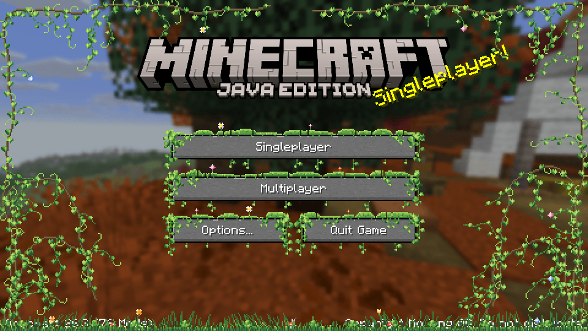
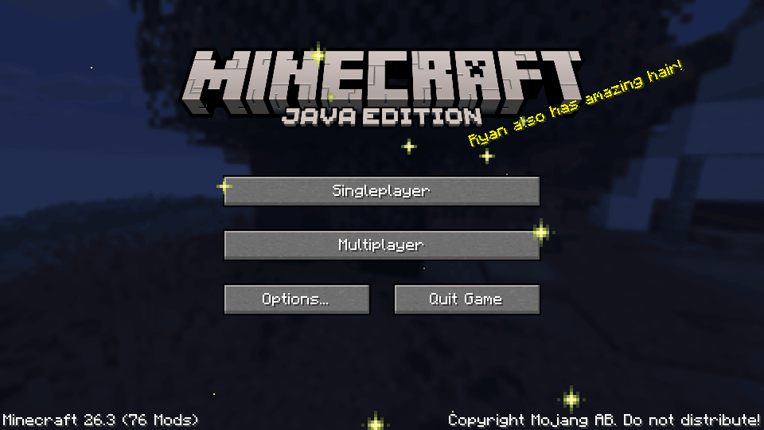
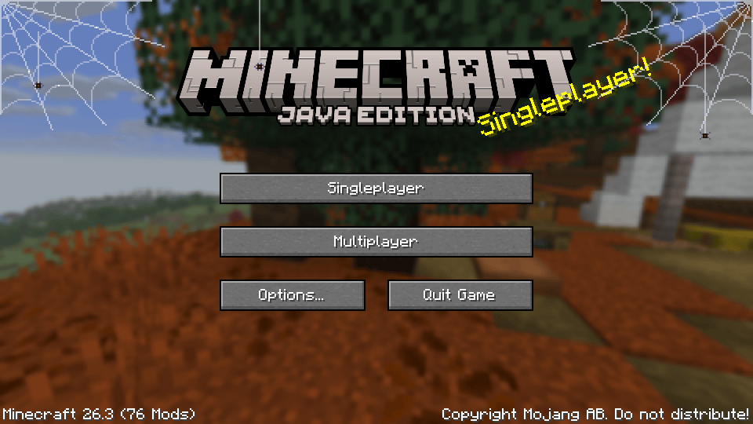

# เอฟเฟกต์ตกแต่ง

เอฟเฟกต์ตกแต่งคือเอฟเฟกต์เคลื่อนไหวที่แสดงทั่วทั้งหน้าจอ เช่น หิมะที่โปรยปราย หิ่งห้อย หมอก หรือไฟประดับ เอฟเฟกต์หลายอย่างโต้ตอบกับเมนูของคุณได้ เช่น หิมะกองพะเนินบนปุ่ม นกมาเกาะปุ่ม และหมอกแหวกออกเมื่อเมาส์เคลื่อนผ่าน


# การเพิ่มเอฟเฟกต์

1. เปิดเลย์เอาต์ในตัวแก้ไขเลย์เอาต์
2. คลิกขวาที่พื้นหลังของตัวแก้ไข แล้วเปิด **Decoration Overlays**
3. เปิดเอฟเฟกต์ เช่น **Snowfall**
4. คลิก **Show Overlay** เพื่อเปิดใช้งาน

เอฟเฟกต์ที่เปิดใช้งานจะมีเครื่องหมาย ✔ แสดงอยู่ในรายการ คุณสามารถแสดงเอฟเฟกต์ได้มากเท่าที่ต้องการในหนึ่งเลย์เอาต์ วางเมาส์เหนือเอฟเฟกต์หรือการตั้งค่าเพื่อดูรายละเอียด

เอฟเฟกต์จะแสดงในตัวแก้ไขเลย์เอาต์ด้วย แต่จะโต้ตอบกับองค์ประกอบต่าง ๆ ของคุณเฉพาะในเมนูจริงเท่านั้น บันทึกเลย์เอาต์แล้วเปิดเมนูเพื่อดูเอฟเฟกต์ทั้งหมด

หากมีเลย์เอาต์หลายรายการของหน้าจอเดียวกันที่เปิดใช้เอฟเฟกต์ไว้ เอฟเฟกต์ทั้งหมดจะแสดงพร้อมกัน แม้จะเป็นเอฟเฟกต์เดียวกันซ้ำสองครั้งก็ตาม รวมถึง [เลย์เอาต์สากล](/universal-layouts) ด้วย

# การตั้งค่าที่มีในทุกเอฟเฟกต์

เอฟเฟกต์ทุกแบบมีการตั้งค่าสองรายการนี้:

- **Show Overlay** ใช้เปิดหรือปิดเอฟเฟกต์
- **Layers** กำหนดตำแหน่งที่เอฟเฟกต์จะแสดง:
  - **Background & Foreground**: ส่วนที่อยู่ไกลจะแสดงอยู่หลังองค์ประกอบ ส่วนที่อยู่ใกล้จะแสดงอยู่ด้านหน้า เพื่อสร้างมิติความลึก ซึ่งเป็นค่าเริ่มต้น
  - **Only Background**: ทุกส่วนจะแสดงอยู่หลังองค์ประกอบ แต่ยังอยู่ด้านหน้าแบ็กกราวด์ของเมนู
  - **Only Foreground**: ทุกส่วนจะแสดงอยู่ด้านหน้าองค์ประกอบ

สิ่งที่เอฟเฟกต์วางลงบนองค์ประกอบโดยตรง เช่น หิมะบนปุ่ม จะยังคงอยู่บนองค์ประกอบนั้นเสมอ

เอฟเฟกต์หลายแบบยังมีการตั้งค่าเหล่านี้ด้วย:

| การตั้งค่า | รายละเอียด |
|---|---|
| **Amount (%)** | กำหนดปริมาณ ตั้งแต่ 25% ถึง 300% โดย 100% คือปริมาณปกติ |
| **Size** | ขยายพิกเซลอาร์ตให้ใหญ่ขึ้น 2 เท่าหรือ 3 เท่า โดยแต่ละพิกเซลยังคงเป็นสี่เหลี่ยมคมชัด |
| **Look** | **Detailed** แสดงพิกเซลอาร์ตเต็มรูปแบบ พร้อมแสงเงาและเอฟเฟกต์เพิ่มเติม ส่วน **Simple** มีรายละเอียดเรียบง่ายกว่าและใกล้เคียงรูปลักษณ์แบบคลาสสิกมากกว่า |

# เอฟเฟกต์และองค์ประกอบของคุณ

เอฟเฟกต์หลายแบบโต้ตอบกับองค์ประกอบของคุณได้ เช่น หิมะ เถ้า และกระดาษสีจะกองอยู่บนองค์ประกอบ หยาดน้ำแข็งห้อยลงมา ตะไคร่น้ำเติบโต และนกมาเกาะ

หากต้องการเลือกว่าจะให้องค์ประกอบใดได้รับผล ให้คลิกขวาที่องค์ประกอบ แล้วตั้งค่า **Should Be Affected By Decoration Overlays**:

- ตัวเลือกนี้เปิดไว้โดยค่าเริ่มต้นสำหรับปุ่ม แถบเลื่อน ช่องทำเครื่องหมาย ช่องกรอกข้อมูล และ[องค์ประกอบวานิลลา](/vanilla-elements)
- รวมถึงโลโก้ ข้อความ Splash ข้อมูลแบรนด์ และลิขสิทธิ์บนหน้าจอไตเติลด้วย หากไม่ต้องการให้มีอะไรมาเกาะหรือวางอยู่บนองค์ประกอบเหล่านี้ ให้ปิดตัวเลือกนี้
- องค์ประกอบที่ซ่อนอยู่จะไม่ได้รับผล และส่วนขององค์ประกอบที่ถูกตัดออกโดย [พื้นที่เลื่อนได้](/scrollable-areas) ก็จะไม่ได้รับผลเช่นกัน

> [!TIP]
> เว้นระยะระหว่างองค์ประกอบอย่างน้อย 13 พิกเซล สิ่งที่กองอยู่บนองค์ประกอบหรือห้อยอยู่ด้านล่างจะมีขนาดได้ไม่เกินพื้นที่ว่างจนถึงองค์ประกอบถัดไป

เอฟเฟกต์บางแบบตอบสนองต่อการคลิก เช่น Bubbles, Frost และ Confetti แต่ปุ่มของคุณยังคงรับการคลิกทั้งหมดได้ตามปกติ

# เอฟเฟกต์ตกแต่งทั้งหมด

เอฟเฟกต์ตกแต่งทั้งหมดที่มีใน FancyMenu จัดเรียงตามธีม

## สภาพอากาศ

### Snowfall

หิมะโปรยปรายและค่อย ๆ กองอยู่บนปุ่ม รวมถึงตามขอบล่างของหน้าจอ


- **Accumulate Snow** ทำให้หิมะกองสะสม
- **Snow Color [HEX]**, **Snowfall Speed**, **Amount (%)** และ **Size** ใช้ปรับแต่งหิมะ

### Rainfall

ฝนตก เกิดระลอกคลื่นบนแอ่งน้ำตื้น ๆ และมีน้ำหยดจากปุ่ม


- **Puddles** เคลือบองค์ประกอบและขอบล่างของหน้าจอด้วยฟิล์มน้ำ โดยเกิดระลอกคลื่นเมื่อหยดน้ำตกกระทบ
- **Drips** ทำให้หยดน้ำเกาะและตกลงมาจากองค์ประกอบ
- **Thunder Flashes** เพิ่มฟ้าแลบเป็นครั้งคราว พร้อมสายฟ้าที่แตกแขนงและแสงวาบนุ่มนวล ส่วน **Thunder Flash Brightness** ใช้กำหนดความสว่าง
- **Rain Color [HEX]**, **Amount (%)** และ **Size** ใช้ปรับแต่งฝน

> [!WARNING]
> **Thunder Flashes** ทำให้หน้าจอเกิดแสงวาบ หากผู้เล่นอาจไวต่อแสงกะพริบ ให้ปิดตัวเลือกนี้ไว้

### Fog

ชั้นหมอกบาง ๆ ลอยผ่านหน้าจอและองค์ประกอบ โดยจะหนาทึบที่สุดบริเวณใกล้พื้น


- **Clear Around Pointer** ทำให้หมอกแหวกออกบริเวณเมาส์

### Frost

น้ำแข็งปกคลุมเมนูของคุณ ลามไปตามขอบ เข้ามาตามมุม และเกาะบนองค์ประกอบ คลิกน้ำแข็งเพื่อทำให้แตกออกเป็นชิ้น


- **Screen Edges**, **Corners** และ **On Elements** ใช้เปิดหรือปิดน้ำแข็งแต่ละส่วน โดยข้อความบนองค์ประกอบจะยังคงมองเห็นชัดเจน

## ธรรมชาติ

### Leaves

ใบไม้ร่วงหล่นและถูกลมกระโชกพัดให้ปลิวไปมา


- **Look** ใช้สลับระหว่างใบไม้แบบ **Detailed** และ **Simple**
- **Colors** ใช้เลือก **Autumn Mix** (สีฤดูใบไม้ร่วงโทนอุ่นห้าสี) หรือ **Custom Range** (เลือกสีห้าสีในช่วงระหว่าง **Leaf Color Start [HEX]** และ **Leaf Color End [HEX]**)
- **Wind Blows** ใช้เปิดหรือปิดลมกระโชกแรง ส่วน **Wind Intensity** ใช้กำหนดความแรงของลม
- **Leaf Density**, **Leaf Fall Speed** และ **Leaf Overlay Scale** ใช้ปรับแต่งใบไม้

### Cherry Blossoms

กิ่งซากุระที่กำลังผลิบานยื่นเข้ามาจากมุมบน พร้อมกลีบดอกที่ลอยลงมา


- **Left Branch** และ **Right Branch** ใช้แสดงหรือซ่อนกิ่งไม้แต่ละข้าง
- **Look** และ **Amount (%)** ใช้ปรับแต่งกลีบดอก

### Overgrowth

ธรรมชาติเข้าปกคลุมเมนูของคุณ ทั้งมอส เถาวัลย์ หญ้า และดอกไม้ที่ค่อย ๆ เติบโตไปทั่ว



- **Grass**, **Left Vines**, **Right Vines** และ **On Elements** ใช้เปิดหรือปิดพืชแต่ละชนิด โดยข้อความบนองค์ประกอบจะยังคงมองเห็นชัดเจน
- **Flowers on Vines**, **Flowers on Elements** และ **Flowers in Grass** ใช้ให้ดอกไม้ผลิบานตามตำแหน่งเหล่านั้น ส่วน **Flowers (%)** ใช้กำหนดจำนวนดอกไม้

### Clouds

เมฆพิกเซลปุย ๆ ลอยผ่านท้องฟ้าด้านหลังองค์ประกอบ โดยมีความลึกสามชั้น เอฟเฟกต์ Clouds ไม่มีการตั้งค่าเฉพาะ


### Sunbeams

ลำแสงอาทิตย์แผ่ออกมาจากดวงอาทิตย์ที่อยู่นอกจอ พร้อมฝุ่นที่ลอยระยิบระยับในแสง


- **Sun Side** กำหนดขอบหน้าจอที่ดวงอาทิตย์อยู่ด้านหลัง ส่วน **Sun Angle (°)** ใช้เลื่อนตำแหน่งดวงอาทิตย์ไปตามขอบนั้น
- **Sunlight Color [HEX]** และ **Intensity (%)** ใช้ปรับแต่งแสง
- **Sun Glow** เพิ่มแสงเรืองนุ่มนวลจากดวงอาทิตย์
- **Dust** ทำให้ฝุ่นลอยผ่านลำแสง เมาส์ของคุณจะพัดฝุ่นให้ฟุ้งขึ้น
- **Hit Elements** ทำให้ลำแสงหยุดที่องค์ประกอบ ส่องขอบให้สว่าง และทอดเงา หากปิดตัวเลือกนี้ ลำแสงจะส่องอยู่ด้านหน้าองค์ประกอบ

### Bubbles

ฟองอากาศลอยขึ้นเป็นสายอย่างโอนเอนไปมา และเลื่อนไปตามด้านล่างขององค์ประกอบ คลิกเพื่อทำให้ฟองแตก! เอฟเฟกต์ Bubbles ไม่มีการตั้งค่าเฉพาะ


## สัตว์

### Birds

นกตัวเล็ก ๆ บินเข้ามา กระโดดไปมาบนองค์ประกอบ และบินหนีเมื่อเมาส์เข้าใกล้เกินไป


### Butterflies

ผีเสื้อหลากสีบินกระพือปีกไปมา พักบนองค์ประกอบ และบินหนีเมื่อเห็นเมาส์


### Bats

ค้างคาวบินกระพือปีกข้ามหน้าจอเป็นกลุ่มเล็ก ๆ และห้อยหลับอยู่ใต้บริเวณองค์ประกอบ เข้าใกล้มากเกินไปแล้วพวกมันจะตื่น!


Birds, Butterflies และ Bats มีการตั้งค่า **Amount (%)** และ **Size**

### Fireflies

หิ่งห้อยรวมกลุ่มกัน ส่องแสงและบินไปมา บางตัวจะมาเกาะบนองค์ประกอบของคุณ



- **Look** ใช้สลับระหว่างหิ่งห้อยแบบ **Detailed** และ **Simple** ส่วน **Unlit Bodies** ใช้แสดงลำตัวสีเข้มเล็ก ๆ ระหว่างช่วงที่ไม่ได้ส่องแสง
- **Follow Mouse** ทำให้กลุ่มหิ่งห้อยบินตามเมาส์เมื่อเมาส์อยู่ใกล้
- **Landing** ทำให้หิ่งห้อยมาเกาะบนองค์ประกอบเป็นครั้งคราว
- **Firefly Color [HEX]**, **Group Amount**, **Group Density**, **Group Size** และ **Firefly Scale** ใช้ปรับแต่งหิ่งห้อย

### Buddy

Buddy คือสัตว์เลี้ยงเสมือนตัวน้อยที่อาศัยอยู่บริเวณด้านล่างของเมนู มันเดินไปมา แสดงความต้องการผ่านกรอบความคิด ตอบสนองเมื่อคุณเล่นด้วย และจดจำทุกอย่างระหว่างการเล่นเกมแต่ละครั้ง


#### การดูแล Buddy

Buddy มีความต้องการสี่อย่าง โดยแต่ละค่าอยู่ระหว่าง `0` ถึง `100`:

- **Hunger** ลดลงเมื่อเวลาผ่านไป ให้อาหารเพื่อเพิ่มค่านี้
- **Happiness** ลดลงเมื่อเวลาผ่านไป การลูบ ให้อาหาร และเล่นด้วยจะช่วยเพิ่มค่านี้
- **Energy** ลดลงขณะที่ Buddy ตื่น และจะฟื้นกลับมาขณะนอนหลับ
- **Fun** ลดลงเมื่อเวลาผ่านไป การเล่นด้วยจะช่วยเพิ่มค่านี้

วิธีดูแล Buddy:

- คลิกซ้ายที่ Buddy เพื่อลูบ หากปลุกมันด้วยวิธีนี้ ความสุขจะลดลงเล็กน้อย
- คลิกขวาที่ Buddy เพื่อเปิดหน้าสถานะ แท็บ **Stats** แสดงความต้องการ ระดับ และ XP ส่วนแท็บ **Achievements** แสดงความสำเร็จ
- คลิก **Feed** ในหน้าสถานะ แล้วลากอาหารไปให้ Buddy
- คลิก **Play** ในหน้าสถานะ จากนั้นลากลูกบอลแล้วปล่อยเพื่อโยน Buddy จะวิ่งไล่และจับลูกบอล
- คลิก **Sleep** เพื่อให้ Buddy พักผ่อน นอกจากนี้มันจะหลับเองเมื่อพลังงานลดลงต่ำมาก
- Buddy จะอึเป็นครั้งคราว คลิกซ้ายที่อึเพื่อเก็บกวาด หากมีอึวางอยู่ตั้งแต่สามกองขึ้นไป ความสุขของ Buddy จะลดลงเรื่อย ๆ

#### ระดับและความสำเร็จ

การดูแล Buddy จะทำให้ได้รับ XP โดย Buddy จะเลื่อนระดับจาก 1 ถึง 30 ยิ่งระดับสูงขึ้น ความหิว ความสุข และพลังงานก็จะลดลงช้าลง โดยที่ระดับ 30 จะลดลงช้าเหลือครึ่งหนึ่งของอัตราปกติ

#### เมื่อ Buddy ตาย

หากค่าความหิวหรือความสุขอยู่ที่ `0` ต่อเนื่องเป็นเวลา 10 ชั่วโมงจริง Buddy จะตายและทิ้งป้ายหลุมศพไว้ คลิกซ้ายที่ป้ายหลุมศพเพื่อเริ่มต้นใหม่กับ Buddy ตัวใหม่ ปิด **Buddy Can Die** เพื่อป้องกันไม่ให้ Buddy ตาย

**Reset Buddy Save** ใช้เริ่มต้นใหม่ได้ทุกเมื่อ

> [!WARNING]
> การรีเซ็ต Buddy จะลบค่าความต้องการ ระดับ XP ความสำเร็จ และอึของมันอย่างถาวร

#### การบันทึกและปรับแต่ง

Buddy จะบันทึกข้อมูลของตัวเองประมาณทุกสองนาที และเมื่อปิดหน้าจอ โดยบันทึกไว้ที่ `<game-directory>/fancymenu_data/buddy/` เอฟเฟกต์ Buddy แต่ละรายการจะมีไฟล์บันทึกของตัวเอง ดูเพิ่มเติมได้ที่ [ตำแหน่งจัดเก็บข้อมูล](/data-storage-locations)

- **Custom Textures** ใช้แทนที่สไปรต์ ไอเทม ไอคอน หน้าสถานะ และป้ายหลุมศพของ Buddy ด้วยเท็กซ์เจอร์ของคุณเอง
- **Stat Tuning** ใช้ปรับความเร็วในการลดลงของค่าความต้องการ ค่าใช้จ่ายและสิ่งที่ได้รับจากกิจกรรม รวมถึงจำนวนอึสูงสุดที่วางอยู่ได้ (**Max Poops**)

## ท้องฟ้ายามค่ำคืน

### Aurora

แสงเหนือเรืองรองอยู่บนท้องฟ้าส่วนบนและค่อย ๆ พลิ้วไหวอยู่ด้านหลังองค์ประกอบ


- **Edge Color [HEX]** กำหนดสีของขอบล่างที่สว่าง ส่วน **Tip Color [HEX]** กำหนดสีที่ลำแสงค่อย ๆ จางไปหา

### Shooting Stars

ท้องฟ้ายามค่ำคืนระยิบระยับอยู่ด้านหลังองค์ประกอบ มีดาวตกทุกไม่กี่วินาที และมีฝนดาวตกครั้งใหญ่เป็นครั้งคราว เอฟเฟกต์ Shooting Stars ไม่มีการตั้งค่าเฉพาะ


### Sky Lanterns

โคมลอยกระดาษเรืองแสงลอยขึ้นสู่ท้องฟ้ายามค่ำคืน บางครั้งก็ลอยขึ้นมาพร้อมกันทั้งกลุ่ม Sky Lanterns มีการตั้งค่า **Amount (%)** และ **Size**


## ปาร์ตี้

### Confetti

ปืนปาร์ตี้ที่มุมล่างยิงกระดาษสีออกมาทุกไม่กี่วินาที และกระดาษสีกองสะสมอยู่บนองค์ประกอบ


- **Corner Poppers** ใช้เปิดหรือปิดปืนปาร์ตี้
- **Burst on Click** ยิงกระดาษสีชุดเล็ก ๆ ตรงตำแหน่งที่คุณคลิก
- **Color Mix Mode** ใช้สีแบบสุ่ม ปิดตัวเลือกนี้เพื่อใช้ **Confetti Color [HEX]** กับกระดาษสีทั้งหมด
- **Landed Particle Cap** กำหนดจำนวนชิ้นกระดาษสีที่ตกค้างอยู่ได้พร้อมกัน
- **Amount (%)**, **Size** และ **Confetti Fall Speed** ใช้ปรับแต่งกระดาษสี

### Fireworks

จรวดพุ่งขึ้นฟ้าแล้วระเบิดเป็นดอกไม้ไฟ


- **Show Rocket Flight** ใช้แสดงจรวดขณะพุ่งขึ้น
- **Amount (%)**, **Size** และ **Explosion Size** ใช้ปรับแต่งดอกไม้ไฟ

### String Lights

สายไฟประดับพาดอยู่ทั่วเมนูและแกว่งไหวตามลม


- **Look** ใช้สลับระหว่างไฟแบบ **Simple** และ **Detailed** ส่วน **Pine Garland** ใช้เปลี่ยนสายไฟเป็นใบสนประดับลูกบอล
- **Light Program** กำหนดรูปแบบการส่องสว่างและกะพริบของไฟ (ดูรายละเอียดด้านล่าง)
- **String Light Scale**, **Wind Strength** และ **Flicker Speed** ใช้ปรับแต่งสายไฟทั้งหมด
- **Strings** มีเมนูสำหรับตำแหน่งแขวนสายไฟทั้งแปดตำแหน่ง เปิดใช้งานตำแหน่งใดตำแหน่งหนึ่งด้วย **Show String Light**

สายไฟแต่ละเส้นมีการตั้งค่าดังนี้:

- **Light Count** กำหนดจำนวนหลอดไฟบนสาย `0` จะเติมหลอดไฟให้เต็มสายตามความยาว
- **Light Color [HEX]** กำหนดสีของหลอดไฟ ส่วน **Christmas Lights Mode** จะทำให้หลอดไฟมีหลายสีแทน
- **String Color [HEX]** กำหนดสีของสายไฟ ใช้ช่องอัลฟาเพื่อทำให้สายโปร่งใสหรือซ่อนสายไฟ
- **Individual Light Colors** และ **Individual Light Sizes** ใช้กำหนดสีหรือขนาดให้หลอดไฟแต่ละดวง โดยใส่รายการคั่นด้วยจุลภาค หากมีหลอดไฟมากกว่าจำนวนค่าที่ระบุ รายการจะวนกลับไปเริ่มต้นใหม่:

```
#FF0000, #00FF00, #0000FF
```

| รูปแบบไฟ | การทำงานของไฟ |
|---|---|
| **On** | หลอดไฟทุกดวงส่องสว่าง และบางครั้งจะมีดวงใดดวงหนึ่งหรี่ลงเล็กน้อยอย่างนุ่มนวล ให้ความรู้สึกเหมือนไฟจริง |
| **Fully Lit** | หลอดไฟทุกดวงส่องสว่างเต็มที่ |
| **Half Lit** | หลอดไฟทุกดวงส่องสว่างที่ความสว่างครึ่งหนึ่ง |
| **Off** | ปิดไฟทุกดวง |
| **Cycle** | เล่นรูปแบบ Twinkle, Chase, Alternate และ Breathe โดยสลับทุก 7 วินาที |
| **Twinkle** | หลอดไฟกะพริบแบบสุ่ม |
| **Chase** | แสงสว่างวิ่งไปตามสายไฟ |
| **Alternate** | หลอดไฟเว้นดวงสว่างก่อน จากนั้นอีกครึ่งหนึ่งจะสว่างแทน |
| **Breathe** | หลอดไฟทั้งหมดค่อย ๆ สว่างขึ้นและหรี่ลงพร้อมกันอย่างช้า ๆ |

## สยองขวัญ

### Cobwebs

ใยแมงมุมเก่าที่มีฝุ่นเกาะห้อยอยู่ตามมุมบน พร้อมแมงมุมตัวเล็ก ๆ ที่ไต่ลงมาตามใย



- **Left Web** และ **Right Web** ใช้แสดงหรือซ่อนใยแมงมุมแต่ละด้าน พร้อมแมงมุมของใยนั้น
- **Spiders** ทำให้แมงมุมไต่ลงมา เกาะอยู่สักพัก แล้วไต่กลับขึ้นไป พวกมันจะรีบหนีเมื่อเมาส์เข้าใกล้
- **Closed Front** เชื่อมปลายเส้นใยเข้าด้วยกันด้วยขอบ เพื่อไม่ให้มีเส้นใยลอยอยู่กลางหน้าจอ

### Embers

ถ่านไฟคุแดงลอยขึ้นมาจากด้านล่าง ขณะที่เถ้าลอยลงมาและกองสะสม


- **Ash on Floor** เพิ่มชั้นเถ้าหนา ๆ ตามขอบล่างของหน้าจอ พร้อมจุดคุกรุ่นและถ่านที่เรืองแสง
- **Ash on Elements** ทำให้เถ้ากองสะสมอยู่บนองค์ประกอบ

## กำหนดเอง

### Browser

เอฟเฟกต์ Browser แสดงเว็บไซต์เต็มหน้าจอ

> [!IMPORTANT]
> เอฟเฟกต์ Browser ต้องใช้ม็อด [Rinku](https://modrinth.com/mod/rinku)

- **URL** กำหนดเว็บไซต์ที่ต้องการแสดง
- **Consume Mouse Clicks**, **Consume Mouse Scrolls** และ **Consume Keyboard Presses** ป้องกันไม่ให้อินพุตถูกส่งไปยังเมนูที่อยู่ด้านหลังเบราว์เซอร์
- **Process Mouse Clicks**, **Process Mouse Scrolls** และ **Process Keyboard Presses** อนุญาตให้เบราว์เซอร์ตอบสนองต่ออินพุต
- **Hide Video Controls**, **Loop Videos**, **Mute Browser** และ **Audio/Video Volume** ใช้ควบคุมวิดีโอและเสียงของเว็บไซต์

การตั้งค่า Consume และ Process เปิดไว้โดยค่าเริ่มต้น ทำให้เบราว์เซอร์ทำงานเหมือนเบราว์เซอร์ทั่วไปที่อยู่ด้านหน้าเมนู หากต้องการแสดงเว็บไซต์เป็นเพียงฉากหลัง ให้ปิดตัวเลือกเหล่านี้ทั้งหมด

เว็บไซต์ยังสามารถเรียกใช้การทำงานของ FancyMenu และอ่าน Placeholder ได้ ดูเพิ่มเติมที่ [Browser JavaScript API](/browser-api)

### GLSL Shader

เอฟเฟกต์ GLSL Shader ใช้แสดงเชดเดอร์ของคุณเองเต็มหน้าจอ เพื่อสร้างเอฟเฟกต์แบบเคลื่อนไหวหรือภาพนิ่ง วางโค้ดเชดเดอร์ลงใน **Shader Source**

ดูวิธีเขียนเชดเดอร์สำหรับ FancyMenu ได้ที่ [GLSL Shader API](/glsl-shader-api)
