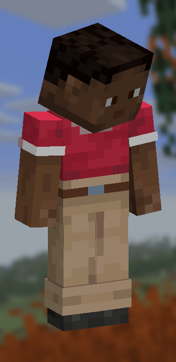

# องค์ประกอบ

องค์ประกอบคือส่วนต่าง ๆ ของเลย์เอาต์ เช่น ปุ่ม ข้อความ รูปภาพ แถบเลื่อน เพลง และอื่น ๆ หน้านี้รวบรวมองค์ประกอบทุกประเภทและการตั้งค่าที่สำคัญที่สุดของแต่ละประเภท

> [!TIP]
> ปุ่มและส่วนอื่น ๆ ที่มีอยู่บนหน้าจอเป็นค่าเริ่มต้นเรียกว่า [องค์ประกอบ Vanilla](/vanilla-elements) คุณสามารถย้าย แก้ไข และซ่อนองค์ประกอบเหล่านี้ได้เช่นกัน

# การเพิ่มองค์ประกอบ

1. ในตัวแก้ไขเลย์เอาต์ ให้คลิกขวาบริเวณว่าง แล้วคลิก **องค์ประกอบใหม่** แถบเมนูก็มีรายการเดียวกันใน **องค์ประกอบ -> ใหม่**
2. คลิกประเภทองค์ประกอบที่ต้องการ วางเมาส์เหนือประเภทเพื่อดูว่าใช้ทำอะไร

องค์ประกอบจะปรากฏตรงตำแหน่งที่คุณคลิกขวา ลากเพื่อย้าย ลากขอบเพื่อปรับขนาด และคลิกขวาเพื่อเปิดการตั้งค่า


ดูวิธีเลือก ย้าย คัดลอก และลบองค์ประกอบ รวมถึงปุ่มลัดทั้งหมดของตัวแก้ไขได้ที่ [ตัวแก้ไขเลย์เอาต์](/layout-editor) หากต้องการให้องค์ประกอบอยู่ตำแหน่งเดิมในทุกขนาดหน้าต่าง โปรดอ่าน [การจัดตำแหน่งองค์ประกอบ](/positioning-elements) หากต้องการจัดองค์ประกอบให้อยู่ด้านหน้าหรือด้านหลังองค์ประกอบอื่น โปรดอ่าน [เลเยอร์และกลุ่ม](/layout-editor#layers-and-groups)

# การตั้งค่าที่ใช้กับองค์ประกอบทุกประเภท

องค์ประกอบทุกชิ้นมีการตั้งค่าต่อไปนี้ในเมนูคลิกขวา นอกเหนือจากการตั้งค่าเฉพาะประเภทขององค์ประกอบนั้น:

| การตั้งค่า | ใช้ทำอะไร |
|---|---|
| **จุดยึด** | ใช้ยึดองค์ประกอบไว้กับตำแหน่งใด เช่น มุมหน้าจอหรือองค์ประกอบอื่น ดู [การจัดตำแหน่งองค์ประกอบ](/positioning-elements) |
| **การจัดตำแหน่งขั้นสูง** และ **การปรับขนาดขั้นสูง** | คำนวณตำแหน่งและขนาด เช่น โดยใช้ [ตัวแทนค่า](/placeholders) ดู [การจัดตำแหน่งและการปรับขนาดขั้นสูง](/advanced-positioning-sizing) |
| **ข้อกำหนดในการโหลด** และ **โหลดครั้งเดียวต่อเซสชัน** | แสดงองค์ประกอบเมื่อเป็นไปตาม[ข้อกำหนด](/conditions)เท่านั้น หรือแสดงเพียงครั้งเดียวต่อการเปิดเกม ดู [การแสดงองค์ประกอบ](/element-visibility) |
| **หน่วงเวลาการแสดง** และ **หน่วงเวลาการซ่อน** | รอสักครู่ก่อนแสดงหรือซ่อนองค์ประกอบ ดู [การแสดงองค์ประกอบ](/element-visibility#delaying-elements) |
| **การเฟดเข้า/ออก** และ **ความทึบ** | ค่อย ๆ แสดงหรือซ่อนองค์ประกอบ หรือทำให้องค์ประกอบโปร่งใส ดู [การแสดงองค์ประกอบ](/element-visibility#fading-in-and-out) |
| **การหมุน**, **การเอียงแนวตั้ง** และ **การเอียงแนวนอน** | หมุนและเอียงองค์ประกอบ ดู [การหมุนและเอียงองค์ประกอบ](/rotating-elements) |
| **เอฟเฟกต์พารัลแลกซ์** | ขยับองค์ประกอบเล็กน้อยตามเมาส์ ดู [เอฟเฟกต์พารัลแลกซ์](/parallax) |
| **คัดลอกรหัสองค์ประกอบ** | คัดลอกตัวระบุที่แอ็กชัน ตัวแทนค่า และองค์ประกอบอื่น ๆ ใช้ค้นหาองค์ประกอบนี้ ดู [ตัวระบุองค์ประกอบ](/element-identifiers) |
| **ชื่อที่แสดงในตัวแก้ไข** | ชื่อขององค์ประกอบในรายการเลเยอร์ |
| **ส่งออกสำหรับ AI** | แปลงองค์ประกอบเป็นข้อความสำหรับ[ผู้ช่วย AI](/export-for-ai) |

# องค์ประกอบทั้งหมด

องค์ประกอบทุกประเภทที่มีใน FancyMenu แบ่งตามการใช้งาน

## ปุ่มและช่องป้อนข้อมูล

### ปุ่ม

ปุ่มที่เรียกใช้[สคริปต์แอ็กชัน](/action-scripts) เมื่อคลิก เช่น เข้าร่วมเซิร์ฟเวอร์ เปิดเว็บไซต์ หรือเปิดเมนูอื่น


- **แก้ไขสคริปต์แอ็กชัน**: กำหนดสิ่งที่จะเกิดขึ้นเมื่อคลิกปุ่ม
- **ป้ายชื่อ** และ **ป้ายชื่อเมื่อวางเมาส์**: ข้อความบนปุ่มและข้อความที่แสดงเมื่อวางเมาส์เหนือปุ่ม ทั้งสองส่วนรองรับ[ตัวแทนค่า](/placeholders)และ[การจัดรูปแบบข้อความ](/text-formatting)
- **การจัดแนวป้ายชื่อ**: จัดป้ายชื่อไว้ทาง**ซ้าย**, **กึ่งกลาง** หรือ**ขวา**ของปุ่ม หากป้ายชื่อยาวเกินปุ่ม ข้อความจะเลื่อนไปมาไม่ว่าจะจัดแนวไว้ที่ใด
- **ขนาดป้ายชื่อ**, **สีพื้นฐานของป้ายชื่อ**, **สีป้ายชื่อเมื่อวางเมาส์**, **เงาป้ายชื่อ** และ **ขีดเส้นใต้ป้ายชื่อเมื่อวางเมาส์**: ปรับขนาด สี และเงาของป้ายชื่อ
- **พื้นผิวปุ่ม** และ **พื้นผิวไอคอนปุ่ม**: กำหนดรูปภาพของคุณเองให้ปุ่มและไอคอนบนปุ่ม สำหรับปุ่มสถานะปกติ เมื่อวางเมาส์ และเมื่อไม่ทำงาน ดู [การแบ่งพื้นผิวเป็นเก้าส่วนและการปูกระเบื้อง](/nine-slicing-and-tiling) เพื่อให้พื้นผิวปรับขนาดได้อย่างสวยงาม
- **เสียงเมื่อวางเมาส์**, **เสียงเมื่อเลื่อนเมาส์ออก** และ **เสียงเมื่อคลิก**: กำหนดเสียงที่ปุ่มเล่น
- **คำแนะนำเครื่องมือ**: ข้อความที่แสดงเมื่อวางเมาส์เหนือปุ่ม
- **ควบคุมสถานะการทำงาน**: [ข้อกำหนด](/conditions) สำหรับการคลิกปุ่ม หากไม่เป็นไปตามข้อกำหนด ปุ่มจะเป็นสีเทา
- **โหมดเทมเพลต**: กำหนดให้ปุ่มและแถบเลื่อนอื่น ๆ บนหน้าจอใช้รูปลักษณ์ของปุ่มนี้ ดู [เทมเพลตปุ่มและแถบเลื่อน](/button-slider-templates)

### แถบเลื่อน

แถบเลื่อนที่ผู้เล่นลากเพื่อเลือกค่า โดยจะเรียกใช้สคริปต์แอ็กชันทุกครั้งที่ค่าเปลี่ยน


- **ประเภทแถบเลื่อน**:
  - **รายการค่า**: เลื่อนดูข้อความใน **ค่ารายการ** ทีละหนึ่งบรรทัด หากเลือก **ค่าจากตัวแปรรายการ** ค่าจะมาจาก[ตัวแปรรายการ](/variables#text-and-list-variables)แทน
  - **ช่วงจำนวนเต็ม**: ตัวเลขจำนวนเต็มตั้งแต่ **ค่าต่ำสุดของช่วง** ถึง **ค่าสูงสุดของช่วง**
  - **ช่วงทศนิยม**: ทำงานเหมือนกันแต่ใช้ตัวเลขทศนิยม **ตำแหน่งทศนิยมที่ปัดเศษ** กำหนดจำนวนหลักหลังจุดทศนิยม ส่วน `-1` หมายถึงไม่ปัดเศษ
- **ป้ายชื่อแถบเลื่อน**: ข้อความบนแถบเลื่อน ใช้ `$$value` เพื่อแสดงค่าปัจจุบัน
- **แก้ไขสคริปต์แอ็กชัน**: เรียกใช้เมื่อค่าเปลี่ยน โดย `$$value` จะเป็นค่าใหม่
- **ค่าที่เลือกไว้ล่วงหน้า**: ค่าที่แถบเลื่อนเริ่มต้น ควรกำหนดให้ตรงกับค่าที่แถบเลื่อนใช้เปลี่ยน เพื่อให้แสดงค่าที่ถูกต้องเมื่อเปิดหน้าจอ

ตัวอย่างเช่น แถบเลื่อนระดับเสียงที่ใช้ประเภท **ช่วงจำนวนเต็ม** ตั้งแต่ `0` ถึง `100` มีป้ายชื่อ `Music Volume: $$value%` และมีแอ็กชัน [**กำหนดค่าตัวแปร (ตัวแปร FM)**](/action-scripts#set-variable-value-fm-variable) โดยใช้ค่านี้:

```
music_volume:$$value
```

กำหนด **ค่าที่เลือกไว้ล่วงหน้า** เป็น `$$music_volume` เพื่อให้แถบเลื่อนเริ่มจากค่าล่าสุดที่ผู้เล่นเลือก

แถบเลื่อนมีการตั้งค่าป้ายชื่อ พื้นผิว เสียง คำแนะนำเครื่องมือ และ **ควบคุมสถานะการทำงาน** เช่นเดียวกับปุ่ม คุณจึงจัดป้ายชื่อไว้ทางซ้ายหรือขวาได้ด้วย **การจัดแนวป้ายชื่อ** เช่นกัน

### ช่องทำเครื่องหมาย

ช่องที่ผู้เล่นเลือกหรือยกเลิกการเลือก โดยจะเรียกใช้สคริปต์แอ็กชันทุกครั้งที่สถานะเปลี่ยน


- `$$value` จะมีค่าเป็น `true` หรือ `false` ในสคริปต์แอ็กชันและข้อกำหนด **ควบคุมสถานะการทำงาน**
- **โหมดตัวแปร** และ **เชื่อมโยงกับตัวแปร**: ช่องทำเครื่องหมายจะแสดงค่าของ[ตัวแปร](/variables)และเขียนค่า `true` หรือ `false` ลงในตัวแปรนั้น หากเชื่อมโยงกับตัวแปรรายการ ค่า `true` หรือ `false` จะกลายเป็นรายการเดียวในตัวแปร
- หากไม่ได้ใช้โหมดตัวแปร ช่องทำเครื่องหมายจะจดจำสถานะของตัวเองแยกกันในแต่ละ[โปรไฟล์](/profiles)
- **พื้นผิว**: กำหนดรูปภาพของคุณเองให้ช่องและเครื่องหมายถูก

ช่องทำเครื่องหมายมีการตั้งค่าคำแนะนำเครื่องมือ เสียง และ **นำทางได้** เช่นเดียวกับปุ่ม

### ช่องป้อนข้อความ

ช่องที่ผู้เล่นพิมพ์ข้อความลงไป เช่น ที่อยู่เซิร์ฟเวอร์หรือชื่อ


- **เชื่อมโยงกับตัวแปร**: ข้อความที่ผู้เล่นพิมพ์จะถูกบันทึกลงใน[ตัวแปร](/variables) และช่องจะแสดงค่าของตัวแปร หากเชื่อมโยงกับตัวแปรรายการ ข้อความที่พิมพ์จะแทนที่รายการทั้งหมด
- **ประเภทข้อมูลที่ป้อน**: **ข้อความ**, **ตัวเลขเท่านั้น**, **ตัวเลขทศนิยมเท่านั้น** หรือ **URL** อักขระประเภทอื่นจะพิมพ์ไม่ได้
- **ข้อความแนะนำ** และ **สีข้อความแนะนำ**: ข้อความที่แสดงเมื่อช่องว่าง
- **ความยาวข้อความสูงสุด**: จำนวนอักขระที่ป้อนได้
- **สีพื้นหลัง**, **สีเส้นขอบ**, **รัศมีมุมโค้งของเส้นขอบ** และ **สีข้อความ**: ปรับรูปลักษณ์ของช่อง

ตัวอย่างเช่น ช่องที่เชื่อมโยงกับ `server_address` และปุ่มที่ใช้แอ็กชัน [**เข้าร่วมเซิร์ฟเวอร์**](/action-scripts#join-server) พร้อมค่า `$$server_address` จะช่วยให้ผู้เล่นเข้าร่วมเซิร์ฟเวอร์ใดก็ได้

หากไม่ได้ใช้ตัวแปร ตัวแทนค่า [**ค่าของช่องป้อนข้อความ**](/placeholders#text-input-field-value) จะอ่านข้อความในช่อง ส่วนแอ็กชัน [**กำหนดค่าช่องป้อนข้อความ**](/action-scripts#set-text-input-field-value) ใช้เปลี่ยนข้อความนั้น

## ข้อความและคำแนะนำเครื่องมือ

### ข้อความ

ข้อความยาวเท่าใดก็ได้ ตั้งแต่ป้ายชื่อสั้น ๆ ไปจนถึงกฎหรือบันทึกการอัปเดตที่เลื่อนได้ รองรับ [Markdown](/text-formatting) และ[ตัวแทนค่า](/placeholders)


- **โหมดแหล่งที่มา**: พิมพ์ข้อความหรือโหลดจากไฟล์หรือเว็บไซต์
- เลือกรูปลักษณ์ตั้งต้น และตั้งค่าให้เลื่อนดูได้เมื่อข้อความยาวเกินองค์ประกอบ
- **พื้นหลัง**: แผงสีเข้มด้านหลังข้อความ ปิดได้ด้วย **แสดงพื้นหลัง** หรือใช้พื้นผิวของคุณเองแทน

อ่านรายละเอียดทั้งหมดได้ที่ [ข้อความในเมนู](/text-in-menus)

### คำแนะนำเครื่องมือ

กล่องข้อความที่มีลักษณะเหมือนคำแนะนำเครื่องมือในเกม รองรับ [Markdown](/text-formatting) และ[ตัวแทนค่า](/placeholders)


- แสดงตรงตำแหน่งที่คุณวางไว้ หรือแสดงตามตำแหน่งเมาส์เมื่อเปิด **ติดตามเมาส์**
- **ข้อกำหนดในการโหลด** ใช้กำหนดเวลาที่จะแสดง เช่น [**เมื่อวางเมาส์เหนือองค์ประกอบ**](/conditions#is-element-hovered) สำหรับปุ่ม
- **พื้นหลังคำแนะนำเครื่องมือ**: ใช้พื้นผิวของคุณเองแทนกล่องสีเข้ม

อ่านเพิ่มเติมได้ที่ [ข้อความในเมนู](/text-in-menus)

### ข้อความสแปลช

ข้อความสีเหลืองบนหน้าจอชื่อเรื่องที่ใช้ข้อความของคุณเองได้


- **โหมดแหล่งที่มา**: ใช้ข้อความสแปลชของเกม ข้อความของคุณเอง หรือสุ่มหนึ่งบรรทัดจากไฟล์ข้อความ
- **เด้ง**, **ขนาด**, **การหมุน**, **สีข้อความ** และ **เงา**: ปรับรูปลักษณ์
- **รีเฟรชเมื่อโหลดหน้าจอ**: สุ่มข้อความสแปลชใหม่ทุกครั้งที่เปิดหน้าจอ

อ่านเพิ่มเติมได้ที่ [ข้อความสแปลช](/splash-text)

## รูปภาพและสื่อ

### รูปภาพ

รูปภาพจากไฟล์ของคุณ เว็บไซต์ หรือทรัพยากรของเกม รองรับภาพเคลื่อนไหวด้วย


- **แหล่งที่มาของรูปภาพ**: เลือกรูปภาพ ดูรายการไฟล์ที่รองรับได้ที่ [รูปภาพ](/images)
- **รักษาอัตราส่วนภาพ**: ปรับความกว้างเพื่อไม่ให้รูปภาพถูกยืด
- **พื้นผิวแบ่งเก้าส่วน** และ **พื้นผิวซ้ำ**: ปรับขนาดกรอบโดยไม่ยืดขอบ หรือปูรูปภาพซ้ำ ดู [การแบ่งพื้นผิวเป็นเก้าส่วนและการปูกระเบื้อง](/nine-slicing-and-tiling)
- **ปรับสีรูปภาพ [HEX]**: เปลี่ยนสีรูปภาพ
- **รัศมีมุมโค้ง**: ทำมุมของรูปภาพให้โค้งมน

### สไลด์โชว์

แสดงรูปภาพในสไลด์โชว์ทีละภาพ คุณสร้างสไลด์โชว์ได้ใน `config/fancymenu/slideshows/` ดู [สไลด์โชว์](/slideshows)

- **สไลด์โชว์**: เลือกสไลด์โชว์ที่ต้องการแสดง
- **รักษาอัตราส่วนภาพ**: ปรับความกว้างเพื่อไม่ให้รูปภาพถูกยืด

### วิดีโอ

เล่นไฟล์วิดีโอ เช่น ตัวอย่างเกมหรือภาพพื้นหลังเคลื่อนไหว

> [!IMPORTANT]
> วิดีโอต้องใช้ม็อด Watermedia V3 และ Watermedia Binaries V3 ดู [วิดีโอ](/video)

- **แหล่งที่มาของวิดีโอ**: ไฟล์วิดีโอ ลิงก์เว็บ หรือทรัพยากรของเกม
- **เล่นวิดีโอวนซ้ำ**, **ระดับเสียง** และ **ช่องเสียง**: กำหนดวิธีเล่นวิดีโอ
- **เล่นวิดีโอในตัวแก้ไขเลย์เอาต์**: กำหนดว่าจะเล่นวิดีโอขณะกำลังแก้ไขด้วยหรือไม่
- แอ็กชันอย่าง [**สลับสถานะหยุดชั่วคราวขององค์ประกอบวิดีโอ**](/action-scripts#toggle-video-element-paused-state) ใช้หยุดชั่วคราว ข้ามไปยังเวลาใดเวลาหนึ่ง หรือเปลี่ยนระดับเสียงได้

**วิดีโอ [Rinku]** เป็นองค์ประกอบวิดีโอรุ่นเก่าที่ต้องใช้ม็อด Rinku ยังคงใช้งานได้ในเลย์เอาต์เก่า แต่ไม่มีให้เลือกใน **องค์ประกอบใหม่**

### เชเดอร์ GLSL

เรียกใช้เชเดอร์ GLSL ของคุณเองภายในองค์ประกอบ เช่น สีเคลื่อนไหวหรือเอฟเฟกต์จาก Shadertoy


- **แหล่งที่มาของเชเดอร์**: โค้ดเชเดอร์ เชเดอร์จาก Shadertoy ที่ใช้ `mainImage` สามารถใช้งานได้ทันที
- **โหมดคอมไพล์**: **อัตโนมัติ**, **Shadertoy** หรือ **Direct Fragment**
- **แหล่งที่มาของบัฟเฟอร์ A** ถึง **แหล่งที่มาของบัฟเฟอร์ D**: เพิ่มพาสสำหรับเชเดอร์ที่ใช้บัฟเฟอร์

ดูวิธีเขียนได้ที่ [API เชเดอร์ GLSL](/glsl-shader-api)

### เบราว์เซอร์

แสดงเว็บไซต์แบบโต้ตอบได้ เช่น แผนที่เซิร์ฟเวอร์หรือหน้าวิกิ

> [!IMPORTANT]
> เบราว์เซอร์ต้องใช้ม็อด [Rinku](https://modrinth.com/mod/rinku) ([CurseForge](https://www.curseforge.com/minecraft/mc-mods/rinku)

- **URL**: เว็บไซต์ที่ต้องการแสดง
- **โต้ตอบได้**: อนุญาตให้ผู้เล่นคลิก เลื่อน และพิมพ์ในหน้าเว็บได้ แต่ในตัวแก้ไขเลย์เอาต์จะไม่สามารถโต้ตอบได้
- **ปิดเสียงเบราว์เซอร์**, **ระดับเสียงเสียง/วิดีโอ**, **เล่นวิดีโอวนซ้ำ** และ **ซ่อนตัวควบคุมวิดีโอ**: ตั้งค่าสื่อในหน้าเว็บ

หากต้องการโหลดไฟล์ HTML จาก `config/fancymenu/assets/` ให้ขึ้นต้น URL ด้วย `file:///`:

```
file:///config/fancymenu/assets/changelog.html
```

บน Linux ให้ใช้ตัวแทนค่า [**พาธไฟล์/โฟลเดอร์แบบเต็ม**](/placeholders#absolute-filefolder-path) แทน:

```
file:///{"placeholder":"absolute_path","values":{"short_path":"/config/fancymenu/assets/changelog.html"}}
```

เว็บไซต์สามารถเรียกใช้แอ็กชันและอ่านตัวแทนค่าได้ ดู [API JavaScript ของเบราว์เซอร์](/browser-api)

## รูปร่าง ไอเท็ม และโมเดล

### รูปทรงสี่เหลี่ยมผืนผ้า

สี่เหลี่ยมผืนผ้าสีเดียว เช่น แผงด้านหลังข้อความ


- **สี**: สี HEX หากเพิ่มตัวเลขอีกสองหลักจะทำให้โปร่งแสง เช่น `#101828C8`
- **รัศมีมุมโค้ง**: ทำมุมทั้งหมดให้โค้ง หรือปรับแต่ละมุมแยกกัน
- **เบลอ** และ **ความเข้มของการเบลอ**: ทำให้สิ่งที่อยู่ด้านหลังเบลอ

### รูปทรงวงกลม

วงกลมหรือวงรีสีเดียว เช่น ไฟแสดงสถานะ


- **สี**, **เบลอ** และ **ความเข้มของการเบลอ**: ทำงานเหมือนกับรูปทรงสี่เหลี่ยมผืนผ้า
- **ความกลม**: ค่า `2` คือวงกลม ค่าที่มากขึ้นจะทำให้รูปทรงเป็นเหลี่ยมมากขึ้น ส่วนค่าที่น้อยลงจะทำให้ปลายแหลมขึ้น

### ไอเท็ม

แสดงไอเท็มของ Minecraft หรือม็อด เช่นเดียวกับในช่องเก็บของ


- **คีย์ไอเท็ม**: ไอเท็ม เช่น `minecraft:diamond_sword`
- **จำนวนไอเท็ม**, **ชื่อไอเท็ม**, **คำบรรยายไอเท็ม** และ **ร่ายมนตร์**: ตั้งค่าได้เหมือนไอเท็มจริง
- **แสดงคำแนะนำเครื่องมือของไอเท็ม**: แสดงคำแนะนำเครื่องมือของไอเท็มเมื่อวางเมาส์เหนือไอเท็ม
- **ข้อมูล NBT กำหนดเอง**: เพิ่มข้อมูลไอเท็ม โดยเขียนในรูปแบบเดียวกับส่วนที่อยู่ถัดจากชื่อไอเท็มในคำสั่ง `/give`

### โมเดล JSON ของบล็อก/ไอเท็ม

แสดงโมเดลบล็อกหรือไอเท็มแบบ 3 มิติ จากทรัพยากรของเกมหรือไฟล์ JSON ของคุณเอง


- **โมเดล**: กำหนด **แหล่งที่มาของโมเดล** เช่น `minecraft:models/block/crafting_table.json`
- **พื้นผิว**: ใช้พื้นผิวของคุณแทนพื้นผิวของโมเดล
- **การแปลง**: ปรับขนาด หมุน และย้ายโมเดล
- **แสง**: **สีเฉดแสง [HEX]** ใช้เปลี่ยนสีแสงบนโมเดล

### เอนทิตีผู้เล่น

แสดงผู้เล่นแบบ 3 มิติ เช่น ตัวละครของผู้เล่นเองบนหน้าจอชื่อเรื่อง



> [!IMPORTANT]
> เอนทิตีผู้เล่นต้องใช้ม็อด Fancy Entity Renderer ([CurseForge](https://www.curseforge.com/minecraft/mc-mods/fancy-entity-renderer), [Modrinth](https://modrinth.com/mod/fancy-entity-renderer)) หากไม่มีม็อดนี้ จะแสดงข้อผิดพลาดแทนผู้เล่น

- **คัดลอกผู้เล่นในไคลเอนต์**: แสดงผู้เล่นที่กำลังเล่นเกม พร้อมสกินและชื่อของผู้เล่น
- **ชื่อผู้เล่น**, **พื้นผิวสกิน** และ **พื้นผิวผ้าคลุม**: กำหนดผู้เล่นหรือสกินอื่น
- **ท่าทางเอนทิตี**, **ศีรษะหันตามเมาส์** และ **ลำตัวหันตามเมาส์**: กำหนดท่ายืนและทิศทางที่มอง
- **เกราะและเครื่องมือ**, **นกแก้ว**, **เป็นเด็ก** และ **แสดงชื่อผู้เล่น**: กำหนดสิ่งที่สวมใส่และแสดง

อ่านเพิ่มเติมได้ที่ [เอนทิตีผู้เล่น](/player-entities) หากต้องการแสดงเฉพาะศีรษะ ดูที่ [หัวผู้เล่น](/player-heads)

### แถบความคืบหน้า

แถบที่ค่อย ๆ เติมเต็ม เช่น แถบโหลด


- **แหล่งที่มาของค่าความคืบหน้า**: กำหนดระดับความคืบหน้า โดยใช้[ตัวแทนค่า](/placeholders)ได้ เช่น [**ความคืบหน้าการโหลดโลก**](/placeholders#world-loading-progress) บนหน้าจอโหลดโลก
- **โหมดค่าความคืบหน้า**: **เปอร์เซ็นต์ (0-100)** หรือ **เลขทศนิยม (0.0-1.0)**
- **ทิศทาง**: กำหนดด้านที่แถบจะเติมไปหา
- **สีแถบ** และ **สีพื้นหลัง** หรือ **พื้นผิวแถบ** และ **พื้นผิวพื้นหลัง**
- **แอนิเมชันเติมแถบแบบนุ่มนวล**: เลื่อนไปยังค่าใหม่แทนที่จะเปลี่ยนทันที
- **ใช้ความคืบหน้าเป็นจุดยึดขององค์ประกอบ**: องค์ประกอบที่ยึดกับแถบจะเคลื่อนที่ตามปลายของส่วนที่เติมแล้ว

## องค์ประกอบช่วยจัดเลย์เอาต์

### พื้นที่เลื่อนได้

ใช้บรรจุองค์ประกอบอื่นและเลื่อนดูได้ เช่น รายการเซิร์ฟเวอร์หรือหน้าข้อมูลยาว ๆ


- ลากองค์ประกอบมาวางในพื้นที่นี้ผ่านตัวแก้ไขเลย์เอาต์ ใส่ได้เฉพาะองค์ประกอบที่กำหนดเอง ไม่รองรับองค์ประกอบ Vanilla
- **การจัดเรียง**: จัดวางองค์ประกอบด้วยตัวเอง หรือให้พื้นที่จัดเรียงเป็นกอง ตาราง หรือแบบไหลต่อเนื่อง
- **พื้นหลัง**: แผงสีเข้มด้านหลังพื้นที่ ปิดได้ด้วย **แสดงพื้นหลัง** หรือใช้พื้นผิวของคุณเองแทน

อ่านรายละเอียดทั้งหมดได้ที่ [พื้นที่เลื่อนได้](/scrollable-areas)

### ตัวลาก

พื้นที่ที่ผู้เล่นสามารถจับและลากเพื่อย้ายตำแหน่งได้เมื่ออยู่นอกตัวแก้ไข องค์ประกอบที่ยึดไว้กับพื้นที่นี้จะเคลื่อนที่ตาม เช่น แผงข้อมูลที่ย้ายตำแหน่งได้ ตัวลากจะมองไม่เห็นเมื่ออยู่นอกตัวแก้ไข

**บันทึกการเลื่อนตำแหน่งโดยผู้ใช้** จะเก็บตำแหน่งใหม่ไว้หลังปิดหน้าจอและเริ่มเกมใหม่ อ่านเพิ่มเติมได้ที่ [ตัวลาก](/dragger)

### ตัวทำแอนิเมชันองค์ประกอบ

ย้ายและปรับขนาดองค์ประกอบอื่นด้วยคีย์เฟรม เช่น แผงที่เลื่อนเข้ามาบนหน้าจอ ตัวทำแอนิเมชันจะมองไม่เห็นเมื่ออยู่นอกตัวแก้ไข

- **จัดการองค์ประกอบเป้าหมาย**: เลือกองค์ประกอบที่จะทำแอนิเมชัน
- **แก้ไขคีย์เฟรม**: เปิดตัวแก้ไขคีย์เฟรม
- **วนแอนิเมชัน**: เริ่มเล่นใหม่เมื่อเล่นจบ

อ่านรายละเอียดทั้งหมดได้ที่ [ตัวทำแอนิเมชันองค์ประกอบ](/element-animator)

## องค์ประกอบที่มองไม่เห็น

องค์ประกอบเหล่านี้จะแสดงเฉพาะในตัวแก้ไขเลย์เอาต์

### ตัวนับเวลา

เรียกใช้สคริปต์แอ็กชันซ้ำไปเรื่อย ๆ ขณะที่หน้าจอเปิดอยู่

> [!IMPORTANT]
> แนะนำให้ใช้[ตัวจัดตารางเวลา](/schedulers) สำหรับงานที่ทำซ้ำหรือทำในภายหลัง ใช้ตัวจัดตารางเวลาแทนตัวนับเวลาเมื่อทำได้ ตัวจัดตารางเวลาทำงานได้กับทุกหน้าจอและทำงานได้แม้ไม่มีหน้าจอเปิดอยู่ อีกทั้งทุกแอ็กชันก็ใช้ได้ และยังสั่งเริ่มหรือหยุดการทำงานได้ด้วยแอ็กชัน

วิธีใช้ตัวจัดตารางเวลาแทนสิ่งที่ตัวนับเวลาทำได้:

- ทำงานตลอดเวลาขณะที่หน้าจอเปิดอยู่: สร้างตัวจัดตารางเวลาพร้อม **หน่วงเวลาการทำงาน (มิลลิวินาที)** เริ่มด้วย [**เริ่มตัวจัดตารางเวลา**](/action-scripts#start-scheduler) ใน **แก้ไขสคริปต์แอ็กชัน 'เปิดหน้าจอ'** ของเลย์เอาต์ แล้วหยุดด้วย [**หยุดตัวจัดตารางเวลา**](/action-scripts#stop-scheduler) ใน **แก้ไขสคริปต์แอ็กชัน 'ปิดหน้าจอ'** ทั้งสองรายการอยู่ในเมนูคลิกขวาของพื้นหลังตัวแก้ไข
- ทำงานครั้งเดียวต่อการเปิดเกม: สร้างตัวจัดตารางเวลาพร้อม **เริ่มเมื่อเปิดเกม** และตั้ง **จำนวนรอบที่ทำงาน** เป็น `1`
- ทำงานครั้งเดียวทุกครั้งที่เปิดหน้าจอ: ไม่ต้องใช้ตัวนับเวลาหรือตัวจัดตารางเวลา ให้วางแอ็กชันไว้ใน **แก้ไขสคริปต์แอ็กชัน 'เปิดหน้าจอ'**

การตั้งค่าตัวนับเวลา:

- **หน่วงเวลาการทำงาน [มิลลิวินาที]**: ระยะเวลาระหว่างการทำงานสองครั้ง หน่วยเป็นมิลลิวินาที ค่า `0` จะทำงานทุกทิก หรือ 20 ครั้งต่อวินาที
- **โหมดการทำงาน**: **ปกติ** จะทำงานตลอดเวลา **เซสชัน** จะทำงานครั้งเดียวจนกว่าจะเริ่มเกมใหม่ **เมื่อโหลดหน้าจอ** จะทำงานหนึ่งครั้งทุกครั้งที่เปิดหน้าจอ รวมถึงเมื่อปรับขนาดหน้าต่างด้วย
- **อะซิงโครนัส**: ทำงานเบื้องหลัง แอ็กชันส่วนใหญ่ไม่สามารถทำงานด้วยวิธีนี้และจะแสดงข้อผิดพลาด

### เสียง

เล่นเพลงหรือเสียงขณะที่หน้าจอเปิดอยู่ โดยเล่นทีละแทร็ก

- **จัดการแทร็ก**: จัดการไฟล์เสียง ลำดับแทร็ก และ **น้ำหนักแทร็ก** ที่ใช้สุ่มลำดับ
- **โหมดเล่น**: **ปกติ** จะเล่นตามลำดับ ส่วน **สุ่ม** จะเล่นแบบสุ่ม
- **เล่นแทร็กวนซ้ำ**, **ระดับเสียง** และ **ช่องเสียง**: กำหนดวิธีเล่น

หากต้องการให้เพลงเล่นต่อเนื่องขณะสลับหน้าจอ ให้วางองค์ประกอบเสียงไว้ใน[เลย์เอาต์สากล](/universal-layouts) อ่านเพิ่มเติมได้ที่ [เพลงพื้นหลังเมนู](/background-music)

### ตัวควบคุมเพลง

ปิดเพลงของเกมเองสำหรับหน้าจอนี้

- **เล่นเพลงเมนู**: เพลงของเมนูเมื่อไม่ได้โหลดโลก เช่น เพลงบนหน้าจอชื่อเรื่อง
- **เล่นเพลงในโลก**: เพลงจากโลกที่ยังเล่นต่อในเมนู เช่น เมนูช่องเก็บของ

องค์ประกอบนี้ทำงานเฉพาะขณะที่มีหน้าจอเปิดอยู่

### เคอร์เซอร์

แทนที่เคอร์เซอร์เมาส์ด้วยรูปภาพของคุณเองขณะที่หน้าจอเปิดอยู่

- **พื้นผิวเคอร์เซอร์**: รูปภาพ PNG เช่น ขนาด 32×32 พิกเซล
- **พิกัด X ของจุดคลิก** และ **พิกัด Y ของจุดคลิก**: พิกเซลบนรูปภาพที่ใช้คลิก เช่น ปลายลูกศร
- **โหมดแสดงตัวอย่างในตัวแก้ไข**: แสดงเคอร์เซอร์ในตัวแก้ไขเมื่อเมาส์อยู่เหนือองค์ประกอบ

อ่านเพิ่มเติมได้ที่ [เคอร์เซอร์กำหนดเอง](/custom-cursor)
