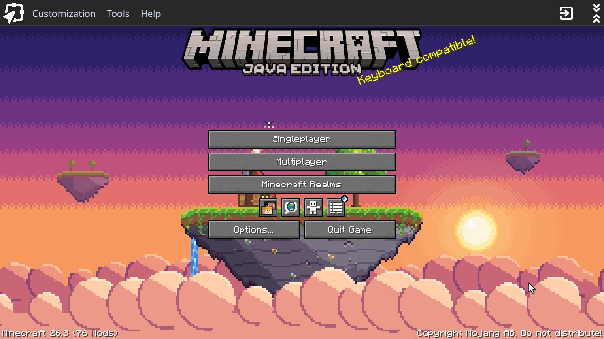

# บทนำเกม

บทนำเกมจะเล่นแอนิเมชันหรือวิดีโอเมื่อเริ่มเกม หลังจากหน้าจอกำลังโหลดของ Minecraft ทันที เมื่อเล่นจบ ภาพจะค่อย ๆ เปลี่ยนไปเป็นหน้าจอชื่อเรื่อง ฟีเจอร์นี้สร้างมาเพื่อม็อดแพ็กโดยเฉพาะ เช่น ใช้แสดงโลโก้ บทนำสตูดิโอ หรือตัวอย่างเกมสั้น ๆ

ผู้เล่นสามารถข้ามได้ด้วยการกดปุ่มใดก็ได้หรือคลิก บทนำเกมเป็นหนึ่งใน [การปรับแต่งส่วนกลาง](/global-customizations) จึงไม่ต้องใช้เลย์เอาต์

# ตั้งค่าบทนำ

1. วางแอนิเมชันหรือวิดีโอไว้ใน `<game-directory>/config/fancymenu/assets/`
2. เปิด **แถบเมนู -> การปรับแต่ง -> การปรับแต่งส่วนกลาง -> บทนำเกม**
3. คลิก **ตั้งค่าบทนำเกม** เมื่อตั้งค่า **ประเภทแหล่งที่มา** เป็น **ในเครื่อง** ให้คลิก **เลือกไฟล์ทรัพยากรในเครื่อง** เลือกไฟล์ แล้วคลิก **ตกลง**
4. คลิก **เล่นบทนำเกมซ้ำ** เพื่อดูทันที

หากต้องการลบบทนำ ให้เลื่อนเมาส์ไปที่ **ตั้งค่าบทนำเกม** แล้วคลิก **คืนค่าเริ่มต้น**

## แอนิเมชันและวิดีโอ

- **แอนิเมชัน:** ไฟล์ APNG หรือ GIF ดูวิธีสร้างได้ที่ [แอนิเมชัน](/animations)
- **วิดีโอ:** ไฟล์ MP4 ต้องใช้ม็อด Watermedia V3 และ Watermedia Binaries V3 ดูที่ [วิดีโอ](/video#requirements) หากไม่มีม็อดเหล่านี้ บทนำวิดีโอจะแสดงข้อความสีแดงพร้อมลิงก์ดาวน์โหลดเป็นเวลาสองสามวินาทีเท่านั้น
- ใช้ไฟล์จากอินสแตนซ์และแพ็กทรัพยากรได้ แต่ใช้ลิงก์เว็บไม่ได้ ดูที่ [ทรัพยากร](/resources)

บทนำจะเต็มหน้าจอและคงสัดส่วนเดิมไว้ ดังนั้นบางส่วนอาจถูกตัดออกหากหน้าจอมีสัดส่วนต่างกัน หน้าจอส่วนใหญ่มีสัดส่วน 16:9 ดังนั้นควรสร้างบทนำในสัดส่วน 16:9 เช่นกัน เช่น 1920x1080 ส่วนที่โปร่งใสจะแสดงเป็นสีดำ

> [!TIP]
> ผู้เล่นจะเห็นบทนำทุกครั้งที่เริ่มเกม ดังนั้นควรทำให้สั้น โดยมีความยาวประมาณ 5 ถึง 10 วินาที

## ตัวอย่างบทนำฟรี

บทนำ Skyhaven ที่แสดงใน GIF บนหน้านี้ใช้ฟรีได้ ทั้งเพื่อทดสอบและใช้ในม็อดแพ็กของคุณ:

- [skyhaven_intro.apng](https://raw.githubusercontent.com/Keksuccino/docs_fancymenu/refs/heads/wiki-2026/assets/skyhaven_intro.apng?raw=true): บทนำ ความละเอียด 1280x720 ความยาว 5.4 วินาที เล่นหนึ่งครั้ง
- [skyhaven_menu.png](https://raw.githubusercontent.com/Keksuccino/docs_fancymenu/refs/heads/wiki-2026/assets/skyhaven_menu.png?raw=true): ฉากสุดท้ายของบทนำที่ไม่มีโลโก้ ความละเอียด 1280x720 ตั้งเป็น[ภาพพื้นหลัง](/menu-backgrounds#image)ของเลย์เอาต์หน้าจอชื่อเรื่องได้ เพื่อให้บทนำค่อย ๆ เปลี่ยนไปเป็นเมนูที่เข้าชุดกัน เหมือนใน GIF แรก

# การตั้งค่า

การตั้งค่าทั้งหมดอยู่ที่ **แถบเมนู -> การปรับแต่ง -> การปรับแต่งส่วนกลาง -> บทนำเกม**:

| การตั้งค่า | การทำงาน |
|---|---|
| **ตั้งค่าบทนำเกม** | แอนิเมชันหรือวิดีโอ |
| **การข้ามบทนำเกม** | กดปุ่มใดก็ได้หรือคลิกเพื่อข้ามบทนำ และจะแสดง **กดปุ่มใดก็ได้เพื่อข้าม** ที่ด้านล่าง เมื่อข้าม บทนำจะจบทันทีโดยไม่มีการค่อย ๆ เปลี่ยนภาพ หากปิดการตั้งค่านี้ บทนำจะเล่นจนจบเสมอ |
| **การค่อย ๆ เปลี่ยนภาพเมื่อจบบทนำเกม** | ค่อย ๆ เปลี่ยนจากบทนำไปเป็นหน้าจอชื่อเรื่องเมื่อเล่นจบ หากปิดการตั้งค่านี้ หน้าจอชื่อเรื่องจะปรากฏทันที |
| **ไม่สนใจการเล่นวนซ้ำของบทนำเกม** | จบบทนำหลังจากแอนิเมชันเล่นหนึ่งครั้ง แม้แอนิเมชันจะเล่นวนซ้ำ หากปิดการตั้งค่านี้ บทนำจะเล่นแอนิเมชันจนครบทุกลูป วิดีโอจะเล่นเพียงครั้งเดียวเสมอ |
| **ข้อความข้ามแบบกำหนดเอง** | ใช้แทนข้อความ **กดปุ่มใดก็ได้เพื่อข้าม** เช่น `กดปุ่มใดก็ได้เพื่อเริ่มการผจญภัย` หากใส่คีย์การแปลภาษาจากแพ็กทรัพยากร เช่น `skyhaven.intro.skip` ข้อความจะแสดงเป็นภาษาของผู้เล่น |
| **ระดับเสียงบทนำเกม** | ระดับเสียงของบทนำวิดีโอ ตั้งแต่ 0% ถึง 100% |
| **ช่องเสียงบทนำเกม** | ช่องเสียงของบทนำวิดีโอ เช่น เพลง ระดับเสียงของช่องนั้นและระดับเสียงหลักในการตั้งค่าเสียงของ Minecraft จะมีผลเพิ่มเติมด้วย |
| **เล่นบทนำเกมซ้ำ** | เล่นบทนำทันที โดยแสดงทับหน้าจอที่กำลังเปิดอยู่ |

**การข้ามบทนำเกม**, **การค่อย ๆ เปลี่ยนภาพเมื่อจบบทนำเกม** และ **ไม่สนใจการเล่นวนซ้ำของบทนำเกม** เปิดใช้งานไว้ตามค่าเริ่มต้น

> [!WARNING]
> หากปิดทั้ง **การข้ามบทนำเกม** และ **ไม่สนใจการเล่นวนซ้ำของบทนำเกม** แอนิเมชันที่เล่นวนซ้ำไม่สิ้นสุดก็จะไม่จบ และผู้เล่นจะไปยังหน้าจอชื่อเรื่องไม่ได้

# ข้อมูลที่ควรรู้

- บทนำจะเล่นหนึ่งครั้งต่อการเริ่มเกม โดยเล่นก่อนหน้าจอแรกหลังหน้าจอกำลังโหลด ซึ่งปกติคือหน้าจอชื่อเรื่อง
- หากต้องการเปลี่ยนหน้าจอกำลังโหลดของ Minecraft ก่อนบทนำ ดูที่ [หน้าจอกำลังโหลด](/loading-screen)
- แหล่งที่มาของบทนำสามารถมี[ตัวแทนข้อความ](/resources#placeholders-in-resource-sources)ได้
- การตั้งค่าบทนำเกมจะบันทึกไว้ใน `options.txt` ของ FancyMenu จึงเป็นส่วนหนึ่งของ[โปรไฟล์](/profiles)ที่โหลดอยู่ ม็อดแพ็กที่มี `config/fancymenu/` จะรวมบทนำไว้ด้วย พร้อมกับไฟล์ใน `assets/` ดูที่ [ม็อดแพ็ก](/modpacks)
