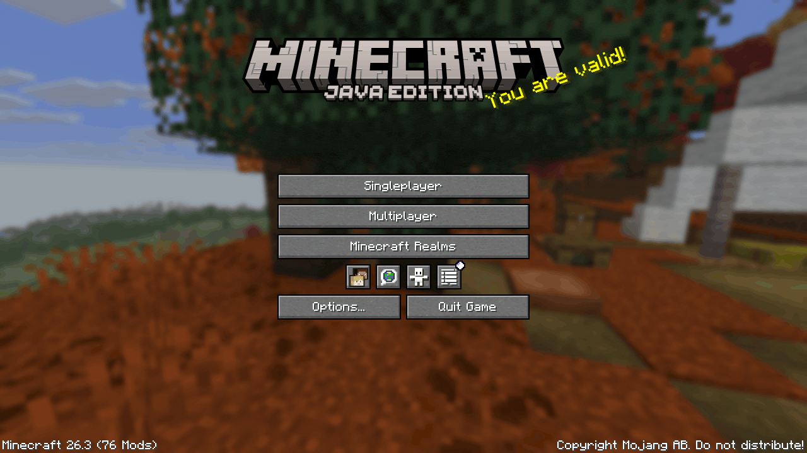

# ตัวฟังเหตุการณ์

ตัวฟังเหตุการณ์จะเรียกใช้ [สคริปต์แอ็กชัน](/action-scripts) เมื่อมีเหตุการณ์เกิดขึ้นในเกม เช่น กดปุ่ม เปิดหน้าจอ ปลดล็อกความสำเร็จ และอื่น ๆ อีกมากมาย ตัวฟังเหตุการณ์ทำงานได้ในทุกเมนูและระหว่างเล่นเกม โดยไม่ขึ้นกับเลย์เอาต์

ตัวฟังเหตุการณ์ส่วนใหญ่จะส่งตัวแปรเกี่ยวกับเหตุการณ์ที่เกิดขึ้นให้สคริปต์ เช่น ชื่อปุ่มที่กด

> [!CAUTION]
> ตัวฟังเหตุการณ์อาจเรียกใช้แอ็กชันเกี่ยวกับไฟล์ เครือข่าย คำสั่ง คลิปบอร์ด รีซอร์สแพ็ก และลิงก์ได้แม้ไม่มีเมนูเปิดอยู่ ใช้ตัวฟังเหตุการณ์จากโปรไฟล์และไฟล์ของบุคคลที่คุณไว้ใจเท่านั้น

# เพิ่มตัวฟังเหตุการณ์

1. เปิด **แถบเมนู -> Customization -> Manage Listeners**
2. คลิก **Add Listener**
3. คลิกเหตุการณ์ใน **Available Listeners** แถบค้นหาจะค้นหาตัวฟังเหตุการณ์จากชื่อและคำอธิบาย
   - **Listener Description** แสดงว่าตัวฟังเหตุการณ์ทำอะไรและมีตัวแปรใดบ้าง
   - **Copy Variables to Clipboard** คัดลอกชื่อตัวแปร
   - **Pop Out Description** เปิดคำอธิบายในหน้าต่างแยก
4. คลิก **Done** หรือดับเบิลคลิกตัวฟังเหตุการณ์ โปรแกรมแก้ไขสคริปต์แอ็กชันจะเปิดขึ้น
5. เพิ่มแอ็กชันที่ต้องการให้ทำงาน แล้วคลิก **Done** ดูเพิ่มเติมที่ [สคริปต์แอ็กชัน](/action-scripts#making-an-action-script)
6. คลิก **Done** ใน **Manage Listeners** เพื่อบันทึก ตัวฟังเหตุการณ์จะเริ่มทำงานทันที

คลิก **Cancel** เพื่อยกเลิกการเปลี่ยนแปลงทั้งหมดใน **Manage Listeners** หลังจากยืนยัน

# จัดการตัวฟังเหตุการณ์

- คลิกตัวฟังเหตุการณ์เพื่อดูประเภทและสคริปต์แอ็กชันทางด้านขวา
- คลิก **Edit Actions** หรือคลิกขวาที่ตัวฟังเหตุการณ์ เพื่อเปิดสคริปต์แอ็กชัน
- ดับเบิลคลิกชื่อของตัวฟังเหตุการณ์เพื่อเปลี่ยนชื่อ เช่น `Help Key` กด `Enter` เพื่อบันทึกชื่อ หรือกด `Esc` เพื่อยกเลิก หากไม่ระบุชื่อ จะแสดงประเภทของตัวฟังเหตุการณ์อีกครั้ง
- **Remove Listener** ลบตัวฟังเหตุการณ์ที่เลือก
- **Export for AI** คัดลอกตัวฟังเหตุการณ์ที่เลือกหรือตัวฟังเหตุการณ์ทั้งหมดสำหรับ [แชต AI](/export-for-ai) โดยรวมการเปลี่ยนแปลงที่ยังไม่ได้บันทึกด้วย

ตัวฟังเหตุการณ์จะบันทึกไว้ใน `config/fancymenu/listener_instances.txt` (ดู [ตำแหน่งจัดเก็บข้อมูล](/data-storage-locations)) แต่ละ[โปรไฟล์](/profiles) มีตัวฟังเหตุการณ์ของตัวเอง

# ตัวแปรของตัวฟังเหตุการณ์

ตัวแปรของตัวฟังเหตุการณ์ขึ้นต้นด้วย `$$` และใช้ได้ทุกที่ในสคริปต์ของตัวเอง ทั้งในค่าของทุกแอ็กชันและในเงื่อนไขของ[คำสั่ง IF](/action-scripts#if-else-if-and-else) ตัวพิมพ์ใหญ่และตัวพิมพ์เล็กมีผล ตัวฟังเหตุการณ์แต่ละรายการด้านล่างจะแสดงตัวแปรของตนไว้ เช่นเดียวกับคำอธิบายในหน้าต่างเลือกตัวฟังเหตุการณ์

ตัวอย่างเช่น ตัวฟังเหตุการณ์นี้จะเปิดหน้าช่วยเหลือเมื่อกด `H`:

1. เพิ่มตัวฟังเหตุการณ์ **On Keyboard Key Pressed**
2. ในสคริปต์ ให้ใช้ **Add IF Statement** พร้อมเงื่อนไข [**Is Text**](/conditions#is-text) ตั้ง **Compare Mode** เป็น **Equals**, ตั้ง **Text** เป็น `$$key_name` และตั้ง **Compare to Text** เป็น `H`
3. ภายใน IF ให้เพิ่ม [**Open Screen or Custom GUI**](/action-scripts#open-screen-or-custom-gui) พร้อมหน้าช่วยเหลือของคุณ

ข้อมูลเพิ่มเติมเกี่ยวกับตัวแปรของตัวฟังเหตุการณ์:

- ตัวแปรของตัวฟังเหตุการณ์เป็นข้อความเสมอ หากตัวฟังเหตุการณ์หาค่าไม่ได้ ตัวแปรจะใช้ค่าแทน เช่น `ERROR`, `UNKNOWN`, `NONE`, `EMPTY`, `0`, `-1` หรือไม่มีค่า
- ตัวแปรของตัวฟังเหตุการณ์จะถูกกำหนดค่าก่อน[ตัวแทนข้อความ](/placeholders) จึงใช้งานภายในตัวแทนข้อความได้ด้วย
- ตัวแปรของตัวฟังเหตุการณ์มีอยู่เฉพาะระหว่างที่สคริปต์ทำงาน หากต้องการเก็บค่าไว้ ให้บันทึกลงใน[ตัวแปร](/variables)ตัวใดตัวหนึ่งของคุณด้วย [**Set Variable Value (FM Variable)**](/action-scripts#set-variable-value-fm-variable)
- ตัวแปรของคุณเองที่สร้างจาก **แถบเมนู -> Customization -> Manage Variables** ก็ใช้ในสคริปต์ของตัวฟังเหตุการณ์ได้เช่นกัน โดยใส่ `$$` ตามด้วยชื่อ เช่น `$$coins` หากมีตัวแปรของคุณชื่อเดียวกับตัวแปรของตัวฟังเหตุการณ์ `$$name` จะหมายถึงตัวแปรของตัวฟังเหตุการณ์ ส่วนตัวแปรของคุณที่มีชื่อยาวกว่า เช่น `key_name_log` ยังคงใช้งานได้
- ข้อความจากแชต เซิร์ฟเวอร์ ไฟล์ และผู้เล่นอื่นอาจเป็นอะไรก็ได้ อย่านำข้อความเหล่านั้นไปใส่ในคำสั่ง เส้นทางไฟล์ หรือลิงก์โดยตรง

# ข้อควรรู้

- ตัวฟังเหตุการณ์บางรายการต้องมี FancyMenu บนเซิร์ฟเวอร์ ซึ่งจะระบุไว้ด้านล่าง ในโหมดผู้เล่นคนเดียว ตัวฟังเหตุการณ์เหล่านี้ทำงานได้เสมอ
- ตัวฟังเหตุการณ์บางรายการทำงานบ่อยมาก เช่น **On Mouse Moved in Screen**, **On Element Scrolled**, **On Position Changed** และ **On World Sound Triggered** ควรทำให้สคริปต์สั้น และอย่าใช้แอ็กชันที่ทำงานช้า เช่น [**Reload FancyMenu**](/action-scripts#reload-fancymenu) ในตัวฟังเหตุการณ์เหล่านี้
- หากต้องการแทนที่หน้าจอด้วย **On Screen Opened** ให้ตรวจสอบ `$$screen_identifier` ด้วยคำสั่ง IF ก่อน มิฉะนั้นหน้าจอทุกหน้าจะถูกแทนที่ รวมถึงหน้าจอที่คุณเปิดขึ้นมาด้วย

# ตัวฟังเหตุการณ์ทั้งหมด

ตัวฟังเหตุการณ์ทั้งหมดที่ FancyMenu มี เรียงตามสิ่งที่ทำให้เกิดเหตุการณ์

## คีย์บอร์ดและเมาส์

หากต้องการตรวจสอบว่ากดปุ่มใด ให้ใช้ `$$key_name` หมายเลขโค้ดของปุ่มอาจไม่เหมือนกันใน Minecraft แต่ละเวอร์ชัน

### เมื่อกดปุ่มบนคีย์บอร์ด

**Identifier:** `keyboard_key_pressed`

ทำงานเมื่อกดปุ่ม ทั้งในเมนูและระหว่างเล่นเกม หากกดปุ่มค้างไว้ จะทำงานซ้ำไปเรื่อย ๆ

- `$$key_name`: ชื่อปุ่ม เช่น `H` หรือ `Left Shift`
- `$$key_keycode`: หมายเลขโค้ดของปุ่ม
- `$$key_scancode`: สแกนโค้ดของปุ่ม
- `$$key_modifiers`: หมายเลขแทนปุ่มตัวปรับแต่งที่กดพร้อมกัน เช่น `Shift` และ `Ctrl`

### เมื่อปล่อยปุ่มบนคีย์บอร์ด

**Identifier:** `keyboard_key_released`

ทำงานเมื่อปล่อยปุ่ม ทั้งในเมนูและระหว่างเล่นเกม

มีตัวแปรชุดเดียวกับ **On Keyboard Key Pressed** ได้แก่ `$$key_name`, `$$key_keycode`, `$$key_scancode` และ `$$key_modifiers`

### เมื่อพิมพ์อักขระบนคีย์บอร์ดในหน้าจอ

**Identifier:** `keyboard_char_typed`

ทำงานทุกครั้งที่พิมพ์อักขระขณะเปิดหน้าจออยู่

- `$$char`: อักขระที่พิมพ์

### เมื่อเมาส์เคลื่อนที่ในหน้าจอ

**Identifier:** `mouse_moved`

ทำงานทุกครั้งที่เมาส์เคลื่อนที่ขณะเปิดหน้าจออยู่

- `$$mouse_pos_x`, `$$mouse_pos_y`: ตำแหน่งเมาส์ หน่วยเป็นพิกเซลของ GUI
- `$$mouse_move_delta_x`, `$$mouse_move_delta_y`: ระยะที่เมาส์เคลื่อนที่นับจากครั้งก่อน

### เมื่อคลิกปุ่มเมาส์

**Identifier:** `mouse_button_clicked`

ทำงานหนึ่งครั้งเมื่อกดปุ่มเมาส์ ทั้งในเมนูและระหว่างเล่นเกม

- `$$button`: `left`, `right` หรือ `middle` ปุ่มอื่น ๆ จะแสดงเป็นหมายเลข
- `$$mouse_pos_x`, `$$mouse_pos_y`: ตำแหน่งเมาส์ หน่วยเป็นพิกเซลของ GUI

### เมื่อปล่อยปุ่มเมาส์

**Identifier:** `mouse_button_released`

ทำงานหนึ่งครั้งเมื่อปล่อยปุ่มเมาส์ ทั้งในเมนูและระหว่างเล่นเกม

มีตัวแปรชุดเดียวกับ **On Mouse Button Clicked** ได้แก่ `$$button`, `$$mouse_pos_x` และ `$$mouse_pos_y`

### เมื่อเลื่อนล้อเมาส์ในหน้าจอ

**Identifier:** `mouse_scrolled`

ทำงานเมื่อล้อเมาส์หมุนขณะเปิดหน้าจออยู่

- `$$scroll_delta_y`: ระยะที่ล้อเมาส์หมุน ค่ามากกว่า `0` เมื่อเลื่อนขึ้น และน้อยกว่า `0` เมื่อเลื่อนลง

## หน้าจอและองค์ประกอบ

### เมื่อเปิดหน้าจอ

**Identifier:** `screen_open`

ทำงานทันทีหลังเปิดหน้าจอ แอ็กชัน [**Open Screen or Custom GUI**](/action-scripts#open-screen-or-custom-gui) ในสคริปต์สามารถใช้แทนหน้าจอด้วยหน้าจออื่นได้

- `$$screen_identifier`: [ตัวระบุ](/screen-identifiers)ของหน้าจอ

### เมื่อปิดหน้าจอ

**Identifier:** `screen_close`

ทำงานทันทีหลังปิดหน้าจอ

- `$$screen_identifier`: [ตัวระบุ](/screen-identifiers)ของหน้าจอที่ปิดไป

### เมื่อคลิกข้อความ Markdown

**Identifier:** `text_clicked`

ทำงานเมื่อมีคนคลิก[เหตุการณ์เมื่อคลิก](/text-formatting#click-and-hover-events)ในข้อความ เช่น `[อ่านกฎ](click:open_rules)`

- `$$text_event_id`: ID ของเหตุการณ์ เช่น `open_rules`

### เมื่อชี้เมาส์เหนือข้อความ Markdown

**Identifier:** `text_hovered`

ทำงานเมื่อเมาส์เคลื่อนไปบน[เหตุการณ์เมื่อชี้เมาส์](/text-formatting#click-and-hover-events)ในข้อความ เช่น `[นี่คืออะไร?](hover:show_hint)`

- `$$text_event_id`: ID ของเหตุการณ์ เช่น `show_hint`

### เมื่อเลื่อนองค์ประกอบ

**Identifier:** `scroll_area_scrolled`

ทำงานทุกครั้งที่เนื้อหาของ[พื้นที่เลื่อนได้](/scrollable-areas)หรือ[องค์ประกอบข้อความ](/text-in-menus)เคลื่อนที่ ขณะที่เนื้อหาเลื่อนไหล จะทำงานทุกเฟรม ตัวฟังเหตุการณ์นี้ไม่ทำงานในโปรแกรมแก้ไขเลย์เอาต์

- `$$element_identifier`: [ตัวระบุ](/element-identifiers)ขององค์ประกอบ
- `$$scroll_x`: ระยะที่เนื้อหาเลื่อนไปด้านข้าง หน่วยเป็นพิกเซล
- `$$scroll_y`: ระยะที่เนื้อหาเลื่อนลง หน่วยเป็นพิกเซล
- `$$scroll_percent`: ระยะที่เนื้อหาเลื่อนไปตามทิศทางหลักขององค์ประกอบ ตั้งแต่ `0` (จุดเริ่มต้น) ถึง `100` (จุดสิ้นสุด)

### เมื่อองค์ประกอบเลื่อนถึงจุดเริ่มต้น

**Identifier:** `scroll_area_reached_start`

ทำงานเมื่อเนื้อหาของพื้นที่เลื่อนได้หรือองค์ประกอบข้อความเลื่อนกลับไปถึงจุดเริ่มต้น

มีตัวแปรชุดเดียวกับ **On Element Scrolled** ได้แก่ `$$element_identifier`, `$$scroll_x`, `$$scroll_y` และ `$$scroll_percent`

### เมื่อองค์ประกอบเลื่อนถึงจุดสิ้นสุด

**Identifier:** `scroll_area_reached_end`

ทำงานเมื่อเนื้อหาของพื้นที่เลื่อนได้หรือองค์ประกอบข้อความเลื่อนไปถึงจุดสิ้นสุด เช่น เมื่อมีคนเลื่อนอ่านกฎทั้งหมด

มีตัวแปรชุดเดียวกับ **On Element Scrolled** ได้แก่ `$$element_identifier`, `$$scroll_x`, `$$scroll_y` และ `$$scroll_percent`

### เมื่อเริ่มเล่นพื้นผิวเคลื่อนไหว

**Identifier:** `animated_texture_started_playing`

ทำงานเมื่อเริ่มเล่น[พื้นผิวเคลื่อนไหว](/animations) (GIF, APNG หรือ FMA) และทำงานทุกครั้งที่เริ่มเล่นใหม่

- `$$texture_source`: แหล่งที่มาของพื้นผิว เช่น เส้นทางไฟล์ ลิงก์เว็บ หรือตำแหน่งรีซอร์ส
- `$$texture_source_type`: `LOCAL`, `WEB` หรือ `RESOURCE_LOCATION`
- `$$texture_will_restart`: เป็น `true` หากจะเริ่มเล่นใหม่หลังจบรอบนี้ มิฉะนั้นเป็น `false`

### เมื่อเล่นพื้นผิวเคลื่อนไหวจบ

**Identifier:** `animated_texture_finished_playing`

ทำงานเมื่อพื้นผิวเคลื่อนไหวเล่นจบรอบ หากเล่นวนซ้ำ จะทำงานก่อนเริ่มรอบใหม่

มีตัวแปรชุดเดียวกับ **Animated Texture Started Playing** ได้แก่ `$$texture_source`, `$$texture_source_type` และ `$$texture_will_restart`

### เมื่อสถานะการเล่นวิดีโอเปลี่ยน

**Identifier:** `video_playback_status_changed`

ทำงานเมื่อองค์ประกอบ[วิดีโอ](/video)หรือพื้นหลังเมนูเริ่มเล่น หยุดชั่วคราว หยุด หรือเล่นจบ

- `$$video_source`: แหล่งที่มาของวิดีโอ เช่น เส้นทางไฟล์ ลิงก์เว็บ หรือตำแหน่งรีซอร์ส
- `$$video_source_type`: `LOCAL`, `WEB` หรือ `RESOURCE_LOCATION`
- `$$is_looping`: เป็น `true` หากวิดีโอเล่นวนซ้ำ มิฉะนั้นเป็น `false`
- `$$new_status`:
  - `PLAYING`: วิดีโอเริ่มเล่นหรือเล่นต่อหลังหยุดชั่วคราว
  - `PAUSED`: วิดีโอหยุดชั่วคราว
  - `STOPPED`: วิดีโอหยุดเล่น
  - `FINISHED`: วิดีโอเล่นจนจบ วิดีโอที่เล่นวนซ้ำก็จะส่งสถานะนี้ด้วย ก่อนเริ่มเล่นใหม่

## ตัวแปร ไฟล์ และข้อมูล

### เมื่ออัปเดตตัวแปร [FM Variable]

**Identifier:** `fm_variable_updated`

ทำงานทุกครั้งที่มีการกำหนดค่าให้[ตัวแปร](/variables)

- `$$var_name`: ชื่อตัวแปร
- `$$old_value`: ค่าเดิม
- `$$new_value`: ค่าใหม่

สำหรับตัวแปรแบบรายการ ค่าทั้งสองจะแสดงรายการทั้งหมดในรูปอาร์เรย์ JSON เช่น `["Diamonds","Emeralds"]`

### เมื่อเริ่มดาวน์โหลดไฟล์ผ่านแอ็กชัน

**Identifier:** `file_download_started_via_action`

ทำงานเมื่อเริ่มดาวน์โหลดด้วย [**Download File to Game Directory**](/action-scripts#download-file-to-game-directory) ทันทีที่ทราบชื่อไฟล์ ไฟล์จะปรากฏในเส้นทางเมื่อดาวน์โหลดเสร็จแล้วเท่านั้น ดังนั้นให้ใช้ **On File Downloaded via Action** เพื่อตรวจสอบว่าไฟล์พร้อมใช้งานเมื่อใด

- `$$download_url`: ลิงก์ของไฟล์
- `$$target_file_path`: ตำแหน่งที่จะบันทึกไฟล์

### เมื่อดาวน์โหลดไฟล์ผ่านแอ็กชันเสร็จ

**Identifier:** `file_downloaded_via_action`

ทำงานเมื่อดาวน์โหลดด้วย [**Download File to Game Directory**](/action-scripts#download-file-to-game-directory) เสร็จหรือไม่สำเร็จ

- `$$download_url`: ลิงก์ของไฟล์
- `$$target_file_path`: ตำแหน่งที่บันทึกไฟล์ หากดาวน์โหลดไม่สำเร็จ อาจมีเพียงชื่อโฟลเดอร์
- `$$download_succeeded`: `true` หรือ `false`

### เมื่อเลือกไฟล์

**Identifier:** `file_selected_via_action`

ทำงานเมื่อ [**Select File from System**](/action-scripts#select-file-from-system) เสร็จสิ้น ไม่ว่าจะคัดลอกไฟล์แล้ว ปิดหน้าต่างเลือกไฟล์ หรือเกิดข้อผิดพลาด

- `$$selected_file_path`: เส้นทางเต็มของไฟล์ที่เลือก เว้นว่างหากปิดหน้าต่างเลือกไฟล์
- `$$target_file_path`: ตำแหน่งในโฟลเดอร์เกมที่คัดลอกไฟล์ไป
- `$$selection_succeeded`: เป็น `true` เมื่อคัดลอกไฟล์แล้ว
- `$$selection_cancelled`: เป็น `true` เมื่อปิดหน้าต่างเลือกไฟล์โดยไม่ได้เลือกไฟล์
- `$$failure_reason`: สาเหตุของข้อผิดพลาด เว้นว่างหากไม่มีข้อผิดพลาด

### เมื่อแตกไฟล์ ZIP ผ่านแอ็กชัน

**Identifier:** `zip_extracted_via_action`

ทำงานเมื่อ [**Extract ZIP File In Game Directory**](/action-scripts#extract-zip-file-in-game-directory) เสร็จสิ้น

- `$$source_zip_path`: ไฟล์ ZIP
- `$$target_folder_path`: โฟลเดอร์ที่แตกไฟล์ไป
- `$$extract_succeeded`: `true` หรือ `false`
- `$$failure_reason`: สาเหตุของข้อผิดพลาด เว้นว่างหากไม่มีข้อผิดพลาด

เส้นทางในโฟลเดอร์เกมจะขึ้นต้นด้วย `/` เช่น `/config/fancymenu/assets/pack.zip` ส่วนเส้นทางในโฟลเดอร์ `.minecraft` จะขึ้นต้นด้วย `.minecraft/`

### เมื่อได้รับข้อมูล FM

**Identifier:** `fm_data_received`

ทำงานเมื่อเซิร์ฟเวอร์ส่งข้อมูลให้ผู้เล่นคนนี้ด้วย `/fmdata send` ดูเพิ่มเติมที่ [ข้อมูล FM](/fm-data)

- `$$data_identifier`: ตัวระบุที่ใช้ส่งข้อมูล
- `$$data`: ข้อมูล
- `$$sent_by`: IP ของเซิร์ฟเวอร์ หรือ `integrated_server` ในโหมดผู้เล่นคนเดียว

### เมื่อเชื่อมต่อกับเซิร์ฟเวอร์ระยะไกล

**Identifier:** `remote_server_connected`

ทำงานเมื่อเปิด[การเชื่อมต่อเซิร์ฟเวอร์ระยะไกล](/remote-server-communication)

- `$$request_id`: ID คำขอของการเชื่อมต่อ
- `$$remote_server_url`: ลิงก์ของเซิร์ฟเวอร์ระยะไกล

### เมื่อได้รับข้อมูลจากเซิร์ฟเวอร์ระยะไกล

**Identifier:** `remote_server_data_received`

ทำงานทุกครั้งที่เซิร์ฟเวอร์ระยะไกลที่เชื่อมต่ออยู่ส่งข้อความมา

- `$$request_id`: ID คำขอของการเชื่อมต่อ
- `$$remote_server_url`: ลิงก์ของเซิร์ฟเวอร์ระยะไกล
- `$$data`: ข้อความที่ส่งมา

### เมื่อปิดการเชื่อมต่อกับเซิร์ฟเวอร์ระยะไกล

**Identifier:** `remote_server_connection_closed`

ทำงานเมื่อปิดการเชื่อมต่อกับเซิร์ฟเวอร์ระยะไกล

- `$$request_id`: ID คำขอของการเชื่อมต่อ
- `$$remote_server_url`: ลิงก์ของเซิร์ฟเวอร์ระยะไกล
- `$$intentionally_closed`: เป็น `true` เมื่อปิดด้วยแอ็กชัน [**Close Remote Server Connection**](/action-scripts#close-remote-server-connection)
- `$$crashed`: เป็น `true` เมื่อการเชื่อมต่อล้มเหลว
- `$$unknown_close_reason`: เป็น `true` เมื่อปิดด้วยสาเหตุที่ไม่ทราบ

## เกม โลก และเซิร์ฟเวอร์

### เมื่อออกจาก Minecraft

**Identifier:** `quit_minecraft`

ทำงานหนึ่งครั้งเมื่อเกมเริ่มปิด

- `$$timestamp_millis`: เวลาเป็นมิลลิวินาทีนับตั้งแต่ปี 1970
- `$$timestamp_iso`: เวลาในรูปข้อความ ISO-8601 เช่น `2026-11-24T18:30:00.123Z`

### เมื่อถ่ายภาพหน้าจอ

**Identifier:** `screenshot_taken`

ทำงานเมื่อถ่ายและบันทึกภาพหน้าจอ เช่น เมื่อกดปุ่มถ่ายภาพหน้าจอ

- `$$screenshot_path`: เส้นทางของภาพหน้าจอในโฟลเดอร์เกม เช่น `/screenshots/2026-10-29_14.30.00.png`

### เมื่อเข้าโลกผู้เล่นคนเดียว

**Identifier:** `world_entered`

ทำงานเมื่อโหลดโลกผู้เล่นคนเดียวเสร็จและคุณเคลื่อนที่ได้แล้ว

- `$$world_name`: ชื่อโลก
- `$$world_save_path`: เส้นทางเต็มของโฟลเดอร์บันทึกโลก
- `$$world_difficulty`: ระดับความยากของโลก
- `$$world_cheats_allowed`: เป็น `true` เมื่อเปิดใช้สูตรโกง
- `$$world_icon_path`: เส้นทางเต็มของไอคอนโลก
- `$$world_is_first_join`: เป็น `true` เมื่อเข้าโลกเป็นครั้งแรกหลังจากสร้างโลก

### เมื่อออกจากโลกผู้เล่นคนเดียว

**Identifier:** `world_left`

ทำงานเมื่อปิดและบันทึกโลกผู้เล่นคนเดียวแล้ว

มีตัวแปรชุดเดียวกับ **Singleplayer World Entered** ยกเว้น `$$world_is_first_join` ได้แก่ `$$world_name`, `$$world_save_path`, `$$world_difficulty`, `$$world_cheats_allowed` และ `$$world_icon_path`

### เมื่อเริ่มเชื่อมต่อกับเซิร์ฟเวอร์

**Identifier:** `start_joining_server`

ทำงานเมื่อเกมเริ่มเชื่อมต่อกับเซิร์ฟเวอร์หรือ Realm ก่อนเข้าเซิร์ฟเวอร์ และยังทำงานเมื่อการเชื่อมต่อล้มเหลวหรือถูกยกเลิก จึงสามารถจดจำเซิร์ฟเวอร์ไว้ได้ เช่น ใช้กับปุ่มเชื่อมต่อใหม่บนหน้าจอ Disconnected

- `$$server_ip`: IP ของเซิร์ฟเวอร์

### เมื่อเข้าเซิร์ฟเวอร์

**Identifier:** `server_joined`

ทำงานหลังจากเข้าเซิร์ฟเวอร์ผู้เล่นหลายคนแล้ว

- `$$server_ip`: IP ของเซิร์ฟเวอร์

### เมื่อออกจากเซิร์ฟเวอร์

**Identifier:** `server_left`

ทำงานหลังจากออกจากเซิร์ฟเวอร์ผู้เล่นหลายคนแล้ว

- `$$server_ip`: IP ของเซิร์ฟเวอร์

### เมื่อผู้เล่นคนอื่นเข้าโลก/เซิร์ฟเวอร์

**Identifier:** `other_player_joined_world`

ทำงานเมื่อผู้เล่นคนอื่นเข้าโลกหรือเซิร์ฟเวอร์ของคุณ

- `$$player_name`: ชื่อผู้เล่น
- `$$player_uuid`: UUID ของผู้เล่น

### เมื่อผู้เล่นคนอื่นออกจากโลก/เซิร์ฟเวอร์

**Identifier:** `other_player_left_world`

ทำงานเมื่อผู้เล่นคนอื่นออกจากโลกหรือเซิร์ฟเวอร์ของคุณ

- `$$player_name`: ชื่อผู้เล่น
- `$$player_uuid`: UUID ของผู้เล่น

### เมื่อผู้เล่นคนอื่นตาย

**Identifier:** `other_player_died`

ทำงานเมื่อผู้เล่นคนอื่นในโลกของคุณตาย

- `$$player_name`: ชื่อผู้เล่น
- `$$player_uuid`: UUID ของผู้เล่น
- `$$death_pos_x`, `$$death_pos_y`, `$$death_pos_z`: ตำแหน่งที่ผู้เล่นตาย

## แชต

### เมื่อได้รับข้อความแชต

**Identifier:** `chat_message_received`

ทำงานเมื่อข้อความแชตจากผู้เล่นปรากฏในแชตของคุณ

- `$$chat_message_string`: ข้อความในรูปแบบข้อความธรรมดา
- `$$chat_message_component`: ข้อความในรูปแบบคอมโพเนนต์ข้อความ JSON
- `$$sender_uuid`: UUID ของผู้ส่ง หรือ `ERROR` หากไม่ทราบ
- `$$sender_name`: ชื่อผู้ส่ง หรือ `ERROR` หากไม่ทราบ

### เมื่อส่งข้อความแชต

**Identifier:** `chat_message_sent`

ทำงานเมื่อคุณส่งข้อความแชต ไม่นับคำสั่ง

- `$$chat_message_string`: ข้อความในรูปแบบข้อความธรรมดา
- `$$chat_message_component`: ข้อความในรูปแบบคอมโพเนนต์ข้อความ JSON

### เมื่อได้รับข้อความระบบในแชต

**Identifier:** `system_message_received_in_chat`

ทำงานเมื่อมีข้อความที่ไม่ได้มาจากผู้เล่นปรากฏในแชต เช่น ข้อความตอบกลับจากคำสั่ง

- `$$system_message_string`: ข้อความในรูปแบบข้อความธรรมดา
- `$$system_message_component`: ข้อความในรูปแบบคอมโพเนนต์ข้อความ JSON

## ผู้เล่น

### เมื่อตาย

**Identifier:** `player_death`

ทำงานทันทีหลังเปิดหน้าจอแสดงการตาย

- `$$days_survived`: จำนวนวันในเกมนับจากการตายครั้งก่อน โดยปัดเศษลง
- `$$death_reason_string`: ข้อความการตายในรูปแบบข้อความธรรมดา
- `$$death_reason_component`: ข้อความการตายในรูปแบบคอมโพเนนต์ข้อความ JSON
- `$$death_pos_x`, `$$death_pos_y`, `$$death_pos_z`: ตำแหน่งที่คุณตาย

### เมื่อได้รับความเสียหาย

**Identifier:** `damage_taken`

ทำงานหนึ่งครั้งต่อการโจมตีแต่ละครั้งที่คุณได้รับ

- `$$damage_amount`: ปริมาณพลังชีวิตที่การโจมตีทำให้ลดลง
- `$$damage_type`: ประเภทความเสียหาย เช่น `minecraft:fall`
- `$$is_fatal_damage`: เป็น `true` เมื่อการโจมตีทำให้คุณตาย
- `$$damage_source`: ประเภทของสิ่งมีชีวิตที่ทำให้เกิดความเสียหาย เช่น `minecraft:zombie` หรือ `NONE`

### เมื่อได้รับเอฟเฟกต์

**Identifier:** `effect_gained`

ทำงานหนึ่งครั้งเมื่อคุณได้รับเอฟเฟกต์สถานะ

- `$$effect_key`: เอฟเฟกต์ เช่น `minecraft:speed`
- `$$effect_type`: `positive`, `negative` หรือ `neutral`
- `$$effect_duration`: ระยะเวลาที่เอฟเฟกต์คงอยู่ หน่วยเป็น tick (20 tick เท่ากับ 1 วินาที)

### เมื่อเอฟเฟกต์หายไป

**Identifier:** `effect_lost`

ทำงานหนึ่งครั้งเมื่อเอฟเฟกต์สถานะสิ้นสุด

- `$$effect_key`: เอฟเฟกต์ เช่น `minecraft:speed`
- `$$effect_type`: `positive`, `negative` หรือ `neutral`

### เมื่อค่าประสบการณ์เปลี่ยน

**Identifier:** `experience_changed`

ทำงานทุกครั้งที่ค่าประสบการณ์ของคุณเพิ่มขึ้นหรือลดลง

- `$$new_experience_amount`: ค่าประสบการณ์รวมในขณะนี้
- `$$old_experience_amount`: ค่าประสบการณ์รวมก่อนหน้า
- `$$is_level_up`: เป็น `true` เมื่อคุณได้เลเวลใหม่

### เมื่อปลดล็อกความสำเร็จ

**Identifier:** `achievement_unlocked`

ทำงานหนึ่งครั้งเมื่อคุณปลดล็อกความสำเร็จ (advancement) ความสำเร็จที่ทำไว้แล้ว เช่น ตอนเข้าโลก จะไม่นับ

- `$$achievement_key`: ความสำเร็จ เช่น `minecraft:story/mine_diamond`
- `$$achievement_label`: ชื่อความสำเร็จในภาษาของเกม
- `$$achievement_description`: คำอธิบายความสำเร็จในภาษาของเกม
- `$$achievement_icon_item_key`: ไอเท็มที่ใช้เป็นไอคอน เช่น `minecraft:diamond`
- `$$achievement_type`: `advancement`, `goal` หรือ `challenge`

### เมื่อกระโดด

**Identifier:** `jump`

ทำงานทุกครั้งที่คุณกระโดด ไม่มีตัวแปร

### เมื่อเริ่มวิ่ง

**Identifier:** `started_running`

ทำงานหนึ่งครั้งเมื่อคุณเริ่มวิ่งเร็ว ไม่มีตัวแปร

### เมื่อหยุดวิ่ง

**Identifier:** `stopped_running`

ทำงานหนึ่งครั้งเมื่อคุณหยุดวิ่งเร็ว ไม่มีตัวแปร

### เมื่อตำแหน่งเปลี่ยน

**Identifier:** `position_changed`

ทำงานทุกครั้งที่คุณเคลื่อนไปยังบล็อกอื่น

- `$$old_pos_x`, `$$old_pos_y`, `$$old_pos_z`: ตำแหน่งบล็อกก่อนหน้า
- `$$new_pos_x`, `$$new_pos_y`, `$$new_pos_z`: ตำแหน่งบล็อกใหม่

### เมื่อเริ่มติดไฟ

**Identifier:** `started_burning`

ทำงานหนึ่งครั้งเมื่อคุณเริ่มติดไฟ ไม่มีตัวแปร

### เมื่อหยุดติดไฟ

**Identifier:** `stopped_burning`

ทำงานหนึ่งครั้งเมื่อคุณหยุดติดไฟ ไม่มีตัวแปร

### เมื่อเริ่มจมน้ำ

**Identifier:** `started_drowning`

ทำงานหนึ่งครั้งเมื่อคุณเริ่มได้รับความเสียหายจากการจมน้ำ ไม่มีตัวแปร

### เมื่อเริ่มหนาวจนแข็ง

**Identifier:** `started_freezing`

ทำงานหนึ่งครั้งเมื่อคุณเริ่มหนาวจนแข็ง เช่น ในหิมะผง

- `$$freezing_intensity`: ระดับความหนาวเย็นของคุณ ตั้งแต่ `0.0` (ไม่หนาวเลย) ถึง `1.0` (หนาวจนแข็งเต็มที่)

### เมื่อหยุดหนาวจนแข็ง

**Identifier:** `stopped_freezing`

ทำงานหนึ่งครั้งเมื่อคุณหยุดหนาวจนแข็ง ไม่มีตัวแปร

### เมื่อแข็งเต็มที่

**Identifier:** `fully_frozen`

ทำงานหนึ่งครั้งเมื่อคุณแข็งเต็มที่ ไม่มีตัวแปร

### เมื่อเริ่มว่ายน้ำ

**Identifier:** `start_swimming`

ทำงานหนึ่งครั้งเมื่อคุณเริ่มว่ายน้ำ

- `$$fluid_type`: ของเหลว เช่น `minecraft:water`

### เมื่อหยุดว่ายน้ำ

**Identifier:** `stop_swimming`

ทำงานหนึ่งครั้งเมื่อคุณหยุดว่ายน้ำ

- `$$fluid_type`: ของเหลว เช่น `minecraft:water`

### เมื่อเริ่มสัมผัสของเหลว

**Identifier:** `start_touching_fluid`

ทำงานหนึ่งครั้งเมื่อคุณเริ่มสัมผัสของเหลว เช่น น้ำหรือลาวา

- `$$fluid_type`: ของเหลว เช่น `minecraft:lava`

### เมื่อหยุดสัมผัสของเหลว

**Identifier:** `stop_touching_fluid`

ทำงานหนึ่งครั้งเมื่อคุณหยุดสัมผัสของเหลว

- `$$fluid_type`: ของเหลว เช่น `minecraft:lava`

## ไอเท็ม

### เมื่อเก็บไอเท็ม

**Identifier:** `item_picked_up`

ทำงานหนึ่งครั้งเมื่อคุณเก็บไอเท็ม

- `$$item_key`: ไอเท็ม เช่น `minecraft:diamond`

### เมื่อทิ้งไอเท็ม

**Identifier:** `item_dropped`

ทำงานหนึ่งครั้งเมื่อคุณทิ้งไอเท็มจากคลังเก็บของ

- `$$item_key`: ไอเท็ม เช่น `minecraft:diamond`

### เมื่อใช้ไอเท็มจนหมด

**Identifier:** `item_consumed`

ทำงานหนึ่งครั้งเมื่อคุณกินหรือดื่มไอเท็มจนหมด

- `$$item_key`: ไอเท็ม เช่น `minecraft:golden_apple`

### เมื่อใช้ไอเท็ม

**Identifier:** `item_used`

ทำงานหนึ่งครั้งเมื่อคุณใช้ไอเท็ม

- `$$item_key`: ไอเท็ม เช่น `minecraft:flint_and_steel`
- `$$used_on_type`: สิ่งที่ใช้ไอเท็มด้วย: `block`, `entity`, `self` หรือ `none`
- `$$used_on_entity_key`: ประเภทของสิ่งมีชีวิตที่ใช้ไอเท็มด้วย เว้นว่างหากไม่มี
- `$$used_on_block_key`: บล็อกที่ใช้ไอเท็มด้วย เว้นว่างหากไม่มี
- `$$target_pos_x`, `$$target_pos_y`, `$$target_pos_z`: ตำแหน่งที่ใช้ไอเท็มด้วย หรือ `-1`

### เมื่อไอเท็มพัง

**Identifier:** `item_broke`

ทำงานหนึ่งครั้งเมื่อไอเท็มในคลังเก็บของของคุณพัง

- `$$item_key`: ไอเท็ม เช่น `minecraft:iron_pickaxe`
- `$$item_type`: `tool`, `armor` หรือ `other`

### เมื่อชี้เมาส์เหนือไอเท็มในคลังเก็บของ

**Identifier:** `item_hovered_in_inventory`

ทำงานหนึ่งครั้งเมื่อเมาส์เคลื่อนไปบนไอเท็มในคลังเก็บของใด ๆ เช่น ของคุณเองหรือในหีบ

- `$$item_key`: ไอเท็ม เช่น `minecraft:diamond_sword`
- `$$item_display_name_string`: ชื่อไอเท็มในรูปแบบข้อความธรรมดา
- `$$item_display_name_json`: ชื่อไอเท็มในรูปแบบคอมโพเนนต์ข้อความ JSON

## บล็อก

### เมื่อเริ่มมองบล็อก

**Identifier:** `start_looking_at_block`

ทำงานหนึ่งครั้งเมื่อเป้าเล็งเริ่มชี้ไปที่บล็อกซึ่งอยู่ห่างออกไปไม่เกิน 20 บล็อก

- `$$block_key`: บล็อก เช่น `minecraft:oak_log`
- `$$block_pos_x`, `$$block_pos_y`, `$$block_pos_z`: ตำแหน่งของบล็อก
- `$$distance_to_player`: ระยะจากดวงตาของคุณถึงจุดที่เป้าเล็งชี้ไป

### เมื่อหยุดมองบล็อก

**Identifier:** `stop_looking_at_block`

ทำงานหนึ่งครั้งเมื่อเป้าเล็งหยุดชี้ไปที่บล็อก

มีตัวแปรชุดเดียวกับ **On Start Looking At Block** สำหรับบล็อกที่คุณมองก่อนหน้านี้ ได้แก่ `$$block_key`, `$$block_pos_x`, `$$block_pos_y`, `$$block_pos_z` และ `$$distance_to_player`

### เมื่อทำลายบล็อก

**Identifier:** `block_broke`

ทำงานหนึ่งครั้งเมื่อคุณทำลายบล็อก

- `$$block_key`: บล็อก เช่น `minecraft:stone`
- `$$broke_with_item_key`: ไอเท็มในมือ เช่น `minecraft:iron_pickaxe` หรือ `EMPTY`
- `$$block_pos_x`, `$$block_pos_y`, `$$block_pos_z`: ตำแหน่งของบล็อก

### เมื่อวางบล็อก

**Identifier:** `block_placed`

ทำงานหนึ่งครั้งเมื่อคุณวางบล็อก

- `$$block_key`: บล็อก เช่น `minecraft:torch`
- `$$block_pos_x`, `$$block_pos_y`, `$$block_pos_z`: ตำแหน่งของบล็อก

### เมื่อโต้ตอบกับบล็อก

**Identifier:** `interacted_with_block`

ทำงานหนึ่งครั้งเมื่อคุณใช้งานบล็อก เช่น เปิดหีบหรือกดปุ่ม

- `$$block_key`: บล็อก เช่น `minecraft:chest`
- `$$block_pos_x`, `$$block_pos_y`, `$$block_pos_z`: ตำแหน่งของบล็อก

### เมื่อเหยียบลงบนบล็อก

**Identifier:** `stepping_on_block`

ทำงานหนึ่งครั้งเมื่อคุณเหยียบลงบนบล็อก

- `$$block_key`: บล็อก เช่น `minecraft:grass_block`
- `$$block_pos_x`, `$$block_pos_y`, `$$block_pos_z`: ตำแหน่งของบล็อก

## สิ่งมีชีวิต

### เมื่อเริ่มมองสิ่งมีชีวิต

**Identifier:** `start_looking_at_entity`

ทำงานหนึ่งครั้งเมื่อเป้าเล็งเริ่มชี้ไปที่สิ่งมีชีวิตซึ่งอยู่ห่างออกไปไม่เกิน 20 บล็อก

- `$$entity_key`: ประเภทของสิ่งมีชีวิต เช่น `minecraft:villager`
- `$$distance_to_player`: ระยะจากดวงตาของคุณถึงจุดที่เป้าเล็งชี้ไป
- `$$entity_pos_x`, `$$entity_pos_y`, `$$entity_pos_z`: ตำแหน่งของสิ่งมีชีวิต
- `$$entity_uuid`: UUID ของสิ่งมีชีวิต

### เมื่อหยุดมองสิ่งมีชีวิต

**Identifier:** `stop_looking_at_entity`

ทำงานหนึ่งครั้งเมื่อเป้าเล็งหยุดชี้ไปที่สิ่งมีชีวิต

มีตัวแปรชุดเดียวกับ **On Start Looking At Entity** สำหรับสิ่งมีชีวิตที่คุณมองก่อนหน้านี้ ได้แก่ `$$entity_key`, `$$distance_to_player`, `$$entity_pos_x`, `$$entity_pos_y`, `$$entity_pos_z` และ `$$entity_uuid`

### เมื่อสิ่งมีชีวิตเริ่มอยู่ในระยะสายตา

**Identifier:** `entity_starts_being_in_sight`

ทำงานหนึ่งครั้งเมื่อสิ่งมีชีวิตปรากฏให้เห็นบนหน้าจอของคุณ โดยอยู่ห่างออกไปได้ไม่เกิน 200 บล็อก

- `$$entity_key`: ประเภทของสิ่งมีชีวิต เช่น `minecraft:creeper`
- `$$distance_to_player`: ระยะจากดวงตาของคุณถึงสิ่งมีชีวิต
- `$$entity_pos_x`, `$$entity_pos_y`, `$$entity_pos_z`: ตำแหน่งของสิ่งมีชีวิต
- `$$entity_uuid`: UUID ของสิ่งมีชีวิต

### เมื่อสิ่งมีชีวิตออกจากระยะสายตา

**Identifier:** `entity_stops_being_in_sight`

ทำงานหนึ่งครั้งเมื่อสิ่งมีชีวิตที่มองเห็นหายไปจากหน้าจอหรืออยู่ห่างเกิน 200 บล็อก

มีตัวแปรชุดเดียวกับ **On Entity Starts Being In Sight** ได้แก่ `$$entity_key`, `$$distance_to_player`, `$$entity_pos_x`, `$$entity_pos_y`, `$$entity_pos_z` และ `$$entity_uuid`

### เมื่อโต้ตอบกับสิ่งมีชีวิต

**Identifier:** `entity_interacted`

ทำงานหนึ่งครั้งเมื่อคุณใช้งานสิ่งมีชีวิต เช่น แลกเปลี่ยนของกับชาวบ้าน

- `$$entity_key`: ประเภทของสิ่งมีชีวิต เช่น `minecraft:villager`
- `$$entity_pos_x`, `$$entity_pos_y`, `$$entity_pos_z`: ตำแหน่งของสิ่งมีชีวิต
- `$$entity_uuid`: UUID ของสิ่งมีชีวิต

### เมื่อขึ้นขี่สิ่งมีชีวิต

**Identifier:** `entity_mounted`

ทำงานหนึ่งครั้งเมื่อคุณเริ่มขี่สิ่งมีชีวิต เช่น ม้าหรือเรือ

- `$$entity_key`: ประเภทของสิ่งมีชีวิต เช่น `minecraft:horse`
- `$$entity_pos_x`, `$$entity_pos_y`, `$$entity_pos_z`: ตำแหน่งของสิ่งมีชีวิต
- `$$entity_uuid`: UUID ของสิ่งมีชีวิต

### เมื่อลงจากสิ่งมีชีวิต

**Identifier:** `entity_unmounted`

ทำงานหนึ่งครั้งเมื่อคุณหยุดขี่สิ่งมีชีวิต

- `$$entity_key`: ประเภทของสิ่งมีชีวิต เช่น `minecraft:horse`
- `$$entity_pos_x`, `$$entity_pos_y`, `$$entity_pos_z`: ตำแหน่งของสิ่งมีชีวิต
- `$$entity_uuid`: UUID ของสิ่งมีชีวิต

### เมื่อสิ่งมีชีวิตเกิด

**Identifier:** `entity_spawned`

ต้องมี FancyMenu บนเซิร์ฟเวอร์ ทำงานเมื่อสิ่งมีชีวิตเกิดที่ใดก็ได้ในโลก แม้จะอยู่ไกลหรืออยู่ในมิติอื่น

- `$$entity_key`: ประเภทของสิ่งมีชีวิต เช่น `minecraft:zombie`
- `$$distance_to_player`: ระยะห่างจากคุณ หรือ `-1` หากอยู่ในมิติอื่น
- `$$entity_pos_x`, `$$entity_pos_y`, `$$entity_pos_z`: ตำแหน่งที่เกิด
- `$$entity_uuid`: UUID ของสิ่งมีชีวิต
- `$$dimension_key`: มิติ เช่น `minecraft:overworld`
- `$$is_same_dimension_as_player`: เป็น `true` เมื่อสิ่งมีชีวิตเกิดในมิติเดียวกับคุณ

### เมื่อสิ่งมีชีวิตตาย

**Identifier:** `entity_died`

ต้องมี FancyMenu บนเซิร์ฟเวอร์ ทำงานเมื่อสิ่งมีชีวิตตายที่ใดก็ได้ในโลก แม้จะอยู่ไกลหรืออยู่ในมิติอื่น

- `$$entity_key`: ประเภทของสิ่งมีชีวิต เช่น `minecraft:ender_dragon`
- `$$distance_to_player`: ระยะห่างจากคุณ หรือ `-1` หากอยู่ในมิติอื่น
- `$$death_pos_x`, `$$death_pos_y`, `$$death_pos_z`: ตำแหน่งที่สิ่งมีชีวิตตาย
- `$$entity_uuid`: UUID ของสิ่งมีชีวิต
- `$$dimension_key`: มิติ เช่น `minecraft:the_end`
- `$$damage_type`: ประเภทความเสียหายที่ทำให้ตาย เช่น `minecraft:player_attack`
- `$$is_same_dimension_as_player`: เป็น `true` เมื่อตายในมิติเดียวกับคุณ
- `$$entity_killed_by_name`: ชื่อผู้ที่ฆ่า หรือ `NONE`
- `$$entity_killed_by_key`: ประเภทของผู้ที่ฆ่า เช่น `minecraft:player` หรือ `NONE`
- `$$entity_killed_by_uuid`: UUID ของผู้ที่ฆ่า หรือ `NONE`

## โลกและสถานที่

### เมื่อเข้าสู่ไบโอม

**Identifier:** `enter_biome`

ทำงานหนึ่งครั้งเมื่อคุณเข้าสู่ไบโอมอื่น

- `$$biome_key`: ไบโอม เช่น `minecraft:cherry_grove`

### เมื่อออกจากไบโอม

**Identifier:** `leave_biome`

ทำงานหนึ่งครั้งเมื่อคุณออกจากไบโอม

- `$$biome_key`: ไบโอมที่คุณออกมา เช่น `minecraft:cherry_grove`

### เมื่อเข้าสู่โครงสร้าง

**Identifier:** `enter_structure`

ต้องมี FancyMenu บนเซิร์ฟเวอร์ ทำงานหนึ่งครั้งเมื่อคุณเข้าสู่บริเวณของโครงสร้าง โดยกำหนดขอบเขตแบบคร่าว ๆ จึงอาจทำงานเมื่ออยู่ใกล้โครงสร้างหรืออยู่เหนือโครงสร้าง เช่น เหมืองใต้ดินที่อยู่ข้างใต้ หากต้องการตรวจจับเฉพาะพื้นที่ด้านใน ให้ใช้ **On Enter Structure (High Precision)**

- `$$structure_key`: โครงสร้าง เช่น `minecraft:village_plains`

### เมื่อออกจากโครงสร้าง

**Identifier:** `leave_structure`

ต้องมี FancyMenu บนเซิร์ฟเวอร์ ทำงานหนึ่งครั้งเมื่อคุณออกจากบริเวณโครงสร้าง โดยกำหนดขอบเขตแบบคร่าว ๆ เช่นเดียวกับ **On Enter Structure**

- `$$structure_key`: โครงสร้างที่คุณออกมา

### เมื่อเข้าสู่โครงสร้าง (ความแม่นยำสูง)

**Identifier:** `enter_structure_high_precision`

ต้องมี FancyMenu บนเซิร์ฟเวอร์ ทำงานหนึ่งครั้งเมื่อคุณก้าวเข้าไปด้านในโครงสร้าง

- `$$structure_key`: โครงสร้าง เช่น `minecraft:stronghold`

### เมื่อออกจากโครงสร้าง (ความแม่นยำสูง)

**Identifier:** `leave_structure_high_precision`

ต้องมี FancyMenu บนเซิร์ฟเวอร์ ทำงานหนึ่งครั้งเมื่อคุณออกจากโครงสร้างจนพ้นทั้งหมด

- `$$structure_key`: โครงสร้างที่คุณออกมา

### เมื่อเข้าสู่มิติ

**Identifier:** `enter_dimension`

ทำงานหนึ่งครั้งเมื่อคุณเข้าสู่อีกมิติ

- `$$dimension_key`: มิติ เช่น `minecraft:the_nether`

### เมื่อสภาพอากาศเปลี่ยน

**Identifier:** `weather_changed`

ทำงานหนึ่งครั้งเมื่อสภาพอากาศเปลี่ยน และยังทำงานเมื่อสภาพอากาศในบริเวณที่คุณอยู่เปลี่ยนด้วย เช่น ขณะฝนตก การเดินเข้าไปในทะเลทราย ไบโอมที่มีหิมะ หรืออาคารก็นับเช่นกัน

- `$$weather_type`: `clear`, `rain` หรือ `thunder`
- `$$weather_can_snow`: เป็น `true` หากหิมะตกได้ในบริเวณที่คุณอยู่
- `$$weather_can_rain`: เป็น `true` หากฝนตกได้ในบริเวณที่คุณอยู่

### เมื่อการจู่โจมเริ่มต้น

**Identifier:** `raid_started`

ต้องมี FancyMenu บนเซิร์ฟเวอร์ ทำงานเมื่อการจู่โจมเริ่มขึ้นขณะที่คุณอยู่ในบริเวณนั้น ทำให้แถบการจู่โจมปรากฏขึ้น ไม่มีตัวแปร

การเดินเข้าไปในการจู่โจมที่เริ่มไปแล้วจะไม่นับ ให้ใช้ **On Enter Active Raid Area** แทน

### เมื่อเข้าสู่บริเวณการจู่โจมที่กำลังดำเนินอยู่

**Identifier:** `enter_active_raid_area`

ต้องมี FancyMenu บนเซิร์ฟเวอร์ ทำงานเมื่อคุณเดินเข้าไปในบริเวณการจู่โจมที่เริ่มไปแล้ว ทำให้แถบการจู่โจมปรากฏขึ้น ไม่มีตัวแปร

### เมื่อออกจากบริเวณการจู่โจมที่กำลังดำเนินอยู่

**Identifier:** `leave_active_raid_area`

ต้องมี FancyMenu บนเซิร์ฟเวอร์ ทำงานเมื่อคุณออกจากบริเวณการจู่โจม ทำให้แถบการจู่โจมหายไป การตายหรือเปลี่ยนมิติในบริเวณนั้นก็นับด้วย แต่การจู่โจมจบไม่นับ ไม่มีตัวแปร

### เมื่อการจู่โจมสิ้นสุด

**Identifier:** `raid_finished`

ต้องมี FancyMenu บนเซิร์ฟเวอร์ ทำงานเมื่อการจู่โจมสิ้นสุดขณะที่คุณอยู่ในบริเวณนั้น

- `$$raid_result`: `victory` หรือ `defeat`

## เสียงและเพลง

### เมื่อเพลงเริ่มเล่น

**Identifier:** `music_track_started`

ทำงานหนึ่งครั้งเมื่อเพลงเริ่มเล่น

- `$$track_resource_location`: ไฟล์เสียงของเพลง
- `$$track_display_name`: ชื่อเพลง หรือ `UNKNOWN`
- `$$track_artist`: ศิลปิน หรือ `UNKNOWN`
- `$$track_duration_ms`: ความยาวเป็นมิลลิวินาที หรือ `0` หากไม่ทราบ

### เมื่อเพลงหยุดเล่น

**Identifier:** `music_track_stopped`

ทำงานหนึ่งครั้งเมื่อเพลงหยุดเล่น ไม่ว่าจะเล่นจบหรือถูกแทนที่ด้วยเพลงอื่น

มีตัวแปรชุดเดียวกับ **On Music Track Started** ได้แก่ `$$track_resource_location`, `$$track_display_name`, `$$track_artist` และ `$$track_duration_ms`

### เมื่อมีเสียงเกิดขึ้นในโลก

**Identifier:** `world_sound_triggered`

ทำงานทุกครั้งที่มีเสียงเริ่มเล่นในโลกใกล้ตัวคุณ เช่น เสียงประตูหรือครีปเปอร์

- `$$sound_resource_location`: ไฟล์เสียง
- `$$sound_display_name`: คำบรรยายเสียง หรือ `UNKNOWN`
- `$$sound_origin_pos_x`, `$$sound_origin_pos_y`, `$$sound_origin_pos_z`: ตำแหน่งที่มาของเสียง
- `$$sound_origin_distance_to_player`: ระยะห่างของเสียง
- `$$sound_origin_direction_from_player`: ทิศทางของเสียงเป็นองศา (0 ถึง 360) เทียบกับทิศที่คุณกำลังมอง
