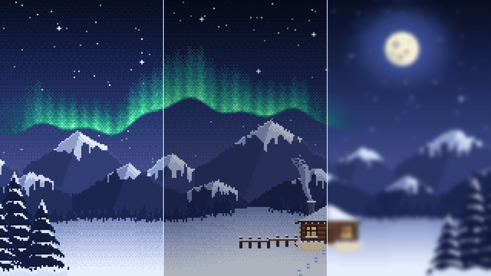

# พื้นหลังเมนู

เลย์เอาต์สามารถกำหนดพื้นหลังเฉพาะให้กับหน้าจอได้ ไม่ว่าจะเป็นรูปภาพ ภาพเคลื่อนไหว พาโนรามา สไลด์โชว์ วิดีโอ สี เว็บไซต์ หรือเชดเดอร์ ซึ่งจะแทนที่พื้นหลังปกติของหน้าจอ เช่น พาโนรามาของหน้าจอ Title เอฟเฟกต์เบลอของเมนูอื่น ๆ หรือโลกที่อยู่ด้านหลังเมนูหยุดเกม

> [!TIP]
> หากต้องการให้เมนูทุกเมนูใช้พื้นหลังเดียวกันโดยไม่ต้องสร้างเลย์เอาต์ ให้ใช้ [การปรับแต่งส่วนกลาง](/global-customizations#menu-backgrounds)

# การตั้งค่าพื้นหลัง

1. เปิดเลย์เอาต์ของหน้าจอใน [ตัวแก้ไขเลย์เอาต์](/layout-editor)
2. คลิกขวาที่พื้นหลังของตัวแก้ไข แล้วเปิด **Menu Backgrounds** นอกจากนี้ยังเข้าถึงได้จาก **แถบเมนู -> Layout -> Layout Properties**
3. เปิดประเภทพื้นหลัง เช่น **Image**
4. คลิก **Show Background** เพื่อตั้งค่าเป็น **Enabled**
5. ตั้งค่าพื้นหลัง เช่น คลิก **Choose Image** เพื่อเลือกรูปภาพสำหรับพื้นหลังประเภท Image

ใน **Menu Backgrounds** ประเภทที่เปิดใช้อยู่จะมีเครื่องหมาย ✔ อยู่ข้างหน้า ส่วนประเภทที่ปิดใช้อยู่จะมีเครื่องหมาย ✖ วางเมาส์เหนือประเภทเพื่อดูคำอธิบาย

หากต้องการคืนค่าพื้นหลังปกติของหน้าจอ ให้ตั้งค่า **Show Background** ของประเภทนั้นเป็น **Disabled** การตั้งค่าจะยังคงอยู่ คุณจึงเปิดใช้อีกครั้งภายหลังได้

# ประเภทพื้นหลัง

## Image

ใช้รูปภาพจากไฟล์ของคุณ เว็บไซต์ หรือทรัพยากรของเกม โดยขยายให้เต็มทั้งหน้าจอ นอกจากนี้ยังเล่นรูปภาพเคลื่อนไหวได้ด้วย ดูรายการไฟล์ที่รองรับได้ที่ [รูปภาพ](/images)

- **Choose Image**: รูปภาพ แหล่งที่มาที่เลือกได้มีดังนี้: [ทรัพยากร](/resources)
- **Choose Fallback Image**: รูปภาพที่แสดงเมื่อโหลดรูปภาพหลักไม่ได้ เช่น รูปภาพจากเว็บขณะที่คุณออฟไลน์
- **Restart Animated Textures When Opening Screen**: เริ่มเล่น [รูปภาพเคลื่อนไหว](/animations) ใหม่ทุกครั้งที่เปิดหน้าจอ หากปิดไว้ รูปภาพจะเล่นต่อจากตำแหน่งเดิม
- **Repeat Texture**: เรียงรูปภาพซ้ำทั่วทั้งหน้าจอแทนการยืดรูปภาพ ดู [การแบ่งภาพเก้าส่วนและการเรียงซ้ำ](/nine-slicing-and-tiling)
- **Slide Wide Images From Left To Right**: รูปภาพกว้าง เช่น ภาพถ่ายทิวทัศน์ทั้งผืน จะเต็มความสูงของหน้าจอและค่อย ๆ เลื่อนจากด้านหนึ่งไปอีกด้านหนึ่ง โดยหยุดสั้น ๆ ที่ปลายแต่ละด้าน
- **Parallax Effect** และการตั้งค่าต่าง ๆ: รูปภาพจะขยับเล็กน้อยตามเมาส์ ดู [เอฟเฟกต์พารัลแลกซ์](/parallax#menu-backgrounds)

ไม่สามารถเปิด **Slide Wide Images From Left To Right** พร้อมกับ **Repeat Texture** หรือ **Parallax Effect** ได้

## Color

ใช้สีเดียวทั่วทั้งหน้าจอ

- **Color [HEX]**: สี เช่น `#1B2440` หากเพิ่มอีกสองหลัก สีจะโปร่งใสได้ เช่น `#1B2440C8` นอกจากนี้ยังใช้เป็น [เพลซโฮลเดอร์](/placeholders) ได้

พื้นหลังประเภท Color จะอยู่ใต้พื้นหลังอื่น ๆ ของเลย์เอาต์ จึงเติมสีในส่วนโปร่งใสของพื้นหลังเหล่านั้น ดู [การซ้อนพื้นหลัง](#stacking-backgrounds)

## Cubic Panorama

พาโนรามาที่หมุนอย่างช้า ๆ เช่นเดียวกับพาโนรามาของหน้าจอ Title คุณสร้างพาโนรามาได้ใน `config/fancymenu/panoramas/` ดู [พาโนรามา](/panoramas)

- **Panorama Name**: เปิด **Choose Panorama** เพื่อเลือกพาโนรามาของคุณและดูตัวอย่าง
- **Clear Panorama**: ลบพาโนรามา

หากไม่มีพาโนรามา พื้นหลังจะแสดงเท็กซ์เจอร์สีม่วงและดำที่ใช้แทนเท็กซ์เจอร์ที่หายไปของ Minecraft

## Slideshow

แสดงรูปภาพในสไลด์โชว์ทีละภาพ คุณสร้างสไลด์โชว์ได้ใน `config/fancymenu/slideshows/` ดู [สไลด์โชว์](/slideshows)

- **Slideshow Name**: เปิด **Choose Slideshow** เพื่อเลือกสไลด์โชว์ของคุณ
- **Clear Slideshow**: ลบสไลด์โชว์

หากไม่มีสไลด์โชว์ พื้นหลังจะแสดงเท็กซ์เจอร์ที่หายไปของ Minecraft เช่นกัน

## Video

เล่นวิดีโอจากไฟล์ของคุณ เว็บไซต์ หรือทรัพยากรของเกม ต้องใช้ Watermedia ดู [วิดีโอ](/video#requirements) หากไม่มี Watermedia พื้นหลังจะแสดงข้อความพร้อมลิงก์ดาวน์โหลด

- **Video Source**: วิดีโอ
- **Loop Video**, **Volume** และ **Sound Channel**: กำหนดวิธีเล่นวิดีโอ
- **Parallax Effect** และการตั้งค่าต่าง ๆ: ทำงานเหมือนกับพื้นหลังประเภท Image
- **Play Video In Layout Editor**: เมื่อปิดไว้ วิดีโอจะหยุดชั่วคราวในตัวแก้ไขเลย์เอาต์

[แอ็กชัน](/video) สามารถหยุดวิดีโอชั่วคราวและเปลี่ยนระดับเสียงกับเวลาเล่นได้ โดยต้องใช้ ID ของพื้นหลัง คลิก **Copy Background Identifier** ในการตั้งค่าของพื้นหลังเพื่อคัดลอก ID

## Browser

แสดงเว็บไซต์เต็มทั้งหน้าจอ คล้ายกับ[องค์ประกอบ Browser](/elements#browser)

> [!IMPORTANT]
> Browser ต้องใช้ม็อด [Rinku](https://modrinth.com/mod/rinku) หากไม่มีม็อดนี้ พื้นหลังจะเป็นสีแดงและแสดงข้อความว่าไม่มี Rinku

- **URL**: เว็บไซต์ สามารถใส่ [เพลซโฮลเดอร์](/placeholders) ได้
- **Process Mouse Clicks**, **Process Mouse Scrolls** และ **Process Keyboard Presses**: อนุญาตให้ผู้เล่นคลิก เลื่อน และพิมพ์บนเว็บไซต์ เว็บไซต์จะได้รับอินพุตจากแป้นพิมพ์ทันทีที่เปิดหน้าจอ
- **Consume Mouse Clicks**, **Consume Mouse Scrolls** และ **Consume Keyboard Presses**: หยุดคลิก การเลื่อน และการกดแป้นพิมพ์ไม่ให้ส่งต่อไปยังเว็บไซต์ เพื่อไม่ให้หน้าจอตอบสนองต่ออินพุตเหล่านั้นด้วย
- **Mute Browser**, **Audio/Video Volume**, **Loop Videos** และ **Hide Video Controls**: ตั้งค่ามีเดียบนเว็บไซต์

ปุ่มและองค์ประกอบที่อยู่หน้าพื้นหลังจะได้รับการคลิกก่อนเสมอ ในตัวแก้ไขเลย์เอาต์ พื้นหลังจะแสดงเป็นลายทางแทนเว็บไซต์

## GLSL Shader

ใช้วาดเชดเดอร์ ซึ่งเป็นโปรแกรมขนาดเล็กสำหรับการ์ดจอ เช่น คลื่นเคลื่อนไหว ดวงดาว หรือลวดลาย และยังใช้เชดเดอร์จาก Shadertoy ได้ด้วย

- **Shader Source**: โค้ดของเชดเดอร์
- **Show Compile Errors**: แสดงข้อผิดพลาดในโค้ดบนหน้าจอ ปิดตัวเลือกนี้เมื่อทำเลย์เอาต์เสร็จแล้ว

การตั้งค่าอื่น ๆ เช่น พาสเพิ่มเติม เท็กซ์เจอร์ และเวลา อธิบายไว้ใน [GLSL Shader API](/glsl-shader-api)

## Video [Rinku]

พื้นหลังวิดีโอรุ่นเก่าที่ต้องใช้ Rinku จะแสดงในรายการเฉพาะเมื่อเปิดใช้อยู่ เช่น ในเลย์เอาต์จากเวอร์ชันเก่า ให้ใช้ **Video** แทน

# การตั้งค่าที่ใช้กับพื้นหลังทุกประเภท

ใต้รายการประเภทพื้นหลัง ใน **Menu Backgrounds** มีการตั้งค่าที่ใช้กับพื้นหลังทุกประเภทของเลย์เอาต์ดังนี้:

- **Preserve Background Aspect Ratio**: คงสัดส่วนของพื้นหลังประเภท Image, Slideshow และ Video โดยพื้นหลังยังคงเต็มทั้งหน้าจอ แต่ส่วนที่ไม่พอดีจะถูกตัดออก หากปิดไว้ ภาพจะถูกยืดให้พอดีกับหน้าจอ
- **Show Dark Overlay On Custom Background**: วางเลเยอร์สีเข้มแบบโปร่งใสของเมนู Minecraft ไว้บนพื้นหลัง เพื่อให้ปุ่มและข้อความโดดเด่นขึ้น
- **Apply Vanilla Background Blur**: ทำให้พื้นหลังเบลอเหมือนกับที่ Minecraft เบลอโลกด้านหลังเมนู ระดับความเบลอขึ้นอยู่กับค่า **Menu Background Blur** ของผู้เล่นใน **Accessibility Settings** ของ Minecraft หากตั้งค่าเป็น `0` จะไม่มีการเบลอ

จากซ้ายไปขวา: ไม่ใช้การตั้งค่า, **Show Dark Overlay On Custom Background** และ **Apply Vanilla Background Blur**

# การซ้อนพื้นหลัง

คุณสามารถเปิดใช้พื้นหลังหลายประเภทในเลย์เอาต์เดียวกันได้ โดยจะวาดซ้อนกันตามลำดับนี้จากล่างขึ้นบน:

1. Color
2. Cubic Panorama
3. Image
4. Slideshow
5. Video
6. Video [Rinku]
7. Browser
8. GLSL Shader

ประเภทที่เพิ่มโดยม็อดอื่น ๆ จะอยู่บนสุด

FancyMenu วาดสีดำไว้ด้านหลังพื้นหลัง ดังนั้นส่วนโปร่งใสของรูปภาพจึงแสดงเป็นสีดำ หากวางพื้นหลังประเภท Color ไว้ด้านล่าง ก็จะเติมสีลงในส่วนเหล่านั้น:

ด้านซ้ายเปิดใช้เฉพาะ Image ส่วนด้านขวาใช้พื้นหลัง Color เติมสีท้องฟ้า

- Image, Slideshow หรือ Shader ที่โปร่งใสและอยู่เหนือ Cubic Panorama จะทำงานในลักษณะเดียวกัน เช่น ใช้เป็นกรอบล้อมรอบพาโนรามาที่กำลังหมุน
- พื้นหลังประเภท Video จะไม่โปร่งใส แต่จะบังทุกอย่างที่อยู่ด้านล่าง แม้ในบริเวณที่วิดีโอไปไม่ถึงก็ตาม

## หลายเลย์เอาต์

เมื่อมีเลย์เอาต์หลายรายการทำงานบนหน้าจอ เช่น [เลย์เอาต์สากล](/universal-layouts) และเลย์เอาต์ของหน้าจอนั้น ๆ พื้นหลังของเลย์เอาต์เหล่านั้นจะซ้อนกันด้วย:

- เลย์เอาต์ที่มีค่า **Layout Index [Multi-Layout Ordering]** สูงกว่าจะอยู่ด้านบน ตั้งค่าได้ในเมนูคลิกขวาที่พื้นหลังของตัวแก้ไข
- หากเลย์เอาต์ใดเปิดใช้[การตั้งค่าที่ใช้กับพื้นหลังทุกประเภท](#settings-for-all-backgrounds) การตั้งค่านั้นจะมีผลกับพื้นหลังของเลย์เอาต์ทั้งหมด
- ตัวแก้ไขเลย์เอาต์จะแสดงเฉพาะพื้นหลังของเลย์เอาต์ที่คุณกำลังแก้ไข

# ข้อควรรู้

- องค์ประกอบของเลย์เอาต์จะอยู่หน้าพื้นหลังของเลย์เอาต์นั้นเสมอ
- **Copy Background Identifier** ในการตั้งค่าของพื้นหลังแต่ละประเภท จะคัดลอก ID ของพื้นหลังสำหรับใช้กับแอ็กชันและเพลซโฮลเดอร์ที่ควบคุมพื้นหลังนั้น เช่น รายการสำหรับ[พื้นหลังประเภท Video](/video)
- **Export for AI** ในการตั้งค่าของพื้นหลังแต่ละประเภท จะคัดลอกพื้นหลังสำหรับใช้ในการ[แชต AI](/export-for-ai)
- ส่วนหัวและส่วนท้ายของหน้าจอที่มีรายการ เช่น รายการโลก จะมีเท็กซ์เจอร์ของตัวเอง คลิกขวาที่พื้นหลังของตัวแก้ไข แล้วเปิด **Header/Footer Customizations**
