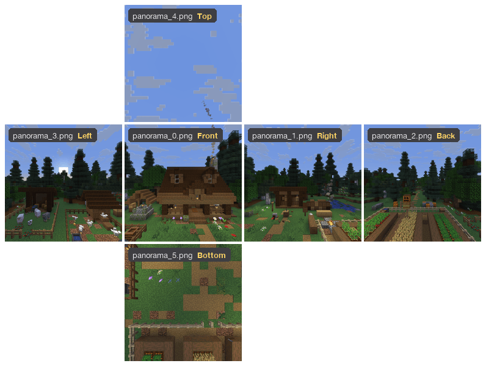

# ภาพพาโนรามา

ภาพพาโนรามาคือพื้นหลังที่ค่อย ๆ หมุนรอบตัวคุณ เหมือนกับภาพบนหน้าจอชื่อเรื่องของ Minecraft โดยสร้างจากภาพ 6 ภาพที่ประกอบกันเป็นลูกบาศก์ล้อมรอบผู้ชม

คุณสามารถแสดงภาพพาโนรามาของคุณเป็น[พื้นหลังเมนู](/menu-backgrounds)ของเลย์เอาต์ หรือใช้แทนภาพพาโนรามาของ Minecraft ในเมนูทั้งหมดได้


> [!TIP]
> ภาพพาโนรามาในหน้านี้ใช้งานได้ฟรี ทั้งเพื่อทดสอบและใช้ในม็อดแพ็กของคุณเอง: [forest_homestead.zip](https://raw.githubusercontent.com/Keksuccino/docs_fancymenu/refs/heads/wiki-2026/assets/forest_homestead.zip) (4 MB) แตกไฟล์ไปไว้ใน `config/fancymenu/panoramas/` แล้วโหลด FancyMenu ใหม่

# สร้างภาพพาโนรามา

1. เปิดโฟลเดอร์ `panoramas` ใน `config/fancymenu/` ภายในโฟลเดอร์เกมของคุณ โดยเลือก **แถบเมนู -> Tools -> Open FancyMenu Directory** เพื่อเปิด `config/fancymenu/`
2. สร้างโฟลเดอร์สำหรับภาพพาโนรามาของคุณ เช่น `forest_homestead` จะตั้งชื่อว่าอะไรก็ได้
3. ใส่ไฟล์ `properties.txt` และโฟลเดอร์ชื่อ `panorama` ที่มี[ภาพทั้ง 6 ภาพ](#ภาพทั้งหก)ลงไป จะใส่ `overlay.png` เพิ่มหรือไม่ก็ได้
4. โหลด FancyMenu ใหม่โดยเลือก **แถบเมนู -> Customization -> Reload FancyMenu** หรือกด `Ctrl + Alt + R` (`Cmd + Alt + R` บน macOS) หรือเริ่มเกมใหม่

```text
config/fancymenu/panoramas/
└── forest_homestead/
    ├── properties.txt
    ├── overlay.png
    └── panorama/
        ├── panorama_0.png
        ├── panorama_1.png
        ├── panorama_2.png
        ├── panorama_3.png
        ├── panorama_4.png
        └── panorama_5.png
```

# ภาพทั้งหก

ภาพแต่ละภาพจะเป็นด้านหนึ่งของลูกบาศก์:



| ภาพ | ด้าน |
|---|---|
| `panorama_0.png` | ด้านหน้า |
| `panorama_1.png` | ด้านขวา |
| `panorama_2.png` | ด้านหลัง |
| `panorama_3.png` | ด้านซ้าย |
| `panorama_4.png` | ด้านบน |
| `panorama_5.png` | ด้านล่าง |

- ภาพทั้งสี่ด้านจะเรียงต่อกันรอบตัวคุณตามลำดับนี้: ขอบขวาของแต่ละภาพจะต่อกับขอบซ้ายของภาพถัดไป และขอบขวาของ `panorama_3.png` จะต่อกับขอบซ้ายของ `panorama_0.png`
- ขอบล่างของภาพด้านบนจะติดกับขอบบนของภาพด้านหน้า ส่วนขอบบนของภาพด้านล่างจะติดกับขอบล่างของภาพด้านหน้า
- ภาพทั้งหกต้องเป็นไฟล์ PNG ที่มีขนาดเท่ากัน และควรเป็นภาพสี่เหลี่ยมจัตุรัส เช่น 1024 × 1024
- FancyMenu ไม่ปรับภาพให้เรียบเนียน ภาพพิกเซลอาร์ตจึงยังคมชัด

Minecraft ใช้การจัดวางแบบเดียวกันนี้กับภาพพาโนรามาของตัวเอง ดังนั้นภาพพาโนรามาที่สร้างสำหรับ Minecraft ก็ใช้ได้เช่นกัน

# properties.txt

```text
type = panorama

panorama-meta {
  name = forest_homestead
  speed = 2.0
  fov = 85.0
  angle = 25.0
  start_rotation = 0
}
```

| การตั้งค่า | หน้าที่ |
|---|---|
| `name` | ชื่อที่ใช้เลือกภาพพาโนรามา แต่ละภาพพาโนรามาควรมีชื่อไม่ซ้ำกัน |
| `speed` | ความเร็วในการหมุน ค่า `1.0` หมุนครบหนึ่งรอบในเวลาประมาณ 4 นาที ส่วน `2.0` จะหมุนเร็วขึ้นสองเท่า ค่า `0` จะหยุดนิ่ง ความเร็วที่มากกว่า `10.0` จะไม่ทำให้หมุนเร็วขึ้นอีก |
| `fov` | ขอบเขตของภาพพาโนรามาที่ปรากฏบนหน้าจอ หน่วยเป็นองศา วัดจากด้านบนถึงด้านล่างของหน้าจอ ค่าที่น้อยลงจะซูมเข้า |
| `angle` | มุมก้มลง หน่วยเป็นองศา ค่า `0` จะมองตรงไปที่เส้นขอบฟ้า ส่วนค่าติดลบจะมองขึ้นด้านบน |
| `start_rotation` | จุดเริ่มต้นของการหมุน หน่วยเป็นองศา ตั้งแต่ `0` ถึง `360` ค่า `0` จะเริ่มโดยให้ภาพด้านหน้าอยู่ตรงกลาง |

จำเป็นต้องระบุเพียง `name` เท่านั้น การตั้งค่าที่ไม่ได้ระบุจะใช้ค่าเริ่มต้น `speed = 1.0`, `fov = 85.0`, `angle = 25.0` และ `start_rotation = 0` คงบรรทัด `type = panorama` และ `panorama-meta {` ไว้ตามเดิม เขียนการตั้งค่าหนึ่งรายการต่อบรรทัด และใช้จุดสำหรับเลขทศนิยม เช่น `1.5`

# ภาพซ้อนทับ

ไฟล์ `overlay.png` ที่อยู่ข้าง `properties.txt` จะถูกวาดทับภาพพาโนรามา โดยขยายให้เต็มหน้าจอ ภาพนี้จะไม่หมุนไปพร้อมกับภาพพาโนรามา จึงเหมาะสำหรับใช้ทำเอฟเฟกต์ขอบมืด กรอบภาพ หรือย้อมสี ส่วนที่โปร่งใสจะแสดงภาพพาโนรามาด้านล่าง

# วิธีใช้ภาพพาโนรามา

## ใช้เป็นพื้นหลังเมนู


1. ใน[ตัวแก้ไขเลย์เอาต์](/layout-editor) คลิกขวาที่พื้นหลัง แล้วเปิด **Menu Backgrounds -> Cubic Panorama**
2. คลิก **Show Background** เพื่อเปิดใช้งาน
3. คลิก **Panorama Name** เลือกภาพพาโนรามาของคุณ แล้วคลิก **Done** ตัวอย่างทางด้านขวาจะแสดงภาพที่กำลังหมุน

คลิก **Clear Panorama** เพื่อนำภาพออก หากต้องการใช้ร่วมกับพื้นหลังอื่น โปรดดูที่ [พื้นหลังเมนู](/menu-backgrounds)

## ใช้ในเมนูทั้งหมด

เลือก **แถบเมนู -> Customization -> Global Customizations -> Custom Menu Background Panorama -> Choose Panorama** เพื่อแสดงภาพพาโนรามาของคุณแทนภาพของ Minecraft บนหน้าจอชื่อเรื่องและในเมนูทั้งหมดก่อนเข้าร่วมโลก ดูรายละเอียดที่ [การปรับแต่งส่วนกลาง](/global-customizations#menu-backgrounds)

## โหลดล่วงหน้า

ภาพพาโนรามาขนาดใหญ่อาจใช้เวลาสักครู่กว่าจะแสดงในครั้งแรก หากต้องการโหลดภาพระหว่างที่เกมเริ่มทำงาน ให้เพิ่มภาพด้วย **Add Cubic Panorama** ใน **แถบเมนู -> Customization -> Pre-Load Resources** ดูรายละเอียดที่ [โหลดทรัพยากรล่วงหน้า](/preload-layouts#pre-loading-slideshows--panoramas)

# ข้อมูลที่ควรรู้

- ภาพพาโนรามาหมุนไปทางขวา: ภาพด้านหน้าจะเลื่อนไปทางซ้าย และภาพด้านขวาจะเข้ามาแทน
- เมนูทั้งหมดที่ใช้ภาพพาโนรามาเดียวกันจะแชร์การหมุนร่วมกัน จึงหมุนต่อเนื่องอย่างราบรื่นเมื่อสลับเมนู การหมุนจะหยุดชั่วคราวเมื่อไม่มีเมนูใดแสดงภาพนั้น
- เมื่อโหลด FancyMenu ใหม่ ภาพพาโนรามาทุกภาพจะเริ่มหมุนใหม่จากค่า `start_rotation`
- ภาพพาโนรามาจะอยู่ใน[โปรไฟล์](/profiles)ที่โหลดอยู่
- หากไม่มีภาพพาโนรามาใน **Choose Panorama** แสดงว่าโหลดไม่สำเร็จ ดูสาเหตุได้ในล็อกของเกมที่ `logs/latest.log` เช่น ไม่ได้ระบุ `name` หรือไม่มีไฟล์ภาพ
- ลายตารางสีม่วงดำหมายถึงยังไม่ได้เลือกภาพพาโนรามา ภาพทั้งหกมีขนาดไม่เท่ากัน หรือเลย์เอาต์ใช้ชื่อภาพพาโนรามาที่ไม่มีอยู่แล้ว
- หากภาพพาโนรามาสองภาพมี `name` เหมือนกัน จะแสดงเพียงภาพเดียว
