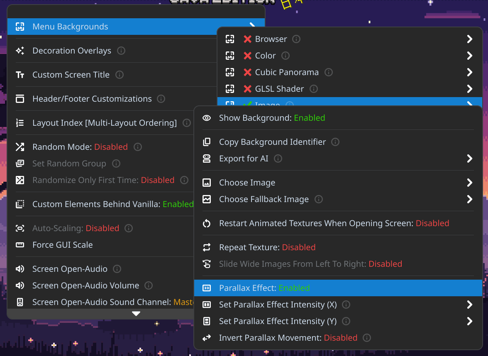

# เอฟเฟกต์พารัลแลกซ์

เอฟเฟกต์พารัลแลกซ์จะขยับพื้นหลังเมนูหรือองค์ประกอบเล็กน้อยเมื่อเมาส์เคลื่อนที่ ให้เลเยอร์ที่อยู่ไกลเคลื่อนที่น้อยกว่าเลเยอร์ที่อยู่ใกล้ แล้วเมนูของคุณจะดูมีมิติขึ้น

ใช้ได้กับ[องค์ประกอบ](/elements) และ[พื้นหลังเมนู](/menu-backgrounds)ประเภท **Image** และ **Video**

# องค์ประกอบ

1. คลิกขวาที่องค์ประกอบในตัวแก้ไขเลย์เอาต์ แล้วเลื่อนลงไปที่ **Parallax Effect**
2. คลิก **Parallax Effect** เพื่อตั้งค่าเป็น **Enabled**
3. คลิก **Parallax Intensity (X)** และ **Parallax Intensity (Y)** เพื่อกำหนดระยะที่องค์ประกอบจะเคลื่อนที่
4. บันทึกเลย์เอาต์แล้วปิดตัวแก้ไข องค์ประกอบจะเคลื่อนที่เฉพาะเมื่ออยู่นอกตัวแก้ไขเท่านั้น

หากต้องการใช้เอฟเฟกต์กับองค์ประกอบหลายชิ้นพร้อมกัน ให้[เลือก](/layout-editor#selecting)องค์ประกอบเหล่านั้นก่อน (`Ctrl` + คลิกเพื่อเพิ่มองค์ประกอบลงในการเลือก) แล้วคลิกขวาที่องค์ประกอบใดองค์ประกอบหนึ่ง

| การตั้งค่า | การทำงาน |
|---|---|
| **Parallax Effect** | เปิดเอฟเฟกต์ |
| **Parallax Intensity (X)** | กำหนดระยะที่องค์ประกอบเคลื่อนไปทางซ้ายและขวา ตั้งแต่ `0.0` (ไม่เคลื่อนที่เลย) ถึง `1.0` องค์ประกอบใหม่จะมีค่า `0.5` |
| **Parallax Intensity (Y)** | กำหนดระยะที่องค์ประกอบเคลื่อนขึ้นและลงในลักษณะเดียวกัน |
| **Invert Parallax Movement** | ทำให้องค์ประกอบเคลื่อนไปในทิศทางเดียวกับเมาส์ หากไม่เปิดใช้ องค์ประกอบจะเคลื่อนไปในทิศทางตรงกันข้าม |

เมื่อกำหนดค่าเป็น `1.0` องค์ประกอบจะเคลื่อนไปด้านข้างได้สูงสุด 5% ของความกว้างหน้าจอ และขึ้นหรือลงได้สูงสุด 5% ของความสูงหน้าจอ เมื่อเมาส์อยู่ตรงขอบหน้าจอ ส่วนตรงกลางหน้าจอ องค์ประกอบจะอยู่ในตำแหน่งที่คุณวางไว้

- องค์ประกอบที่[ยึดตำแหน่ง](/positioning-elements)กับองค์ประกอบที่เปิดเอฟเฟกต์ไว้จะเคลื่อนที่ตาม และเอฟเฟกต์ขององค์ประกอบนั้นเองจะเพิ่มระยะการเคลื่อนที่ด้วย
- **Stay on Screen** ไม่ได้ช่วยให้องค์ประกอบที่เปิดเอฟเฟกต์อยู่ภายในหน้าจอ องค์ประกอบจึงอาจเคลื่อนเลยขอบหน้าจอได้
- องค์ประกอบที่ถูกยืดจะไม่เคลื่อนไปในทิศทางที่ถูกยืด
- [ปุ่มและแถบเลื่อนแบบ Vanilla](/vanilla-elements) จะเคลื่อนที่หลังจากที่คุณขยับปุ่มหรือแถบเลื่อนเหล่านั้นแล้วเท่านั้น หากใช้จุดยึด **Vanilla (Original)** องค์ประกอบเหล่านั้นจะอยู่ในตำแหน่งที่เกมกำหนดไว้
- ปุ่มยังคงคลิกได้ในตำแหน่งที่แสดงอยู่
- [พื้นที่เลื่อนได้](/scrollable-areas) องค์ประกอบภายในพื้นที่เหล่านั้น และองค์ประกอบ Tooltip ไม่มีเอฟเฟกต์พารัลแลกซ์

# พื้นหลังเมนู

1. คลิกขวาที่พื้นหลังของตัวแก้ไข แล้วเปิด **Menu Backgrounds -> Image** (หรือ **Video**)
2. คลิก **Parallax Effect** เพื่อตั้งค่าเป็น **Enabled**
3. ตั้งค่า **Set Parallax Effect Intensity (X)** และ **Set Parallax Effect Intensity (Y)**

พื้นหลังจะตอบสนองแรงกว่าองค์ประกอบมาก พื้นหลังจะขยายใหญ่ขึ้นตามค่าความเข้มของเอฟเฟกต์ เพื่อไม่ให้เห็นขอบของพื้นหลัง เมื่อกำหนดค่าเป็น `1.0` พื้นหลังจะมีขนาดเป็นสองเท่าของหน้าจอ และเคลื่อนไปด้านข้างได้สูงสุดครึ่งหนึ่งของหน้าจอ ควรกำหนดค่าไว้ต่ำ ๆ โดยพื้นหลังใหม่จะมีค่า `0.02` และค่าตั้งแต่ `0.01` ถึง `0.1` จะใช้งานได้ดี

- **Invert Parallax Movement** ทำให้พื้นหลังเคลื่อนไปในทิศทางเดียวกับเมาส์
- ไม่สามารถเปิดใช้ **Slide Wide Images From Left To Right** และ **Parallax Effect** พร้อมกันได้
- ใช้ **Repeat Texture** และ **Preserve Background Aspect Ratio** ร่วมกับเอฟเฟกต์นี้ได้
- พื้นหลังจะเคลื่อนที่ในตัวแก้ไขเลย์เอาต์ด้วย

# สร้างฉากให้มีมิติ

ฉากที่ด้านบนของหน้านี้ประกอบด้วยท้องฟ้าและเลเยอร์สามชั้นบนหน้าจอชื่อเกม:

1. วาดฉากเป็นเลเยอร์ ไล่จากระยะไกลมาหาระยะใกล้ เช่น ท้องฟ้า ภูเขา เนินเขา และฉากหน้า เลเยอร์ทั้งหมดที่ไม่ใช่ท้องฟ้าควรเป็นภาพ PNG ที่มีส่วนโปร่งใส
2. ตั้งค่าท้องฟ้าเป็นพื้นหลังเมนูแบบ **Image** แล้วเปิดใช้ Parallax Effect
3. เพิ่มเลเยอร์อื่น ๆ ทีละชั้นเป็น[องค์ประกอบ Image](/elements#image) โดยเริ่มจากชั้นที่อยู่ไกลไปหาชั้นที่อยู่ใกล้ที่สุด เพื่อให้ชั้นที่ใกล้ที่สุดอยู่ด้านบน
4. ทำให้เลเยอร์มีขนาดใหญ่กว่าหน้าจอเล็กน้อย เพื่อไม่ให้เห็นขอบเมื่อเลเยอร์เคลื่อนที่ เลเยอร์ที่มีค่า `1.0` ต้องกว้างกว่าหน้าจอด้านซ้ายและขวาอย่างละ 5% ของความกว้างหน้าจอ และสูงกว่าหน้าจอด้านบนและด้านล่างอย่างละ 5% ของความสูงหน้าจอ ปิด **Stay on Screen** เพื่อวางเลเยอร์ให้เลยขอบหน้าจอ
5. เปิด Parallax Effect สำหรับทุกเลเยอร์ โดยกำหนดค่าความเข้มต่ำสำหรับเลเยอร์ที่อยู่ไกล และสูงสำหรับเลเยอร์ที่อยู่ใกล้
6. คลิกขวาที่พื้นหลังของตัวแก้ไข แล้วตั้งค่า **Custom Elements Behind Vanilla** เป็น **Enabled** เพื่อให้เลเยอร์อยู่หลังปุ่มและโลโก้

ค่าความเข้มของฉากนี้มีดังนี้:

| เลเยอร์ | ความเข้ม (X) | ความเข้ม (Y) |
|---|---|---|
| ท้องฟ้า (พื้นหลังเมนู) | `0.02` | `0.01` |
| ภูเขา | `0.35` | `0.2` |
| เนินเขา | `0.6` | `0.3` |
| ฉากหน้า | `1.0` | `0.5` |

> [!TIP]
> กำหนดความเข้มแกน Y ให้มีค่าประมาณครึ่งหนึ่งของแกน X วิธีนี้จะช่วยให้พื้นของทิวทัศน์ไม่เด้งขึ้นลงมากเกินไป

# ข้อมูลน่ารู้

- ทุกอย่างจะเคลื่อนที่ทีละพิกเซลของ GUI ดังนั้นค่าความเข้มต่ำจะทำให้เคลื่อนที่เป็นช่วงเล็ก ๆ
- การตั้งค่าความเข้มรองรับ[ตัวแทนค่า](/placeholders) โดยชี้ไปที่ตัวแทนค่าแล้วคลิก **Set As Plain Text** ในเมนูเล็ก ๆ ที่อยู่ข้างตัวแทนค่านั้น เมื่อใช้[ตัวแปร](/variables) คุณจะเปิดให้ผู้เล่นปรับลดเอฟเฟกต์ได้จากเมนูการตั้งค่าที่คุณสร้างขึ้นเอง
