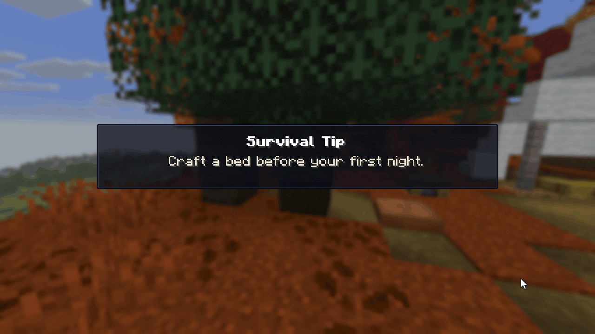

# ตัวกำหนดเวลา

ตัวกำหนดเวลาจะเรียกใช้ [สคริปต์แอ็กชัน](/action-scripts) ตามเวลาที่กำหนด ไม่ว่าจะเป็นการเรียกใช้ครั้งเดียวหลังรอระยะหนึ่ง เรียกใช้สองสามครั้ง หรือเรียกใช้ซ้ำไปเรื่อย ๆ จนกว่าจะมีบางอย่างหยุดการทำงาน ตัวกำหนดเวลาใช้ได้ในทุกเมนูและระหว่างเล่นเกม แม้ไม่มีเมนูเปิดอยู่ และไม่ได้เป็นส่วนหนึ่งของเลย์เอาต์

ตัวกำหนดเวลาเป็นวิธีที่แนะนำสำหรับทุกสิ่งที่ควรเกิดขึ้นในภายหลังหรือเกิดซ้ำ ใช้แทน [องค์ประกอบ Ticker](/elements#ticker) เมื่อทำได้

> [!CAUTION]
> ตัวกำหนดเวลาอาจเรียกใช้แอ็กชันเกี่ยวกับไฟล์ เครือข่าย คำสั่ง คลิปบอร์ด แพ็กทรัพยากร และลิงก์ได้ แม้ไม่มีเมนูเปิดอยู่ ใช้ตัวกำหนดเวลาจากโปรไฟล์และไฟล์ของคนที่คุณไว้ใจเท่านั้น

# เพิ่มตัวกำหนดเวลา

1. เปิด **menu bar -> Customization -> Manage Schedulers**
2. คลิก **Add Scheduler** โปรแกรมจะเปิดตัวแก้ไขสคริปต์แอ็กชัน
3. เพิ่มแอ็กชันที่ต้องการให้ทำงานทุกครั้ง แล้วคลิก **Done** ดูข้อมูลเพิ่มเติมที่ [สคริปต์แอ็กชัน](/action-scripts#making-an-action-script)

4. ตัวกำหนดเวลาใหม่จะปรากฏขึ้นพร้อม ID แบบสุ่ม คลิกตัวกำหนดเวลา แล้วคลิก **Edit Settings**
5. กำหนด **Scheduler ID** เช่น `random_tip` ตั้งค่า[ตัวจับเวลา](#settings) แล้วคลิก **Done**
6. คลิก **Start Now** เพื่อทดลองใช้

การเปลี่ยนแปลงทุกอย่างใน **Manage Schedulers** จะถูกบันทึกทันที

ตัวกำหนดเวลาใน GIF จะเรียกใช้ [**Arrange List (FM Variable)**](/action-scripts#arrange-list-fm-variable) โดยเลือก **Shuffle** สำหรับรายการ `tips` ทุก 4 วินาที องค์ประกอบ Text จะแสดงรายการแรกของรายการ จึงแสดงเคล็ดลับแบบสุ่ม ดูวิธีทำงานของรายการและข้อความได้ที่ [แอ็กชันรายการ](/variables#list-actions)

# การตั้งค่า

| การตั้งค่า | ใช้ทำอะไร |
|---|---|
| **Scheduler ID** | ชื่อที่แอ็กชันและเงื่อนไขใช้ได้ ใช้ได้เฉพาะตัวอักษรภาษาอังกฤษพิมพ์เล็ก ตัวเลข `.`, `_` และ `-` |
| **Start Delay (ms)** | ระยะเวลาที่รอหลังเริ่มทำงาน ก่อนเรียกใช้ครั้งแรก ค่า `0` จะเรียกใช้ทันที |
| **Tick Delay (ms)** | ระยะเวลาระหว่างการเรียกใช้แต่ละครั้ง ค่า `0` จะเรียกใช้ทุกทิก หรือ 20 ครั้งต่อวินาที |
| **Ticks to Run** | จำนวนครั้งที่เรียกใช้ก่อนหยุดเอง ค่า `0` จะทำงานต่อไปจนกว่าจะมีบางอย่างหยุดการทำงาน |
| **Start on Launch** | เริ่มทำงานทุกครั้งที่เปิดเกม |

เวลาระบุเป็นมิลลิวินาที: `1000` คือหนึ่งวินาที, `60000` คือหนึ่งนาที และ `1800000` คือครึ่งชั่วโมง

# เริ่มและหยุดการทำงาน

ตัวกำหนดเวลาจะทำงานหลังจากเริ่มทำงานแล้วเท่านั้น:

- เมื่อเกมเริ่มทำงานและหลังจากสลับ[โปรไฟล์](/profiles) หากเปิด **Start on Launch** ไว้
- คลิก **Start Now** ใน **Manage Schedulers** ขณะที่ตัวกำหนดเวลาทำงานอยู่ ปุ่มจะเปลี่ยนเป็น **Stop Now**
- ใช้แอ็กชัน [**Start Scheduler**](/action-scripts#start-scheduler) พร้อม ID ของตัวกำหนดเวลา เช่น ในสคริปต์ของปุ่มหรือ[ตัวฟังเหตุการณ์](/listeners)

ตัวกำหนดเวลาจะหยุดเมื่อ:

- ทำงานครบตามจำนวนครั้งที่กำหนดไว้ใน **Ticks to Run**
- คลิก **Stop Now** หรือใช้แอ็กชัน [**Stop Scheduler**](/action-scripts#stop-scheduler) พร้อม ID ของตัวกำหนดเวลา
- เปลี่ยนชื่อหรือลบตัวกำหนดเวลา สลับ[โปรไฟล์](/profiles) หรือปิดเกม หลังเริ่มเกมใหม่ จะมีเพียงตัวกำหนดเวลาที่เปิด **Start on Launch** ไว้เท่านั้นที่เริ่มทำงานอีกครั้ง

ตัวกำหนดเวลาที่กำลังทำงานจะเริ่มซ้ำอีกครั้งไม่ได้: **Start Scheduler** จะไม่มีผลจนกว่าตัวกำหนดเวลาจะหยุด หากต้องการเริ่มใหม่ ให้ใช้ **Stop Scheduler** แล้วตามด้วย **Start Scheduler**

เงื่อนไข [**Scheduler Is Running**](/conditions#scheduler-is-running) ใช้ตรวจสอบว่าตัวกำหนดเวลากำลังทำงานอยู่หรือไม่ เช่น ใช้แสดงปุ่มหยุดเฉพาะขณะที่ตัวกำหนดเวลาทำงาน

## ทำงานเฉพาะเมื่อมีหน้าจอเปิดอยู่

หากต้องการให้ตัวกำหนดเวลาทำงานเฉพาะเมื่อมีหน้าจอบางหน้าเปิดอยู่ เช่น หน้าจอชื่อเกม ให้ทำดังนี้:

1. เปิดเลย์เอาต์ของหน้าจอนั้นในตัวแก้ไขเลย์เอาต์
2. คลิกขวาที่พื้นหลังของตัวแก้ไข คลิก **Edit 'Open Screen' Action Script** แล้วเพิ่ม **Start Scheduler** พร้อม ID ของตัวกำหนดเวลา
3. คลิกขวาที่พื้นหลังอีกครั้ง คลิก **Edit 'Close Screen' Action Script** แล้วเพิ่ม **Stop Scheduler** พร้อม ID เดิม

# จัดการตัวกำหนดเวลา

- คลิกตัวกำหนดเวลาเพื่อดูการตั้งค่า สถานะการทำงาน และสคริปต์แอ็กชันทางด้านขวา
- คลิก **Edit Actions** หรือคลิกขวาที่ตัวกำหนดเวลาเพื่อเปิดสคริปต์แอ็กชัน
- ดับเบิลคลิก ID ของตัวกำหนดเวลาเพื่อเปลี่ยนชื่อ กด `Enter` เพื่อบันทึกชื่อ หรือกด `Esc` เพื่อยกเลิก การเปลี่ยนชื่อจะหยุดตัวกำหนดเวลา และแอ็กชันที่ใช้ ID เดิมจะค้นหาไม่พบอีกต่อไป
- **Remove Scheduler** จะลบตัวกำหนดเวลาที่เลือกหลังจากถามยืนยัน
- **Export for AI** จะคัดลอกตัวกำหนดเวลาที่เลือกหรือตัวกำหนดเวลาทั้งหมดสำหรับ[แชต AI](/export-for-ai)
- แถบค้นหาใช้ค้นหาตัวกำหนดเวลาจาก ID

ตัวกำหนดเวลาจะถูกบันทึกไว้ใน `config/fancymenu/scheduler_instances.txt` (ดู[ตำแหน่งจัดเก็บข้อมูล](/data-storage-locations)) แต่ละ[โปรไฟล์](/profiles) จะมีตัวกำหนดเวลาของตัวเอง

# ตัวอย่าง: เตือนให้พัก

แสดงข้อความแจ้งเตือนทุก 30 นาทีหลังเริ่มเกม:

1. เพิ่มตัวกำหนดเวลาที่มี [**Show Toast**](/action-scripts#show-toast) กำหนด **Title** เป็น `Time for a Break` และ **Message** เป็น `Stand up, stretch and drink some water.`
2. ใน **Edit Settings** กำหนด **Scheduler ID** เป็น `break_reminder` กำหนด **Start Delay (ms)** และ **Tick Delay (ms)** เป็น `1800000` และตั้งค่า **Start on Launch** เป็น **Enabled**

หากไม่ตั้งค่า **Start Delay (ms)** ข้อความแจ้งเตือนครั้งแรกจะแสดงทันทีเมื่อเริ่มเกม

# ข้อควรรู้

- ตั้งค่า **Tick Delay (ms)** ให้สูงที่สุดเท่าที่งานนั้นจะทำได้ หากตั้งเป็น `0` แอ็กชันจะทำงาน 20 ครั้งต่อวินาที และแอ็กชันที่ใช้เวลานานจะทำให้เกมกระตุก
- เมื่อเกมกระตุก การเรียกใช้หลายครั้งอาจเกิดขึ้นติด ๆ กัน
- การเปลี่ยนแปลงสคริปต์แอ็กชันจะมีผลทันที แม้ตัวกำหนดเวลาจะกำลังทำงานอยู่ ส่วนการเปลี่ยนแปลงการตั้งค่าจะมีผลเมื่อเริ่มทำงานครั้งถัดไป
- หากแอ็กชันทำงานล้มเหลว ตัวกำหนดเวลาจะยังทำงานต่อ ข้อผิดพลาดจะถูกบันทึกไว้ในล็อกของเกมที่ `logs/latest.log`
- หากต้องการรอเพียงครั้งเดียวภายในสคริปต์แอ็กชัน เช่น “เปิดหน้าจอหลังคลิก 2 วินาที” บล็อก [Execute Later](/action-scripts#execute-later) จะใช้งานง่ายกว่า
