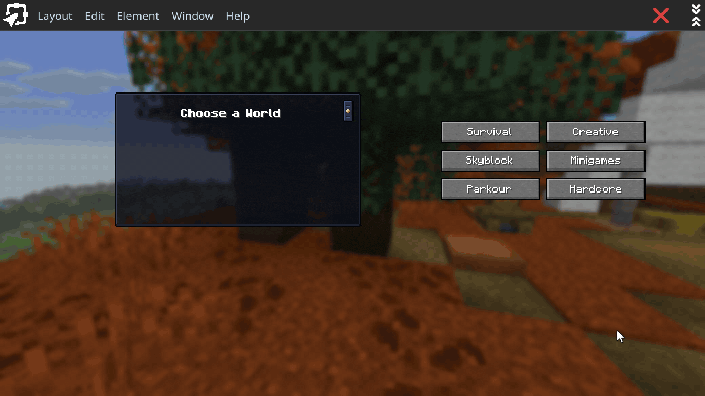

# พื้นที่เลื่อนได้

**พื้นที่เลื่อนได้** ใช้บรรจุองค์ประกอบอื่น ๆ และให้ผู้เล่นเลื่อนดูได้ เหมาะสำหรับรายการปุ่มยาว ๆ ตัวเลือกโลกหรือเซิร์ฟเวอร์ แกลเลอรีไอเท็ม แผงข่าว และทุกอย่างที่แสดงบนหน้าจอเดียวไม่หมด

ทุกอย่างในพื้นที่จะเลื่อนไปพร้อมกัน และถูกตัดออกเมื่อเลยขอบพื้นที่



> [!NOTE]
> เฉพาะองค์ประกอบที่คุณเพิ่มลงในเลย์เอาต์เท่านั้นที่ใส่ในพื้นที่ได้ [องค์ประกอบ Vanilla](/vanilla-elements) ใส่ไม่ได้ เพราะเป็นส่วนหนึ่งของเมนู

# เพิ่มพื้นที่เลื่อนได้

1. เปิดเลย์เอาต์ในตัวแก้ไขเลย์เอาต์
2. คลิกขวาที่พื้นหลังของตัวแก้ไข แล้วเลือก **องค์ประกอบใหม่ -> พื้นที่เลื่อนได้**
3. ลากองค์ประกอบลงในพื้นที่

# ใส่และนำองค์ประกอบออก

- ลากองค์ประกอบไปวางบนพื้นที่เพื่อใส่ลงไป พื้นที่จะสว่างขึ้นเมื่อรับองค์ประกอบไว้ โดยองค์ประกอบจะถูกใส่ลงไปก็ต่อเมื่อมีบางส่วนอยู่ในพื้นที่
- หากต้องการลากองค์ประกอบที่เลือกไว้หลายรายการพร้อมกัน ให้กด `Ctrl` (`Cmd` บน macOS) ค้างไว้ขณะเริ่มลาก
- ขณะลากองค์ประกอบเข้าใกล้ขอบพื้นที่ พื้นที่จะเลื่อนเพื่อให้คุณเข้าถึงทุกส่วนได้ นอกจากนี้ยังใช้ล้อเมาส์เลื่อนพื้นที่ในตัวแก้ไขได้ด้วย
- หากต้องการนำองค์ประกอบออก ให้ลากออกจากพื้นที่ หรือคลิกขวาที่องค์ประกอบแล้วเลือก **ย้ายออกจากพื้นที่เลื่อนได้** องค์ประกอบจะยังอยู่ตำแหน่งเดิมบนหน้าจอ
- พื้นที่สามารถอยู่ภายในพื้นที่อื่นได้เช่นกัน

## เลเยอร์

ใน [วิดเจ็ตเลเยอร์](/layout-editor#scrollable-areas) องค์ประกอบในพื้นที่จะแสดงอยู่ใต้พื้นที่นั้น ลากเลเยอร์ในรายการเพื่อย้ายเข้าออกจากพื้นที่ หรือเปลี่ยนลำดับ ปุ่มยุบของเลเยอร์พื้นที่จะซ่อนองค์ประกอบของพื้นที่นั้นในรายการ

## คัดลอกและลบ

- การคัดลอกพื้นที่จะคัดลอกทุกอย่างที่อยู่ในพื้นที่ด้วย
- เมื่อลบพื้นที่ที่ยังมีองค์ประกอบอยู่ ระบบจะถามว่าต้องการจัดการกับองค์ประกอบเหล่านั้นอย่างไร: **ลบองค์ประกอบ** จะลบองค์ประกอบด้วย ส่วน **เก็บองค์ประกอบไว้** จะคงองค์ประกอบไว้ที่ตำแหน่งเดิมบนหน้าจอ

# จัดเรียงองค์ประกอบ

คลิกขวาที่พื้นที่ แล้วเปิด **การจัดเรียง** ส่วน **โหมด** จะกำหนดวิธีจัดวางองค์ประกอบในพื้นที่:

- **จุดยึด**: คุณจัดวางองค์ประกอบเองเหมือนส่วนอื่น ๆ ของเลย์เอาต์ พื้นที่ใหม่จะใช้โหมดนี้
- **เรียงซ้อน**: องค์ประกอบจะเรียงต่อกัน
- **ตาราง**: องค์ประกอบจะเรียงในช่องที่มีขนาดเท่ากัน
- **เรียงต่อเนื่อง**: องค์ประกอบจะเรียงติดกัน และขึ้นบรรทัดใหม่เมื่อบรรทัดเต็ม


## โหมดจุดยึด

องค์ประกอบในพื้นที่มีจุดยึดของตัวเอง ซึ่งอ้างอิงกับเนื้อหาภายในพื้นที่แทนที่จะอ้างอิงกับหน้าจอ ตัวอย่างเช่น จุดยึด **มุมซ้ายบน** คือมุมซ้ายบนของเนื้อหา ส่วนจุดยึดด้านล่างจะยึดกับปลายเนื้อหา ดูวิธีทำงานของจุดยึดได้ที่ [การจัดตำแหน่งองค์ประกอบ](/positioning-elements)

- **ขยายแนวนอน** และ **ขยายแนวตั้ง** จะทำให้องค์ประกอบกว้างหรือสูงเท่ากับเนื้อหา
- องค์ประกอบจะยึดกับองค์ประกอบอื่นได้เฉพาะเมื่ออยู่ในพื้นที่เดียวกัน เมื่อย้ายองค์ประกอบเข้าหรือออกจากพื้นที่ องค์ประกอบที่เคยยึดข้ามขอบพื้นที่จะเปลี่ยนไปใช้จุดยึด **มุมซ้ายบน** และยังอยู่ตำแหน่งเดิม

### ขนาดเนื้อหา

ในโหมดจุดยึด คุณกำหนดขนาดของเนื้อหา ซึ่งจะเป็นตัวกำหนดระยะที่พื้นที่เลื่อนได้

เลือกพื้นที่ แล้วลากตัวจับที่ปลายเนื้อหา หากลากเลยขอบพื้นที่ ให้ลากต่อไปได้ โดยพื้นที่จะเลื่อนตามไปด้วย


นอกจากนี้ยังคลิกขวาที่พื้นที่ แล้วเปิด **ขนาดเนื้อหา** ได้ด้วย:

- **ความกว้างเนื้อหา** และ **ความสูงเนื้อหา** ใช้กำหนดขนาดเป็นตัวเลข โดยรองรับ [ตัวยึดตำแหน่ง](/placeholders) หากใช้ตัวยึดตำแหน่ง จะลากตัวจับไม่ได้
- **ปรับขนาดให้พอดีกับเนื้อหา** จะกำหนดให้เนื้อหาสิ้นสุดตรงกับปลายขององค์ประกอบสุดท้าย องค์ประกอบที่ยึดกับกึ่งกลางหรือปลายเนื้อหาจะเลื่อนไปพร้อมกัน จึงไม่นำมาคำนวณ

เนื้อหาจะไม่เล็กกว่าพื้นที่ และจะขยายใหญ่ขึ้นเฉพาะทิศทางที่พื้นที่เลื่อนได้เท่านั้น

## เรียงซ้อน ตาราง และเรียงต่อเนื่อง

- พื้นที่จะจัดวางองค์ประกอบให้เอง และขนาดเนื้อหาจะขยายตามองค์ประกอบโดยอัตโนมัติ
- ลากองค์ประกอบเพื่อเปลี่ยนลำดับ โดยจะมีเส้นแสดงตำแหน่งที่องค์ประกอบจะไปอยู่
- เมื่อเปลี่ยนจากโหมดจุดยึดเป็นโหมดใดโหมดหนึ่งเหล่านี้ องค์ประกอบจะยังคงลำดับเดิมบนหน้าจอ หากเปลี่ยนกลับเป็นโหมดจุดยึด องค์ประกอบแต่ละรายการจะยังอยู่ตำแหน่งเดิม
- องค์ประกอบที่ถูกซ่อนด้วย[เงื่อนไข](/conditions)จะไม่เว้นช่องว่างไว้
- โหมดเหล่านี้ไม่รองรับการขยาย
- โหมดเหล่านี้เลื่อนได้เพียงทิศทางเดียว พื้นที่ที่ตั้งค่าเป็น **ทั้งสองทิศทาง** จะเลื่อนในแนวตั้ง

เปิด **การจัดเรียง** เพื่อปรับแต่งเพิ่มเติม:

| การตั้งค่า | รายละเอียด |
|---|---|
| **การจัดแนว** | ตำแหน่งขององค์ประกอบตามแนวขวางกับทิศทางที่เรียง ได้แก่ **เริ่มต้น**, **กึ่งกลาง**, **สิ้นสุด** หรือ **เติมเต็ม** เมื่อเลือก **เติมเต็ม** องค์ประกอบจะกว้างเท่าพื้นที่ว่างที่มี (หรือสูงเท่าพื้นที่ว่าง ในพื้นที่ที่เลื่อนด้านข้าง) โหมดเรียงต่อเนื่องไม่มีตัวเลือก **เติมเต็ม** |
| **ระยะห่าง** | ระยะห่างระหว่างองค์ประกอบ |
| **ระยะขอบ** | ระยะห่างระหว่างองค์ประกอบกับขอบของเนื้อหา |
| **จำนวนองค์ประกอบต่อบรรทัด** | ใช้กับโหมดตารางเท่านั้น กำหนดจำนวนองค์ประกอบในแต่ละบรรทัด |
| **ใส่ให้ได้มากที่สุด** | ใช้กับโหมดตารางเท่านั้น ใส่องค์ประกอบในแต่ละบรรทัดให้มากที่สุดเท่าที่พื้นที่จะรองรับ แทนการกำหนดจำนวนตายตัว โดย **ขนาดช่องขั้นต่ำ** จะกำหนดจำนวนองค์ประกอบ |

# การเลื่อน

ผู้เล่นเลื่อนพื้นที่ได้ด้วยล้อเมาส์ กด `Shift` ค้างไว้เพื่อเลื่อนด้านข้าง

- **ทิศทางการเลื่อน** กำหนดให้พื้นที่เลื่อน **แนวตั้ง**, **แนวนอน** หรือ **ทั้งสองทิศทาง** ในทิศทางที่เลื่อนไม่ได้ เนื้อหาจะมีขนาดพอดีกับพื้นที่
- องค์ประกอบข้อความในพื้นที่จะเลื่อนก่อน เมื่อเลื่อนจนสุดแล้ว พื้นที่จึงจะเลื่อนต่อ
- เมื่อผู้เล่นใช้ `Tab` เพื่อสลับระหว่างปุ่ม พื้นที่จะเลื่อนไปยังปุ่มที่เลือก

เมนู **การเลื่อน**, **เลื่อนอัตโนมัติ** และ **แถบเลื่อน** ใช้การตั้งค่าเดียวกับองค์ประกอบข้อความ ดูรายละเอียดทั้งหมดได้ที่ [ข้อความในเมนู](/text-in-menus#scrolling-settings) ข้อแตกต่างมีดังนี้:

- **จัดตำแหน่งให้ตรงกัน** สามารถจัดเนื้อหา **ให้ตรงกับองค์ประกอบ** เพื่อให้องค์ประกอบอยู่ต้นพื้นที่เสมอ หรือ **ให้ตรงกับหน้า**
- ปุ่มและองค์ประกอบอื่น ๆ ในพื้นที่ยังใช้งานได้เมื่อเปิด **ลากเพื่อเลื่อน**
- ตัวจับเลื่อนจะใช้พิกเซลแฮนเดิล เว้นแต่คุณจะกำหนด **พื้นผิวตัวจับเลื่อน** หรือ **สีตัวจับเลื่อน [HEX]** เอง

# พื้นหลัง

พื้นที่จะแสดงแผงไว้ด้านหลังเนื้อหา เปิด **พื้นหลัง** เพื่อเปลี่ยนการตั้งค่า การทำงานเหมือนกับ[พื้นหลังขององค์ประกอบข้อความ](/text-in-menus#background): ปิดได้ด้วย **แสดงพื้นหลัง** ใช้พื้นผิวของคุณเองร่วมกับ[การแบ่งภาพเก้าส่วน](/nine-slicing-and-tiling)หรือการปูกระเบื้อง และเปลี่ยนระยะที่พื้นหลังขยายไปด้วย **ระยะขอบ**

# เลื่อนด้วยการกระทำ

คุณยังควบคุมและตรวจสอบพื้นที่จากส่วนอื่น ๆ ของ FancyMenu ได้ด้วย:

- [การกระทำ](/action-scripts) **เลื่อนองค์ประกอบ** ใช้เลื่อนพื้นที่ไปยังจุดเริ่มต้น จุดสิ้นสุด ตำแหน่งที่ระบุ หรือองค์ประกอบรายการใดรายการหนึ่งในพื้นที่
- [ตัวยึดตำแหน่ง](/placeholders) **ตำแหน่งการเลื่อนองค์ประกอบ**, **เปอร์เซ็นต์การเลื่อนองค์ประกอบ** และ **ขนาดเนื้อหาขององค์ประกอบ** ใช้ระบุว่าพื้นที่เลื่อนไปไกลแค่ไหนและเนื้อหามีขนาดเท่าใด
- [เงื่อนไข](/conditions) **องค์ประกอบเลื่อนไปจนสุดหรือไม่** ใช้ตรวจสอบว่าพื้นที่เลื่อนไปจนสุดแล้วหรือยัง
- [ตัวรับฟังเหตุการณ์](/listeners) **เมื่อองค์ประกอบเลื่อน**, **เมื่อองค์ประกอบเลื่อนไปยังจุดเริ่มต้น** และ **เมื่อองค์ประกอบเลื่อนไปจนสุด** ใช้เรียกใช้การกระทำขณะที่พื้นที่เลื่อน

ทั้งหมดนี้ต้องใช้[ตัวระบุองค์ประกอบ](/element-identifiers)ของพื้นที่ ตัวอย่างต่อไปนี้แสดงว่าพื้นที่เลื่อนไปไกลแค่ไหน โดยมีค่าตั้งแต่ 0 ถึง 100:

```
{"placeholder":"scroll_area_scroll_percent","values":{"element_identifier":"3f2a9c1e-7b4d-4e8a-9c2f-1d5e6a7b8c9d-1763950000000","axis":"vertical"}}
```

# ข้อมูลที่ควรรู้

- การซ่อนพื้นที่จะซ่อนทุกอย่างที่อยู่ภายในด้วย และความทึบของพื้นที่จะมีผลกับทุกอย่างที่อยู่ภายในเช่นกัน
- พื้นที่หมุนหรือเอียงไม่ได้ และพารัลแลกซ์จะใช้กับพื้นที่และองค์ประกอบภายในไม่ได้
- องค์ประกอบคำแนะนำเครื่องมือในพื้นที่จะถูกตัดเมื่อเลยขอบพื้นที่ เว้นแต่จะแสดงตามเมาส์
