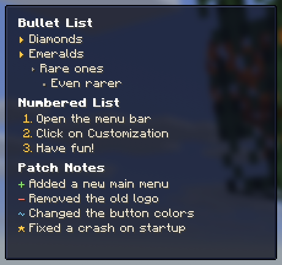

# การจัดรูปแบบข้อความ

FancyMenu มีวิธีจัดรูปแบบข้อความให้คุณ 3 วิธี:

- **Markdown** สำหรับ[องค์ประกอบข้อความและคำอธิบายเมื่อชี้เมาส์](/text-in-menus): หัวข้อ รายการ สี รูปภาพ ตาราง และอื่น ๆ
- **รหัสจัดรูปแบบของ Minecraft** เช่น `&c` สำหรับเปลี่ยนสีอย่างรวดเร็ว ใช้ได้กับช่องข้อความเกือบทุกช่อง รวมถึงข้อความ Markdown
- **คอมโพเนนต์ข้อความของ Minecraft** สำหรับป้ายชื่อปุ่มและแถบเลื่อน

> [!TIP]
> หน้านี้เน้นเรื่อง *วิธีเขียน* ข้อความที่จัดรูปแบบแล้ว หากต้องการเรียนรู้วิธีเพิ่มข้อความลงในเมนู เปลี่ยนรูปลักษณ์ หรือทำให้ข้อความเลื่อนได้ ดูที่[ข้อความในเมนู](/text-in-menus)


# Markdown

Markdown ใช้อักขระพิเศษเพียงไม่กี่ตัวครอบข้อความเพื่อจัดรูปแบบ ตัวอย่างเช่น `**ตัวหนา**` จะแสดงเป็นข้อความ**ตัวหนา**

Markdown ใช้ได้กับ[องค์ประกอบข้อความ](/elements#text) และ[องค์ประกอบคำอธิบายเมื่อชี้เมาส์](/elements#tooltip) อักขระที่คุณเขียนจะกำหนดว่าเนื้อหานั้นเป็นอะไร (เช่น หัวข้อ รายการ หรือคำพูด) ส่วน[รูปลักษณ์](/text-in-menus#looks-and-styles) ขององค์ประกอบจะกำหนดว่าจะแสดงอย่างไร เช่น สีและขนาด

## ภาพรวมอย่างย่อ

| สิ่งที่เขียน | ผลลัพธ์ |
|---|---|
| `**ตัวหนา**` หรือ `__ตัวหนา__` | ข้อความตัวหนา |
| `*ตัวเอียง*` หรือ `_ตัวเอียง_` | ข้อความตัวเอียง |
| `++ขีดเส้นใต้++` | ข้อความขีดเส้นใต้ |
| `~~ขีดฆ่า~~` | ข้อความขีดฆ่า |
| `` `โค้ด` `` | โค้ดในบรรทัด |
| `[เปิดเว็บไซต์](https://example.com)` | ลิงก์ที่คลิกได้ |
| `%#ff5555%ข้อความสีแดง%#%` | ข้อความสีต่าง ๆ |
| `# หัวข้อ` | หัวข้อ |
| `- รายการ` | รายการหัวข้อย่อย |
| `1. รายการ` | รายการลำดับเลข |
| `> ข้อความ` | คำพูดอ้างอิง |
| `> [!TIP]` | กล่องข้อความเน้น |
| `---` | เส้นคั่น |

## รูปแบบข้อความ

| รูปแบบ | วิธีเขียน |
|---|---|
| **ตัวหนา** | `**ข้อความ**` หรือ `__ข้อความ__` |
| **ตัวเอียง** | `*ข้อความ*` หรือ `_ข้อความ_` |
| **ขีดเส้นใต้** | `++ข้อความ++` |
| **ขีดฆ่า** | `~~ข้อความ~~` (ใช้ `~` ตัวเดียวที่ทั้งสองด้านก็ได้) |

คุณสามารถใช้หลายรูปแบบพร้อมกันได้ เช่น `***ตัวหนาและตัวเอียง***`

ขีดล่างตัวเดียวที่อยู่ภายในคำจะยังเป็นขีดล่างตามปกติ ดังนั้น `my_cool_layout` จะไม่กลายเป็นตัวเอียง ชื่ออย่าง `C++` ก็จะแสดงเหมือนเดิม

> [!TIP]
> ในตัวแก้ไขข้อความ ให้เลือกข้อความแล้วกด `Ctrl + B`, `Ctrl + I` หรือ `Ctrl + U` (`Cmd` บน macOS) เพื่อทำให้ข้อความเป็นตัวหนา ตัวเอียง หรือขีดเส้นใต้ ดูที่[ปุ่มลัดสำหรับการจัดรูปแบบ](/text-in-menus#formatting-shortcuts)

## สีข้อความ (HEX)

ใส่ `%<สี HEX>%` ไว้หน้าข้อความ และใส่ `%#%` ไว้ด้านหลัง:

```
%#77fc03%ข้อความนี้เป็นสีเขียว!%#%
```

สี HEX ต้องขึ้นต้นด้วย `#` คุณยังสามารถใช้ชื่อสีได้ด้วย:

```
%#red%ข้อความนี้เป็นสีแดง!%#%
```

ชื่อสีที่รองรับ: `black`, `silver`, `gray`, `grey`, `white`, `maroon`, `red`, `purple`, `fuchsia`, `magenta`, `green`, `lime`, `olive`, `yellow`, `navy`, `blue`, `teal`, `aqua`, `cyan` และ `transparent`

## แบบอักษร

หากต้องการแสดงข้อความด้วยแบบอักษรอื่น ให้ใส่ `%!!<ชื่อแบบอักษร>%` ไว้หน้าข้อความ และใส่ `%!!%` ไว้ด้านหลัง แบบอักษรอาจมาจาก Minecraft หรือแพ็กทรัพยากรก็ได้

```
%!!uniform%ข้อความนี้ใช้แบบอักษร uniform%!!%
```

## การจัดแนวข้อความ

ค่าเริ่มต้นข้อความจะชิดซ้าย หากต้องการจัดบรรทัดให้อยู่กึ่งกลางหรือชิดขวา ให้ใส่รหัสการจัดแนวไว้คนละบรรทัดก่อนและหลังข้อความ:

- `^^^` จัดบรรทัดให้อยู่กึ่งกลาง
- `|||` จัดบรรทัดชิดขวา

```
บรรทัดนี้ชิดซ้าย

^^^
บรรทัดนี้อยู่กึ่งกลาง
บรรทัดนี้ก็เช่นกัน
^^^

|||
บรรทัดนี้ชิดขวา
|||
```

> [!TIP]
> ในตัวแก้ไขข้อความ กด `Ctrl + L`, `Ctrl + E` และ `Ctrl + R` (`Cmd` บน macOS) เพื่อจัดแนวบรรทัดที่เลือกให้ชิดซ้าย อยู่กึ่งกลาง หรือชิดขวาได้ทันที

## หัวข้อ

ขึ้นต้นบรรทัดด้วย `# ` (ใหญ่ที่สุด), `## ` (ใหญ่) หรือ `### ` (เล็ก):

```
# ยินดีต้อนรับ!
## ข่าวสาร
### หัวข้อขนาดเล็ก
```

## รายการ



### รายการหัวข้อย่อย

ขึ้นต้นบรรทัดด้วย `- ` เพิ่มช่องว่างสองช่องด้านหน้าในแต่ละระดับที่เยื้องเข้าไป:

```
- รายการแรก
- รายการที่สอง
  - รายการย่อย
    - รายการย่อยระดับลึกขึ้นไปอีก
```

### รายการลำดับเลข

ขึ้นต้นบรรทัดด้วยตัวเลขและจุดหรือวงเล็บ:

```
1. เปิดแถบเมนู
2. คลิกการปรับแต่ง
3) แบบนี้ก็ใช้ได้เช่นกัน
```

### สัญลักษณ์บันทึกการอัปเดต

บรรทัดยังขึ้นต้นด้วย `+`, `-`, `~` หรือ `*` ได้ โดยแต่ละตัวจะมีสัญลักษณ์ของตัวเอง เหมาะสำหรับบันทึกการอัปเดตและบันทึกการเปลี่ยนแปลง:

```
+ เพิ่มเมนูหลักใหม่
- ลบโลโก้เก่าออก
~ เปลี่ยนสีปุ่ม
* แก้ไขปัญหาเกมแครชตอนเริ่มต้น
```

| สัญลักษณ์ | ความหมาย |
|---|---|
| `+` | เพิ่มสิ่งใหม่ |
| `-` | ลบสิ่งออก |
| `~` | เปลี่ยนแปลงสิ่งเดิม |
| `*` | สิ่งที่ควรเน้นให้เห็น |

รายการ `-` จะแสดงสัญลักษณ์ "ลบออก" ก็ต่อเมื่อในรายการเดียวกันมีรายการ `+` ด้วย หากไม่มี จะเป็นรายการหัวข้อย่อยตามปกติ คุณเปลี่ยนการตั้งค่านี้ได้ที่ **Markdown -> Lists -> Extra Markers (+ - ~ \*) -> - Marker Used**

> [!NOTE]
> องค์ประกอบข้อความและคำอธิบายเมื่อชี้เมาส์ที่สร้างใหม่จะเปิดใช้รายการลำดับเลข สัญลักษณ์บันทึกการอัปเดต และ[กล่องข้อความเน้น](#callouts) ส่วนองค์ประกอบจากเลย์เอาต์เก่าจะปิดใช้ไว้ เพื่อไม่ให้ข้อความเปลี่ยนไปโดยไม่คาดคิด เปิดใช้ได้จากเมนู **Markdown** ขององค์ประกอบ: **Lists -> Numbered Lists**, **Lists -> Extra Markers (+ - ~ \*)** และ **Callouts**

## คำพูดอ้างอิง

ขึ้นต้นบรรทัดด้วย `> ` เพื่อสร้างคำพูดอ้างอิง โดยจะต่อเนื่องไปจนถึงบรรทัดว่างถัดไป:

```
> นี่คือคำพูดอ้างอิง
บรรทัดนี้ก็เป็นส่วนหนึ่งของคำพูดด้วย

บรรทัดนี้กลับมาเป็นข้อความปกติแล้ว
```

บรรทัดภายในคำพูดอ้างอิงก็ขึ้นต้นด้วย `>` ได้เช่นกัน และบรรทัดที่มีเพียง `>` จะเพิ่มบรรทัดว่างในคำพูดอ้างอิง:

```
> ย่อหน้าแรกของคำพูดอ้างอิง
>
> ย่อหน้าที่สองของคำพูดอ้างอิง
```

## กล่องข้อความเน้น

กล่องข้อความเน้นคือกล่องสีที่มีไอคอนและป้ายกำกับ เหมาะสำหรับเคล็ดลับและคำเตือน เขียนคำพูดอ้างอิงที่บรรทัดแรกระบุประเภทของกล่อง:

```
> [!WARNING]
> อย่าลืมบันทึกเลย์เอาต์ของคุณ!
```


มีทั้งหมดห้าประเภท: `[!NOTE]`, `[!TIP]`, `[!IMPORTANT]`, `[!WARNING]` และ `[!CAUTION]`

## ไฮเปอร์ลิงก์

ครอบข้อความด้วย `[ ]` แล้วใส่ลิงก์ไว้ด้านหลังใน `( )`:

```
[เยี่ยมชมเว็บไซต์ของเรา](https://example.com)
```

ลิงก์สามารถมีวงเล็บได้ เช่น `https://en.wikipedia.org/wiki/Minecraft_(video_game)` หากต้องการแสดงวงเล็บเหลี่ยมในข้อความลิงก์ ให้ใส่ `\` ไว้ด้านหน้า: `[คลิก \[ที่นี่\]](https://example.com)`

## เหตุการณ์เมื่อคลิกและเมื่อวางเมาส์

ข้อความยังสามารถเรียกใช้[ตัวรับฟังเหตุการณ์](/listeners) แทนการเปิดเว็บไซต์ได้ ใช้คำนำหน้า `click:` หรือ `hover:` พร้อม ID ที่คุณเลือก:

```
[ข้อความที่คลิกได้](click:unique_text_click_event_id)
[ข้อความที่วางเมาส์เหนือได้](hover:unique_text_hover_event_id)
```

ตอบสนองต่อเหตุการณ์เหล่านี้ด้วยตัวรับฟัง [**On Markdown Text Clicked**](/listeners#on-markdown-text-clicked) และ [**On Markdown Text Hovered**](/listeners#on-markdown-text-hovered) ทั้งสองตัวจะส่ง ID มาให้ในรูปแบบ `$$text_event_id`

## รูปภาพ

วางรูปภาพไว้ในบรรทัดของตัวเองด้วย ``:

```

```

แหล่งที่มาอาจเป็น URL บนเว็บ ไฟล์ในเครื่อง เช่น `/config/fancymenu/assets/image.png` หรือรูปภาพจากแพ็กทรัพยากร ดูแหล่งที่มาทั้งหมดได้ที่[ทรัพยากร](/resources)

ข้อความระหว่างวงเล็บเหลี่ยมจะกลายเป็นคำบรรยายของรูปภาพ:

```

```

คำบรรยายจะแสดงใต้รูปภาพ หากเปิดตัวเลือก **Markdown -> Images -> Caption** ขององค์ประกอบไว้

หากต้องการให้คลิกรูปภาพได้ ให้ครอบรูปภาพด้วยลิงก์:

```
[](https://example.com)
```

## ตาราง

คั่นแต่ละช่องด้วย `|` แถวแรกคือส่วนหัว ส่วนแถวที่สองใช้ `---` ในแต่ละคอลัมน์:

```
| ไอเทม | ราคา |
|:---|---:|
| ดาบเพชร | 10 |
| แอปเปิลทองคำ | 5 |
```

เครื่องหมายทวิภาคในแถวที่สองใช้จัดแนวคอลัมน์: `:---` ชิดซ้าย, `:---:` กึ่งกลาง และ `---:` ชิดขวา หากต้องการแสดง `|` ภายในช่อง ให้เขียน `\|`


## เส้นคั่น

บรรทัดที่มีเพียง `---` จะวาดเส้นคั่นตลอดความกว้างของข้อความ

## โค้ด

โค้ดจะแสดงข้อความตามที่เขียน โดยไม่จัดรูปแบบ

- **โค้ดในบรรทัด:** ครอบส่วนหนึ่งของบรรทัดด้วย `` ` `` เช่น `` `/spawn` ``
- **บล็อกโค้ด:** ใส่บรรทัดที่มี `` ``` `` ไว้ก่อนและหลังบรรทัดโค้ด บล็อกโค้ดจะไม่ตัดบรรทัด

````
```
/give @p minecraft:diamond 64
```
````

คุณสามารถใส่ชื่อภาษาไว้หลัง `` ``` `` ตัวแรกได้ เช่น `` ```json `` FancyMenu ยอมรับรูปแบบนี้ แต่จะไม่เปลี่ยนรูปลักษณ์ของโค้ด

[ตัวแทนข้อความ](/placeholders) ยังคงถูกแทนที่ภายในโค้ด

## ข้อความธรรมดา

ข้อความธรรมดาจะแสดงอักขระจัดรูปแบบตามที่เขียน แต่ไม่มีรูปลักษณ์แบบโค้ด ครอบส่วนหนึ่งของบรรทัดด้วย `;;`:

```
ข้อความนี้จะแสดง ;;**เครื่องหมายดอกจัน**;; แทนข้อความตัวหนา
```

หากต้องการใช้กับทั้งบรรทัด ให้ใส่ `;;;` ไว้คนละบรรทัดก่อนและหลังข้อความ:

```
;;;
**ไม่ใช่ตัวหนา**, _ไม่ใช่ตัวเอียง_
;;;
```

## การใส่อักขระหลีก

หากต้องการแสดงอักขระจัดรูปแบบเป็นข้อความปกติ ให้ใส่ `\` ไว้ด้านหน้า ตัวอย่างเช่น `\*ไม่ใช่ตัวเอียง\*` จะแสดงเป็น `*ไม่ใช่ตัวเอียง*`

ใช้ได้กับ `\` `` ` `` `*` `_` `{` `}` `[` `]` `(` `)` `#` `+` `-` `.` `!` `|` `>` `~` และ `^`

# การจัดรูปแบบข้อความของ Minecraft

รหัสจัดรูปแบบของ Minecraft ใช้ได้กับช่องข้อความส่วนใหญ่ใน FancyMenu ใช้ `&` แทน `§` ของ Minecraft ตัวอย่างเช่น `&cคำเตือน` จะแสดงข้อความสีแดง และ `&l` จะทำให้ข้อความเป็นตัวหนา ส่วน `&r` จะรีเซ็ตการจัดรูปแบบ

ดูรหัสทั้งหมดได้ที่ [Minecraft Wiki](https://minecraft.wiki/w/Formatting_codes)

รหัสจัดรูปแบบยังใช้ในข้อความ Markdown ได้ ยกเว้นภายในโค้ดและข้อความธรรมดา สำหรับรูปแบบอย่างตัวหนาและตัวเอียง โดยทั่วไป Markdown อ่านง่ายกว่า แต่รหัสเหล่านี้เหมาะสำหรับเปลี่ยนสีอย่างรวดเร็ว

# คอมโพเนนต์ข้อความของ Minecraft (ระบบคอมโพเนนต์ดิบ)

คอมโพเนนต์ข้อความของ Minecraft คือข้อความที่จัดรูปแบบและเขียนในรูปแบบ JSON ใช้ได้กับข้อความ **บรรทัดเดียว** เช่น **ป้ายชื่อปุ่มและแถบเลื่อน** แต่ใช้ในองค์ประกอบข้อความไม่ได้

หากต้องการใช้ ให้กำหนดคอมโพเนนต์เป็นป้ายชื่อเพียงอย่างเดียว:

```
{"text":"ข้อความป้ายปุ่ม","font":"uniform"}
```

ตัวอย่างนี้จะแสดง `ข้อความป้ายปุ่ม` ด้วยแบบอักษร `uniform` คุณสามารถใช้[ตัวแทนข้อความ](/placeholders) ในค่า `text` ได้

ดูข้อมูลเพิ่มเติมได้ที่หน้า Minecraft Wiki เกี่ยวกับ[รูปแบบคอมโพเนนต์ข้อความ](https://minecraft.wiki/w/Raw_JSON_text_format) และ[แบบอักษร](https://minecraft.wiki/w/Resource_pack#Fonts)
