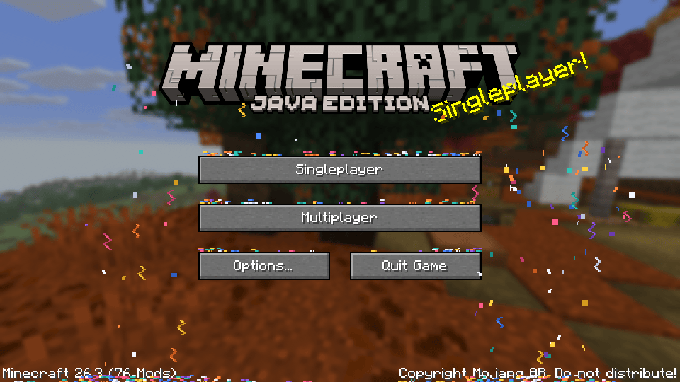

# Декоративні накладки

Декоративні накладки — це анімовані ефекти для всього екрана, наприклад снігопад, світлячки, туман або гірлянди. Багато з них взаємодіють із вашим меню: сніг накопичується на кнопках, пташки сідають на них, а туман розступається навколо курсора.


# Додавання накладки

1. Відкрийте макет у редакторі макетів.
2. Клацніть правою кнопкою миші на тлі редактора й відкрийте розділ **Декоративні накладки**.
3. Відкрийте накладку, наприклад **Снігопад**.
4. Натисніть **Показати накладку**, щоб увімкнути її.

У списку біля ввімкнених накладок стоїть ✔. У макеті можна одночасно показувати скільки завгодно накладок. Наведіть курсор на накладку або один із її параметрів, щоб дізнатися, що він робить.

Накладки відтворюються і в редакторі макетів, але взаємодіють з елементами лише в справжньому меню. Збережіть макет і відкрийте меню, щоб побачити повний ефект.

Якщо накладки є в кількох макетах одного екрана, вони відтворюються всі, навіть якщо це одна й та сама накладка. Це стосується й [універсальних макетів](/universal-layouts).

# Параметри всіх накладок

У кожної накладки є два такі параметри:

- **Показати накладку** — вмикає або вимикає накладку.
- **Шари** — визначає, де відображається накладка:
  - **Тло й передній план**: дальні частини відображаються позаду ваших елементів, а ближні — перед ними, створюючи приємне відчуття глибини. Це значення типове.
  - **Лише тло**: усе відображається позаду ваших елементів, але перед тлом меню.
  - **Лише передній план**: усе відображається перед вашими елементами.

Ефекти, які накладка розміщує безпосередньо на ваших елементах, наприклад сніг на кнопці, завжди залишаються на них.

Багато накладок також мають такі параметри:

| Параметр | Що він робить |
|---|---|
| **Кількість (%)** | Визначає кількість ефекту: від 25% до 300%. 100% — звичайна кількість. |
| **Розмір** | Збільшує піксельну графіку в 2 або 3 рази. Кожен піксель залишається чітким квадратом. |
| **Вигляд** | **Детальний** показує піксельну графіку повністю, із затіненням і додатковими ефектами. **Простий** — пласкіший і ближчий до класичного вигляду. |

# Накладки та ваші елементи

Багато накладок взаємодіють із вашими елементами: на них накопичуються сніг, попіл і конфеті, з них звисають бурульки, на них росте мох і сідають пташки.

Щоб вибрати елементи, з якими вони взаємодіятимуть, клацніть елемент правою кнопкою миші й налаштуйте параметр **Піддавати впливу декоративних накладок**:

- За замовчуванням він увімкнений для кнопок, повзунків, прапорців, полів введення та [стандартних елементів](/vanilla-elements).
- До них також належать логотип, текст-заставка, брендінг і авторські права на титульному екрані. Вимкніть для них цей параметр, якщо не хочете, щоб на них щось осідало.
- Приховані елементи не беруть участі. Так само не бере участі частина елемента, яку обрізає [прокручувана область](/scrollable-areas).

> [!TIP]
> Залишайте між елементами щонайменше 13 пікселів. Ефекти, що накопичуються на елементі або звисають із нього, можуть збільшуватися лише настільки, наскільки дозволяє проміжок до наступного елемента.

Деякі накладки реагують на клацання, наприклад «Бульбашки», «Іній» і «Конфеті». Ваші кнопки все одно отримують усі клацання.

# Усі декоративні накладки

Усі декоративні накладки FancyMenu, згруповані за темами.

## Погода

### Снігопад

Сніг падає й поступово накопичується на кнопках і вздовж нижнього краю екрана.


- **Накопичення снігу** дає змогу снігу накопичуватися.
- Параметри **Колір снігу [HEX]**, **Швидкість снігопаду**, **Кількість (%)** і **Розмір** змінюють вигляд снігу.

### Дощ

Дощ падає, утворює брижі в неглибоких калюжах і капає з ваших кнопок.


- **Калюжі** вкривають ваші елементи й нижній край екрана вологою плівкою, на якій з'являються брижі від крапель.
- **Краплі** дає змогу краплям затримуватися й падати з ваших елементів.
- **Спалахи блискавки** час від часу додають блискавки з розгалуженими зигзагами та м'якими спалахами. Параметр **Яскравість спалахів блискавки** визначає їхню яскравість.
- Параметри **Колір дощу [HEX]**, **Кількість (%)** і **Розмір** змінюють вигляд дощу.

> [!WARNING]
> **Спалахи блискавки** спричиняють спалахи на екрані. Вимкніть цей параметр, якщо гравці можуть бути чутливими до миготливого світла.

### Туман

М'які шари туману пливуть екраном і вашими елементами, стаючи найгустішими біля землі.


- **Розступання туману біля курсора** змушує туман розступатися навколо миші.

### Іній

Ваше меню замерзає. Лід повзе краями й кутами екрана та вкриває ваші елементи. Клацніть по льоду, щоб відколоти шматок.


- Параметри **Краї екрана**, **Кути** й **На елементах** вмикають або вимикають відповідні частини льоду. Написи на ваших елементах залишаються чіткими.

## Природа

### Листя

Листя падає, а пориви вітру підхоплюють і розносять його.


- **Вигляд** перемикає листя між варіантами **Детальний** і **Простий**.
- **Кольори** дає змогу вибрати **Осінню палітру** (п'ять теплих осінніх кольорів) або **Власний діапазон** (п'ять кольорів між значеннями **Початковий колір листя [HEX]** і **Кінцевий колір листя [HEX]**).
- **Пориви вітру** вмикає або вимикає сильні пориви. **Сила вітру** визначає їхню потужність.
- Параметри **Густота листя**, **Швидкість падіння листя** й **Масштаб накладки листя** змінюють вигляд листя.

### Сакура

Квітучі гілки з'являються з верхніх кутів, а пелюстки повільно опускаються вниз.


- **Ліва гілка** й **Права гілка** показують або приховують відповідну гілку.
- Параметри **Вигляд** і **Кількість (%)** змінюють пелюстки.

### Заростання

Природа захоплює ваше меню: мох, ліани, трава й квіти повільно розростаються по всьому екрану.


- Параметри **Трава**, **Ліві ліани**, **Праві ліани** й **На елементах** вмикають або вимикають відповідні види рослинності. Написи на ваших елементах залишаються чіткими.
- Параметри **Квіти на ліанах**, **Квіти на елементах** і **Квіти в траві** дають змогу квітам розквітати у відповідних місцях. **Квіти (%)** визначає їхню кількість.

### Хмари

Пухнасті піксельні хмари пливуть небом позаду ваших елементів у трьох шарах глибини. У хмар немає власних параметрів.


### Сонячні промені

Сонячні промені розходяться віялом від сонця за межами екрана, а в їхньому світлі кружляє пил.


- **Бік сонця** визначає край екрана, за яким розташоване сонце. **Кут сонця (°)** переміщує його вздовж цього краю.
- Параметри **Колір сонячного світла [HEX]** і **Інтенсивність (%)** змінюють світло.
- **Сонячне сяйво** додає навколо сонця м'яке світіння.
- **Пил** дає змогу пилинкам кружляти в променях. Миша здіймає їх у повітря.
- **Зіткнення з елементами** змушує промені зупинятися на ваших елементах, підсвічувати їхні краї та відкидати тіні. Якщо цей параметр вимкнено, промені сяють перед вашими елементами.

### Бульбашки

Бульбашки струмками погойдуються вгору й ковзають уздовж нижнього боку ваших елементів. Клацайте по них, щоб лускати! У бульбашок немає власних параметрів.


## Тварини

### Пташки

Маленькі пташки прилітають, стрибають по ваших елементах і злітають, якщо миша наближається надто близько.


### Метелики

Барвисті метелики пурхають навколо, сідають на ваші елементи й лякаються миші.


### Кажани

Кажани зграйками пролітають екраном і висять догори ногами під вашими елементами, коли сплять. Підійдіть надто близько — і вони прокинуться!


Для пташок, метеликів і кажанів доступні параметри **Кількість (%)** і **Розмір**.

### Світлячки

Зграї світлячків світяться й літають навколо, а деякі сідають на ваші елементи.


- **Вигляд** перемикає світлячків між варіантами **Детальний** і **Простий**. **Невидимі тіла** показує їхні темні тільця між спалахами.
- **Слідувати за мишею** дає змогу зграям летіти за мишею, коли вона наближається.
- **Приземлення** дає змогу світлячкам час від часу сідати на ваші елементи.
- Параметри **Колір світлячків [HEX]**, **Кількість зграй**, **Густота зграй**, **Розмір зграй** і **Масштаб світлячків** змінюють вигляд світлячків.

### Бадді

Бадді — маленький віртуальний улюбленець, який живе внизу вашого меню. Він ходить навколо, показує свої потреби в хмаринках думок, реагує на ігри з ним і пам'ятає все між ігровими сеансами.


#### Догляд за Бадді

Бадді має чотири потреби, значення яких змінюються від `0` до `100`:

- **Голод** зростає з часом. Їжа втамовує його.
- **Щастя** зменшується з часом. Погладжування, їжа та ігри підвищують його.
- **Енергія** зменшується, коли Бадді не спить, і відновлюється під час сну.
- **Веселощі** зменшуються з часом. Ігри підвищують їх.

Щоб доглядати за Бадді:

- Клацніть по Бадді лівою кнопкою миші, щоб погладити його. Якщо так розбудити його, він стане трохи менш щасливим.
- Клацніть по Бадді правою кнопкою миші, щоб відкрити екран стану. На вкладці **Статистика** відображаються його потреби, рівень і досвід. На вкладці **Досягнення** відображаються його досягнення.
- Натисніть **Годувати** на екрані стану, а потім перетягніть їжу до Бадді.
- Натисніть **Грати** на екрані стану, а потім перетягніть м'яч і відпустіть кнопку миші, щоб кинути його. Бадді побіжить за м'ячем і спіймає його.
- Натисніть **Спати**, щоб Бадді відпочив. Він також засинає сам, коли його енергія стає дуже низькою.
- Час від часу Бадді какає. Клацніть по купці лівою кнопкою миші, щоб прибрати її. Якщо навколо лежить три чи більше купок, Бадді ставатиме дедалі менш щасливим.

#### Рівні й досягнення

Догляд за Бадді дає йому досвід. Бадді підіймається з 1-го до 30-го рівня. Що вищий його рівень, то повільніше зменшуються голод, щастя й енергія. На 30-му рівні вони зменшуються вдвічі повільніше.

#### Якщо Бадді помре

Якщо голод або щастя залишаються на рівні `0` протягом 10 реальних годин, Бадді помре й залишить надгробок. Клацніть по надгробку лівою кнопкою миші, щоб почати спочатку з новим Бадді. Вимкніть параметр **Бадді може померти**, щоб він не помер.

Параметр **Скинути збереження Бадді** дає змогу почати спочатку будь-коли.

> [!WARNING]
> Скидання Бадді назавжди видаляє його потреби, рівень, досвід, досягнення й купки.

#### Збереження та налаштування

Бадді зберігає дані приблизно кожні дві хвилини й під час закриття екрана. Файли зберігаються в `<game-directory>/fancymenu_data/buddy/`. Для кожної накладки Бадді створюється окреме збереження. Див. [Розташування даних](/data-storage-locations).

- **Власні текстури** замінює спрайти, предмети, піктограми, екран стану й надгробок Бадді вашими текстурами.
- **Налаштування характеристик** змінює швидкість зменшення потреб, витрати й нагороди за дії, а також максимальну кількість купок навколо (**Максимум купок**).

## Нічне небо

### Полярне сяйво

Угорі неба сяє полярне сяйво, яке повільно коливається позаду ваших елементів.


- **Колір краю [HEX]** задає колір яскравого нижнього краю. **Колір верхівки [HEX]** задає колір, у який переходять промені.

### Падаючі зорі

Зоряне нічне небо позаду ваших елементів, де кожні кілька секунд пролітає падаюча зоря, а час від часу здіймається цілий метеорний дощ. У падаючих зір немає власних параметрів.


### Небесні ліхтарики

Світні паперові ліхтарики здіймаються в нічне небо, іноді цілою зграєю. Для небесних ліхтариків доступні параметри **Кількість (%)** і **Розмір**.


## Свято

### Конфеті

Хлопавки в нижніх кутах кожні кілька секунд розкидають конфеті, яке накопичується на ваших елементах.



- **Хлопавки в кутах** вмикає або вимикає хлопавки.
- **Вибух під час клацання** розкидає трохи конфеті в місці клацання.
- **Режим змішування кольорів** використовує випадкові кольори. Вимкніть його, щоб задавати колір усього конфеті параметром **Колір конфеті [HEX]**.
- **Максимум осілих частинок** визначає, скільки частинок може одночасно лежати на екрані.
- Параметри **Кількість (%)**, **Розмір** і **Швидкість падіння конфеті** змінюють вигляд конфеті.

### Феєрверки

Ракети злітають угору й вибухають феєрверками.


- **Показувати політ ракети** показує ракети під час зльоту.
- Параметри **Кількість (%)**, **Розмір** і **Розмір вибуху** змінюють вигляд феєрверків.

### Гірлянди

Гірлянди звисають над вашим меню й гойдаються на вітрі.


- **Вигляд** перемикає гірлянди між варіантами **Простий** і **Детальний**. Параметр **Хвойна гірлянда** замінює дріт на хвою з ялинковими прикрасами.
- **Режим гірлянди** визначає, як світяться й блимають лампочки (див. нижче).
- Параметри **Масштаб гірлянд**, **Сила вітру** й **Швидкість мерехтіння** змінюють усі гірлянди.
- У розділі **Гірлянди** є окреме меню для кожного з восьми місць, де може висіти гірлянда. Щоб увімкнути гірлянду, активуйте параметр **Показувати гірлянду**.

Для кожної гірлянди доступні такі параметри:

- **Кількість лампочок** визначає, скільки лампочок на ній висить. Значення `0` заповнює гірлянду лампочками відповідно до її довжини.
- **Колір лампочок [HEX]** задає колір лампочок. У режимі **Різдвяні гірлянди** замість цього використовуються різнокольорові лампочки.
- **Колір гірлянди [HEX]** задає колір дроту. Використовуйте альфа-канал, щоб зробити його напівпрозорим або приховати.
- Параметри **Індивідуальні кольори лампочок** і **Індивідуальні розміри лампочок** дають змогу задати окремий колір або розмір для кожної лампочки списком, де значення розділяються комами. Якщо лампочок більше, ніж значень, список починається спочатку:

```
#FF0000, #00FF00, #0000FF
```

| Режим гірлянди | Як світяться лампочки |
|---|---|
| **Увімкнено** | Усі лампочки світяться, час від часу одна злегка тьмяніє, як у справжніх гірляндах. |
| **На повну** | Усі лампочки світяться на повну яскравість. |
| **На половину** | Усі лампочки світяться наполовину яскравості. |
| **Вимкнено** | Усі лампочки вимкнені. |
| **Цикл** | По черзі відтворює режими «Мерехтіння», «Пробігання», «Почергове світіння» й «Дихання», перемикаючи їх кожні 7 секунд. |
| **Мерехтіння** | Лампочки блимають у випадковому порядку. |
| **Пробігання** | Яскраве світло пробігає вздовж гірлянди. |
| **Почергове світіння** | Світиться кожна друга лампочка, потім її змінює друга половина. |
| **Дихання** | Усі лампочки повільно й плавно разом яскравішають і тьмяніють. |

## Моторошне

### Павутиння

Запилене павутиння звисає з верхніх кутів, а маленькі павуки спускаються на нитках.


- **Ліва павутина** й **Права павутина** показують або приховують павутину разом із павуком.
- **Павуки** дає змогу павукам спускатися, звисати й знову повзти вгору. Вони тікають від миші.
- **Замкнений край** з'єднує кінці ниток облямівкою, щоб на екрані не залишалося вільних ниток.

### Жаринки

Світні жаринки здіймаються знизу, а попіл падає й накопичується.


- **Попіл на землі** додає вздовж нижнього краю екрана товстий шар попелу з тліючими місцями й жаринами, що світяться.
- **Попіл на елементах** дає змогу попелу накопичуватися на ваших елементах.

## Власні

### Браузер

Накладка «Браузер» показує вебсайт на весь екран.

> [!IMPORTANT]
> Для накладки «Браузер» потрібен мод [Rinku](https://modrinth.com/mod/rinku).

- **URL-адреса** визначає, який вебсайт показувати.
- Параметри **Перехоплювати клацання миші**, **Перехоплювати прокручування миші** й **Перехоплювати натискання клавіш** не дають введеним даним потрапляти до меню за браузером.
- Параметри **Обробляти клацання миші**, **Обробляти прокручування миші** й **Обробляти натискання клавіш** дають змогу браузеру реагувати на введені дані.
- Параметри **Приховати елементи керування відео**, **Зациклювати відео**, **Вимкнути звук браузера** й **Гучність аудіо/відео** керують відео та звуком вебсайту.

За замовчуванням перехоплення й обробка введення ввімкнені, тож браузер працює перед меню як звичайний браузер. Щоб показувати вебсайт лише як тло, вимкніть усі ці параметри.

Вебсайти також можуть виконувати дії FancyMenu й зчитувати заповнювачі. Див. [JavaScript API браузера](/browser-api).

### Шейдер GLSL

Накладка «Шейдер GLSL» відображає ваш шейдер на весь екран, створюючи анімовані або статичні ефекти. Вставте код шейдера в поле **Джерело шейдера**.

Відомості про створення шейдерів для FancyMenu див. у розділі [API шейдерів GLSL](/glsl-shader-api).
