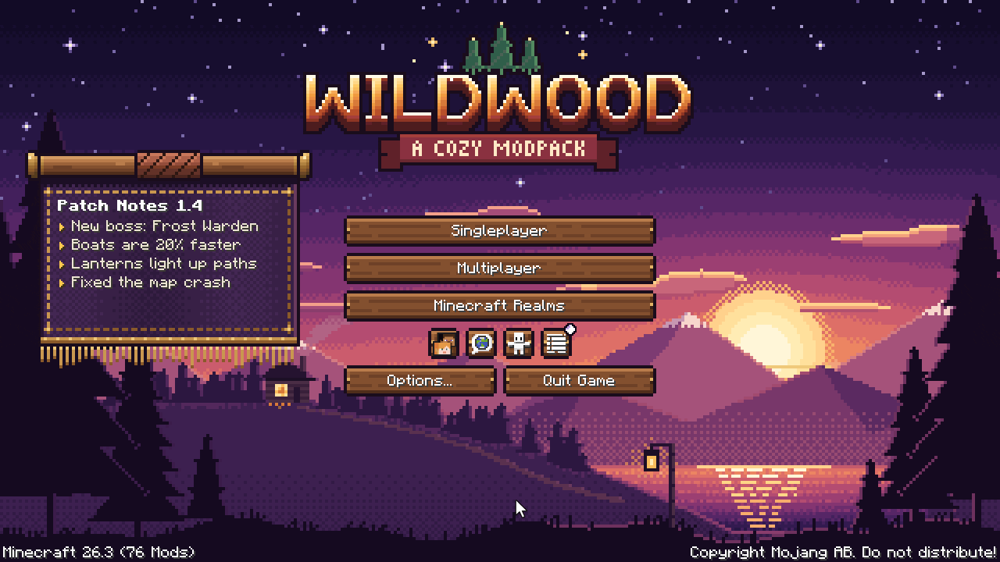

# Перетягувач

Перетягувач — це невидима область, яку гравці можуть схопити мишею та переміщувати. Усе, що до неї прив’язано, рухається разом із нею: наприклад, панель із нотатками до оновлення або нотатка з правилами сервера. Меню запам’ятовує, де гравці її залишили, навіть після перезапуску.

Гравці можуть перетягувати його лише поза редактором макета. У редакторі перетягувач позначено червоною рамкою з його назвою (колір можна змінити параметром **Колір у редакторі** в контекстному меню, яке відкривається клацанням правою кнопкою миші), а всі елементи залишаються на місцях, заданих макетом.

# Як зробити елемент рухомим

1. Створіть елемент, який має рухатися, наприклад зображення банера з текстовим елементом на ньому.
2. Клацніть правою кнопкою миші на вільному місці в редакторі макета та виберіть **Новий елемент -> Перетягувач**.
3. Змініть розмір перетягувача так, щоб він відповідав розміру банера, і перемістіть його на банер.
4. Клацайте правою кнопкою миші перетягувач і вибирайте **Перемістити на один шар нижче**, доки він не опиниться під усіма елементами банера. Вибрані елементи завжди відображаються поверх інших, тож клацніть на вільному місці, щоб побачити результат.
5. Прив’яжіть банер до перетягувача: трохи перетягніть банер за межі перетягувача, поверніть назад і утримуйте його там, доки смужка не заповниться. Докладніше — у розділі [Розташування елементів](/positioning-elements#anchoring-elements-to-other-elements).
6. Збережіть макет і перевірте результат поза редактором.

Елементи, прив’язані до рухомого елемента, теж рухаються разом із ним. У GIF текст прив’язаний до банера, тому перетягувач потрібен лише для банера.

Щоб прив’язати кілька елементів одночасно, перед кроком 4 клацніть правою кнопкою миші перетягувач і виберіть **Копіювати ID елемента**. Потім виберіть потрібні елементи, клацніть правою кнопкою миші один із них, виберіть **Точка прив’язки -> Інший елемент** і вставте ID.

> [!TIP]
> Гравці не бачать перетягувача, тож покажіть їм, за що хапати, наприклад, додавши заголовок або ручку.

# Збереження розташування

Для нових перетягувачів параметр **Зберігати зміщення перетягування користувача** в контекстному меню ввімкнено.

- **Увімкнено**: розташування зберігається, коли гравець відпускає елемент. Воно зберігається після закриття екрана та перезапуску гри.
- **Вимкнено**: щоразу, коли екран відкривається знову, а також коли змінюється розмір вікна або масштаб інтерфейсу, усе повертається на місця, задані макетом.

Якщо вимкнути цей параметр у редакторі, гра також забуде збережене гравцями розташування цього перетягувача.

Розташування кожного перетягувача зберігається за його [ідентифікатором елемента](/element-identifiers) у файлі `fancymenu_data/dragger_metas.json`. Ця папка не входить до складу [профілів](/profiles), тож розташування, задані під час тестування, не потраплять до папки `config/fancymenu/` вашого модпака. Докладніше див. у розділі [Розташування даних](/data-storage-locations#instance-data).

Щоб повернути всі перетягувачі на місця, задані макетом, видаліть `dragger_metas.json`, коли гра закрита.

# За що гравці можуть хапатися

Гравці хапають перетягувач там, де розташовані поверх нього елементи не перехоплюють клацання:

- Зображення поверх нього пропускають клацання, тож гравці хапають сам банер.
- Кнопки та слова в текстових елементах поверх нього перехоплюють клацання, тому кнопки й далі працюють на рухомій панелі.
- Якщо перетягувач розташований поверх кнопки, кнопка не реагуватиме на клацання. Саме тому в наведених вище кроках перетягувач розташовано під банером.

Поки [умови видимості](/element-visibility#showing-elements-only-sometimes) приховують перетягувач, гравці не можуть його схопити.

# Не виходити за межі екрана

Для нових елементів параметр **Залишатися на екрані** ввімкнено. Він зупиняє перетягувач біля країв екрана, щоб гравці не могли перетягнути його за межі видимості. Якщо перетягувач має такий самий розмір, як увесь банер, банер зупиняється біля краю разом із ним.

Перетягувач, який охоплює лише частину елемента, наприклад заголовок, теж працює. Однак у прив’язаних до нього елементів є власний параметр **Залишатися на екрані**: біля краю вони зупиняються, а перетягувач продовжує рухатися — і панель розпадається. Вимкніть для них параметр **Залишатися на екрані**, щоб вони рухалися разом із перетягувачем, а на екрані залишався лише заголовок.
