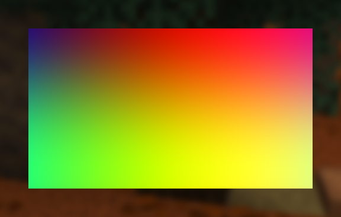

# Елементи

Елементи — це складові макета: кнопки, текст, зображення, повзунки, музика та багато іншого. На цій сторінці наведено всі типи елементів і їхні найважливіші параметри.

> [!TIP]
> Кнопки та інші частини екрана, наявні за замовчуванням, — це [елементи Vanilla](/vanilla-elements). Їх теж можна переміщувати, змінювати й приховувати.

# Додавання елементів

1. У редакторі макета клацніть правою кнопкою миші на вільному місці та виберіть **Новий елемент**. У меню у верхній частині вікна доступний той самий список: **Елемент -> Створити**.
2. Виберіть тип елемента. Наведіть курсор на тип, щоб побачити його призначення.

Елемент з’явиться там, де ви клацнули правою кнопкою миші. Перетягніть його, щоб перемістити, потягніть за краї, щоб змінити розмір, або клацніть правою кнопкою миші, щоб відкрити його параметри.


Про вибір, переміщення, копіювання та видалення елементів, а також усі комбінації клавіш редактора читайте в розділі [Редактор макета](/layout-editor). Щоб елементи залишалися на місці за будь-якого розміру вікна, дивіться [Розташування елементів](/positioning-elements). Щоб розмістити елементи перед іншими або позаду них, читайте [Шари та групи](/layout-editor#layers-and-groups).

# Загальні параметри елементів

У меню, яке відкривається натисканням правою кнопкою миші, кожен елемент має наведені нижче параметри, а також параметри свого типу:

| Параметр | Призначення |
|---|---|
| **Точка прив’язки** | До чого прив’язано елемент: наприклад, до кута екрана або іншого елемента. Дивіться [Розташування елементів](/positioning-elements). |
| **Розширене позиціювання** та **Розширене налаштування розміру** | Обчислення позиції та розміру, наприклад за допомогою [плейсхолдерів](/placeholders). Дивіться [Розширене позиціювання та налаштування розміру](/advanced-positioning-sizing). |
| **Умови завантаження** та **Завантажувати лише один раз за сеанс** | Показувати елемент лише за виконання [умов](/conditions) або лише один раз після запуску гри. Дивіться [Видимість елементів](/element-visibility). |
| **Затримка появи** та **Затримка зникнення** | Зачекати кілька секунд, перш ніж елемент з’явиться або зникне. Дивіться [Видимість елементів](/element-visibility#delaying-elements). |
| **Поява/зникнення з ефектом згасання** та **Непрозорість** | Плавно показувати й приховувати елемент або робити його напівпрозорим. Дивіться [Видимість елементів](/element-visibility#fading-in-and-out). |
| **Обертання**, **Вертикальний нахил** та **Горизонтальний нахил** | Обертати й нахиляти елемент. Дивіться [Обертання та нахил елементів](/rotating-elements). |
| **Ефект паралаксу** | Трохи переміщувати елемент за рухом миші. Дивіться [Ефект паралаксу](/parallax). |
| **Копіювати ID елемента** | Копіює ідентифікатор, за яким дії, плейсхолдери та інші елементи знаходять цей елемент. Дивіться [Ідентифікатори елементів](/element-identifiers). |
| **Назва в редакторі** | Назва елемента у списку шарів. |
| **Експорт для ШІ** | Перетворює елемент на текст для [ШІ-помічників](/export-for-ai). |

# Усі елементи

Усі елементи FancyMenu, упорядковані за призначенням.

## Кнопки та поля введення

### Кнопка

Кнопка, яка після натискання виконує [скрипт дій](/action-scripts), наприклад приєднується до сервера, відкриває вебсайт або інше меню.


- **Редагувати скрипт дій**: визначає дію кнопки після натискання.
- **Напис** та **Напис під час наведення**: звичайний текст кнопки та текст, який відображається, коли на неї наведено курсор. Обидва варіанти підтримують [плейсхолдери](/placeholders) і [форматування тексту](/text-formatting).
- **Вирівнювання напису**: розташовує напис **ліворуч**, **по центру** або **праворуч** на кнопці. Якщо напис завширшки більший за кнопку, він прокручуватиметься в обох напрямках незалежно від вирівнювання.
- **Масштаб напису**, **Основний колір напису**, **Колір напису під час наведення**, **Тінь напису** та **Підкреслювати напис під час наведення**: розмір, колір і тінь напису.
- **Текстури кнопки** та **Текстури піктограми кнопки**: власні зображення кнопки й піктограми на ній для звичайного, активного під час наведення та неактивного станів. Як текстури, що добре масштабуються, можна використовувати [текстури з розбиттям на дев’ять частин і тайлінгом](/nine-slicing-and-tiling).
- **Звук наведення**, **Звук зняття наведення** та **Звук натискання**: звуки, які відтворює кнопка.
- **Підказка**: текст, який відображається, коли на кнопку наведено курсор.
- **Керувати активним станом**: [умови](/conditions), за яких кнопку можна натиснути. Якщо вони не виконуються, кнопка стає сірою.
- **Режим шаблону**: задає вигляд інших кнопок і повзунків на екрані за зразком цієї кнопки. Дивіться [Шаблони кнопок і повзунків](/button-slider-templates).

### Повзунок

Повзунок, за допомогою якого гравці вибирають значення. Скрипт дій виконується щоразу, коли значення змінюється.


- **Тип повзунка**:
  - **Список значень**: послідовно вибирає тексти зі списку **Значення списку**, по одному в кожному рядку. Параметр **Значення зі змінної-списку** бере їх із [змінної-списку](/variables#text-and-list-variables).
  - **Діапазон цілих чисел**: цілі числа від **Мінімального значення діапазону** до **Максимального значення діапазону**.
  - **Діапазон десяткових чисел**: те саме, але з десятковими значеннями. Параметр **Кількість знаків після коми** визначає кількість цифр після коми; значення `-1` вимикає округлення.
- **Напис повзунка**: його текст. `$$value` показує поточне значення.
- **Редагувати скрипт дій**: запускається, коли значення змінюється. `$$value` — це нове значення.
- **Попередньо вибране значення**: значення, яке повзунок матиме спочатку. Задайте тут значення, яке змінює повзунок, щоб після відкриття екрана відображалося правильне значення.

Наприклад, повзунок гучності типу **Діапазон цілих чисел** від `0` до `100` має напис `Гучність музики: $$value%` і дію [**Задати значення змінної (змінна FM)**](/action-scripts#set-variable-value-fm-variable) з таким значенням:

```
music_volume:$$value
```

Його **Попередньо вибране значення** — `$$music_volume`, тому повзунок починається з останнього значення, вибраного гравцем.

У повзунків є такі самі параметри напису, текстури, звуку, підказки та **Керування активним станом**, як у кнопок. Тому за допомогою параметра **Вирівнювання напису** їхній напис також можна розташувати ліворуч або праворуч.

### Прапорець

Прапорець, який гравці можуть позначити або зняти позначку. Скрипт дій виконується щоразу, коли стан прапорця змінюється.


- У скрипті дій і умовах **Керування активним станом** значення `$$value` дорівнює `true` або `false`.
- **Режим змінної** та **Зв’язати зі змінною**: прапорець відображає значення [змінної](/variables) і записує в неї `true` або `false`. Якщо його зв’язати зі змінною-списком, `true` або `false` стане єдиним елементом списку.
- Без режиму змінної прапорець зберігає свій стан окремо для кожного [профілю](/profiles).
- **Текстури**: власні зображення прапорця та позначки.

Прапорці мають такі самі параметри підказки, звуку та **Можливість навігації**, як кнопки.

### Поле введення тексту

Поле, у яке гравці вводять текст, наприклад адресу сервера або ім’я.


- **Зв’язати зі змінною**: введений гравцем текст записується в [змінну](/variables), а поле відображає її значення. Якщо поле зв’язати зі змінною-списком, введений текст замінить увесь список.
- **Тип введення**: **Текст**, **Лише числа**, **Лише десяткові числа** або **URL**. Інші символи ввести не можна.
- **Текст підказки** та **Колір тексту підказки**: текст, який відображається, поки поле порожнє.
- **Максимальна довжина тексту**: кількість символів, які можна ввести.
- **Колір тла**, **Колір рамки**, **Радіус заокруглення рамки** та **Колір тексту**: вигляд поля.

Наприклад, поле, зв’язане зі змінною `server_address`, і кнопка з дією [**Приєднатися до сервера**](/action-scripts#join-server) та значенням `$$server_address` дадуть гравцям змогу приєднатися до будь-якого сервера.

Якщо поле не зв’язане зі змінною, прочитати його текст можна за допомогою плейсхолдера [**Значення поля введення тексту**](/placeholders#text-input-field-value), а змінити — за допомогою дії [**Задати значення поля введення тексту**](/action-scripts#set-text-input-field-value).

## Текст і підказки

### Текст

Текст будь-якої довжини — від короткого напису до правил або приміток до оновлення, які можна прокручувати. Підтримує [Markdown](/text-formatting) і [плейсхолдери](/placeholders).


- **Режим джерела**: введіть текст або завантажте його з файлу чи вебсайту.
- Початковий стиль оформлення та прокручування, якщо текст не вміщується в елемент.
- **Тло**: темна панель позаду тексту. Вимкніть її за допомогою параметра **Показувати тло** або замість неї використайте власну текстуру.

Докладніше читайте в розділі [Текст у меню](/text-in-menus).

### Підказка

Текстове поле, схоже на ігрові підказки. Підтримує [Markdown](/text-formatting) і [плейсхолдери](/placeholders).


- Показується у вибраному місці або біля курсора, якщо ввімкнути параметр **Слідувати за курсором**.
- Параметр **Умови завантаження** визначає, коли вона відображається, наприклад за умови [**На елемент наведено курсор**](/conditions#is-element-hovered) для кнопки.
- **Тло підказки**: власна текстура замість темного прямокутника.

Докладніше читайте в розділі [Текст у меню](/text-in-menus).

### Вітальний напис

Жовтий текст на титульному екрані з власними написами.


- **Режим джерела**: стандартні написи гри, власний текст або випадковий рядок із текстового файла.
- **Пружинення**, **Масштаб**, **Обертання**, **Колір тексту** та **Тінь**: вигляд напису.
- **Оновлювати під час завантаження екрана**: щоразу вибирає новий напис після відкриття екрана.

Докладніше читайте в розділі [Вітальні написи](/splash-text).

## Зображення та медіа

### Зображення

Зображення з файлів, вебсайту або ресурсів гри. Анімовані зображення також відтворюються.


- **Джерело зображення**: зображення. Список підтримуваних файлів наведено в розділі [Зображення](/images).
- **Зберегти пропорції**: змінює ширину, щоб зображення не розтягувалося.
- **Текстура з розбиттям на дев’ять частин** та **Повторювати текстуру**: дають змогу масштабувати рамки без розтягування країв або заповнювати область повторюваними фрагментами зображення. Дивіться [Розбиття на дев’ять частин і тайлінг](/nine-slicing-and-tiling).
- **Відтінок зображення [HEX]**: задає колір зображення.
- **Радіус заокруглення кутів**: заокруглює кути зображення.

### Слайдшоу

Показує зображення зі слайдшоу одне за одним. Створюйте слайдшоу в папці `config/fancymenu/slideshows/`. Дивіться [Слайдшоу](/slideshows).

- **Слайдшоу**: слайдшоу, яке потрібно показувати.
- **Зберегти пропорції**: змінює ширину, щоб зображення не розтягувалися.

### Відео

Відтворює відеофайл, наприклад трейлер або анімоване тло.

> [!IMPORTANT]
> Для відео потрібні моди Watermedia V3 і Watermedia Binaries V3. Дивіться [Відео](/video).

- **Джерело відео**: відеофайл, вебпосилання або ресурс гри.
- **Зациклювати відео**, **Гучність** і **Канал звуку**: параметри відтворення.
- **Відтворювати відео в редакторі макета**: визначає, чи відтворюватиметься відео під час редагування.
- За допомогою дій, наприклад [**Перемкнути стан паузи відеоелемента**](/action-scripts#toggle-video-element-paused-state), можна призупинити відео, перейти до певного моменту або змінити гучність.

**Відео [Rinku]** — застарілий відеоелемент, для якого потрібен мод Rinku. Він і далі працює в старих макетах, але його немає в меню **Новий елемент**.

### Шейдер GLSL

Запускає у власному елементі шейдер GLSL, наприклад анімовані кольори або ефекти з Shadertoy.



- **Джерело шейдера**: код шейдера. Шейдери Shadertoy із функцією `mainImage` працюють без змін.
- **Режим компіляції**: **Авто**, **Shadertoy** або **Безпосередній фрагментний шейдер**.
- **Джерело буфера A** — **Джерело буфера D**: додаткові проходи для шейдерів із буферами.

Як їх писати: [API шейдерів GLSL](/glsl-shader-api).

### Браузер

Показує вебсайт у реальному часі, наприклад мапу сервера або сторінку вікі.

> [!IMPORTANT]
> Для браузера потрібен мод [Rinku](https://modrinth.com/mod/rinku) ([CurseForge](https://www.curseforge.com/minecraft/mc-mods/rinku)).

- **URL**: вебсайт.
- **Можливість взаємодії**: дає гравцям змогу натискати, прокручувати та вводити текст на вебсторінці. У редакторі макета взаємодія недоступна.
- **Вимкнути звук браузера**, **Гучність аудіо/відео**, **Зациклювати відео** та **Приховати елементи керування відео**: параметри медіа на сторінці.

Щоб завантажити HTML-файл із папки `config/fancymenu/assets/`, почніть URL із `file:///`:

```
file:///config/fancymenu/assets/changelog.html
```

У Linux замість цього використовуйте плейсхолдер [**Абсолютний шлях до файла/папки**](/placeholders#absolute-filefolder-path):

```
file:///{"placeholder":"absolute_path","values":{"short_path":"/config/fancymenu/assets/changelog.html"}}
```

Вебсайти можуть запускати дії та читати плейсхолдери: [JavaScript API браузера](/browser-api).

## Фігури, предмети та моделі

### Прямокутник

Прямокутник одного кольору, наприклад панель позаду тексту.


- **Колір**: колір HEX. Додайте ще дві цифри, щоб зробити його напівпрозорим, наприклад `#101828C8`.
- **Радіус заокруглення кутів**: заокруглює всі кути або кожен кут окремо.
- **Розмиття** та **Інтенсивність розмиття**: розмивають зображення позаду фігури.

### Коло

Коло або овал одного кольору, наприклад індикатор стану.


- **Колір**, **Розмиття** та **Інтенсивність розмиття**: як у прямокутника.
- **Округлість**: значення `2` утворює коло. Більші значення роблять фігуру квадратнішою, менші — гострішою.

### Предмет

Показує предмет Minecraft або мода, як в інвентарі.


- **Ключ предмета**: предмет, наприклад `minecraft:diamond_sword`.
- **Кількість предметів**, **Назва предмета**, **Опис предмета** та **Зачарований**: параметри, як у звичайного предмета.
- **Показувати підказку предмета**: показує підказку предмета, коли на нього наведено курсор.
- **Власні дані NBT**: додаткові дані предмета у форматі, як у частині команди `/give` відразу після предмета.

### JSON-модель блока/предмета

Показує 3D-модель блока або предмета з ресурсів гри чи з власного JSON-файла.


- **Модель**: **Джерело моделі**, наприклад `minecraft:models/block/crafting_table.json`.
- **Текстура**: замінює текстуру моделі на вашу.
- **Трансформація**: масштабує, обертає та переміщує модель.
- **Освітлення**: параметр **Відтінок світла [HEX]** змінює колір світла на моделі.

### Гравець

Показує гравця у 3D, наприклад персонажа самого гравця на титульному екрані.


> [!IMPORTANT]
> Для відображення гравців потрібен мод Fancy Entity Renderer ([CurseForge](https://www.curseforge.com/minecraft/mc-mods/fancy-entity-renderer), [Modrinth](https://modrinth.com/mod/fancy-entity-renderer)). Без нього замість гравця відображатиметься повідомлення про помилку.

- **Копіювати гравця клієнта**: показує гравця, який грає в гру, із його скіном та ім’ям.
- **Ім’я гравця**, **Текстура скіна** та **Текстура плаща**: дають змогу показати іншого гравця або скін.
- **Поза гравця**, **Голова слідує за курсором** та **Тіло слідує за курсором**: визначають позу й напрямок погляду.
- **Броня та інструменти**, **Папуга**, **Дитинча** та **Показувати ім’я гравця**: визначають, що вдягнено та показано.

Докладніше читайте в розділі [Гравці](/player-entities). Якщо потрібна лише голова, дивіться [Голови гравців](/player-heads).

### Індикатор виконання

Смуга, яка поступово заповнюється, наприклад смуга завантаження.


- **Джерело значення виконання**: визначає заповненість смуги. Використовуйте тут [плейсхолдери](/placeholders), наприклад [**Прогрес завантаження світу**](/placeholders#world-loading-progress) на екрані завантаження світу.
- **Режим значення виконання**: **ВІДСОТКИ (0–100)** або **ДРОБОВЕ ЧИСЛО (0.0–1.0)**.
- **Напрямок**: у який бік заповнюється смуга.
- **Колір смуги** та **Колір тла** або **Текстура смуги** та **Текстура тла**.
- **Плавна анімація заповнення**: плавно переходить до нового значення замість миттєвого перемикання.
- **Використовувати прогрес для прив’язки елемента**: елементи, прив’язані до смуги, переміщуються разом із кінцем заповненої частини.

## Допоміжні елементи макета

### Область із прокручуванням

Містить інші елементи та дає змогу прокручувати їх, наприклад список серверів або довгу інформаційну сторінку.


- Перетягніть елементи до неї в редакторі макета. Додавати можна лише власні елементи, стандартні елементи гри додати не можна.
- **Розташування**: розміщуйте елементи самостійно або налаштуйте автоматичне розташування стосом, сіткою чи потоком.
- **Тло**: темна панель позаду області. Вимкніть її за допомогою параметра **Показувати тло** або замість неї використайте власну текстуру.

Докладніше читайте в розділі [Області з прокручуванням](/scrollable-areas).

### Перетягувач

Область, яку гравці можуть захопити й перемістити поза редактором. Прив’язані до неї елементи переміщуються разом із нею, наприклад рухома інформаційна панель. Поза редактором вона невидима.

Параметр **Зберігати зміщення перетягування користувача** зберігає нове розташування після закриття екрана та перезапуску гри. Докладніше читайте в розділі [Перетягувач](/dragger).

### Аніматор елементів

Переміщує та змінює розмір інших елементів за допомогою ключових кадрів, наприклад створює панель, що виїжджає на екран. Поза редактором він невидимий.

- **Керування цільовими елементами**: елементи, для яких створюється анімація.
- **Редагувати ключові кадри**: відкриває редактор ключових кадрів.
- **Зациклювати анімацію**: запускає її знову після завершення.

Докладніше читайте в розділі [Аніматор елементів](/element-animator).

## Невидимі елементи

Ці елементи відображаються лише в редакторі макета.

### Таймер

Неодноразово виконує свій скрипт дій, поки екран відкритий.

> [!IMPORTANT]
> Для всього, що має повторюватися або запускатися пізніше, рекомендуємо використовувати [планувальники](/schedulers). За можливості використовуйте їх замість таймерів. Вони працюють на будь-якому екрані й навіть без екрана, підтримують усі дії, а дії можуть запускати та зупиняти їх.

Як замінити таймери планувальниками:

- Безперервний запуск, поки екран відкритий: створіть планувальник із параметром **Затримка тика (мс)**. Запускайте його дією [**Запустити планувальник**](/action-scripts#start-scheduler) у пункті **Редагувати скрипт дій «Відкрити екран»** макета, а зупиняйте дією [**Зупинити планувальник**](/action-scripts#stop-scheduler) у пункті **Редагувати скрипт дій «Закрити екран»**. Обидва пункти доступні в меню редактора, яке відкривається натисканням правою кнопкою миші на тлі.
- Одноразовий запуск після кожного запуску гри: створіть планувальник із параметром **Запускати під час запуску** та значенням **Кількість тиків** `1`.
- Одноразовий запуск щоразу після відкриття екрана: таймер або планувальник не потрібен. Додайте дії в пункт **Редагувати скрипт дій «Відкрити екран»**.

Параметри таймера:

- **Затримка тика [мс]**: час між двома запусками в мілісекундах. Значення `0` запускає його з кожним тиком — 20 разів на секунду.
- **Режим тика**: **Звичайний** — працює безперервно. **Сеанс** — запускається лише один раз до перезапуску гри. **Під час завантаження екрана** — запускається раз щоразу після відкриття екрана, зокрема після зміни розміру вікна.
- **Асинхронно**: виконується у фоновому режимі. Більшість дій так не працює й показує помилку.

### Аудіо

Відтворює музику або звуки, поки екран відкритий, по одній доріжці за раз.

- **Керування доріжками**: аудіофайли, порядок їх відтворення та **Вага доріжки** для перемішування.
- **Режим відтворення**: **Звичайний** відтворює доріжки по черзі, **Перемішування** — у випадковому порядку.
- **Зациклювати доріжки**, **Гучність** і **Канал звуку**: параметри відтворення.

Щоб музика продовжувала грати під час переходу між екранами, додайте елемент аудіо до [універсального макета](/universal-layouts). Докладніше читайте в розділі [Фонова музика меню](/background-music).

### Керування музикою

Вимикає власну музику гри для цього екрана.

- **Відтворювати музику меню**: музику меню, коли світ не завантажено, наприклад на титульному екрані.
- **Відтворювати музику світу**: музику світу, яка продовжує грати в меню, наприклад в інвентарі.

Працює лише тоді, коли екран відкритий.

### Курсор

Замінює курсор миші власним зображенням, поки екран відкритий.

- **Текстура курсора**: зображення PNG, наприклад розміром 32×32 пікселі.
- **Координата X точки натискання** та **Координата Y точки натискання**: піксель зображення, яким виконується натискання, наприклад кінчик стрілки.
- **Режим попереднього перегляду в редакторі**: показує курсор у редакторі, коли миша перебуває над елементом.

Докладніше читайте в розділі [Власний курсор](/custom-cursor).
