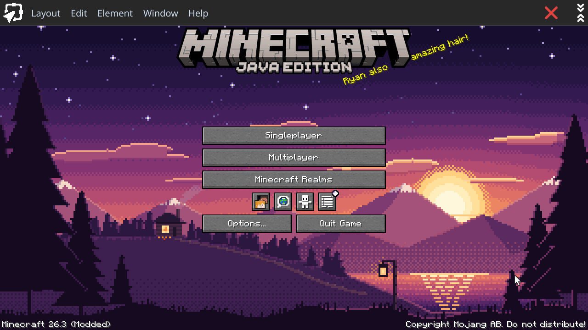

# Початок роботи

FancyMenu дає змогу змінювати будь-яке меню Minecraft: головний екран, меню паузи та меню інших модів. Додавайте власні фони, логотипи, кнопки, тексти, звуки й анімації, переміщуйте або приховуйте наявні елементи, призначайте кнопкам нові дії чи створюйте цілком нові меню. Усе це можна робити в грі, без коду.

На цій сторінці ви крок за кроком ознайомитеся з основами. У процесі ви створите простішу версію цього головного екрана, а в розділі [Як створено приклад](#how-the-example-is-made) дізнаєтеся, що додано до повної версії.

> [!TIP]
> Завантажте цей головний екран для своєї гри: отримайте файл [wildwood_title_screen.fmp](https://raw.githubusercontent.com/Keksuccino/docs_fancymenu/refs/heads/wiki-2026/assets/wildwood_title_screen.fmp?raw=true), а потім [імпортуйте](/profiles#importing) і [завантажте](/profiles#loading-a-profile) його через **рядок меню -> Налаштування -> Профілі**. Його можна безкоштовно використовувати для будь-чого: щоб спробувати FancyMenu, навчитися на його прикладі чи додати до свого модпака — зі змінами або без. Вказувати авторство не потрібно.

# Рядок меню

У рядку меню у верхній частині кожного меню зібрано всі можливості FancyMenu.

- **Налаштування**: макети поточного меню та всі параметри вашого налаштування, зокрема [Глобальні налаштування](/global-customizations), [Власні інтерфейси](/custom-guis), [Змінні](/variables), [Слухачі](/listeners), [Планувальники](/schedulers), [Профілі](/profiles) і налаштування FancyMenu.
- **Інструменти**: допоміжні засоби, як-от [Екземпляри тестового екрана](/dummy-screen-instances), [Творець AFMA](/animations#fma-and-afma), **Переглянути ресурси гри** та **Відкрити папку FancyMenu**, де зберігаються файли вашого налаштування (див. [Місця зберігання даних](/data-storage-locations)).
- **Довідка**: ця документація, сервер Discord, **Повідомити про помилку** та [Експорт для ШІ](/export-for-ai).
- Значок дверей праворуч закриває поточне меню — це корисно для меню, у яких немає власного способу вийти.
- Подвійна стрілка в крайньому правому куті згортає рядок меню до маленької кнопки й розгортає його назад.

Гравцям вашого модпака рядок меню не потрібен. Дізнайтеся, як його вимкнути, у розділі [Модпаки](/modpacks#disabling-the-menu-bar-and-hotkeys).

## Комбінації клавіш рядка меню

Ці комбінації працюють у кожному меню, але не в редакторі макетів і не тоді, коли ввімкнено режим модпака. У macOS замість `Ctrl + Alt` використовуйте `Cmd + Option`.

| Комбінація | Дія |
|---|---|
| `Ctrl + Alt + C` | Показати або приховати рядок меню. Якщо він раптом зник, ця комбінація допоможе його повернути. |
| `Ctrl + Alt + R` | Перезавантажити FancyMenu — так само, як через **рядок меню -> Налаштування -> Перезавантажити FancyMenu** |
| `Ctrl + Alt + D` | Показати або приховати **Накладку налагодження**, яка відображає [ідентифікатор](/screen-identifiers) меню та інші дані |
| `Ctrl + Alt + L` | Відкрити [редактор макетів](/layout-editor) з макетом, який ви редагували востаннє |

# Ваш перший макет

Макет зберігає ваші зміни до меню: його фон, додані вами елементи, а також зміни кнопок і тексту, які вже були в меню. Для одного меню можна створити кілька макетів і вмикати або вимикати кожен із них.

## Створення макета

1. Відкрийте меню, яке хочете змінити, наприклад головний екран.
2. Натисніть **рядок меню -> Налаштування -> Налаштування поточного екрана**, щоб з’явився напис **Увімкнено**. FancyMenu змінює лише ті меню, для яких цю функцію ввімкнено.
3. Натисніть **рядок меню -> Налаштування -> Макети -> Створити -> Для поточного екрана**.

Відкриється редактор макетів. У ньому меню відображається так, як його бачать гравці, тож ви одразу бачитимете кожну зміну. Докладніше про нього, зокрема про переміщення, зміну розміру та копіювання елементів, читайте в розділі [Редактор макетів](/layout-editor).

Пункт **Для всіх екранів [універсальний]** створює [універсальний макет](/universal-layouts), який відображається в кожному меню.

## Налаштування фону

Спочатку помістіть зображення в папку `config/fancymenu/assets` вашої гри. Пункт **рядок меню -> Інструменти -> Відкрити папку FancyMenu** відкриває `config/fancymenu`.

1. Клацніть правою кнопкою миші на фоні редактора й відкрийте **Фони меню -> Зображення**.
2. Натисніть **Показувати фон**, щоб з’явився напис **Увімкнено**.
3. Натисніть **Вибрати зображення**, установіть для **Типу джерела** значення **Локальний** і натисніть **Вибрати локальний файл ресурсу**.
4. Клацніть своє зображення й натисніть **OK**. Подвійне клацання відкриває папки.

Фоном також можуть бути панорами, слайд-шоу, відео, кольори та інше. Див. розділ [Фони меню](/menu-backgrounds).

## Додавання логотипа

1. Клацніть логотип Minecraft і натисніть `Delete`. Так само видаліть жовтий текст-заставку.
2. У рядку меню редактора натисніть **Елемент -> Створити -> Зображення**.
3. Клацніть правою кнопкою миші новий елемент, виберіть **Джерело зображення** та вкажіть свій логотип, як і для фону.

Видалені стандартні елементи лише приховуються. Щоб повернути їх, відкрийте **Елемент -> Видалені стандартні елементи**.

4. Знову клацніть його правою кнопкою миші й виберіть **Відновити співвідношення сторін**, щоб логотип не був сплющеним. Клавіша `Esc` закриває меню.
5. Перетягніть логотип на потрібне місце.

Можна додати багато інших елементів, наприклад кнопки, тексти, відео та програвачі. Див. розділ [Елементи](/elements).

## Зміна кнопок

1. Клацніть першу кнопку, а потім, утримуючи `Ctrl` (у macOS — `Cmd`), клацніть інші, щоб вибрати їх усі. Клацання правою кнопкою миші на одній із них змінить усі вибрані кнопки одночасно.
2. Клацніть правою кнопкою миші одну з кнопок, виберіть **Текстури кнопок -> Задати -> Звичайний фон** і вкажіть потрібну текстуру, як і для фону.

3. Так само задайте **Фон під час наведення** — текстуру, яка відображається, коли курсор перебуває над кнопкою.
4. Натисніть **Текстури кнопок -> Дев’ятисегментний користувацький фон**, щоб з’явився напис **Увімкнено**. Так краї текстури залишатимуться чіткими на кнопках будь-якої ширини. Див. розділ [Дев’ятисегментне розтягування](/nine-slicing-and-tiling).

У контекстному меню кількох елементів є лише спільні для них налаштування, тож вибирайте тільки кнопки. Щоб переглянути всі налаштування окремої кнопки, клацніть її правою кнопкою миші. Серед них — її назва, звуки, дії під час натискання ([Скрипти дій](/action-scripts)) і правила відображення ([Видимість елементів](/element-visibility)). Див. розділ [Стандартні елементи та елементи модів](/vanilla-elements).

## Збереження

1. Натисніть `Ctrl + S` (у macOS — `Cmd + S`) або виберіть **Макет -> Зберегти**.
2. Під час першого збереження FancyMenu запропонує ввести назву файлу. Залиште запропоновану назву або введіть нову й натисніть **Зберегти**.
3. Закрийте редактор кнопкою X праворуч у його рядку меню.

Макет одразу відобразиться в меню. Щоб змінити його пізніше, наведіть курсор на нього в меню **рядок меню -> Налаштування -> Макети** й натисніть **Редагувати макет** або скористайтеся комбінацією `Ctrl + Alt + L`.

# Як створено приклад

Головний екран на початку цієї сторінки містить кілька додаткових елементів порівняно зі створеним вами:

- Небо, пагорби й дерева — це три зображення, які рухаються за курсором. Найбільше рухаються дерева. Див. розділ [Ефект паралакса](/parallax).
- Пагорби й дерева — це елементи-зображення розміром з екран. Щоб вони залишалися за кнопками й текстом, у контекстному меню фону редактора ввімкнено параметр **Користувацькі елементи позаду стандартних**.
- Світлячки — це [декоративне накладання](/decoration-overlays#fireflies).
- Розмір пагорбів, дерев і логотипа залежить від розміру екрана. Для цього використано [розширене позиціювання та масштабування](/advanced-positioning-sizing) із заповнювачами, завдяки чому меню підлаштовується під розмір будь-якого вікна. На невисоких екранах логотип зменшується, щоб не перекривати кнопки.

Щоб переглянути все це в редакторі макетів, завантажте [профіль із прикладом](#getting-started) і відредагуйте його макет.

# Що далі

**Створіть чудовий вигляд**

- [Елементи](/elements): усе, що можна додати до меню.
- [Розташування елементів](/positioning-elements): закріплення елементів на місці для вікон будь-якого розміру.
- [Фони меню](/menu-backgrounds), [Анімації](/animations), [Відео](/video), [Декоративні накладання](/decoration-overlays) і [Фонова музика](/background-music).

**Додайте функціональності**

- [Скрипти дій](/action-scripts): дії кнопок та інших елементів.
- [Видимість елементів](/element-visibility) і [Умови](/conditions): налаштування показу елементів лише за певних умов.
- [Заповнювачі](/placeholders): динамічна інформація в тексті, як-от ім’я гравця.
- [Змінні](/variables), [Слухачі](/listeners) і [Планувальники](/schedulers): збереження даних, реакція на події в грі та виконання дій за розкладом.

**Створюйте більше**

- [Власні інтерфейси](/custom-guis): створення цілком нових меню.
- [Універсальні макети](/universal-layouts): зміни, які застосовуються до всіх меню.
- [Глобальні налаштування](/global-customizations): зміни для всієї гри, як-от назва вікна.
- [Екран завантаження](/loading-screen) і [Вступ до гри](/game-intro).

**Діліться своїми роботами**

- [Модпаки](/modpacks): додавання своїх налаштувань до модпака.
- [Профілі](/profiles): перемикання між налаштуваннями та їх експорт.

# Де отримати допомогу

- Відповіді на найпоширеніші запитання є у [Частих запитаннях](/faq).
- Пункт **рядок меню -> Довідка -> Приєднатися до Discord** відкриває сервер FancyMenu у Discord.
- [Експорт для ШІ](/export-for-ai) перетворює ваші налаштування на текст для чатів зі ШІ, наприклад для бота підтримки на сервері Discord.
- Якщо щось працює неправильно, виберіть **рядок меню -> Довідка -> Повідомити про помилку**.

# Для розробників

Щоб створити доповнення для FancyMenu або використовувати його у своєму моді, див. [документацію для розробників](https://github.com/Keksuccino/FancyMenu-Dev-Docs/wiki).
