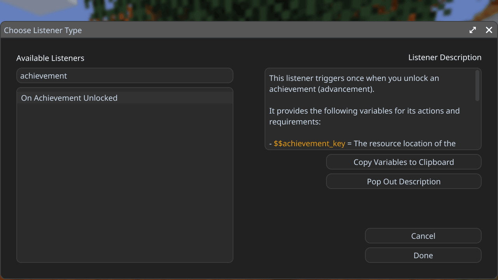

# Обробники подій

Обробники подій запускають [сценарій дій](/action-scripts), коли в грі щось відбувається: натискається клавіша, відкривається екран, ви здобуваєте досягнення тощо. Вони працюють у кожному меню та під час гри й не належать до макета.

Більшість обробників також передають сценарію змінні з інформацією про подію, наприклад назву натиснутої клавіші.

> [!CAUTION]
> Обробник може запускати дії з файлами, мережею, командами, буфером обміну, наборами ресурсів і посиланнями, навіть коли жодне меню не відкрите. Використовуйте лише обробники з профілів і файлів людей, яким довіряєте.

# Додавання обробника подій

1. Відкрийте **Рядок меню -> Налаштування -> Керування обробниками подій**.
2. Натисніть **Додати обробник подій**.
3. Натисніть подію в розділі **Доступні обробники подій**. Рядок пошуку знаходить обробники за назвою та описом.
   - **Опис обробника подій** пояснює, що робить обробник і які змінні він передає.
   - **Копіювати змінні в буфер обміну** копіює назви його змінних.
   - **Відкрити опис в окремому вікні** відкриває опис в окремому вікні.
4. Натисніть **Готово** або двічі клацніть обробник. Відкриється редактор сценаріїв дій.
5. Додайте потрібні дії та натисніть **Готово**. Див. [Сценарії дій](/action-scripts#making-an-action-script).
6. Щоб зберегти зміни, натисніть **Готово** у вікні **Керування обробниками подій**. Обробник почне працювати негайно.

Кнопка **Скасувати** відкине всі зміни у вікні **Керування обробниками подій** після вашого підтвердження.

# Керування обробниками подій

- Натисніть обробник, щоб побачити його тип і сценарій дій праворуч.
- Кнопка **Редагувати дії** або клацання правою кнопкою миші на обробнику відкриває його сценарій дій.
- Двічі клацніть назву обробника, щоб перейменувати його, наприклад на `Клавіша довідки`. Натисніть `Enter`, щоб зберегти назву, або `Esc`, щоб скасувати. Якщо назва порожня, знову відображатиметься тип обробника.
- Кнопка **Видалити обробник подій** видаляє вибраний обробник.
- **Експорт для ШІ** копіює вибраний обробник або всі обробники для [чату зі ШІ](/export-for-ai), зокрема незбережені зміни.

Обробники зберігаються у файлі `config/fancymenu/listener_instances.txt` (див. [Розташування сховищ даних](/data-storage-locations)). Кожен [профіль](/profiles) має власні обробники подій.

# Змінні обробників подій

Змінні обробника починаються з `$$` і працюють у всьому його сценарії: у значеннях кожної дії та в умовах [операторів IF](/action-scripts#if-else-if-and-else). Регістр має значення. Нижче для кожного обробника наведено його змінні; вони також указуються в описі у вікні вибору обробника.

Наприклад, цей обробник відкриває екран довідки після натискання `H`:

1. Додайте обробник **Після натискання клавіші клавіатури**.
2. У його сценарії виберіть **Додати оператор IF** з умовою [**Є текстом**](/conditions#is-text). Для параметра **Режим порівняння** виберіть **Дорівнює**, у полі **Текст** укажіть `$$key_name`, а в полі **Порівняти з текстом** — `H`.
3. Усередині IF додайте дію [**Відкрити екран або власний інтерфейс**](/action-scripts#open-screen-or-custom-gui) і вкажіть екран довідки.

Докладніше про змінні обробників:

- Змінні обробників завжди є текстом. Якщо обробник не може отримати значення, змінна матиме резервне значення, наприклад `ERROR`, `UNKNOWN`, `NONE`, `EMPTY`, `0`, `-1` або порожній рядок.
- Змінні обробника заповнюються перед [плейсхолдерами](/placeholders), тому їх можна використовувати й усередині плейсхолдерів.
- Змінні обробника існують лише під час виконання його сценарію. Щоб зберегти значення, запишіть його в одну зі своїх [змінних](/variables) за допомогою дії [**Установити значення змінної (FM Variable)**](/action-scripts#set-variable-value-fm-variable).
- Власні змінні, створені через **Рядок меню -> Налаштування -> Керування змінними**, також доступні у сценаріях обробників: додайте `$$` перед назвою, наприклад `$$coins`. Якщо назва однієї з них збігається з назвою змінної обробника, `$$name` означатиме змінну обробника. Власні змінні з довшими назвами, наприклад `key_name_log`, продовжать працювати.
- Текст із чату, серверів, файлів та від інших гравців може містити будь-що. Ніколи не вставляйте його безпосередньо в команди, шляхи до файлів або посилання.

# Корисно знати

- Деяким обробникам потрібен FancyMenu на сервері. Про це зазначено нижче. В одиночній грі вони завжди працюють.
- Деякі обробники запускаються дуже часто, зокрема **Після переміщення миші на екрані**, **Після прокручування елемента**, **Після зміни позиції** та **Після відтворення звуку світу**. Робіть їхні сценарії короткими й не використовуйте в них повільні дії, як-от [**Перезавантажити FancyMenu**](/action-scripts#reload-fancymenu).
- Щоб замінити екран за допомогою обробника **Після відкриття екрана**, спершу перевірте `$$screen_identifier` оператором IF. Інакше замінюватимуться всі екрани, зокрема той, який ви відкриваєте.

# Усі обробники подій

Усі обробники FancyMenu, упорядковані за типом подій, на які вони реагують.

## Клавіатура та миша

Щоб перевірити, яку клавішу натиснуто, використовуйте `$$key_name`. Числові коди клавіш відрізняються в різних версіях Minecraft.

### Після натискання клавіші клавіатури

**Ідентифікатор:** `keyboard_key_pressed`

Запускається, коли клавішу натиснуто в меню або під час гри. Якщо утримувати клавішу, обробник запускатиметься знову й знову.

- `$$key_name`: назва клавіші, наприклад `H` або `Left Shift`
- `$$key_keycode`: числовий код клавіші
- `$$key_scancode`: скан-код клавіші
- `$$key_modifiers`: число, що відповідає клавішам-модифікаторам, які натиснуті одночасно, наприклад `Shift` і `Ctrl`

### Після відпускання клавіші клавіатури

**Ідентифікатор:** `keyboard_key_released`

Запускається, коли клавішу відпущено в меню або під час гри.

Передає ті самі змінні, що й обробник **Після натискання клавіші клавіатури**: `$$key_name`, `$$key_keycode`, `$$key_scancode` і `$$key_modifiers`.

### Після введення символу на екрані

**Ідентифікатор:** `keyboard_char_typed`

Запускається для кожного символу, введеного, коли відкрито екран.

- `$$char`: введений символ

### Після переміщення миші на екрані

**Ідентифікатор:** `mouse_moved`

Запускається щоразу, коли миша переміщується на відкритому екрані.

- `$$mouse_pos_x`, `$$mouse_pos_y`: положення миші в пікселях інтерфейсу
- `$$mouse_move_delta_x`, `$$mouse_move_delta_y`: відстань переміщення миші від попереднього моменту

### Після натискання кнопки миші

**Ідентифікатор:** `mouse_button_clicked`

Запускається один раз, коли натискається кнопка миші в меню або під час гри.

- `$$button`: `left`, `right` або `middle`. Для інших кнопок указується їхній номер.
- `$$mouse_pos_x`, `$$mouse_pos_y`: положення миші в пікселях інтерфейсу

### Після відпускання кнопки миші

**Ідентифікатор:** `mouse_button_released`

Запускається один раз, коли відпускається кнопка миші в меню або під час гри.

Передає ті самі змінні, що й обробник **Після натискання кнопки миші**: `$$button`, `$$mouse_pos_x` і `$$mouse_pos_y`.

### Після прокручування миші на екрані

**Ідентифікатор:** `mouse_scrolled`

Запускається, коли на відкритому екрані прокручується коліщатко миші.

- `$$scroll_delta_y`: величина прокручування. Значення більше за `0` означає прокручування вгору, менше за `0` — униз.

## Екрани та елементи

### Після відкриття екрана

**Ідентифікатор:** `screen_open`

Запускається одразу після відкриття екрана. Дія [**Відкрити екран або власний інтерфейс**](/action-scripts#open-screen-or-custom-gui) у його сценарії може замінити цей екран іншим.

- `$$screen_identifier`: [ідентифікатор](/screen-identifiers) екрана

### Після закриття екрана

**Ідентифікатор:** `screen_close`

Запускається одразу після закриття екрана.

- `$$screen_identifier`: [ідентифікатор](/screen-identifiers) закритого екрана

### Після натискання на текст Markdown

**Ідентифікатор:** `text_clicked`

Запускається, коли хтось натискає на [подію натискання](/text-formatting#click-and-hover-events) у тексті, наприклад `[Прочитати правила](click:open_rules)`.

- `$$text_event_id`: ідентифікатор події, наприклад `open_rules`

### Після наведення на текст Markdown

**Ідентифікатор:** `text_hovered`

Запускається, коли вказівник миші наводять на [подію наведення](/text-formatting#click-and-hover-events) у тексті, наприклад `[Що це?](hover:show_hint)`.

- `$$text_event_id`: ідентифікатор події, наприклад `show_hint`

### Після прокручування елемента

**Ідентифікатор:** `scroll_area_scrolled`

Запускається щоразу, коли переміщується вміст [області прокручування](/scrollable-areas) або [текстового елемента](/text-in-menus). Під час плавного прокручування це відбувається кожного кадру. У редакторі макетів не запускається.

- `$$element_identifier`: [ідентифікатор](/element-identifiers) елемента
- `$$scroll_x`: величина горизонтального прокручування вмісту в пікселях
- `$$scroll_y`: величина вертикального прокручування вмісту в пікселях
- `$$scroll_percent`: відсоток прокручування вмісту в основному напрямку елемента — від `0` (початок) до `100` (кінець)

### Після прокручування елемента до початку

**Ідентифікатор:** `scroll_area_reached_start`

Запускається, коли вміст області прокручування або текстового елемента прокручено назад до початку.

Передає ті самі змінні, що й обробник **Після прокручування елемента**: `$$element_identifier`, `$$scroll_x`, `$$scroll_y` і `$$scroll_percent`.

### Після прокручування елемента до кінця

**Ідентифікатор:** `scroll_area_reached_end`

Запускається, коли вміст області прокручування або текстового елемента прокручено до кінця, наприклад після прочитання всіх правил.

Передає ті самі змінні, що й обробник **Після прокручування елемента**: `$$element_identifier`, `$$scroll_x`, `$$scroll_y` і `$$scroll_percent`.

### Початок відтворення анімованої текстури

**Ідентифікатор:** `animated_texture_started_playing`

Запускається, коли починає відтворюватися [анімована текстура](/animations) (GIF, APNG або FMA), а також щоразу, коли її відтворення починається спочатку.

- `$$texture_source`: джерело текстури — шлях до файлу, вебпосилання або розташування ресурсу
- `$$texture_source_type`: `LOCAL`, `WEB` або `RESOURCE_LOCATION`
- `$$texture_will_restart`: `true`, якщо після цього циклу відтворення почнеться знову; інакше — `false`

### Завершення відтворення анімованої текстури

**Ідентифікатор:** `animated_texture_finished_playing`

Запускається після завершення циклу відтворення анімованої текстури. Якщо вона циклічна, обробник запускається безпосередньо перед її повторним відтворенням.

Передає ті самі змінні, що й обробник **Початок відтворення анімованої текстури**: `$$texture_source`, `$$texture_source_type` і `$$texture_will_restart`.

### Зміна стану відтворення відео

**Ідентифікатор:** `video_playback_status_changed`

Запускається, коли починає відтворюватися, призупиняється, зупиняється або завершується [відео](/video) чи тло меню.

- `$$video_source`: джерело відео — шлях до файлу, вебпосилання або розташування ресурсу
- `$$video_source_type`: `LOCAL`, `WEB` або `RESOURCE_LOCATION`
- `$$is_looping`: `true`, якщо відео відтворюється циклічно; інакше — `false`
- `$$new_status`:
  - `PLAYING`: відтворення відео почалося або його було відновлено
  - `PAUSED`: відтворення відео призупинено
  - `STOPPED`: відтворення відео зупинено
  - `FINISHED`: відео завершилося. Для циклічних відео цей стан також настає безпосередньо перед повторним відтворенням.

## Змінні, файли та дані

### Після оновлення змінної [FM Variable]

**Ідентифікатор:** `fm_variable_updated`

Запускається щоразу, коли встановлюється [змінна](/variables).

- `$$var_name`: назва змінної
- `$$old_value`: попереднє значення
- `$$new_value`: нове значення

Для змінних-списків обидва значення містять увесь список у форматі масиву JSON, наприклад `["Diamonds","Emeralds"]`.

### Після початку завантаження файла дією

**Ідентифікатор:** `file_download_started_via_action`

Запускається, коли починається завантаження за допомогою дії [**Завантажити файл до папки гри**](/action-scripts#download-file-to-game-directory), щойно стає відомою назва файла. Файл з'явиться за вказаним шляхом лише після завершення завантаження, тому скористайтеся обробником **Після завантаження файла дією**, щоб дізнатися, коли він буде готовий.

- `$$download_url`: посилання на файл
- `$$target_file_path`: шлях, за яким буде збережено файл

### Після завантаження файла дією

**Ідентифікатор:** `file_downloaded_via_action`

Запускається, коли завантаження за допомогою дії [**Завантажити файл до папки гри**](/action-scripts#download-file-to-game-directory) завершується успішно або з помилкою.

- `$$download_url`: посилання на файл
- `$$target_file_path`: шлях, за яким збережено файл. Якщо завантаження не вдалося, тут може бути лише шлях до папки.
- `$$download_succeeded`: `true` або `false`

### Після вибору файла

**Ідентифікатор:** `file_selected_via_action`

Запускається після завершення дії [**Вибрати файл у системі**](/action-scripts#select-file-from-system): файл скопійовано, вікно вибору файла закрито без вибору або сталася помилка.

- `$$selected_file_path`: повний шлях до вибраного файла. Порожній, якщо вікно вибору файла закрили без вибору.
- `$$target_file_path`: шлях у папці гри, куди скопійовано файл
- `$$selection_succeeded`: `true`, якщо файл скопійовано
- `$$selection_cancelled`: `true`, якщо вікно вибору файла закрили, не вибравши файл
- `$$failure_reason`: причина помилки. Порожній, якщо помилки не було.

### Після розпакування ZIP-архіву дією

**Ідентифікатор:** `zip_extracted_via_action`

Запускається після завершення дії [**Розпакувати ZIP-файл у папці гри**](/action-scripts#extract-zip-file-in-game-directory).

- `$$source_zip_path`: шлях до ZIP-файла
- `$$target_folder_path`: шлях до папки, куди його розпаковано
- `$$extract_succeeded`: `true` або `false`
- `$$failure_reason`: причина помилки. Порожній, якщо помилки не було.

Шляхи в папці гри починаються з `/`, наприклад `/config/fancymenu/assets/pack.zip`. Шляхи в папці `.minecraft` починаються з `.minecraft/`.

### Після отримання даних FM

**Ідентифікатор:** `fm_data_received`

Запускається, коли сервер надсилає цьому гравцеві дані командою `/fmdata send`. Див. [Дані FM](/fm-data).

- `$$data_identifier`: ідентифікатор, з яким надіслано дані
- `$$data`: дані
- `$$sent_by`: IP-адреса сервера або `integrated_server` в одиночній грі

### Після підключення до віддаленого сервера

**Ідентифікатор:** `remote_server_connected`

Запускається, коли встановлюється [з'єднання з віддаленим сервером](/remote-server-communication).

- `$$request_id`: ідентифікатор запиту з'єднання
- `$$remote_server_url`: посилання на віддалений сервер

### Після отримання даних від віддаленого сервера

**Ідентифікатор:** `remote_server_data_received`

Запускається щоразу, коли підключений віддалений сервер надсилає текст.

- `$$request_id`: ідентифікатор запиту з'єднання
- `$$remote_server_url`: посилання на віддалений сервер
- `$$data`: надісланий текст

### Після закриття з'єднання з віддаленим сервером

**Ідентифікатор:** `remote_server_connection_closed`

Запускається, коли з'єднання з віддаленим сервером закривається.

- `$$request_id`: ідентифікатор запиту з'єднання
- `$$remote_server_url`: посилання на віддалений сервер
- `$$intentionally_closed`: `true`, якщо з'єднання закрила дія [**Закрити з'єднання з віддаленим сервером**](/action-scripts#close-remote-server-connection)
- `$$crashed`: `true`, якщо з'єднання перервалося через збій
- `$$unknown_close_reason`: `true`, якщо з'єднання закрилося з невідомої причини

## Гра, світи та сервери

### Під час виходу з Minecraft

**Ідентифікатор:** `quit_minecraft`

Запускається один раз, коли гра починає закриватися.

- `$$timestamp_millis`: час у мілісекундах від 1970 року
- `$$timestamp_iso`: час у форматі ISO-8601, наприклад `2026-11-24T18:30:00.123Z`

### Після створення знімка екрана

**Ідентифікатор:** `screenshot_taken`

Запускається після створення та збереження знімка екрана, наприклад за допомогою клавіші знімка екрана.

- `$$screenshot_path`: шлях до знімка екрана в папці гри, наприклад `/screenshots/2026-10-29_14.30.00.png`

### Після входу в одиночний світ

**Ідентифікатор:** `world_entered`

Запускається, коли завантаження одиночного світу завершилося і ви можете рухатися.

- `$$world_name`: назва світу
- `$$world_save_path`: повний шлях до папки зі збереженням світу
- `$$world_difficulty`: складність світу
- `$$world_cheats_allowed`: `true`, якщо чити ввімкнено
- `$$world_icon_path`: повний шлях до значка світу
- `$$world_is_first_join`: `true` під час першого входу після створення світу

### Після виходу з одиночного світу

**Ідентифікатор:** `world_left`

Запускається, коли одиночний світ закривається і зберігається.

Передає ті самі змінні, що й обробник **Після входу в одиночний світ**, окрім `$$world_is_first_join`: `$$world_name`, `$$world_save_path`, `$$world_difficulty`, `$$world_cheats_allowed` і `$$world_icon_path`.

### Під час початку підключення до сервера

**Ідентифікатор:** `start_joining_server`

Запускається, коли гра починає підключатися до сервера або Realm, але ще не підключилася. Обробник запускається також у разі помилки чи скасування підключення, тож може запам'ятати сервер, наприклад для кнопки повторного підключення на екрані від'єднання.

- `$$server_ip`: IP-адреса сервера

### Після підключення до сервера

**Ідентифікатор:** `server_joined`

Запускається після підключення до багатокористувацького сервера.

- `$$server_ip`: IP-адреса сервера

### Після виходу із сервера

**Ідентифікатор:** `server_left`

Запускається після виходу з багатокористувацького сервера.

- `$$server_ip`: IP-адреса сервера

### Після входу іншого гравця у світ або на сервер

**Ідентифікатор:** `other_player_joined_world`

Запускається, коли інший гравець приєднується до вашого світу або сервера.

- `$$player_name`: ім'я гравця
- `$$player_uuid`: UUID гравця

### Після виходу іншого гравця зі світу або із сервера

**Ідентифікатор:** `other_player_left_world`

Запускається, коли інший гравець виходить із вашого світу або із сервера.

- `$$player_name`: ім'я гравця
- `$$player_uuid`: UUID гравця

### Після смерті іншого гравця

**Ідентифікатор:** `other_player_died`

Запускається, коли у вашому світі помирає інший гравець.

- `$$player_name`: ім'я гравця
- `$$player_uuid`: UUID гравця
- `$$death_pos_x`, `$$death_pos_y`, `$$death_pos_z`: місце смерті гравця

## Чат

### Після отримання повідомлення в чаті

**Ідентифікатор:** `chat_message_received`

Запускається, коли в чаті з'являється повідомлення від гравця.

- `$$chat_message_string`: повідомлення у вигляді звичайного тексту
- `$$chat_message_component`: повідомлення як текстовий компонент JSON
- `$$sender_uuid`: UUID відправника або `ERROR`, якщо його не вдалося визначити
- `$$sender_name`: ім'я відправника або `ERROR`, якщо його не вдалося визначити

### Після надсилання повідомлення в чат

**Ідентифікатор:** `chat_message_sent`

Запускається, коли ви надсилаєте повідомлення в чат. Команди не враховуються.

- `$$chat_message_string`: повідомлення у вигляді звичайного тексту
- `$$chat_message_component`: повідомлення як текстовий компонент JSON

### Після отримання системного повідомлення в чаті

**Ідентифікатор:** `system_message_received_in_chat`

Запускається, коли в чаті з'являється повідомлення не від гравця, наприклад результат виконання команди.

- `$$system_message_string`: повідомлення у вигляді звичайного тексту
- `$$system_message_component`: повідомлення як текстовий компонент JSON

## Гравець

### Після смерті

**Ідентифікатор:** `player_death`

Запускається одразу після відкриття екрана смерті.

- `$$days_survived`: кількість ігрових днів від останньої смерті, округлена вниз
- `$$death_reason_string`: повідомлення про смерть у вигляді звичайного тексту
- `$$death_reason_component`: повідомлення про смерть як текстовий компонент JSON
- `$$death_pos_x`, `$$death_pos_y`, `$$death_pos_z`: місце вашої смерті

### Після отримання шкоди

**Ідентифікатор:** `damage_taken`

Запускається окремо для кожного отриманого удару.

- `$$damage_amount`: кількість здоров'я, втрачена від удару
- `$$damage_type`: тип шкоди, наприклад `minecraft:fall`
- `$$is_fatal_damage`: `true`, якщо удар убив вас
- `$$damage_source`: тип істоти, яка завдала шкоди, наприклад `minecraft:zombie`, або `NONE`

### Після отримання ефекту

**Ідентифікатор:** `effect_gained`

Запускається один раз, коли ви отримуєте ефект стану.

- `$$effect_key`: ефект, наприклад `minecraft:speed`
- `$$effect_type`: `positive`, `negative` або `neutral`
- `$$effect_duration`: тривалість ефекту в тіках (20 тіків — 1 секунда)

### Після втрати ефекту

**Ідентифікатор:** `effect_lost`

Запускається один раз, коли дія ефекту стану завершується.

- `$$effect_key`: ефект, наприклад `minecraft:speed`
- `$$effect_type`: `positive`, `negative` або `neutral`

### Після зміни досвіду

**Ідентифікатор:** `experience_changed`

Запускається щоразу, коли кількість очок досвіду збільшується або зменшується.

- `$$new_experience_amount`: поточна загальна кількість очок досвіду
- `$$old_experience_amount`: попередня загальна кількість очок досвіду
- `$$is_level_up`: `true`, якщо ви отримали новий рівень

### Після здобуття досягнення

**Ідентифікатор:** `achievement_unlocked`

Запускається один раз, коли ви здобуваєте досягнення. Уже виконані досягнення, наприклад під час входу у світ, не враховуються.

- `$$achievement_key`: досягнення, наприклад `minecraft:story/mine_diamond`
- `$$achievement_label`: його назва мовою гри
- `$$achievement_description`: його опис мовою гри
- `$$achievement_icon_item_key`: предмет-значок, наприклад `minecraft:diamond`
- `$$achievement_type`: `advancement`, `goal` або `challenge`

### Після стрибка

**Ідентифікатор:** `jump`

Запускається щоразу, коли ви стрибаєте. Змінних немає.

### Після початку бігу

**Ідентифікатор:** `started_running`

Запускається один раз, коли ви починаєте бігти. Змінних немає.

### Після припинення бігу

**Ідентифікатор:** `stopped_running`

Запускається один раз, коли ви припиняєте бігти. Змінних немає.

### Після зміни позиції

**Ідентифікатор:** `position_changed`

Запускається щоразу, коли ви переходите до іншого блока.

- `$$old_pos_x`, `$$old_pos_y`, `$$old_pos_z`: попередні координати блока
- `$$new_pos_x`, `$$new_pos_y`, `$$new_pos_z`: нові координати блока

### Після початку горіння

**Ідентифікатор:** `started_burning`

Запускається один раз, коли ви починаєте горіти. Змінних немає.

### Після припинення горіння

**Ідентифікатор:** `stopped_burning`

Запускається один раз, коли ви перестаєте горіти. Змінних немає.

### Після початку утоплення

**Ідентифікатор:** `started_drowning`

Запускається один раз, коли ви починаєте отримувати шкоду від утоплення. Змінних немає.

### Після початку замерзання

**Ідентифікатор:** `started_freezing`

Запускається один раз, коли ви починаєте замерзати, наприклад у пухкому снігу.

- `$$freezing_intensity`: ступінь замерзання від `0.0` (зовсім не замерзли) до `1.0` (повністю замерзли)

### Після припинення замерзання

**Ідентифікатор:** `stopped_freezing`

Запускається один раз, коли ви перестаєте замерзати. Змінних немає.

### Після повного замерзання

**Ідентифікатор:** `fully_frozen`

Запускається один раз, коли ви повністю замерзаєте. Змінних немає.

### Після початку плавання

**Ідентифікатор:** `start_swimming`

Запускається один раз, коли ви починаєте плавати.

- `$$fluid_type`: рідина, наприклад `minecraft:water`

### Після припинення плавання

**Ідентифікатор:** `stop_swimming`

Запускається один раз, коли ви перестаєте плавати.

- `$$fluid_type`: рідина, наприклад `minecraft:water`

### Після початку контакту з рідиною

**Ідентифікатор:** `start_touching_fluid`

Запускається один раз, коли ви починаєте торкатися рідини, наприклад води чи лави.

- `$$fluid_type`: рідина, наприклад `minecraft:lava`

### Після припинення контакту з рідиною

**Ідентифікатор:** `stop_touching_fluid`

Запускається один раз, коли ви перестаєте торкатися рідини.

- `$$fluid_type`: рідина, наприклад `minecraft:lava`

## Предмети

### Після підбирання предмета

**Ідентифікатор:** `item_picked_up`

Запускається один раз, коли ви підбираєте предмет.

- `$$item_key`: предмет, наприклад `minecraft:diamond`

### Після викидання предмета

**Ідентифікатор:** `item_dropped`

Запускається один раз, коли ви викидаєте предмет з інвентарю.

- `$$item_key`: предмет, наприклад `minecraft:diamond`

### Після споживання предмета

**Ідентифікатор:** `item_consumed`

Запускається один раз, коли ви закінчуєте їсти або пити предмет.

- `$$item_key`: предмет, наприклад `minecraft:golden_apple`

### Після використання предмета

**Ідентифікатор:** `item_used`

Запускається один раз, коли ви використовуєте предмет.

- `$$item_key`: предмет, наприклад `minecraft:flint_and_steel`
- `$$used_on_type`: ціль використання — `block`, `entity`, `self` або `none`
- `$$used_on_entity_key`: тип істоти, на якій використали предмет. Якщо цілі немає — порожній рядок.
- `$$used_on_block_key`: блок, на якому використали предмет. Якщо цілі немає — порожній рядок.
- `$$target_pos_x`, `$$target_pos_y`, `$$target_pos_z`: координати цілі використання або `-1`

### Після ламання предмета

**Ідентифікатор:** `item_broke`

Запускається один раз, коли ламається предмет у вашому інвентарі.

- `$$item_key`: предмет, наприклад `minecraft:iron_pickaxe`
- `$$item_type`: `tool`, `armor` або `other`

### Після наведення на предмет в інвентарі

**Ідентифікатор:** `item_hovered_in_inventory`

Запускається один раз, коли вказівник миші переміщується на предмет у будь-якому інвентарі, наприклад у вашому чи в скрині.

- `$$item_key`: предмет, наприклад `minecraft:diamond_sword`
- `$$item_display_name_string`: назва предмета у вигляді звичайного тексту
- `$$item_display_name_json`: назва предмета як текстовий компонент JSON

## Блоки

### Після наведення прицілу на блок

**Ідентифікатор:** `start_looking_at_block`

Запускається один раз, коли приціл починає вказувати на блок на відстані до 20 блоків.

- `$$block_key`: блок, наприклад `minecraft:oak_log`
- `$$block_pos_x`, `$$block_pos_y`, `$$block_pos_z`: координати блока
- `$$distance_to_player`: відстань від ваших очей до точки, на яку вказує приціл

### Після припинення наведення прицілу на блок

**Ідентифікатор:** `stop_looking_at_block`

Запускається один раз, коли приціл перестає вказувати на блок.

Передає ті самі змінні, що й обробник **Після наведення прицілу на блок**, для блока, на який ви дивилися раніше: `$$block_key`, `$$block_pos_x`, `$$block_pos_y`, `$$block_pos_z` і `$$distance_to_player`.

### Після руйнування блока

**Ідентифікатор:** `block_broke`

Запускається один раз, коли ви руйнуєте блок.

- `$$block_key`: блок, наприклад `minecraft:stone`
- `$$broke_with_item_key`: предмет у вашій руці, наприклад `minecraft:iron_pickaxe`, або `EMPTY`
- `$$block_pos_x`, `$$block_pos_y`, `$$block_pos_z`: координати блока

### Після встановлення блока

**Ідентифікатор:** `block_placed`

Запускається один раз, коли ви встановлюєте блок.

- `$$block_key`: блок, наприклад `minecraft:torch`
- `$$block_pos_x`, `$$block_pos_y`, `$$block_pos_z`: координати блока

### Після взаємодії з блоком

**Ідентифікатор:** `interacted_with_block`

Запускається один раз, коли ви взаємодієте з блоком, наприклад відкриваєте скриню або натискаєте кнопку.

- `$$block_key`: блок, наприклад `minecraft:chest`
- `$$block_pos_x`, `$$block_pos_y`, `$$block_pos_z`: координати блока

### Після наступання на блок

**Ідентифікатор:** `stepping_on_block`

Запускається один раз, коли ви наступаєте на блок.

- `$$block_key`: блок, наприклад `minecraft:grass_block`
- `$$block_pos_x`, `$$block_pos_y`, `$$block_pos_z`: координати блока

## Істоти

### Після наведення прицілу на істоту

**Ідентифікатор:** `start_looking_at_entity`

Запускається один раз, коли приціл починає вказувати на істоту на відстані до 20 блоків.

- `$$entity_key`: тип істоти, наприклад `minecraft:villager`
- `$$distance_to_player`: відстань від ваших очей до точки, на яку вказує приціл
- `$$entity_pos_x`, `$$entity_pos_y`, `$$entity_pos_z`: координати істоти
- `$$entity_uuid`: UUID істоти

### Після припинення наведення прицілу на істоту

**Ідентифікатор:** `stop_looking_at_entity`

Запускається один раз, коли приціл перестає вказувати на істоту.

Передає ті самі змінні, що й обробник **Після наведення прицілу на істоту**, для істоти, на яку ви дивилися раніше: `$$entity_key`, `$$distance_to_player`, `$$entity_pos_x`, `$$entity_pos_y`, `$$entity_pos_z` і `$$entity_uuid`.

### Після появи істоти в полі зору

**Ідентифікатор:** `entity_starts_being_in_sight`

Запускається один раз, коли істота стає видимою на екрані на відстані до 200 блоків.

- `$$entity_key`: тип істоти, наприклад `minecraft:creeper`
- `$$distance_to_player`: відстань від ваших очей до істоти
- `$$entity_pos_x`, `$$entity_pos_y`, `$$entity_pos_z`: координати істоти
- `$$entity_uuid`: UUID істоти

### Після зникнення істоти з поля зору

**Ідентифікатор:** `entity_stops_being_in_sight`

Запускається один раз, коли видима істота зникає з екрана або віддаляється більш ніж на 200 блоків.

Передає ті самі змінні, що й обробник **Після появи істоти в полі зору**: `$$entity_key`, `$$distance_to_player`, `$$entity_pos_x`, `$$entity_pos_y`, `$$entity_pos_z` і `$$entity_uuid`.

### Після взаємодії з істотою

**Ідентифікатор:** `entity_interacted`

Запускається один раз, коли ви взаємодієте з істотою, наприклад торгуєте із селянином.

- `$$entity_key`: тип істоти, наприклад `minecraft:villager`
- `$$entity_pos_x`, `$$entity_pos_y`, `$$entity_pos_z`: координати істоти
- `$$entity_uuid`: UUID істоти

### Після посадки на істоту

**Ідентифікатор:** `entity_mounted`

Запускається один раз, коли ви починаєте їхати верхи на істоті, наприклад на коні чи човні.

- `$$entity_key`: тип істоти, наприклад `minecraft:horse`
- `$$entity_pos_x`, `$$entity_pos_y`, `$$entity_pos_z`: координати істоти
- `$$entity_uuid`: UUID істоти

### Після спішування з істоти

**Ідентифікатор:** `entity_unmounted`

Запускається один раз, коли ви припиняєте їхати верхи на істоті.

- `$$entity_key`: тип істоти, наприклад `minecraft:horse`
- `$$entity_pos_x`, `$$entity_pos_y`, `$$entity_pos_z`: координати істоти
- `$$entity_uuid`: UUID істоти

### Після появи істоти

**Ідентифікатор:** `entity_spawned`

Потрібен FancyMenu на сервері. Запускається, коли істота з'являється будь-де у світі, навіть далеко від вас або в іншому вимірі.

- `$$entity_key`: тип істоти, наприклад `minecraft:zombie`
- `$$distance_to_player`: відстань до вас або `-1` в іншому вимірі
- `$$entity_pos_x`, `$$entity_pos_y`, `$$entity_pos_z`: місце її появи
- `$$entity_uuid`: UUID істоти
- `$$dimension_key`: вимір, наприклад `minecraft:overworld`
- `$$is_same_dimension_as_player`: `true`, якщо істота з'явилася у вашому вимірі

### Після смерті істоти

**Ідентифікатор:** `entity_died`

Потрібен FancyMenu на сервері. Запускається, коли істота помирає будь-де у світі, навіть далеко від вас або в іншому вимірі.

- `$$entity_key`: тип істоти, наприклад `minecraft:ender_dragon`
- `$$distance_to_player`: відстань до вас або `-1` в іншому вимірі
- `$$death_pos_x`, `$$death_pos_y`, `$$death_pos_z`: місце її смерті
- `$$entity_uuid`: UUID істоти
- `$$dimension_key`: вимір, наприклад `minecraft:the_end`
- `$$damage_type`: тип шкоди, від якої вона загинула, наприклад `minecraft:player_attack`
- `$$is_same_dimension_as_player`: `true`, якщо істота загинула у вашому вимірі
- `$$entity_killed_by_name`: ім'я вбивці або `NONE`
- `$$entity_killed_by_key`: тип вбивці, наприклад `minecraft:player`, або `NONE`
- `$$entity_killed_by_uuid`: UUID вбивці або `NONE`

## Світ і місцевість

### Після входу в біом

**Ідентифікатор:** `enter_biome`

Запускається один раз, коли ви переходите до іншого біома.

- `$$biome_key`: біом, наприклад `minecraft:cherry_grove`

### Після виходу з біома

**Ідентифікатор:** `leave_biome`

Запускається один раз, коли ви залишаєте біом.

- `$$biome_key`: біом, який ви залишили, наприклад `minecraft:cherry_grove`

### Після входу в споруду

**Ідентифікатор:** `enter_structure`

Потрібен FancyMenu на сервері. Запускається один раз, коли ви входите в область споруди. Межі визначаються приблизно, тому обробник може запускатися поблизу споруди або над нею, наприклад над шахтою під вами. Щоб реагувати лише на перебування всередині, використовуйте **Після входу в споруду (висока точність)**.

- `$$structure_key`: споруда, наприклад `minecraft:village_plains`

### Після виходу зі споруди

**Ідентифікатор:** `leave_structure`

Потрібен FancyMenu на сервері. Запускається один раз, коли ви виходите з області споруди; межі визначаються так само приблизно, як і для обробника **Після входу в споруду**.

- `$$structure_key`: споруда, яку ви залишили

### Після входу в споруду (висока точність)

**Ідентифікатор:** `enter_structure_high_precision`

Потрібен FancyMenu на сервері. Запускається один раз, коли ви входите всередину споруди.

- `$$structure_key`: споруда, наприклад `minecraft:stronghold`

### Після виходу зі споруди (висока точність)

**Ідентифікатор:** `leave_structure_high_precision`

Потрібен FancyMenu на сервері. Запускається один раз, коли ви повністю виходите зі споруди.

- `$$structure_key`: споруда, яку ви залишили

### Після входу у вимір

**Ідентифікатор:** `enter_dimension`

Запускається один раз, коли ви переходите в інший вимір.

- `$$dimension_key`: вимір, наприклад `minecraft:the_nether`

### Після зміни погоди

**Ідентифікатор:** `weather_changed`

Запускається один раз, коли змінюється погода. Обробник також запускається, коли змінюється погода саме у вашому місці: під час дощу це відбувається і тоді, коли ви заходите в пустелю, засніжений біом або будівлю.

- `$$weather_type`: `clear`, `rain` або `thunder`
- `$$weather_can_snow`: `true`, якщо у вашому місці може йти сніг
- `$$weather_can_rain`: `true`, якщо у вашому місці може йти дощ

### Після початку рейду

**Ідентифікатор:** `raid_started`

Потрібен FancyMenu на сервері. Запускається, коли рейд починається у вашій області й з'являється смуга рейду. Змінних немає.

Вхід до області рейду, який уже триває, не враховується. Для цього використовуйте **Після входу в область активного рейду**.

### Після входу в область активного рейду

**Ідентифікатор:** `enter_active_raid_area`

Потрібен FancyMenu на сервері. Запускається, коли ви входите в область рейду, який уже триває, і з'являється смуга рейду. Змінних немає.

### Після виходу з області активного рейду

**Ідентифікатор:** `leave_active_raid_area`

Потрібен FancyMenu на сервері. Запускається, коли ви виходите з області рейду й смуга рейду зникає. Смерть або перехід в інший вимір у цій області також вважаються виходом, але завершення рейду — ні. Змінних немає.

### Після завершення рейду

**Ідентифікатор:** `raid_finished`

Потрібен FancyMenu на сервері. Запускається, коли рейд завершується, поки ви перебуваєте в його області.

- `$$raid_result`: `victory` або `defeat`

## Звуки та музика

### Після початку музичної композиції

**Ідентифікатор:** `music_track_started`

Запускається один раз, коли починає відтворюватися музична композиція.

- `$$track_resource_location`: файл із композицією
- `$$track_display_name`: назва композиції або `UNKNOWN`
- `$$track_artist`: виконавець композиції або `UNKNOWN`
- `$$track_duration_ms`: тривалість у мілісекундах або `0`, якщо вона невідома

### Після зупинення музичної композиції

**Ідентифікатор:** `music_track_stopped`

Запускається один раз, коли композиція зупиняється: завершується або замінюється іншою.

Передає ті самі змінні, що й обробник **Після початку музичної композиції**: `$$track_resource_location`, `$$track_display_name`, `$$track_artist` і `$$track_duration_ms`.

### Після відтворення звуку світу

**Ідентифікатор:** `world_sound_triggered`

Запускається щоразу, коли поблизу вас у світі починає відтворюватися звук, наприклад звук дверей або кріпера.

- `$$sound_resource_location`: звуковий файл
- `$$sound_display_name`: субтитр звуку або `UNKNOWN`
- `$$sound_origin_pos_x`, `$$sound_origin_pos_y`, `$$sound_origin_pos_z`: місце, звідки лунає звук
- `$$sound_origin_distance_to_player`: відстань до джерела звуку
- `$$sound_origin_direction_from_player`: напрямок звуку в градусах (від 0 до 360) відносно напрямку вашого погляду
