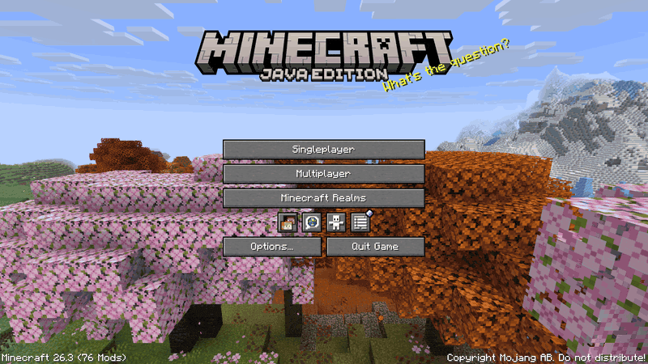

# Слайдшоу

Слайдшоу показує зображення одне за одним із плавним переходом від одного до наступного — наприклад, знімки світу вашого модпака.

Ви можете показувати його як [тло меню](/menu-backgrounds) у макеті або в окремій частині екрана за допомогою [елемента «Слайдшоу»](/elements#slideshow).



# Створення слайдшоу

1. Відкрийте папку `slideshows` у `config/fancymenu/` в каталозі гри. Пункт **Рядок меню -> Інструменти -> Відкрити каталог FancyMenu** відкриває `config/fancymenu/`.
2. Створіть у ній папку для слайдшоу, наприклад `world_tour`. Назва не має значення.
3. Додайте до неї файл [`properties.txt`](#propertiestxt) і папку `images` із [вашими зображеннями](#the-images). Файл [`overlay.png`](#overlay) додавати необов’язково.
4. Перезавантажте FancyMenu через **Рядок меню -> Налаштування -> Перезавантажити FancyMenu** або натисніть `Ctrl + Alt + R` (`Cmd + Alt + R` у macOS), чи перезапустіть гру.

```text
config/fancymenu/slideshows/
└── world_tour/
    ├── properties.txt
    ├── overlay.png
    └── images/
        ├── 01_river_valley.png
        ├── 02_cherry_grove.png
        └── 03_coast.png
```

# Зображення

- Враховуються лише файли PNG і JPG, назви яких закінчуються на `.png` або `.jpg`. Перейменуйте файли `.jpeg`, замінивши розширення на `.jpg`.
- Зображення відображаються в алфавітному порядку назв файлів. Цифри сортуються як літери, тому `10.png` буде перед `2.png`. Додавайте нулі на початку назв: `01`, `02` … `10`.
- Усі зображення мають бути однакового розміру. Перше визначає пропорції слайдшоу, а решта розтягуються відповідно до них.
- Файли в папках усередині `images` не враховуються.

# properties.txt

```text
type = slideshow

slideshow-meta {
  name = world_tour
  duration = 5.0
  fadespeed = 5.0
  randomize = false
}
```

| Налаштування | Призначення |
|---|---|
| `name` | Назва, за якою можна вибрати слайдшоу. Кожне слайдшоу має мати власну назву. |
| `duration` | Кількість секунд між змінами зображень, з урахуванням переходу. Якщо перехід триває довше, наступна зміна чекатиме його завершення. |
| `fadespeed` | Швидкість переходу від одного зображення до наступного. За значення `1.0` перехід триває приблизно 6 секунд, за `3.0` — близько 2 секунд. Значення має бути більшим за `0`. |
| `randomize` | Значення `true` показує зображення у випадковому порядку, не повторюючи те саме зображення двічі поспіль. Значення `false` показує їх у порядку назв файлів. |

Обов’язкове лише налаштування `name`. Якщо не вказати решту параметрів, використовуватимуться значення `duration = 10.0`, `fadespeed = 1.0` і `randomize = false`. Не змінюйте рядки `type = slideshow` і `slideshow-meta {`, записуйте кожне налаштування з нового рядка та використовуйте крапку для десяткових дробів, наприклад `2.5`.

У слайдшоу, створених для старіших версій, можуть бути рядки `width`, `height`, `x` і `y`. Вони нічого не змінюють: місце відображення слайдшоу та його розмір визначають тло або елемент.

# Накладка

Файл `overlay.png`, розташований поруч із `properties.txt`, накладається на кожне зображення та розтягується до розміру слайдшоу. Накладка не зникає під час переходів між зображеннями, тому вона підходить для рамок, віньєток або логотипа в кутку. Крізь прозорі ділянки видно зображення.

Накладка належить до слайдшоу, тож відображатиметься скрізь, де показується воно. Щоб використовувати ті самі зображення з рамкою та без неї, створіть два окремі слайдшоу.

# Використання слайдшоу

## Як тло меню


1. У [редакторі макета](/layout-editor) клацніть правою кнопкою миші тло та відкрийте **Тло меню -> Слайдшоу**.
2. Натисніть **Показувати тло**, щоб увімкнути його.
3. Натисніть **Назва слайдшоу**, виберіть потрібне слайдшоу та натисніть **Готово**. Праворуч у попередньому перегляді буде показано слайдшоу.

Пункт **Очистити слайдшоу** прибирає його. Щоб поєднати його з іншими фонами, дивіться розділ [Тло меню](/menu-backgrounds).

Слайдшоу розтягується на весь екран. Щоб зберегти пропорції зображень, увімкніть параметр **Зберігати пропорції тла** в розділі **Тло меню**. Тоді зображення заповнить екран, а його краї або верхню й нижню частини буде обрізано.

## Як елемент


1. У редакторі макета клацніть правою кнопкою миші на вільному місці та додайте слайдшоу за допомогою пункту **Новий елемент**.
2. Клацніть правою кнопкою миші елемент, натисніть **Слайдшоу** та виберіть потрібне. Форма елемента відповідатиме пропорціям його зображень.
3. Переміщуйте й змінюйте його розмір, як будь-який інший елемент. Параметр **Відновити пропорції** змінює ширину відповідно до висоти, щоб зображення не розтягувалися.

## Попереднє завантаження

Слайдшоу завантажує кожне зображення під час першого показу, тому великі зображення можуть з’явитися із затримкою. Щоб завантажити всі зображення та накладку під час запуску гри, додайте слайдшоу за допомогою пункту **Додати слайдшоу** в меню **Рядок меню -> Налаштування -> Попередньо завантажити ресурси**. Докладніше дивіться в розділі [Попереднє завантаження ресурсів](/preload-layouts#pre-loading-slideshows--panoramas).

# Корисно знати

- Усі місця, де показується те саме слайдшоу, відображають одне й те саме зображення одночасно, навіть у різних меню.
- Слайдшоу відтворюється лише тоді, коли щось його показує. Якщо після перерви, довшої за його значення `duration`, слайдшоу з’являється знову, воно одразу переходить до наступного зображення.
- Після перезавантаження FancyMenu кожне слайдшоу запускається спочатку. Перше зображення після запуску показується лише половину часу, відведеного для решти зображень.
- Слайдшоу належать до завантаженого [профілю](/profiles).
- Якщо слайдшоу немає у списку **Вибрати слайдшоу**, його не вдалося завантажити. У журналі гри `logs/latest.log` зазначено причину, наприклад відсутність `name`, `properties.txt` або папки `images`.
- У Windows увімкніть відображення розширень файлів у Провіднику, щоб випадково не отримати файл `properties.txt.txt` замість `properties.txt`.
- Фіолетово-чорна шахівниця означає, що слайдшоу не вибрано або в макеті використовується назва слайдшоу, якого більше не існує.
- Якщо два слайдшоу мають однакове значення `name`, відображатиметься лише одне з них.
- **Налагоджувальний оверлей** (`Ctrl + Alt + D`) показує, скільки слайдшоу та зображень завантажив FancyMenu.
