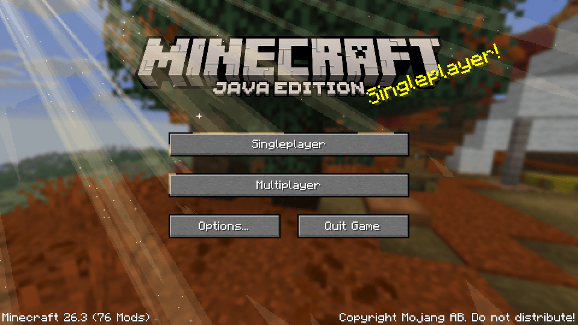
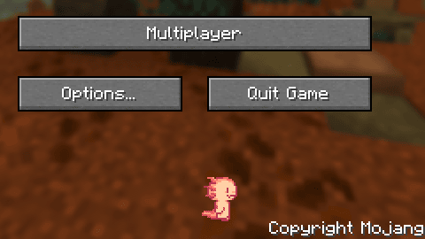

# 装饰覆盖层

装饰覆盖层是作用于整个屏幕的动态效果，例如飘落的雪、萤火虫、雾气或串灯。许多效果还会与菜单互动：雪会堆积在按钮上，鸟儿会落在按钮上，雾气则会在鼠标周围散开。


# 添加覆盖层

1. 在布局编辑器中打开一个布局。
2. 右键单击编辑器背景，然后打开 **装饰覆盖层**。
3. 打开一个覆盖层，例如 **降雪**。
4. 单击 **显示覆盖层** 将其启用。

已启用的覆盖层会在列表中显示 ✔。一个布局可以同时显示任意数量的覆盖层。将鼠标悬停在覆盖层或其某项设置上，即可查看相关说明。

覆盖层在布局编辑器中也会播放，但只有在实际菜单中才会对元素作出反应。保存布局并打开菜单，即可查看完整效果。

如果一个屏幕的多个布局都启用了覆盖层，它们都会播放，即使是同一个覆盖层也会重复播放。这也包括[通用布局](/universal-layouts)。

# 每个覆盖层都有的设置

每个覆盖层都有以下两项设置：

- **显示覆盖层**：开启或关闭覆盖层。
- **图层**：设置覆盖层的绘制位置：
  - **背景和前景**：远处的部分绘制在元素后面，近处的部分绘制在元素前面，营造出良好的纵深感。这是默认设置。
  - **仅背景**：所有内容都绘制在元素后面，但位于菜单背景前面。
  - **仅前景**：所有内容都绘制在元素前面。

覆盖层直接显示在元素上的效果（例如按钮上的雪）始终会保留在元素上。

许多覆盖层还包含以下设置：

| 设置 | 说明 |
|---|---|
| **数量 (%)** | 设置效果的数量，范围为 25% 到 300%。100% 为默认数量。 |
| **大小** | 将像素艺术放大到 2 倍或 3 倍。每个像素都会保持为清晰的正方形。 |
| **外观** | **精细**会显示完整的像素艺术，包括阴影和额外效果。**简洁**则更扁平，更接近经典风格。 |

# 覆盖层与元素

许多覆盖层会与元素互动：雪、灰烬和五彩纸屑会堆积在元素上，冰锥会从元素上垂下，苔藓会在元素上生长，鸟儿也会落在元素上。

若要选择哪些元素参与互动，请右键单击元素并设置 **应受装饰覆盖层影响**：

- 按钮、滑块、复选框、输入框和[原版元素](/vanilla-elements)默认启用此选项。
- 标题屏幕的徽标、闪烁文字、品牌标识和版权信息也包含在内。如果不想让东西落在这些元素上，请关闭此选项。
- 隐藏的元素不会参与互动；被[可滚动区域](/scrollable-areas)裁切掉的元素部分也不会参与。

> [!TIP]
> 元素之间至少留出 13 像素的间距。堆积在元素上或悬挂在元素下方的效果，大小会受与下一个元素之间的间距限制。

有些覆盖层会对点击作出反应，例如气泡、霜冻和五彩纸屑。你的按钮仍会接收到所有点击。

# 所有装饰覆盖层

以下按主题列出了 FancyMenu 中的所有装饰覆盖层。

## 天气

### 降雪

雪花飘落，并慢慢堆积在按钮上以及屏幕底部。


- **积雪**：允许雪堆积。
- **雪的颜色 [HEX]**、**降雪速度**、**数量 (%)** 和 **大小**：调整雪的效果。

### 降雨

雨水落下，在浅浅的水洼中激起涟漪，并从按钮上滴落。


- **水洼**：让元素和屏幕底部蒙上一层湿润的水膜，雨滴落下时会激起涟漪。
- **滴水**：让雨滴悬挂在元素上并滴落。
- **雷电闪光**：不时加入闪电，伴有分叉的闪电光束和柔和的闪光。**雷电闪光亮度**用于设置闪光亮度。
- **雨的颜色 [HEX]**、**数量 (%)** 和 **大小**：调整雨的效果。

> [!WARNING]
> **雷电闪光**会让屏幕闪烁。如果玩家可能对闪光敏感，请关闭此选项。

### 雾气

柔和的雾层飘过屏幕和元素，靠近地面时最为浓厚。


- **指针周围散雾**：让雾气在鼠标周围散开。

### 霜冻

菜单逐渐被冰霜覆盖。冰层沿着屏幕边缘蔓延到角落，也会爬上元素。点击冰层即可敲掉一块冰。


- **屏幕边缘**、**角落**和**元素上**：分别开启或关闭对应位置的冰层。元素上的标签会保持清晰。

## 自然

### 落叶

树叶飘落，并被阵阵强风吹动。


- **外观**：在**精细**和**简洁**的树叶之间切换。
- **颜色**：选择**秋日混色**（五种温暖的秋日色彩）或**自定义范围**（从**叶片起始颜色 [HEX]**到**叶片结束颜色 [HEX]**之间的五种颜色）。
- **起风**：开启或关闭强风。**风力强度**用于设置风力大小。
- **树叶密度**、**树叶飘落速度**和**树叶覆盖层缩放**：调整树叶效果。

### 樱花

开花的树枝从顶部两角伸入屏幕，花瓣随风飘落。


- **左侧树枝**和**右侧树枝**：分别显示或隐藏对应的树枝。
- **外观**和**数量 (%)**：调整花瓣效果。

### 植被蔓延

自然逐渐占据你的菜单：苔藓、藤蔓、草和花朵慢慢遍布整个菜单。


- **草地**、**左侧藤蔓**、**右侧藤蔓**和**元素上**：分别开启或关闭对应的生长效果。元素上的标签会保持清晰。
- **藤蔓上的花朵**、**元素上的花朵**和**草地上的花朵**：允许对应位置开花。**花朵 (%)**用于设置花朵数量。

### 云朵

蓬松的像素风云朵分三层深度飘过天空，位于元素后方。云朵没有独立设置。


### 阳光光束

阳光从屏幕外的太阳向四周散射，光线中还有尘埃飞舞。



- **太阳方位**：设置太阳位于屏幕哪一侧的后方。**太阳角度 (°)**用于调整太阳在该边缘上的位置。
- **阳光颜色 [HEX]**和**强度 (%)**：调整光线效果。
- **太阳光晕**：让太阳散发柔和的光晕。
- **尘埃**：让尘埃在光束中飘动。鼠标会搅动尘埃。
- **照射元素**：让光束在元素处停止、照亮元素边缘并投下阴影。关闭此选项时，光束会照在元素前方。

### 气泡

气泡成串摇摇晃晃地向上升起，并沿着元素底部滑动。点击即可戳破气泡！气泡没有独立设置。


## 动物

### 鸟儿

小鸟飞入屏幕，在元素上蹦跳；当鼠标靠得太近时，它们就会飞走。


### 蝴蝶

色彩缤纷的蝴蝶翩翩飞舞，停在元素上休息，并躲开鼠标。


### 蝙蝠

蝙蝠成群飞过屏幕，也会倒挂在元素下方睡觉。靠得太近就会惊醒它们！


鸟儿、蝴蝶和蝙蝠都有**数量 (%)**和**大小**设置。

### 萤火虫

一群群萤火虫发光并四处游荡，有些还会落在元素上。


- **外观**：在**精细**和**简洁**的萤火虫之间切换。**未发光时显示身体**会在萤火虫闪光的间隙显示它们深色的小身体。
- **跟随鼠标**：鼠标靠近时，萤火虫群会跟着鼠标移动。
- **停落**：允许萤火虫不时停在元素上。
- **萤火虫颜色 [HEX]**、**群组数量**、**群组密度**、**群组大小**和**萤火虫缩放**：调整萤火虫效果。

### Buddy

Buddy 是一只生活在菜单底部的虚拟小宠物。它会四处走动，通过思考气泡表达需求，对你的互动做出反应，并会在不同游戏会话之间记住一切。



#### 照顾 Buddy

Buddy 有四项需求，数值范围为 `0` 到 `100`：

- **饥饿度**会随时间下降。喂食可以补充饥饿度。
- **幸福度**会随时间下降。抚摸、喂食和玩耍都能提高幸福度。
- **精力**会在 Buddy 醒着时下降，睡觉时恢复。
- **乐趣**会随时间下降。玩耍可以提高乐趣。

照顾 Buddy 的方法：

- 左键单击 Buddy 可以抚摸它。用这种方式叫醒它会让它的幸福度稍微降低。
- 右键单击 Buddy 可打开状态界面。**属性**选项卡会显示它的需求、等级和经验值；**成就**选项卡会显示它的成就。
- 在状态界面中单击**喂食**，然后将食物拖到 Buddy 身上。
- 在状态界面中单击**玩耍**，然后拖动球并松开以将球扔出。Buddy 会追上并接住球。
- 单击**睡觉**让 Buddy 休息。精力很低时，它也会自行入睡。
- Buddy 偶尔会拉便便。左键单击便便即可清理。如果地上有三个或更多便便，Buddy 的幸福度会持续下降。

#### 等级和成就

照顾 Buddy 可以获得经验值。Buddy 的等级从 1 级升到 30 级。等级越高，饥饿度、幸福度和精力下降得越慢；达到 30 级时，下降速度最多可减半。

#### Buddy 死亡时

如果饥饿度或幸福度在现实时间内持续 10 小时为 `0`，Buddy 就会死亡，并留下墓碑。左键单击墓碑，即可重新开始并获得一只新的 Buddy。关闭**Buddy 可能死亡**可防止它死亡。

**重置 Buddy 存档**可随时重新开始。

> [!WARNING]
> 重置 Buddy 会永久删除它的需求、等级、经验值、成就和便便。

#### 保存和自定义

Buddy 大约每两分钟自动保存一次，也会在其界面关闭时保存。存档位于 `<game-directory>/fancymenu_data/buddy/`。每个 Buddy 覆盖层都有独立存档。请参阅[数据存储位置](/data-storage-locations)。

- **自定义纹理**：使用你自己的纹理替换 Buddy 的精灵图、物品、图标、状态界面和墓碑。
- **属性调整**：调整需求下降的速度、各项活动的消耗和收益，以及地上最多可以留下的便便数量（**便便上限**）。

## 夜空

### 极光

绚丽的北极光悬挂在天空上方，在元素后方缓缓摇曳。


- **边缘颜色 [HEX]**：设置明亮下缘的颜色。**尖端颜色 [HEX]**：设置光束渐变至的颜色。

### 流星

元素后方是闪烁的夜空，每隔几秒就有一颗流星划过，偶尔还会出现一整场流星雨。流星没有独立设置。


### 天灯

发光的纸灯笼飘向夜空，有时会成群出现。天灯有**数量 (%)**和**大小**设置。


## 派对

### 五彩纸屑

屏幕底部两角的派对礼花筒每隔几秒就会喷出五彩纸屑，纸屑还会堆积在元素上。


- **角落礼花筒**：开启或关闭礼花筒。
- **点击时喷射**：在你点击的位置喷出一小簇五彩纸屑。
- **混色模式**：使用随机颜色。关闭此选项后，所有五彩纸屑都会使用**五彩纸屑颜色 [HEX]**。
- **落地粒子上限**：设置同时可以留在场景中的落地碎片数量。
- **数量 (%)**、**大小**和**五彩纸屑飘落速度**：调整五彩纸屑效果。

### 烟花

火箭升空后绽放成烟花。


- **显示火箭飞行轨迹**：显示火箭升空的过程。
- **数量 (%)**、**大小**和**爆炸尺寸**：调整烟花效果。

### 串灯

串灯横跨菜单悬挂，并随风摇摆。


- **外观**：在**简洁**和**精细**的灯光之间切换。**松枝花环**会用带有装饰球的松针替换电线。
- **灯光模式**：设置灯光的常亮和闪烁方式（见下文）。
- **串灯缩放**、**风力强度**和**闪烁速度**：调整所有串灯。
- **串灯**：为八个可悬挂串灯的位置分别提供菜单。使用**显示串灯**启用对应位置的串灯。

每串灯都有以下设置：

- **灯泡数量**：设置串灯上的灯泡数量。设为 `0` 时，会根据串灯长度填满灯泡。
- **灯泡颜色 [HEX]**：设置灯泡颜色。启用**圣诞灯模式**后，灯泡会变为五彩颜色。
- **串灯颜色 [HEX]**：设置电线颜色。使用 Alpha 通道可以让电线半透明或将其隐藏。
- **单独设置灯泡颜色**和**单独设置灯泡大小**：通过逗号分隔的列表，为每个灯泡指定颜色或大小。如果灯泡数量多于列表中的值，列表会从头开始循环：

```
#FF0000, #00FF00, #0000FF
```

| 灯光模式 | 灯光效果 |
|---|---|
| **常亮** | 所有灯泡都会亮起，偶尔会有一盏灯微微变暗，模拟真实灯光。 |
| **全亮** | 所有灯泡都以最高亮度亮起。 |
| **半亮** | 所有灯泡都以一半亮度亮起。 |
| **关闭** | 所有灯泡都熄灭。 |
| **循环** | 依次播放闪烁、追逐、交替和呼吸效果，每 7 秒切换一次。 |
| **闪烁** | 灯泡随机闪烁。 |
| **追逐** | 一束亮光沿着串灯移动。 |
| **交替** | 每隔一盏灯亮起，然后由另一半灯泡接替。 |
| **呼吸** | 所有灯泡一起缓缓变亮，再一起渐渐变暗。 |

## 恐怖

### 蜘蛛网

布满灰尘的蜘蛛网挂在顶部两角，小蜘蛛沿着蛛丝垂下。


- **左侧蛛网**和**右侧蛛网**：分别显示或隐藏对应的蛛网和蜘蛛。
- **蜘蛛**：让蜘蛛垂下来、停留一会儿，再爬回去。蜘蛛会躲开鼠标。
- **闭合边框**：用边框连接蛛丝末端，避免松散的蛛丝悬在屏幕上。

### 余烬

发光的余烬从下方升起，灰烬则缓缓落下并堆积起来。


- **地面灰烬**：在屏幕底部铺上厚厚一层灰烬，并加入阴燃的斑点和发光的炭块。
- **元素上的灰烬**：允许灰烬堆积在元素上。

## 自定义

### 浏览器

浏览器覆盖层会让网站铺满整个屏幕。

> [!IMPORTANT]
> 浏览器覆盖层需要安装 [Rinku](https://modrinth.com/mod/rinku) 模组。

- **URL**：设置要显示的网站。
- **拦截鼠标点击**、**拦截鼠标滚动**和**拦截键盘按键**：阻止输入传递给浏览器后方的菜单。
- **处理鼠标点击**、**处理鼠标滚动**和**处理键盘按键**：允许浏览器本身响应输入。
- **隐藏视频控件**、**循环播放视频**、**静音浏览器**和**音频/视频音量**：控制网站的视频和声音。

默认情况下，拦截和处理输入的设置均已开启，因此浏览器会像普通浏览器一样显示在菜单前方。若只想将网站用作背景，请关闭这些设置。

网站还可以运行 FancyMenu 操作并读取占位符。请参阅[浏览器 JavaScript API](/browser-api)。

### GLSL 着色器

GLSL 着色器覆盖层会让你编写的着色器铺满整个屏幕，可用于制作动态或静态效果。将着色器代码粘贴到**着色器源代码**中。

有关如何为 FancyMenu 编写着色器，请参阅 [GLSL 着色器 API](/glsl-shader-api)。
