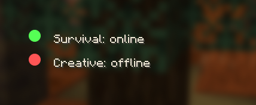

# 元素

元素是布局的组成部分：按钮、文本、图片、滑块、音乐等等。本页列出了所有元素类型及其最重要的设置。

> [!TIP]
> 屏幕默认自带的按钮和其他部分属于[原版元素](/vanilla-elements)。你也可以移动、修改和隐藏它们。

# 添加元素

1. 在布局编辑器中，右键单击空白处，然后单击**新建元素**。菜单栏的**元素 -> 新建**中也有相同的列表。
2. 单击一种元素类型。将鼠标悬停在类型上，可以查看它的用途。

元素会出现在你右键单击的位置。拖动它即可移动，拖动边缘即可调整大小，右键单击它可以打开设置。


关于如何选择、移动、复制和删除元素，以及编辑器的所有快捷键，请参阅[布局编辑器](/layout-editor)。要让元素在各种窗口尺寸下都保持位置不变，请阅读[定位元素](/positioning-elements)。要将元素放在其他元素的前面或后面，请阅读[图层与组](/layout-editor#layers-and-groups)。

# 所有元素通用的设置

除了各类型自己的设置外，每个元素的右键菜单中还包含以下设置：

| 设置 | 功能 |
|---|---|
| **锚点** | 元素所依附的位置，例如屏幕的一角或另一个元素。请参阅[定位元素](/positioning-elements)。 |
| **高级定位**和**高级尺寸** | 计算元素的位置和大小，例如使用[占位符](/placeholders)。请参阅[高级定位与尺寸](/advanced-positioning-sizing)。 |
| **加载条件**和**每个会话仅加载一次** | 仅在满足[条件](/conditions)时显示元素，或在每次游戏启动后仅显示一次。请参阅[元素可见性](/element-visibility)。 |
| **延迟显示**和**延迟隐藏** | 等待若干秒后再显示或隐藏元素。请参阅[元素可见性](/element-visibility#delaying-elements)。 |
| **淡入/淡出**和**不透明度** | 让元素淡入或淡出，或将其设为半透明。请参阅[元素可见性](/element-visibility#fading-in-and-out)。 |
| **旋转**、**垂直倾斜**和**水平倾斜** | 旋转或倾斜元素。请参阅[旋转和倾斜元素](/rotating-elements)。 |
| **视差效果** | 让元素随着鼠标稍微移动。请参阅[视差效果](/parallax)。 |
| **复制元素 ID** | 复制操作、占位符和其他元素用来查找该元素的标识符。请参阅[元素标识符](/element-identifiers)。 |
| **编辑器内显示名称** | 元素在图层列表中的名称。 |
| **导出供 AI 使用** | 将元素转换为文本，供 [AI 助手](/export-for-ai)使用。 |

# 所有元素

FancyMenu 中的所有元素，按用途分类。

## 按钮和输入控件

### 按钮

单击后会运行[操作脚本](/action-scripts)的按钮，例如加入服务器、打开网站或打开另一个菜单。


- **编辑操作脚本**：按钮单击后执行的操作。
- **标签**和**悬停标签**：按钮上的文本，以及鼠标悬停时显示的文本。两者都支持[占位符](/placeholders)和[文本格式](/text-formatting)。
- **标签对齐方式**：将标签放在按钮的**左侧**、**居中**或**右侧**。无论选择哪种对齐方式，超出按钮宽度的标签都会左右滚动。
- **标签缩放**、**标签基础颜色**、**标签悬停颜色**、**标签阴影**和**悬停时为标签添加下划线**：设置标签的大小、颜色和阴影。
- **按钮纹理**和**按钮图标纹理**：为按钮及其图标设置自定义图片，可分别设置普通、悬停和未激活状态。关于可平滑缩放的纹理，请参阅[九宫格切片与平铺](/nine-slicing-and-tiling)。
- **悬停音效**、**移出悬停音效**和**点击音效**：按钮播放的音效。
- **工具提示**：鼠标悬停在按钮上时显示的文本。
- **控制激活状态**：按钮可点击所需满足的[条件](/conditions)。条件未满足时，按钮会显示为灰色。
- **模板模式**：让屏幕上的其他按钮和滑块采用此按钮的外观。请参阅[按钮与滑块模板](/button-slider-templates)。

### 滑块

玩家可以拖动滑块来选择数值。每次数值发生变化时，滑块都会运行其操作脚本。


- **滑块类型**：
  - **值列表**：依次显示**列表值**中的文本，每行一个值。**从列表变量获取值**则会改为从[列表变量](/variables#text-and-list-variables)中读取。
  - **整数范围**：从**最小范围值**到**最大范围值**之间的整数。
  - **小数范围**：与整数范围相同，但允许小数。**小数位数**用于设置小数点后的位数；`-1` 表示不进行舍入。
- **滑块标签**：滑块上的文本。`$$value` 会显示当前值。
- **编辑操作脚本**：数值变化时运行。`$$value` 表示新值。
- **预选值**：滑块的初始值。应将其设置为滑块所控制的值，这样屏幕打开时才能正确显示当前值。

例如，一个**整数范围**为 `0` 到 `100` 的音量滑块，其标签设为 `音乐音量：$$value%`，并使用[**设置变量值（FM 变量）**](/action-scripts#set-variable-value-fm-variable)操作，值设为：

```
music_volume:$$value
```

其**预选值**设为 `$$music_volume`，这样滑块就会从玩家上次选择的值开始。

滑块拥有与按钮相同的标签、纹理、音效、工具提示和**控制激活状态**设置，因此也可以通过**标签对齐方式**将标签放在左侧或右侧。

### 复选框

玩家可以勾选或取消勾选的方框。每次状态发生变化时，复选框都会运行其操作脚本。


- 在操作脚本和**控制激活状态**条件中，`$$value` 的值为 `true` 或 `false`。
- **变量模式**和**链接到变量**：复选框显示某个[变量](/variables)的值，并将 `true` 或 `false` 写入该变量。若链接到列表变量，`true` 或 `false` 会成为列表中唯一的一项。
- 未启用变量模式时，复选框会自行记住状态，并为每个[配置档案](/profiles)分别保存。
- **纹理**：为方框和勾选标记设置自定义图片。

复选框拥有与按钮相同的工具提示、音效和**可导航**设置。

### 文本输入框

供玩家输入内容的输入框，例如服务器地址或名称。


- **链接到变量**：玩家输入的内容会写入[变量](/variables)，输入框也会显示该变量的值。若链接到列表变量，输入的文本会替换整个列表。
- **输入类型**：**文本**、**仅数字**、**仅小数**或**URL**。其他字符无法输入。
- **提示文本**和**提示文本颜色**：输入框为空时显示的文本及其颜色。
- **文本最大长度**：可以输入的字符数。
- **背景颜色**、**边框颜色**、**边框圆角半径**和**文本颜色**：设置输入框的外观。

例如，将输入框链接到 `server_address`，再添加一个使用[**加入服务器**](/action-scripts#join-server)操作、值为 `$$server_address` 的按钮，玩家就能加入任意服务器。

如果没有链接变量，可以使用[**文本输入框的值**](/placeholders#text-input-field-value)占位符读取文本，也可以使用[**设置文本输入框的值**](/action-scripts#set-text-input-field-value)操作修改文本。

## 文本和工具提示

### 文本

可以是任意长度的文本，从简短标签到可滚动的规则或更新说明，并支持 [Markdown](/text-formatting)和[占位符](/placeholders)。


- **来源模式**：输入文本，或从文件或网站加载文本。
- 可以选择一种初始外观；当文本超出元素范围时，可以启用滚动。
- **背景**：文本后方的深色面板。关闭**显示背景**即可隐藏，也可以改用自定义纹理。

详细内容请参阅[菜单中的文本](/text-in-menus)。

### 工具提示

类似游戏内工具提示的文本框，支持 [Markdown](/text-formatting)和[占位符](/placeholders)。


- 工具提示会显示在你放置的位置，也可以通过**跟随鼠标**让它跟着鼠标移动。
- **加载条件**决定工具提示何时显示，例如为按钮设置[**元素正被悬停**](/conditions#is-element-hovered)条件。
- **工具提示背景**：使用自定义纹理代替深色方框。

更多内容请参阅[菜单中的文本](/text-in-menus)。

### 启动画面文字

标题屏幕上的黄色文字，可替换为自定义文本。


- **来源模式**：原版启动画面文字、自定义文本，或从文本文件中随机选择一行。
- **弹跳**、**缩放**、**旋转**、**文本颜色**和**阴影**：设置其外观。
- **屏幕加载时刷新**：每次屏幕打开时都会选择一条新的启动画面文字。

更多内容请参阅[启动画面文字](/splash-text)。

## 图片和媒体

### 图片

从本地文件、网站或游戏资源中加载图片，也支持播放动画图片。


- **图片来源**：图片。支持的文件类型见[图片](/images)。
- **恢复宽高比**：调整宽度，避免图片被拉伸。
- **九宫格纹理**和**重复纹理**：缩放边框而不拉伸边缘，或平铺图片。请参阅[九宫格切片与平铺](/nine-slicing-and-tiling)。
- **图片色调 [HEX]**：为图片着色。
- **圆角半径**：设置图片的圆角。

### 幻灯片

依次显示幻灯片中的图片。你可以在 `config/fancymenu/slideshows/` 中创建幻灯片，请参阅[幻灯片](/slideshows)。

- **幻灯片**：要显示的幻灯片。
- **恢复宽高比**：调整宽度，避免图片被拉伸。

### 视频

播放视频文件，例如预告片或动态背景。

> [!IMPORTANT]
> 播放视频需要安装 Watermedia V3 和 Watermedia Binaries V3 模组。请参阅[视频](/video)。

- **视频来源**：视频文件、网页链接或游戏资源。
- **循环播放视频**、**音量**和**声音通道**：设置视频的播放方式。
- **在布局编辑器中播放视频**：设置编辑时是否也播放视频。
- 使用[**切换视频元素的暂停状态**](/action-scripts#toggle-video-element-paused-state)等操作可以暂停视频、跳转到指定时间或调整音量。

**视频 [Rinku]** 是较旧的视频元素，需要 Rinku 模组。它仍可用于旧布局，但不会出现在**新建元素**菜单中。

### GLSL 着色器

在元素中运行自定义 GLSL 着色器，例如动态色彩或 Shadertoy 效果。


- **着色器来源**：着色器代码。包含 `mainImage` 的 Shadertoy 着色器可以直接使用。
- **编译模式**：**自动**、**Shadertoy**或**直接片段着色器**。
- **缓冲区 A 来源**到**缓冲区 D 来源**：为使用缓冲区的着色器添加额外的处理步骤。

编写方法请参阅 [GLSL 着色器 API](/glsl-shader-api)。

### 浏览器

显示实时网站，例如服务器地图或 Wiki 页面。

> [!IMPORTANT]
> 浏览器需要安装模组 [Rinku](https://modrinth.com/mod/rinku)（[CurseForge](https://www.curseforge.com/minecraft/mc-mods/rinku)）。

- **URL**：网站地址。
- **可交互**：允许玩家在网页中单击、滚动和输入。在布局编辑器中，网页始终不可交互。
- **静音浏览器**、**音频/视频音量**、**循环播放视频**和**隐藏视频控件**：控制网页中的媒体。

要加载 `config/fancymenu/assets/` 中的 HTML 文件，请在 URL 前加上 `file:///`：

```
file:///config/fancymenu/assets/changelog.html
```

在 Linux 上，请改用[**绝对文件/文件夹路径**](/placeholders#absolute-filefolder-path)占位符：

```
file:///{"placeholder":"absolute_path","values":{"short_path":"/config/fancymenu/assets/changelog.html"}}
```

网站可以运行操作并读取占位符：请参阅[浏览器 JavaScript API](/browser-api)。

## 形状、物品和模型

### 矩形形状

单色矩形，例如文本后方的面板。


- **颜色**：HEX 颜色。再添加两位数字即可设置透明度，例如 `#101828C8`。
- **圆角半径**：为所有角设置圆角，也可以分别设置每个角。
- **模糊**和**模糊强度**：模糊其后方的内容。

### 圆形形状

单色圆形或椭圆形，例如状态指示灯。



- **颜色**、**模糊**和**模糊强度**：与矩形形状相同。
- **圆度**：`2` 表示圆形。数值越大，形状越接近正方形；数值越小，形状越尖。

### 物品

显示 Minecraft 或模组物品，外观与物品栏中的物品类似。


- **物品键**：物品，例如 `minecraft:diamond_sword`。
- **物品数量**、**物品名称**、**物品描述**和**附魔**：设置物品的对应属性。
- **显示物品工具提示**：鼠标悬停在物品上时显示其工具提示。
- **自定义 NBT 数据**：添加更多物品数据，格式与 `/give` 命令中物品之后的部分相同。

### 方块/物品 JSON 模型

以 3D 形式显示方块或物品模型，模型可来自游戏资源或你自己的 JSON 文件。


- **模型**：指定**模型来源**，例如 `minecraft:models/block/crafting_table.json`。
- **纹理**：用自定义纹理替换模型纹理。
- **变换**：缩放、旋转和移动模型。
- **光照**：**光照色相 [HEX]**用于设置模型上的光照颜色。

### 玩家实体

以 3D 形式显示玩家，例如标题屏幕上的玩家角色。


> [!IMPORTANT]
> 玩家实体需要安装模组 Fancy Entity Renderer（[CurseForge](https://www.curseforge.com/minecraft/mc-mods/fancy-entity-renderer)、[Modrinth](https://modrinth.com/mod/fancy-entity-renderer)）。如果没有安装该模组，玩家实体会显示错误，而不是玩家。

- **复制客户端玩家**：显示正在游戏的玩家及其皮肤和名称。
- **玩家名称**、**皮肤纹理**和**披风纹理**：指定其他玩家或皮肤。
- **实体姿势**、**头部跟随鼠标**和**身体跟随鼠标**：设置实体的站姿以及视线方向。
- **盔甲和工具**、**鹦鹉**、**是否为幼年实体**和**显示玩家名称**：设置玩家穿戴或显示的内容。

更多内容请参阅[玩家实体](/player-entities)。如果只需要显示头部，请参阅[玩家头部](/player-heads)。

### 进度条

会逐渐填充的条形元素，例如加载条。


- **进度值来源**：设置进度值。可以在此使用[占位符](/placeholders)，例如在世界加载屏幕中使用[**世界加载进度**](/placeholders#world-loading-progress)。
- **进度值模式**：**百分比（0-100）**或**浮点数（0.0-1.0）**。
- **方向**：进度条的填充方向。
- **进度条颜色**和**背景颜色**，或**进度条纹理**和**背景纹理**。
- **平滑填充动画**：数值改变时平滑过渡，而不是直接跳变。
- **使用进度作为元素锚点**：锚定到进度条的元素会随已填充部分的末端移动。

## 布局辅助元素

### 可滚动区域

用于容纳其他元素并滚动查看，例如服务器列表或较长的信息页面。


- 在布局编辑器中将元素拖入其中。只能放入自定义元素，不能放入原版元素。
- **排列方式**：手动放置元素，或让区域将它们排列成堆叠、网格或流式布局。
- **背景**：区域后方的深色面板。关闭**显示背景**即可隐藏，也可以改用自定义纹理。

详细内容请参阅[可滚动区域](/scrollable-areas)。

### 拖动器

玩家可以在编辑器外抓住并移动的区域。锚定到拖动器的元素会随之移动，例如可移动的信息面板。编辑器外不会显示拖动器本身。

**保存用户拖动偏移量**会在关闭屏幕并重新启动游戏后保留新位置。更多内容请参阅[拖动器](/dragger)。

### 元素动画器

通过关键帧移动和调整其他元素的大小，例如让面板滑入屏幕。编辑器外不会显示动画器本身。

- **管理目标元素**：选择要为其添加动画的元素。
- **编辑关键帧**：打开关键帧编辑器。
- **循环动画**：动画结束后重新开始。

详细内容请参阅[元素动画器](/element-animator)。

## 不可见元素

这些元素只会在布局编辑器中显示。

### 计时器

屏幕打开期间反复运行其操作脚本。

> [!IMPORTANT]
> 对于所有需要反复运行或延迟运行的任务，建议使用[调度器](/schedulers)。请尽可能使用调度器代替计时器。调度器可在任何屏幕上运行，也可以在没有屏幕时运行；其中可以执行所有操作，并且可以通过操作启动和停止。

以下是使用调度器实现计时器功能的方法：

- 屏幕打开期间持续运行：创建一个带有**刻度延迟（毫秒）**的调度器。在布局的**编辑“打开屏幕”操作脚本**中使用[**启动调度器**](/action-scripts#start-scheduler)来启动它，并在**编辑“关闭屏幕”操作脚本**中使用[**停止调度器**](/action-scripts#stop-scheduler)来停止它。这两个选项都位于编辑器背景的右键菜单中。
- 每次启动游戏时运行一次：创建一个启用了**启动时启动**、且**运行刻度数**为 `1` 的调度器。
- 每次屏幕打开时运行一次：无需使用计时器或调度器。将操作放入**编辑“打开屏幕”操作脚本**即可。

计时器设置：

- **刻度延迟 [毫秒]**：两次运行之间的间隔，以毫秒为单位。设为 `0` 时，每个刻度都会运行一次，即每秒 20 次。
- **刻度模式**：**普通**模式会持续运行。**会话**模式会运行一次，直到游戏重启。**屏幕加载时**模式会在每次屏幕打开时运行一次；窗口尺寸改变时也会再次运行。
- **异步**：在后台运行。大多数操作无法以这种方式运行，并会显示错误。

### 音频

屏幕打开期间播放音乐或音效，并按顺序逐首播放。

- **管理曲目**：管理音频文件、播放顺序以及用于随机播放的**曲目权重**。
- **播放模式**：**普通**模式按顺序播放，**随机播放**模式则以随机顺序播放。
- **循环曲目**、**音量**和**声音通道**：设置播放方式。

如需让音乐在不同屏幕间持续播放，请将音频元素放入[通用布局](/universal-layouts)。更多内容请参阅[菜单背景音乐](/background-music)。

### 音乐控制器

关闭此屏幕的游戏自带音乐。

- **播放菜单音乐**：未加载世界时播放的菜单音乐，例如标题屏幕中的音乐。
- **播放世界音乐**：在菜单中继续播放的世界音乐，例如物品栏中的音乐。

只有在屏幕打开时才有效。

### 鼠标光标

屏幕打开期间，将鼠标光标替换为自定义图片。

- **光标纹理**：PNG 图片，例如 32×32 像素。
- **热点 X 坐标**和**热点 Y 坐标**：图片中用于点击的像素位置，例如箭头的尖端。
- **编辑器预览模式**：鼠标悬停在该元素上时，在编辑器中显示光标。

更多内容请参阅[自定义光标](/custom-cursor)。
