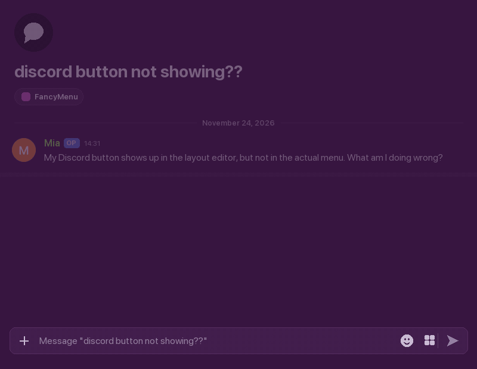

# 导出供 AI 使用

**导出供 AI 使用**会将 FancyMenu 配置的部分内容转换为适合 AI 助手使用的文本，例如 [FancyMenu Discord](https://discord.gg/rhayah27GC) 上的助手机器人 Alice。将文本粘贴到聊天中，AI 就能准确了解你的设置，而不必靠猜测。



# 为什么要使用此功能

截图只能展示某样东西看起来是什么样子，却无法说明它是如何设置的。手动输入动作脚本或条件很耗时，而且途中常常会遗漏关键细节。

导出内容包含 AI 所需的一切信息：

- 所导出内容的每项设置、动作、条件和值。
- 你的 FancyMenu、Minecraft、模组加载器、Java 和系统版本。
- 对 FancyMenu 工作方式的简短说明，帮助 AI 正确理解导出内容。

无论你使用哪种语言进行游戏，导出内容始终为英文。文件路径中的账户名称会替换为 `<user>`，因此你可以在公开聊天中分享导出内容。

# 何时使用

- 某些功能未按预期工作，例如按钮点击后没有反应，或某个元素始终不显示。
- FancyMenu 显示错误或警告。
- 你想要帮助来构建某项内容，例如动作脚本、条件或整个菜单。
- 你想了解游戏中可以实现哪些功能。**FancyMenu 能做的一切**会列出你拥有的所有元素、背景、动作、条件、占位符和监听器，包括附加组件提供的内容。

只导出与你的问题相关的内容，例如那个无法正常工作的按钮。较小的导出内容能让 AI 更专注。然后告诉 AI 你原本预期会发生什么，以及实际发生了什么。

# 如何导出

以下每个位置都会打开一个小菜单：

- **复制到剪贴板**会复制导出内容，你可以使用 `Ctrl + V`（macOS 上为 `Cmd + V`）将其粘贴到聊天中。
- **另存为文件**会将内容保存为 Markdown 文件，放在 `<game-directory>/fancymenu_data/ai_exports/` 中，并打开该文件夹，方便你将文件拖入聊天中。对于无法放入聊天消息的大型导出内容，请使用此选项。

从布局编辑器以及监听器和调度器窗口导出的内容，会包含尚未保存的更改。

# 可导出内容的位置

## 菜单栏

| 导出内容 | 位置 |
|---|---|
| 当前屏幕、其中的小组件，以及 FancyMenu 在该屏幕上的行为 | **菜单栏 -> 自定义 -> 导出当前屏幕供 AI 使用** |
| 一个布局 | **菜单栏 -> 自定义 -> 布局**，选择布局，然后点击 **导出布局供 AI 使用** |
| 你的游戏、硬件和模组，以及 FancyMenu 可使用的功能，例如视频和浏览器支持 | **菜单栏 -> 帮助 -> 导出供 AI 使用 -> 系统信息** |
| FancyMenu 的所有设置，包括[全局自定义](/global-customizations) | **菜单栏 -> 帮助 -> 导出供 AI 使用 -> FancyMenu 设置** |
| 所有[变量](/variables) | **菜单栏 -> 帮助 -> 导出供 AI 使用 -> 所有变量** |
| 所有[监听器](/listeners) | **菜单栏 -> 帮助 -> 导出供 AI 使用 -> 所有监听器** |
| 所有[调度器](/schedulers) | **菜单栏 -> 帮助 -> 导出供 AI 使用 -> 所有调度器** |
| 所有[自定义 GUI](/custom-guis) | **菜单栏 -> 帮助 -> 导出供 AI 使用 -> 自定义 GUI** |
| 所有[配置文件](/profiles) | **菜单栏 -> 帮助 -> 导出供 AI 使用 -> 配置文件** |
| 游戏中的所有元素、背景、动作、条件、占位符和监听器 | **菜单栏 -> 帮助 -> 导出供 AI 使用 -> FancyMenu 能做的一切** |

## 布局编辑器

| 导出内容 | 位置 |
|---|---|
| 正在编辑的布局 | 编辑器菜单栏中的 **布局 -> 导出布局供 AI 使用** |
| 屏幕上的另一个布局 | 编辑器菜单栏中的 **布局 -> 打开**，选择布局，然后点击 **导出布局供 AI 使用** |
| 一个元素 | 右键单击该元素，然后选择 **导出供 AI 使用** |
| 所有选中的元素 | 编辑器菜单栏中的 **编辑 -> 导出选中的元素供 AI 使用** |
| 一个[菜单背景](/menu-backgrounds) | 右键单击编辑器背景，然后选择 **菜单背景**，选中背景，再选择 **导出供 AI 使用** |
| 一个[装饰叠加层](/decoration-overlays) | 右键单击编辑器背景，然后选择 **装饰叠加层**，选中叠加层，再选择 **导出供 AI 使用** |

## 编辑器和窗口

| 导出内容 | 位置 |
|---|---|
| 一个[动作脚本](/action-scripts) | 右键单击动作脚本编辑器，然后选择 **导出动作脚本供 AI 使用** |
| [条件](/conditions) | 在 **管理条件** 窗口中右键单击，然后选择 **导出条件供 AI 使用** |
| 一段文本，例如文本元素的内容 | 右键单击文本编辑器，然后选择 **导出文本供 AI 使用** |
| 一个变量或所有变量 | 打开 **菜单栏 -> 自定义 -> 管理变量**，然后右键单击并选择 **导出变量供 AI 使用** 或 **导出所有变量供 AI 使用** |
| 一个监听器或所有监听器 | 打开 **菜单栏 -> 自定义 -> 管理监听器**，点击 **导出供 AI 使用**，然后选择 **选中的监听器** 或 **所有监听器** |
| 一个调度器或所有调度器 | 打开 **菜单栏 -> 自定义 -> 管理调度器**，点击 **导出供 AI 使用**，然后选择 **选中的调度器** 或 **所有调度器** |

## 错误和警告

当 FancyMenu 显示错误或警告时，点击 **确定** 旁边的 **导出供 AI 使用**，即可导出相关消息。

## 服务器

服务器的 [FMData](/fm-data) 配置，包括服务器监听器和欢迎数据，可以通过命令导出。与所有 `/fmdata` 命令一样，此操作需要权限等级 2。

```mcfunction
/fmdata export_for_ai copy
/fmdata export_for_ai file
```

- `copy` 会向你发送一条聊天消息。点击该消息即可复制导出内容。在服务器控制台中，则会显示完整的导出内容。
- `file` 会将导出内容保存到服务器上的 `fancymenu_data/ai_exports/` 中。当导出内容太大而无法通过聊天发送时，请使用此选项。
