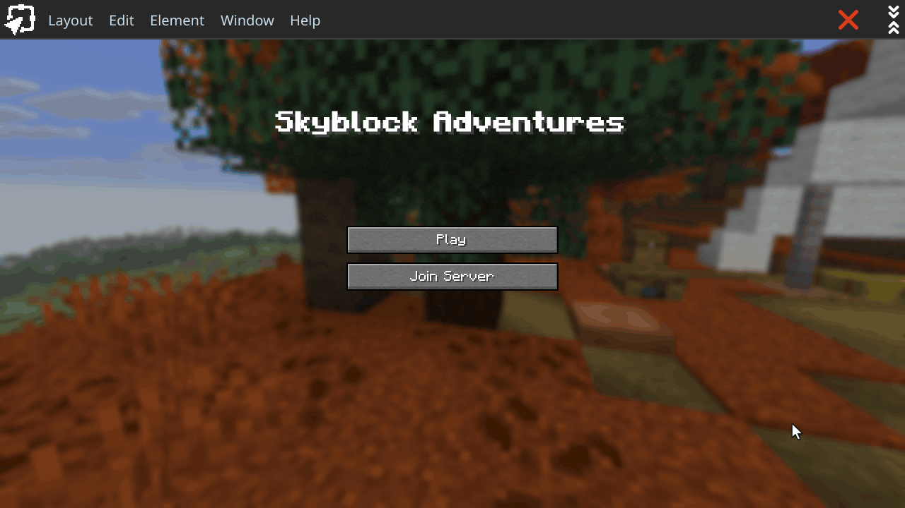
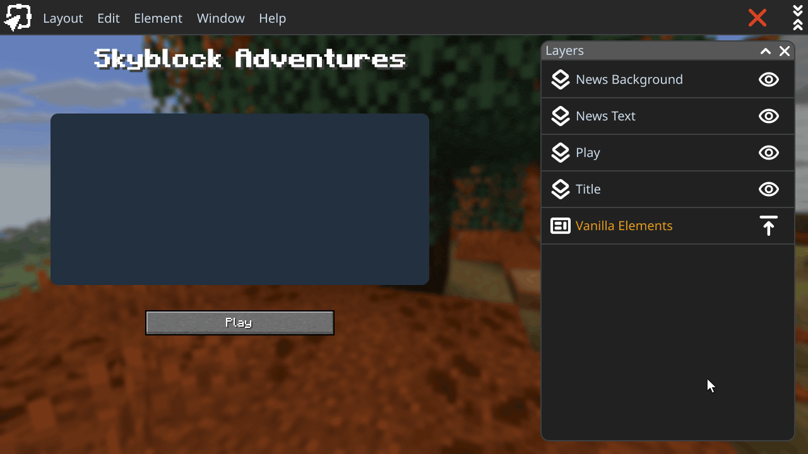

# 布局编辑器

布局编辑器是创建[布局](/home#your-first-layout)的地方：你可以添加元素、移动元素并调整其大小，还可以更改元素周围的菜单。编辑器会按照玩家看到的样子显示菜单，让你立即查看布局的实际效果。

# 打开编辑器

1. 打开你想要修改的菜单，例如标题屏幕。
2. 点击 **菜单栏 -> 自定义 -> 当前屏幕自定义**，直到该选项显示为 **已启用**。
3. 点击 **菜单栏 -> 自定义 -> 布局 -> 新建 -> 当前屏幕**。

- **所有屏幕 [通用]**会创建一个[通用布局](/universal-layouts)，并在每个菜单中显示。
- 你已有的布局也会列在**布局**中。将鼠标悬停在某个布局上，然后点击**编辑布局**。
- 在任何菜单中，按 `Ctrl + Alt + L` 可打开你上次编辑的布局。参见[菜单栏快捷键](/home#menu-bar-shortcuts)。

# 编辑器概览

- 右键点击背景，可打开整个布局的设置，也可以通过**新建元素**添加元素。
- 右键点击元素可打开其设置。参见[元素](/elements#settings-of-all-elements)。
- 右侧的**图层**会列出布局中的所有元素。参见[图层和分组](#layers-and-groups)。
- 顶部的菜单栏：

| 菜单 | 内容 |
|---|---|
| **布局** | **新建**、**打开**、**保存**、**另存为**、**为 AI 导出布局**、**布局属性**（与右键点击背景时的菜单相同）、**设置**和**关闭编辑器** |
| **编辑** | **撤销**、**重做**、**复制**、**粘贴**和**全选** |
| **元素** | **新建**用于添加元素；**已删除的原版元素**用于恢复你[删除的原版元素](/deleted-vanilla-elements) |
| **窗口** | **编辑器小组件**、[网格](#grid-and-anchor-overlay)、[锚点叠加层](#grid-and-anchor-overlay)、**元素旋转控件**和**元素倾斜控件** |

## 布局设置

右键点击背景可以打开布局本身的所有设置，例如：

- [**菜单背景**](/menu-backgrounds)和[**装饰叠加层**](/decoration-overlays)
- **自定义屏幕标题**用于设置部分菜单顶部的文字，例如“选项”。其中可以使用[占位符](/placeholders)。
- **页眉/页脚自定义**用于[可滚动屏幕](/customizing-scrollable-screens)
- **布局索引 [多布局排序]**和**随机模式**用于在一个菜单中使用[多个布局](/randomize-layouts)
- **加载要求 [适用于整个布局]**，参见[要求](/conditions#layout-wide-requirements)
- **编辑“打开屏幕”动作脚本**和**编辑“关闭屏幕”动作脚本**，参见[动作脚本](/action-scripts)
- **通用布局选项**，仅适用于[通用布局](/universal-layouts)

# 使用元素

## 选择元素

- 点击元素即可选中。点击背景可取消选择所有元素。
- 在背景上拖动鼠标，可选中矩形范围内的所有元素。
- 按住 `Ctrl` 并点击，可将元素添加到选区，或从选区中移除已选元素。
- 按 `Ctrl + A` 可选中所有元素。

点击、拖动矩形选取和 `Ctrl + A` 都会跳过你在[图层中隐藏的元素](#hiding-and-renaming)。

## 移动元素

- 拖动元素即可移动。要移动多个已选元素，请在开始拖动时按住 `Ctrl`。如果不按 `Ctrl`，点击只会选中你点到的元素。
- 使用方向键可将选中的元素移动一个像素。
- 拖动时会显示锚点。将元素悬停在另一个锚点或元素上，即可将其锚定到那里。参见[放置元素](/positioning-elements)。
- 将元素拖放到[可滚动区域](/scrollable-areas)中，即可将其放入该区域。

## 调整大小

拖动已选元素的边缘或角落即可调整其大小。按住 `Shift` 可保持宽高比。

只有选中一个元素时才能调整大小。

## 旋转和倾斜

支持此功能的已选元素会显示用于[旋转和倾斜](/rotating-elements)的控件。拖动时按住 `Shift` 可按固定角度调整：旋转以 45° 为步进，倾斜以 15° 为步进。

**窗口 -> 元素旋转控件**和**元素倾斜控件**可以隐藏这些控件。

## 复制、粘贴和删除

- 按 `Ctrl + C` 复制选中的元素，按 `Ctrl + V` 粘贴。副本会出现在原元素上方并自动选中，因此你可以立即将其拖开。
- 在游戏关闭前，你也可以将元素粘贴到另一个布局中。
- 按 `Delete` 可删除选中的元素。原版元素只会被隐藏：通过**元素 -> 已删除的原版元素**可将其恢复。
- 删除可滚动区域时，系统会询问是否也删除其中的内容，或将内容保留在布局中。

## 撤销和重做

按 `Ctrl + Z` 撤销上一步更改，按 `Ctrl + Y` 重做。**编辑**菜单中也有这两个选项。

## 不可见元素

玩家看不到[音频](/elements#audio)、[拖动器](/dragger)、[元素动画器](/element-animator)、[音乐控制器](/elements#music-controller)和[滚动文字](/elements#ticker)元素。在编辑器中，它们会显示为带有名称的彩色方框，方便你找到、移动和调整它们的大小。

- 右键菜单中的**编辑器内颜色**可以更改方框的颜色，例如用来区分多个滚动文字元素。颜色格式为 `#RRGGBB`；如需设置透明度，则使用 `#RRGGBBAA`：像 `#E30E2366` 这样的半透明颜色可以透出方框后面的内容。
- 方框中显示的名称是元素的图层名称，参见[隐藏和重命名](#hiding-and-renaming)。

玩家永远不会看到方框、方框颜色或名称。

# 图层和分组

**图层**会按从上到下的顺序列出布局中的所有元素：列表中靠上的元素会显示在下方所有元素的前面。通过**窗口 -> 编辑器小组件 -> 图层**可显示或隐藏图层面板。

## 更改顺序

- 点击图层可选中对应元素，然后将其向上或向下拖动。线条会显示元素放置的位置。所有已选图层会一起移动。
- 也可以右键点击元素或其图层，然后点击**上移一层**或**下移一层**。

在编辑器中，已选元素始终显示在其他元素前面。取消选择后即可查看实际顺序。

在某些 Minecraft 版本中，[玩家实体](/elements#player-entity)和[物品](/elements#item)元素无论位于哪一层，都会显示在所有元素前面。参见[已知问题](/known-issues#1-player-entity--item-elements-are-always-in-front-of-everything)。

## 原版元素

**原版元素**这一行代表菜单自身的所有元素，例如菜单按钮。这些元素的顺序无法更改，但这一行右侧的按钮可以将你的所有元素置于原版元素的后面或前面。此按钮的效果与右键点击背景菜单中的**自定义元素置于原版元素后方**相同。

## 隐藏和重命名

- 点击图层的眼睛图标可在编辑器中隐藏对应元素，这样你处理其他元素时就不会受它干扰。再次点击即可显示该元素。
- 隐藏的元素无法被点击、移动、复制或删除。玩家仍然可以看到它们，它们只是在编辑器中隐藏。布局会记住你隐藏了哪些元素。
- 右键点击图层并选择**重命名图层**，即可为其设置更容易识别的名称，例如 `新闻面板`。这相当于修改元素的**编辑器内显示名称**，玩家看不到该名称。

## 分组

分组可将相关图层归在同一名称下，例如新闻面板的所有部分。分组只会整理列表，元素的显示和功能不会改变。

- 右键点击图层面板内部，然后选择**添加分组**。分组会显示在图层下方。
- 将图层拖到分组上即可将其放入分组。将图层拖出分组即可移出。
- 点击分组可选中其中的所有元素。拖动分组可一次性将其中所有元素向上或向下移动。
- 点击分组的箭头可折叠或展开其中的图层；点击眼睛图标可隐藏或显示所有图层。
- 右键点击分组可重命名、上移或下移一层，也可以删除分组。**删除分组**不会删除其中的元素。

**上移一层**和**下移一层**不会将元素移出分组。要将元素移出分组，请把它的图层拖出分组。

布局会保存分组以及各分组的折叠状态。

## 可滚动区域

[可滚动区域](/scrollable-areas)中的元素会显示在该区域图层的下方，并向右缩进。

- 将图层拖到区域图层的下半部分，即可将元素放入该区域。将图层拖到其他图层之间，即可将其移出。元素在屏幕上的位置不会改变。
- 点击区域图层的箭头可折叠或展开其中的元素。
- 区域中的元素不属于任何分组，并会随区域一起移动。

# 网格和锚点叠加层

**窗口**菜单中包含编辑器辅助工具的设置：

- **网格**可显示网格线，按 `Ctrl + G` 可开关网格。**网格大小**用于设置网格线之间的间距。
- **网格吸附**会在显示网格时使拖动的元素吸附到网格线上。**网格吸附强度**用于设置吸附的力度。
- **锚点叠加层可见性**用于设置锚点的显示时机：
  - **拖动元素时显示**：拖动元素时显示。
  - **始终可见**：始终显示。
  - **按键时显示（按键“O”）**：按住 `O` 时显示。
  - **禁用**：从不显示。
- **锚点区域悬停**用于设置将元素悬停在锚点上时是否更改其锚点。**锚点元素悬停**会将其他元素添加为锚点，因此只有同时启用**锚点区域悬停**时，此功能才有效。

# 保存和关闭

- 按 `Ctrl + S` 或选择**布局 -> 保存**即可保存布局。首次保存时，FancyMenu 会要求你输入文件名。
- 选择**布局 -> 另存为**可将布局保存为新文件。
- 有未保存的更改时，菜单栏会显示 **\* 有未保存的更改！ \***。
- 点击菜单栏右侧的 X，或选择**布局 -> 关闭编辑器**，即可关闭编辑器。如果有未保存的更改，系统会先询问你如何处理。

# 快捷键

在 macOS 上，请用 `Cmd` 代替 `Ctrl`。

| 快捷键 | 功能 |
|---|---|
| `Ctrl + S` | 保存 |
| `Ctrl + Z` | 撤销 |
| `Ctrl + Y` | 重做 |
| `Ctrl + C` | 复制选中的元素 |
| `Ctrl + V` | 粘贴 |
| `Ctrl + A` | 选中所有元素 |
| `Delete` | 删除选中的元素 |
| 方向键 | 将选中的元素移动一个像素 |
| `Ctrl` + 点击 | 将元素添加到选区，或从选区中移除 |
| `Ctrl` + 拖动 | 移动多个已选元素 |
| `Shift` + 调整大小 | 保持宽高比 |
| `Shift` + 旋转或倾斜 | 按固定角度调整 |
| `Ctrl + G` | 开关网格 |
| 按住 `O` | 在启用**按键时显示（按键“O”）**时显示锚点 |

> [!TIP]
> 文本编辑器有自己的快捷键，参见[菜单中的文本](/text-in-menus#the-text-editor)。[动作脚本](/action-scripts#shortcuts)等窗口会在各自的页面中列出快捷键。
