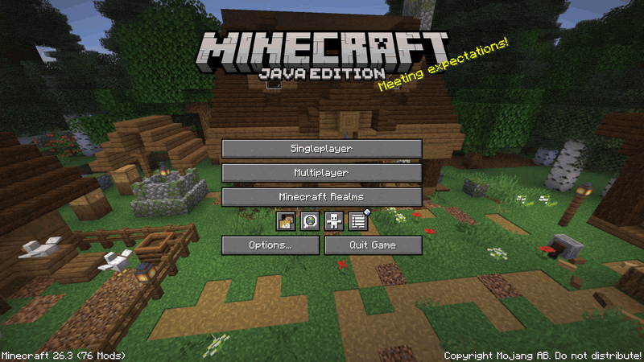

# 全景图

全景图是一种会在你周围缓慢旋转的背景，就像《Minecraft》标题屏幕上的背景一样。它由六张图片组成，围绕观察者构成一个立方体。

你可以将自己的全景图用作布局的[菜单背景](/menu-backgrounds)，也可以用它替换所有菜单中的《Minecraft》全景图。



> [!TIP]
> 本页展示的全景图可免费使用，也可用于测试和你自己的整合包：[forest_homestead.zip](https://raw.githubusercontent.com/Keksuccino/docs_fancymenu/refs/heads/wiki-2026/assets/forest_homestead.zip)（4 MB）。将其解压到 `config/fancymenu/panoramas/`，然后重新加载 FancyMenu。

# 制作全景图

1. 打开游戏目录中 `config/fancymenu/` 下的 `panoramas` 文件夹。点击 **菜单栏 -> 工具 -> 打开 FancyMenu 目录**，即可打开 `config/fancymenu/`。
2. 在其中为全景图新建一个文件夹，例如 `forest_homestead`。文件夹名称不限。
3. 在该文件夹中放入一个 `properties.txt` 文件，以及一个名为 `panorama` 的文件夹，并将[六张图片](#六张图片)放入其中。`overlay.png` 是可选的。
4. 点击 **菜单栏 -> 自定义 -> 重新加载 FancyMenu**，或按 `Ctrl + Alt + R`（macOS 上按 `Cmd + Alt + R`）重新加载 FancyMenu；也可以重启游戏。

```text
config/fancymenu/panoramas/
└── forest_homestead/
    ├── properties.txt
    ├── overlay.png
    └── panorama/
        ├── panorama_0.png
        ├── panorama_1.png
        ├── panorama_2.png
        ├── panorama_3.png
        ├── panorama_4.png
        └── panorama_5.png
```

# 六张图片

每张图片对应立方体的一面：


| 图片 | 对应面 |
|---|---|
| `panorama_0.png` | 正面 |
| `panorama_1.png` | 右侧 |
| `panorama_2.png` | 背面 |
| `panorama_3.png` | 左侧 |
| `panorama_4.png` | 顶部 |
| `panorama_5.png` | 底部 |

- 四个侧面按以下顺序环绕你排列：每张图片的右边缘与下一张图片的左边缘相接；`panorama_3.png` 的右边缘与 `panorama_0.png` 的左边缘相接。
- 顶部图片的下边缘与正面图片的上边缘相接。底部图片的上边缘与正面图片的下边缘相接。
- 六张图片都必须是尺寸相同的 PNG 文件。请使用正方形图片，例如 1024 × 1024。
- FancyMenu 不会平滑处理图片，因此像素画能保持清晰。

《Minecraft》自己的全景图也采用相同的排列方式，因此为《Minecraft》制作的全景图也可以使用。

# properties.txt

```text
type = panorama

panorama-meta {
  name = forest_homestead
  speed = 2.0
  fov = 85.0
  angle = 25.0
  start_rotation = 0
}
```

| 设置项 | 作用 |
|---|---|
| `name` | 用于选择全景图的名称。每个全景图都应使用独有的名称。 |
| `speed` | 全景图的旋转速度。`1.0` 表示大约 4 分钟旋转一圈，`2.0` 表示速度加倍。`0` 表示静止。超过 `10.0` 的速度不会更快。 |
| `fov` | 屏幕上显示的全景范围，以屏幕顶部到屏幕底部的角度计。数值越小，缩放程度越大。 |
| `angle` | 视线向下倾斜的角度。`0` 表示正对地平线，负数表示向上看。 |
| `start_rotation` | 开始旋转的位置，范围为 `0` 到 `360` 度。`0` 表示从正面图片居中时开始。 |

只有 `name` 是必填项。未填写的设置将使用默认值：`speed = 1.0`、`fov = 85.0`、`angle = 25.0` 和 `start_rotation = 0`。请保持 `type = panorama` 和 `panorama-meta {` 两行不变，每行填写一项设置，小数使用英文句点，例如 `1.5`。

# 覆盖层

与 `properties.txt` 放在同一目录下的 `overlay.png` 会覆盖在全景图上，并拉伸至整个屏幕。它不会随全景图旋转，因此适合用作暗角、边框或颜色滤镜等效果。透明区域会透出全景图。

# 使用全景图

## 用作菜单背景


1. 在[布局编辑器](/layout-editor)中右键点击背景，然后打开 **菜单背景 -> 立方体全景图**。
2. 点击 **显示背景** 将其启用。
3. 点击 **全景图名称**，选择你的全景图，然后点击 **完成**。右侧的预览会显示全景图的旋转效果。

点击 **清除全景图** 可以移除它。如需与其他背景搭配使用，请参阅[菜单背景](/menu-backgrounds)。

## 用于所有菜单

点击 **菜单栏 -> 自定义 -> 全局自定义 -> 自定义菜单背景全景图 -> 选择全景图**，即可在标题屏幕以及加入世界前的所有菜单中显示你的全景图，替换《Minecraft》自带的全景图。请参阅[全局自定义](/global-customizations#menu-backgrounds)。

## 预加载

大型全景图首次显示时可能需要等待片刻。若要在游戏启动时加载全景图，请在 **菜单栏 -> 自定义 -> 预加载资源** 中点击 **添加立方体全景图**。请参阅[预加载资源](/preload-layouts#pre-loading-slideshows--panoramas)。

# 其他须知

- 全景图向右旋转：正面图片向左移动，右侧图片随之出现。
- 显示同一个全景图的所有菜单会共享其旋转状态，因此在这些菜单之间切换时，全景图会平滑地继续旋转。没有菜单显示该全景图时，旋转会暂停。
- 重新加载 FancyMenu 后，每个全景图都会从其 `start_rotation` 位置重新开始。
- 全景图属于当前加载的[配置档案](/profiles)。
- 如果全景图没有出现在 **选择全景图** 中，说明它未能加载。游戏日志 `logs/latest.log` 会说明原因，例如缺少 `name` 或图片。
- 紫黑色棋盘格表示尚未选择全景图、六张图片的尺寸不一致，或布局使用的全景图名称已不存在。
- 如果两个全景图使用相同的 `name`，只会显示其中一个。
