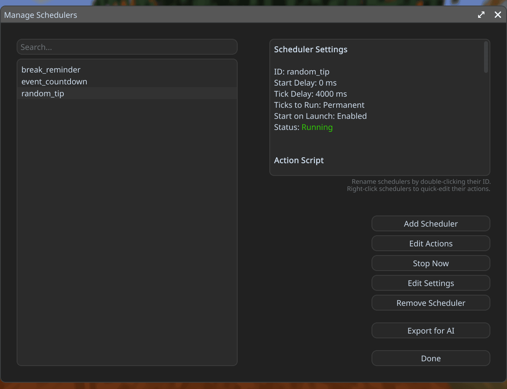

# 调度器

调度器会按计时器运行[操作脚本](/action-scripts)：等待一段时间后运行一次、运行几次，或重复运行直到被停止。它们适用于所有菜单和游戏过程中，即使当前没有打开任何菜单也能运行，而且不属于任何布局。

对于所有需要稍后执行或重复执行的操作，建议使用调度器。请尽可能使用它们代替 [Ticker 元素](/elements#ticker)。

> [!CAUTION]
> 即使没有打开任何菜单，调度器也可以运行文件、网络、命令、剪贴板、资源包和链接操作。请只使用来自你信任的配置文件和文件中的调度器。

# 添加调度器

1. 打开 **菜单栏 -> 自定义 -> 管理调度器**。
2. 点击 **添加调度器**。操作脚本编辑器随即打开。
3. 添加每次运行时要执行的操作，然后点击 **完成**。请参阅[操作脚本](/action-scripts#making-an-action-script)。

4. 新调度器会显示一个随机 ID。点击它，然后点击 **编辑设置**。
5. 为它设置一个 **调度器 ID**，例如 `random_tip`，配置[计时器](#settings)，然后点击 **完成**。
6. 点击 **立即启动**进行测试。

在 **管理调度器** 中所做的所有更改都会立即保存。

GIF 中的调度器每 4 秒对列表 `tips` 执行一次[**排列列表 (FM 变量)**](/action-scripts#arrange-list-fm-variable)，并选择 **打乱**。文本元素会显示列表中的第一项，因此会显示随机提示。有关列表和文本的工作方式，请参阅：[列表操作](/variables#list-actions)。

# 设置

| 设置 | 功能 |
|---|---|
| **调度器 ID** | 操作和条件使用的名称。只能使用小写字母、数字、`.`、`_` 和 `-`。 |
| **启动延迟 (ms)** | 调度器启动后，首次运行前等待的时间。`0` 表示立即运行。 |
| **运行间隔 (ms)** | 两次运行之间的间隔。`0` 表示每个游戏刻都运行一次，即每秒 20 次。 |
| **运行次数** | 调度器自动停止前运行的次数。`0` 表示持续运行，直到被停止。 |
| **启动时运行** | 每次启动游戏时运行调度器。 |

时间单位为毫秒：`1000` 毫秒为一秒，`60000` 毫秒为一分钟，`1800000` 毫秒为半小时。

# 启动和停止

调度器只有在启动后才会运行：

- 启用 **启动时运行** 后，在游戏启动时以及切换[配置文件](/profiles)后运行。
- 在 **管理调度器** 中点击 **立即启动**。调度器运行时，该按钮会显示为 **立即停止**。
- 使用操作[**启动调度器**](/action-scripts#start-scheduler)并指定调度器 ID，例如在按钮或[监听器](/listeners)的脚本中使用。

调度器会在以下情况下停止：

- 自行停止：运行达到 **运行次数** 所设次数后。
- 点击 **立即停止**，或使用操作[**停止调度器**](/action-scripts#stop-scheduler)并指定其 ID。
- 调度器被重命名或移除、切换[配置文件](/profiles)或关闭游戏时。重新启动后，只有启用了 **启动时运行** 的调度器才会再次运行。

正在运行的调度器不能再次启动：它停止之前，**启动调度器**不会执行任何操作。若要重新启动，请先使用 **停止调度器**，再使用 **启动调度器**。

条件[**调度器正在运行**](/conditions#scheduler-is-running)可用于检查调度器是否正在运行，例如只在调度器运行时显示停止按钮。

## 仅在屏幕打开时运行

若要让调度器仅在特定屏幕打开时运行（例如标题屏幕），请按以下步骤操作：

1. 在布局编辑器中打开该屏幕的布局。
2. 右键点击编辑器背景，点击 **编辑“打开屏幕”操作脚本**，然后添加 **启动调度器** 并指定调度器 ID。
3. 再次右键点击背景，点击 **编辑“关闭屏幕”操作脚本**，然后添加 **停止调度器** 并指定相同的 ID。

# 管理调度器

- 点击某个调度器，可在右侧查看其设置、运行状态和操作脚本。
- 点击 **编辑操作**，或右键点击某个调度器，可打开其操作脚本。
- 双击调度器的 ID 可对其重命名。按 `Enter` 保存名称，按 `Esc` 取消。重命名会停止该调度器，使用旧 ID 的操作也将无法再找到它。
- **移除调度器**会在询问确认后删除选中的调度器。
- **导出供 AI 使用**会复制选中的调度器或所有调度器，以供[AI 聊天](/export-for-ai)使用。
- 搜索栏可按 ID 查找调度器。

调度器保存在 `config/fancymenu/scheduler_instances.txt` 中（请参阅[数据存储位置](/data-storage-locations)）。每个[配置文件](/profiles)都有各自的调度器。

# 示例：休息提醒

游戏启动后每 30 分钟显示一条 Toast 通知：

1. 添加一个带有[**显示 Toast**](/action-scripts#show-toast)操作的调度器。将其 **标题**设为 `Time for a Break`，将其 **消息**设为 `Stand up, stretch and drink some water.`。
2. 在 **编辑设置**中，将 **调度器 ID**设为 `break_reminder`，将 **启动延迟 (ms)** 和 **运行间隔 (ms)** 都设为 `1800000`，并将 **启动时运行**设为 **已启用**。

如果不设置 **启动延迟 (ms)**，游戏启动时就会立即显示第一条 Toast 通知。

# 须知

- **运行间隔 (ms)** 应尽可能设为满足任务需求的较大值。设为 `0` 时，操作每秒会运行 20 次；执行较慢的操作会导致游戏卡顿。
- 游戏卡顿时，调度器可能会在短时间内连续运行多次。
- 即使调度器正在运行，对操作脚本所做的更改也会立即生效。对设置所做的更改则会在调度器下次启动时生效。
- 如果某个操作失败，调度器仍会继续运行。错误会记录在游戏日志 `logs/latest.log` 中。
- 如果只需在单个操作脚本中等待一段时间（例如“点击后 2 秒再打开屏幕”），使用 [延迟执行](/action-scripts#execute-later)区块会更简单。
