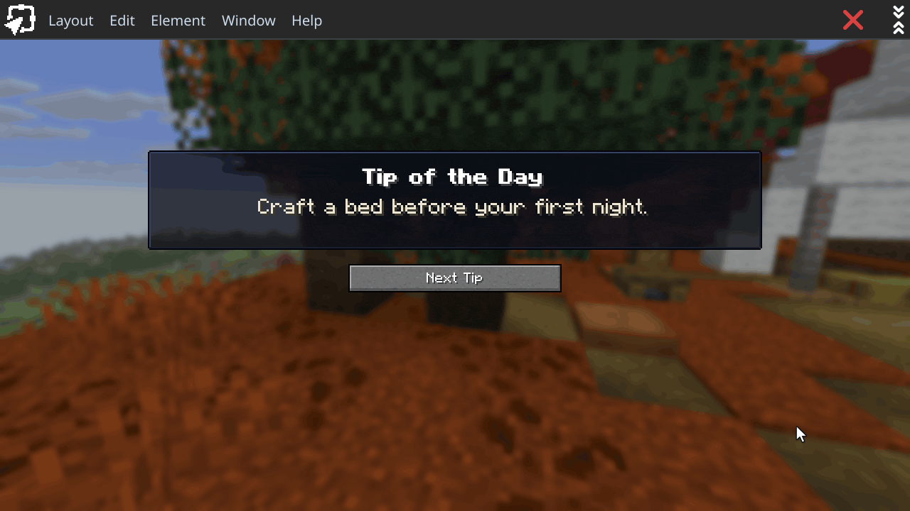

# 变量

FancyMenu 会记住变量的值，即使游戏关闭后也会保留。你可以用它们统计点击次数、记住选择、跟踪进度，或保存加载提示等列表。文本、动作、条件、监听器和某些元素都可以读取和修改变量。

> [!TIP]
> 变量相关的动作列在 [动作脚本](/action-scripts) 中，条件列在 [条件](/conditions) 中，监听器列在 [监听器](/listeners#on-variable-updated-fm-variable) 中。

# 文本变量和列表变量

变量分为两种：

- 文本变量保存一段文本，例如 `dark`、`5` 或 `true`。
- 列表变量保存一组条目，例如加载提示或服务器名称。每个条目都是一段独立的文本。

列表中条目的位置称为索引。第一个条目的索引为 `0`，第二个为 `1`，以此类推。负数索引从末尾开始计数，因此 `-1` 表示最后一个条目。

只支持文本的功能（例如 `$$name` 或 **Is Variable Value (FM Variable)**）会将列表作为包含所有条目的 JSON 数组读取，例如 `["Craft a bed before your first night.","Torches keep most mobs away."]`。

# 管理变量

打开 **菜单栏 -> 自定义 -> 管理变量**。只有在布局编辑器外，菜单栏中才会显示此选项。


## 添加变量

1. 右键单击列表，然后单击 **Add Text Variable** 或 **Add List Variable**。
2. 输入名称，然后单击 **Done**。

名称可以包含小写字母、数字、`.`、`_` 和 `-`，且每个名称只能使用一次。

## 修改变量

右键单击变量可使用以下选项：

| 选项 | 功能 |
|---|---|
| **Set Value** | 设置文本变量的内容。 |
| **Edit List** | 打开列表变量的列表编辑器（见下文）。 |
| **Convert to List…** | 将文本变量转换为列表。**Separator** 用于拆分文本并生成条目：输入 `\n` 可按换行符拆分。**Trim Entries** 会移除每个条目两端的空格，**Skip Empty Entries** 会跳过空条目。像 `["a","b"]` 这样的 JSON 数组文本会被作为一个整体读取（**Read as JSON Array**）。 |
| **Convert to Text…** | 将列表转换为文本变量。**Separator** 用于分隔各条目；**Keep JSON Text** 则会将列表保留为 JSON 数组。 |
| **Clear Variable on Game Launch** | 每次启动游戏时清空变量。适用于只应在单次游戏会话中保留的值。 |
| **Delete Variable** | 删除变量。 |
| **Copy** 和 **Paste** | 复制变量。 |
| **Export Variable for AI** | 导出变量以用于 [AI 聊天](/export-for-ai)。 |

修改会立即生效。按 `Ctrl + Z` 撤销，按 `Ctrl + Y` 重做（macOS 上使用 `Cmd`）。开始输入即可搜索；按 `Enter` 编辑所选变量，或按 `Delete` 删除它。

## 编辑列表

列表编辑器会显示每个条目及其索引。

- 要添加条目，请单击列表下方的 **Add Entry**，输入条目并按 `Enter`。接下来会立即开始添加下一个条目。对空条目按 `Enter` 或按 `Esc` 可停止添加。
- 要编辑条目，请双击它。按 `Shift + Enter` 可在文本编辑器中打开条目，在那里可以输入换行符。
- 要调整条目顺序，可以拖动条目，也可以按 `Alt + Up` 和 `Alt + Down`。
- 右键单击条目可使用 **Duplicate Entry**（`Ctrl + D`）、**Delete Entry**（`Delete`）、**Copy**、**Paste**、**Move Up** 和 **Move Down**。
- **Edit as Text** 可一次编辑所有条目，每行一个。

单击 **Done** 保存列表。单击 **Cancel** 则会丢弃在列表编辑器中的所有更改。

# 在文本中显示变量

输入 `$$`，然后输入变量名称，即可显示其值：名为 `menu_theme` 的变量写作 `$$menu_theme`。所有支持[占位符](/placeholders)的文本中都可以使用此语法，例如[文本元素](/text-in-menus)、按钮标签、工具提示，以及动作和条件的值。变量变化时，文本会自动更新。

```
当前主题：$$menu_theme
```

- 如果变量不存在，`$$name` 会保持原样。
- 如果变量名称以相同内容开头，例如 `coins` 和 `coins_record`，那么 `$$coins_record` 始终表示较长的名称。
- 列表会显示为 JSON 数组。以下占位符可以更方便地显示列表：

| 占位符 | 示例 | 返回值 |
|---|---|---|
| **Get Variable Value (FM Variable)** | `{"placeholder":"getvariable","values":{"name":"clicks"}}` | 变量的值；如果变量为空或不存在，则返回 `0`。最适合数字。 |
| **Get List Entry (FM Variable)** | `{"placeholder":"list_get","values":{"name":"tips","index":"0","fallback":"No tips yet"}}` | 指定索引处的条目；如果没有对应条目，则返回 `fallback`。 |
| **List Size (FM Variable)** | `{"placeholder":"list_size","values":{"name":"tips"}}` | 列表中的条目数。 |
| **Index of List Entry (FM Variable)** | `{"placeholder":"list_index_of","values":{"name":"tips","value":"Torches keep most mobs away.","ignore_case":"false"}}` | 与整个 `value` 匹配的第一个条目的索引；没有匹配项时返回 `-1`。 |
| **Join List Entries (FM Variable)** | `{"placeholder":"list_join","values":{"name":"tips","separator":"\n"}}` | 将所有条目合并为一段文本，并在条目之间插入 `separator`（未填写时使用 `, `）。`\n` 表示换行。 |

# 使用动作修改变量

[动作脚本](/action-scripts)可以在按钮被单击、计时器运行或监听器触发等情况下修改变量。

## 文本变量

[**Set Variable Value (FM Variable)**](/action-scripts#set-variable-value-fm-variable) 使用 `:` 分隔名称和新值。尚不存在的变量会自动创建。

```
menu_theme:dark
```

只有第一个 `:` 用于分隔名称，因此值中可以包含更多冒号，例如 `last_server:play.example.net:25565`。

要统计按钮点击次数，可以将旧值加 1：

```
clicks:{"placeholder":"calc","values":{"decimal":"false","expression":"{"placeholder":"getvariable","values":{"name":"clicks"}} + 1"}}
```

当 `clicks` 仍为空时，**Get Variable Value (FM Variable)** 会返回 `0`，因此第一次点击会将它设为 `1`。

Set Variable Value 不会将列表转换为文本。JSON 数组会成为列表条目，空文本会清空列表，其他任何文本都会成为列表唯一的条目。

[**Delete Variable (FM Variable)**](/action-scripts#delete-variable-fm-variable) 会删除一个变量；[**Clear All Variables (FM Variable)**](/action-scripts#clear-all-variables-fm-variable) 会删除所有变量。

## 列表动作

每个列表动作都有自己的窗口。所有字段都支持占位符。

| 动作 | 功能 |
|---|---|
| [**Add to List (FM Variable)**](/action-scripts#add-to-list-fm-variable) | 在末尾或指定索引处添加条目。启用 **Skip If Already in List** 后，如果列表中已有该条目，就不会添加。 |
| [**Set List Entry (FM Variable)**](/action-scripts#set-list-entry-fm-variable) | 替换指定索引处的条目。 |
| [**Remove from List (FM Variable)**](/action-scripts#remove-from-list-fm-variable) | 删除 **Entry at Index**、某个值的 **First Match**，或 **All Matches**。 |
| [**Clear List (FM Variable)**](/action-scripts#clear-list-fm-variable) | 删除所有条目。列表本身仍然存在，但会变为空列表。 |
| [**Set List (FM Variable)**](/action-scripts#set-list-fm-variable) | 使用 **Split Text** 拆分出的内容，或 **JSON Array** 中的条目替换所有条目。以 JSON 数组形式提供的 `$$other_list` 可以复制另一个列表。 |
| [**Arrange List (FM Variable)**](/action-scripts#arrange-list-fm-variable) | 可选择 **Sort A–Z**、**Sort Z–A**、**Numbers, Smallest First**、**Numbers, Biggest First**、**Reverse Order**、**Shuffle** 或 **Remove Duplicates**。 |

- 如果列表不存在，列表动作会创建它；如果文本变量为空，也会将其转换为列表。但如果文本变量已有值，这些动作不会修改它：请先[转换变量](#changing-variables)。
- 输入列表名称时不要加 `$$`。如果加上 `$$`，动作会将该变量的值用作名称。

例如，文本元素显示列表 `tips` 中的第一条内容：

```
{"placeholder":"list_get","values":{"name":"tips","index":"0"}}
```

在它下方的“下一条提示”按钮，其动作脚本中添加了 **Arrange List (FM Variable)**，并选择 **Shuffle**：



每次单击按钮都会打乱列表，因此文本会显示一条随机提示：


## 遍历列表

[FOR EACH 循环](/action-scripts#for-each-loop)会对列表中的每个条目运行一次循环内的动作，从第一个条目开始，依次处理到最后一个。

1. 在动作脚本编辑器的脚本区域中右键单击，然后单击 **Add FOR EACH Loop**。
2. 输入列表变量的名称（不要加 `$$`），然后单击 **Done**。
3. 在循环中添加动作。在这些动作的值中，`$$list_entry` 表示当前条目，`$$list_index` 表示其索引。

例如，列表 `starter_commands` 中包含 `/time set day` 和 `/weather clear` 两个条目。在循环中添加一个 [**Send Chat Message/Command**](/action-scripts#send-chat-messagecommand) 动作，并将其值设为以下内容，即可依次运行这两条命令：

```
$$list_entry
```

- 循环开始时会读取一次列表。循环中的动作可以修改列表，但不会改变循环将要遍历的条目。
- 如果指定的是文本变量或不存在的列表，循环会运行零次。
- 和 WHILE 循环一样，循环会在 3 秒后停止，因此不会导致游戏卡死。

# 检查变量

[条件](/conditions)可以控制元素是否显示，或动作脚本的部分内容是否运行，具体取决于变量是否具有指定值。

- [**Is Variable Value (FM Variable)**](/conditions#is-variable-value-fm-variable) 会检查整个值。对于列表，它会比较包含所有条目的 JSON 数组。
- [**List Contains Entry (FM Variable)**](/conditions#list-contains-entry-fm-variable) 会检查列表是否包含某个条目。必须与整个条目完全匹配。启用 **Ignore Case** 后，`Apple` 和 `apple` 会被视为匹配。
- [**Is Number**](/conditions#is-number) 可以比较数字，例如检查 `$$clicks` 是否大于 `5`。

例如，某个按钮会打开最新的新闻帖子，并使用 **Add to List (FM Variable)** 将 `news_42` 添加到列表 `read_news` 中。按钮旁边的“新！”徽标设置了 **List Contains Entry (FM Variable)** 条件，用于检查 `news_42` 是否在列表中，并将 **Requirement Mode** 设为 Opposite。这样，玩家阅读帖子后，徽标就会隐藏。

# 将变量关联到元素

- [文本输入框](/elements#text-input-field)：**Link To Variable** 会将玩家输入的内容写入变量，同时输入框会显示变量的值。关联到列表后，输入的文本会替换整个列表。
- [复选框](/elements#checkbox)：启用 **Variable Mode** 并设置 **Link To Variable**。复选框会将 `true` 或 `false` 写入变量。
- 类型为 **Value List** 的[滑块](/elements#slider)：**Values From List Variable** 会从列表变量读取滑块值。列表中的条目增删后，滑块选项会立即更新。

# 响应变量变化

- [**On Variable Updated [FM Variable]**](/listeners#on-variable-updated-fm-variable) 监听器会在变量每次被设置时运行一个动作脚本。
- [`/fmvariable` 命令](/commands#fmvariable)可以在聊天框、命令方块和其他模组中设置或读取变量。

# 变量的保存位置

FancyMenu 会立即将变量保存到 `<game-directory>/config/fancymenu/user_variables.db`，因此重启后变量仍会保留。

- 变量属于整个 Minecraft 实例及其当前启用的[配置文件](/profiles)，不会按布局、世界、服务器或玩家分别保存。
- 名称区分大小写。
- 不要在变量中存储密码、令牌或其他机密信息。任何能够访问游戏文件夹的人都可以读取这些内容。
